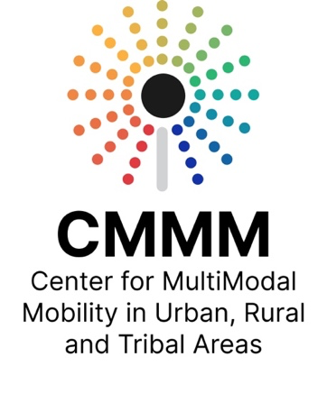

<p align="center"></p>

<h1 align="center">ORIOLE</h1>

<p align="center"><b>From census records to cars on the road.</b><br>
An agent-based platform of population, land use, daily activities and traffic for Maryland.</p>

<p align="center">
<a href="https://tomal121186621.github.io/ORIOLE/">Documentation</a> ·
<a href="https://tomal121186621.github.io/ORIOLE/get-started/">Get started</a> ·
<a href="https://tomal121186621.github.io/ORIOLE/model-design/">Model design</a>
</p>

---

ORIOLE chains five components:

| Stage | Component | Engine |
|---|---|---|
| Synthetic population, 2016 | Conditional variational autoencoder trained on ACS PUMS | Python, PyTorch |
| Land use, 2016 → 2024 | Residential location, car ownership, workplace choice, demography | SILO, Java |
| School location | Three school-choice logits, every year | Python |
| Activities, weekday of 2024 | ORIOLE-Day: survey distributions, destination, stop, tour and mode models | ABIT engine, Java |
| Traffic assignment | Routes and departure times on the 2024 road and transit networks | MATSim, Java |

28 choice models are estimated with Biogeme; each stage is tested on data it was not estimated on.

## Repository

```
population/   synthetic population (CVAE) and post-processing
landuse/      SILO inputs, engine changes, calibration, runs, school location
activity/     ORIOLE-Day engine source, coefficients, runs
assignment/   MATSim runner, network and transit builders, count validation
pipeline/     chain orchestration and plans converter
estimation/   specification search and the Biogeme estimation package (notebooks per model)
reports/      validation reports and figures
docs/         documentation website (MkDocs Material)
```

No data are included: see [Input data](https://tomal121186621.github.io/ORIOLE/inputs-outputs/inputs/).

## Documentation locally

```bash
pip install mkdocs-material
mkdocs serve
```

## Team

<p></p>

Developed at the **Center for MultiModal Mobility in Urban, Rural and Tribal Areas (CMMM)**, University of Maryland,
College Park.

- **Raas Sarker Tomal**, PhD Student and Graduate Research Assistant — rtomal@umd.edu
- **Dr. Cinzia Cirillo**, Director of CMMM, Professor of Civil and Environmental Engineering — ccirillo@umd.edu

## License

MIT. SILO, ABIT and MATSim keep their own licenses.
