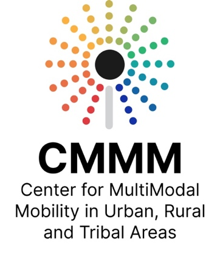
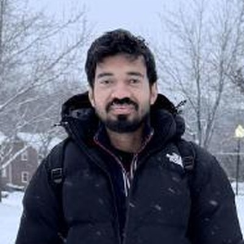
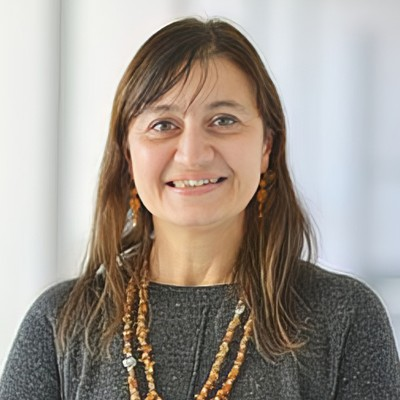

# Team

{ width="190" }

TERP is developed at the **Center for MultiModal Mobility in Urban, Rural and Tribal Areas (CMMM)**, University of
Maryland, College Park — a U.S. Department of Transportation University Transportation Center at the Maryland
Transportation Institute.

### Raas Sarker Tomal

PhD Student and Graduate Research Assistant 
Center for MultiModal Mobility (CMMM) 
Department of Civil and Environmental Engineering 
University of Maryland, College Park

Developer of TERP

:fontawesome-solid-envelope: [rtomal@umd.edu](mailto:rtomal@umd.edu) 
:fontawesome-brands-github: [Tomal121186621](https://github.com/Tomal121186621)

### Dr. Cinzia Cirillo

Director, Center for MultiModal Mobility (CMMM) 
Professor, Department of Civil and Environmental Engineering 
University of Maryland, College Park

PhD supervisor

:fontawesome-solid-envelope: [ccirillo@umd.edu](mailto:ccirillo@umd.edu) 
:fontawesome-solid-globe: [CMMM team](https://mti.umd.edu/cmmm-team)

## Acknowledgements

TERP builds on open-source software and public data:

- **SILO**, the land-use microsimulation of the Technical University of Munich ([msmobility/silo](https://github.com/msmobility/silo));
- **ABIT**, the activity-based model of the Maryland set-up, whose engine runs TERP-Day;
- **TASHA**, whose scheduling approach TERP-Day adopts;
- **MATSim** and **pt2matsim** for the traffic and transit assignment;
- **Biogeme** for the estimation of every choice model;
- data of the U.S. Census Bureau, the Bureau of Labor Statistics, FHWA, NCES, MDOT and MDOT SHA, the Baltimore
  Metropolitan Council and the Metropolitan Washington Council of Governments, and OpenStreetMap contributors.
