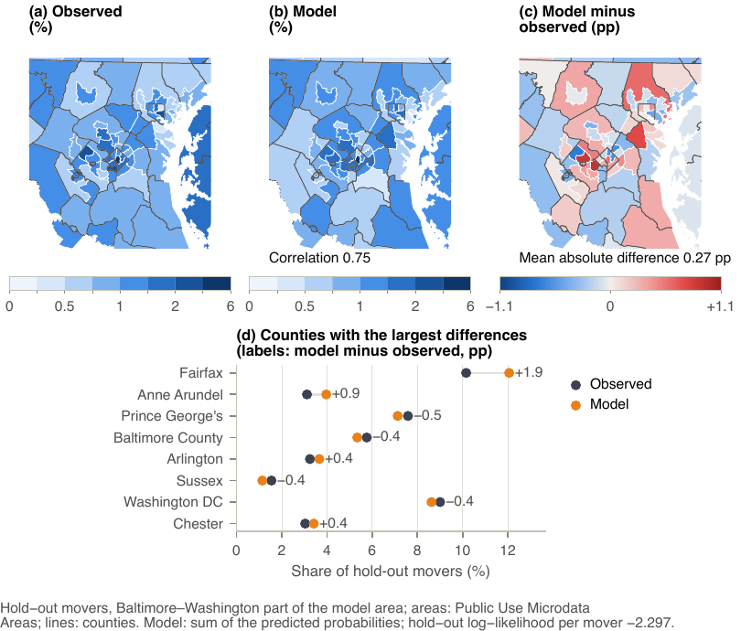
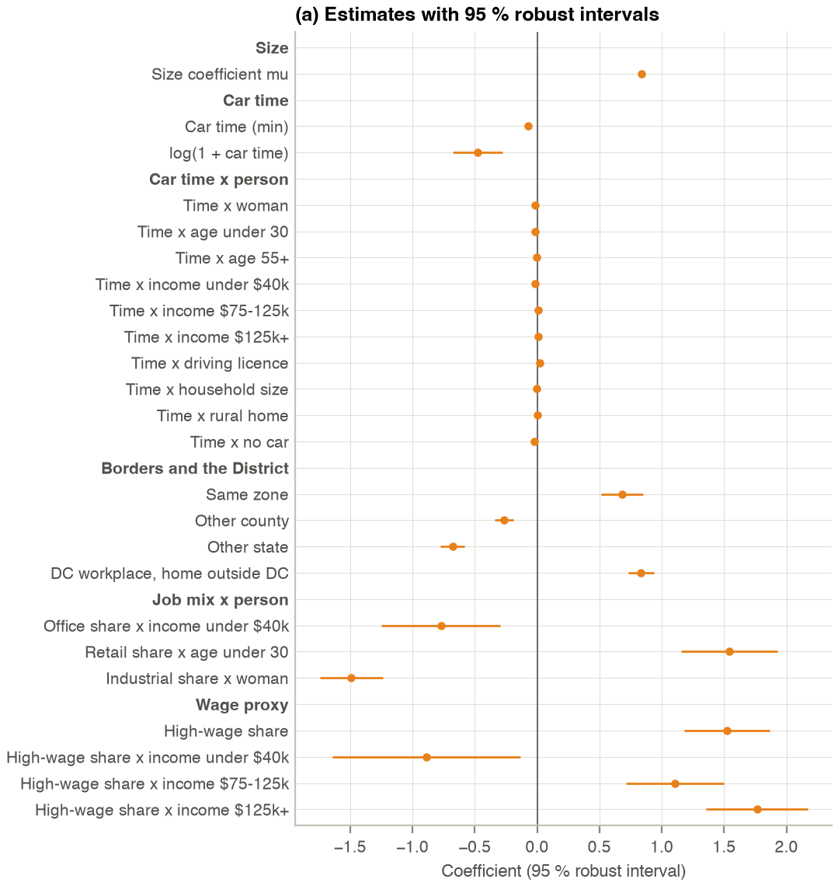
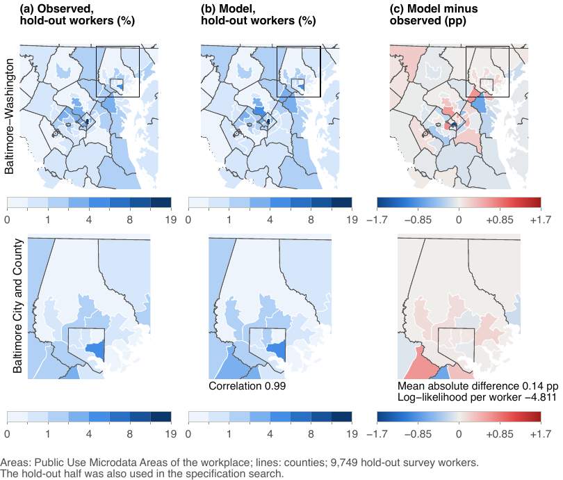

# Land use and workplaces

Residential location (two levels: PUMA, then dwelling), car ownership and workplace choice. The residential and car-ownership models are estimated on ACS PUMS households, the workplace model on the estimation half of the 2017/18 Regional Travel Survey.

!!! note "Reading the tables"
    Coefficient: maximum-likelihood estimate, with significance stars \*\*\* p < 0.01, \*\* p < 0.05, \* p < 0.10; robust (sandwich) standard error; two-sided p-value. N: observations; K: estimated parameters; LL(β̂): log-likelihood at the estimates; ρ̄²: adjusted rho-square. Hold-out: fit on the held-out half of the data, which was also used in the specification search. "Reference": the omitted category; "—": removed from the model.

### Residential location: PUMA

Upper level: the PUMA a moving household chooses among the 97 PUMAs of the zone-system area, with the inclusive value of the dwelling level (coefficient held at 1), the market size, distance from the previous home, the commute, PUMA attributes and the share of the PUMA's households whose householder is of the mover's race category. ACS PUMS movers 2014–2018.

N = 15,163K = 14LL(β̂) = −34,670.3 (weighted)ρ̄² = 0.500Hold-out: LL per mover −2.297

| Variable | Coefficient | Robust s.e. | p |
|---|---:|---:|---:|
| ***Inclusive value of the dwelling level*** |  |  |  |
| Inclusive value IVp | 1 | fixed |  |
| ***Size of the market*** |  |  |  |
| Ln market size Mp | 0.8397\*\*\* | 0.0323 | <0.001 |
| ***Car time from the previous home (per min)*** |  |  |  |
| Under 20 min | 0 | fixed |  |
| 20–60 min | −0.0339\*\*\* | 0.0015 | <0.001 |
| Over 60 min | −0.0087\*\*\* | 0.0006 | <0.001 |
| ***Staying near the origin*** |  |  |  |
| Inside the previous migration area | 2.5267\*\*\* | 0.0851 | <0.001 |
| Bordering the previous migration area | 1.3297\*\*\* | 0.0540 | <0.001 |
| Same state as the origin | 1.0820\*\*\* | 0.0347 | <0.001 |
| ***Commute*** |  |  |  |
| Commute: Σworkers ln(1+t) | −1.7408\*\*\* | 0.0283 | <0.001 |
| ***PUMA attributes*** |  |  |  |
| Crime index × children | −1.1607\*\*\* | 0.1142 | <0.001 |
| Ln dwelling density | −0.5466\*\*\* | 0.0196 | <0.001 |
| &emsp;× single-person household | 0.1698\*\*\* | 0.0229 | <0.001 |
| &emsp;× oldest member under 35 | 0.2446\*\*\* | 0.0217 | <0.001 |
| &emsp;× ln income | −0.1153\*\*\* | 0.0105 | <0.001 |
| Core-city share (DC, Baltimore City) | 0.5055\*\*\* | 0.0401 | <0.001 |
| Own-race share of the PUMA's households | 2.0759\*\*\* | 0.0518 | <0.001 |

Observations: 15,163 ACS PUMS movers 2014–2018 (estimation sample), weighted by the expected in-area share of origin and destination (mean 1); alternatives: the 97 PUMAs of the zone-system area, all available (no sampling); parameters: 14. Inclusive value: ln of the mean of exp V of the dwelling level over 200 dwellings drawn at random from the PUMA's movers' dwellings; ln Mp enters as its own term. Market size: Mp = rp × dwellings of the PUMA, with the fixed turnover rate rp = PUMS dwellings of recent movers (moved in within 12 months) × the PUMA's share of housing units in the zone system / 2016 dwellings of the PUMA; in the simulation Mp changes only with construction and demolition. LL(0) = −69,366.3; LL(β̂) = −34,670.3 (weighted); ρ² = 0.500; AIC = 69,368.6; BIC = 69,475.4. Hold-out movers (3,820; this half was also used in the specification search; unweighted): LL = −8,773.2, −2.297 per mover. Car time applies to the part of the move outside the previous migration area; no effect below 20 min. Previous migration area: share of the dwellings of the household's migration PUMA (ACS) that lie in the PUMA. Commute t: peak car time (min) from the PUMA to the jobs of the worker's place-of-work PUMA, transit door-to-door time for households without a car. Own-race share: share of the PUMA's households whose householder is of the mover's race category (white, Black, Hispanic, other); 2016 in estimation, recomputed every year in the simulation. Density interactions: the main density coefficient is that of a household of $50k with two or more persons and an oldest member of 35 or older; ln income = ln(income / $50k). Core-city share: share of the PUMA's dwellings in DC or Baltimore City (zones weighted as for the other attributes). Dependent variable: destination PUMA of ACS PUMS movers 2014–2018 (estimation sample).

Residential location: destination PUMAs of the hold-out movers, observed and model, and model minus observed.

### Residential location: dwelling

Lower level: the dwelling within the chosen PUMA, among the chosen dwelling and 29 drawn at random from the PUMA's dwellings of recent movers. Each term also enters times ln income. ACS PUMS movers 2014–2018.

N = 15,163K = 18LL(β̂) = −47,478.6ρ̄² = 0.079Hold-out: LL per mover −3.115

| Variable | Coefficient | Robust s.e. | p |
|---|---:|---:|---:|
| ***Affordability*** |  |  |  |
| Cost above 30 % of income (share) | −4.5411\*\*\* | 0.1518 | <0.001 |
| &emsp;× ln income | −1.9322\*\*\* | 0.0686 | <0.001 |
| ***Quality*** |  |  |  |
| Ln monthly housing cost | 0.4398\*\*\* | 0.0256 | <0.001 |
| &emsp;× ln income | 0.2652\*\*\* | 0.0262 | <0.001 |
| ***Size and age of the dwelling*** |  |  |  |
| Bedroom shortfall (per bedroom) | −0.6566\*\*\* | 0.0166 | <0.001 |
| &emsp;× ln income | −0.1424\*\*\* | 0.0169 | <0.001 |
| Bedroom excess (per bedroom) | −0.5353\*\*\* | 0.0176 | <0.001 |
| &emsp;× ln income | 0.1621\*\*\* | 0.0179 | <0.001 |
| Built in the last five years | −0.0414 | 0.0363 | 0.253 |
| &emsp;× ln income | 0.1306\*\*\* | 0.0351 | <0.001 |
| ***Structure type (reference: single-family detached)*** |  |  |  |
| Single-family attached | 0.0314 | 0.0292 | 0.282 |
| &emsp;× ln income | −0.1641\*\*\* | 0.0309 | <0.001 |
| Multifamily 2–4 units | −0.1255\*\*\* | 0.0404 | 0.002 |
| &emsp;× ln income | −0.3343\*\*\* | 0.0414 | <0.001 |
| Multifamily 5+ units | −0.0781\*\* | 0.0316 | 0.014 |
| &emsp;× ln income | −0.3099\*\*\* | 0.0344 | <0.001 |
| Mobile home or other | −0.2092\*\*\* | 0.0707 | 0.003 |
| &emsp;× ln income | −0.4727\*\*\* | 0.0654 | <0.001 |

Observations: 15,163 ACS PUMS movers 2014–2018 (estimation sample, unweighted); alternatives: 30 (chosen + 29 drawn uniformly from the PUMA's dwellings occupied by recent movers); parameters: 18. Choice set: the mover's dwelling and 29 dwellings drawn uniformly at random from the PUMA's market of movers' dwellings. A uniform draw gives consistent estimates and costs only precision (McFadden, 1978); with a second draw, or with 60 or 100 alternatives, no coefficient moves by more than 0.67 robust s.e. In SILO the household sees 30 vacant dwellings drawn at random in the chosen PUMA (all if fewer). LL(0) = −51,572.4; LL(β̂) = −47,478.6; ρ² = 0.079; AIC = 94,993.2; BIC = 95,130.5. Hold-out movers (3,820; this half was also used in the specification search): LL = −11,900.3, −3.115 per mover. Cost above 30 % of income: \max(0, 12 × cost / income - 0.30), income at least $5k, share at most 3; 30 % is the standard housing-cost-burden threshold (fixed). Cost: gross rent (renters) or selected monthly owner costs (owners), 2016 $; ln cost of at least $100. Income: ln(household income / $50k), 2016 $. Bedroom need: household size (at most 5).

### Car ownership

Multinomial logit over 0, 1, 2 and 3 or more cars; every variable has its own coefficient for each alternative (no car = reference). The Baltimore City term is estimated with the other coefficients; no constant is calibrated. Maryland ACS PUMS households 2014–2018.

N = 91,348K = 56LL(β̂) = −78,613.6ρ̄² = 0.379Hold-out: ρ² 0.375

| Variable | Coefficient | Robust s.e. | p |
|---|---:|---:|---:|
| ***One car versus none*** |  |  |  |
| Constant | 1.2652\*\*\* | 0.1440 | <0.001 |
| Workers | 0.1062\*\*\* | 0.0300 | <0.001 |
| Persons aged 16+: 2 | −0.6235\*\*\* | 0.0566 | <0.001 |
| Persons aged 16+: 3 | −1.3456\*\*\* | 0.0764 | <0.001 |
| Persons aged 16+: 4 or more | −1.6925\*\*\* | 0.1020 | <0.001 |
| Children under 16 | −0.2038\*\*\* | 0.0230 | <0.001 |
| Single-person household | −0.2501\*\*\* | 0.0508 | <0.001 |
| Age of the oldest member ((age − 45) / 10) | −0.0656\*\*\* | 0.0104 | <0.001 |
| Age of the oldest member, squared | −0.0347\*\*\* | 0.0036 | <0.001 |
| Ln income, slope under \$25k | 0.5127\*\*\* | 0.0367 | <0.001 |
| Ln income, slope \$25–50k | 1.4038\*\*\* | 0.0872 | <0.001 |
| Ln income, slope \$50–100k | 0.3798\*\*\* | 0.0999 | <0.001 |
| Ln income, slope above \$100k | −0.2813\*\*\* | 0.1000 | 0.005 |
| Single-family attached and other dwelling | reference |  |  |
| Single-family detached dwelling | 0.2074\*\*\* | 0.0444 | <0.001 |
| Multifamily dwelling | −0.3958\*\*\* | 0.0424 | <0.001 |
| Bedrooms | 0.3471\*\*\* | 0.0206 | <0.001 |
| Ln dwelling density of the PUMA (per km²) | — |  |  |
| Non-work accessibility gain from a car (logsum) | 0.4632\*\*\* | 0.1210 | <0.001 |
| Ln income × ln dwelling density (centred) | 0.0616\*\*\* | 0.0105 | <0.001 |
| Baltimore City | −0.9227\*\*\* | 0.0430 | <0.001 |
| ***Two cars versus none*** |  |  |  |
| Constant | −1.2532\*\*\* | 0.1889 | <0.001 |
| Workers | 0.3319\*\*\* | 0.0311 | <0.001 |
| Persons aged 16+: 2 | 2.0214\*\*\* | 0.0404 | <0.001 |
| Persons aged 16+: 3 | 1.0266\*\*\* | 0.0662 | <0.001 |
| Persons aged 16+: 4 or more | 0.3075\*\*\* | 0.0970 | 0.002 |
| Children under 16 | −0.1821\*\*\* | 0.0227 | <0.001 |
| Single-person household | — |  |  |
| Age of the oldest member ((age − 45) / 10) | −0.1364\*\*\* | 0.0102 | <0.001 |
| Age of the oldest member, squared | −0.0459\*\*\* | 0.0040 | <0.001 |
| Ln income, slope under \$25k | 0.3837\*\*\* | 0.0537 | <0.001 |
| Ln income, slope \$25–50k | 1.9106\*\*\* | 0.1052 | <0.001 |
| Ln income, slope \$50–100k | 1.2820\*\*\* | 0.1040 | <0.001 |
| Ln income, slope above \$100k | 0.1458 | 0.1004 | 0.146 |
| Single-family attached and other dwelling | reference |  |  |
| Single-family detached dwelling | 0.7446\*\*\* | 0.0475 | <0.001 |
| Multifamily dwelling | −0.9090\*\*\* | 0.0485 | <0.001 |
| Bedrooms | 0.5272\*\*\* | 0.0230 | <0.001 |
| Ln dwelling density of the PUMA (per km²) | −0.1391\*\*\* | 0.0105 | <0.001 |
| Non-work accessibility gain from a car (logsum) | 0.6501\*\*\* | 0.1480 | <0.001 |
| Ln income × ln dwelling density (centred) | 0.0285\*\* | 0.0128 | 0.026 |
| Baltimore City | −1.1812\*\*\* | 0.0523 | <0.001 |
| ***Three or more cars versus none*** |  |  |  |
| Constant | −3.6183\*\*\* | 0.2405 | <0.001 |
| Workers | 0.6294\*\*\* | 0.0327 | <0.001 |
| Persons aged 16+: 2 | 2.1165\*\*\* | 0.0545 | <0.001 |
| Persons aged 16+: 3 | 2.6169\*\*\* | 0.0755 | <0.001 |
| Persons aged 16+: 4 or more | 2.3784\*\*\* | 0.1026 | <0.001 |
| Children under 16 | −0.3410\*\*\* | 0.0243 | <0.001 |
| Single-person household | — |  |  |
| Age of the oldest member ((age − 45) / 10) | — |  |  |
| Age of the oldest member, squared | −0.0958\*\*\* | 0.0040 | <0.001 |
| Ln income, slope under \$25k | 0.1625\* | 0.0834 | 0.051 |
| Ln income, slope \$25–50k | 2.0388\*\*\* | 0.1393 | <0.001 |
| Ln income, slope \$50–100k | 1.4880\*\*\* | 0.1141 | <0.001 |
| Ln income, slope above \$100k | 0.2811\*\*\* | 0.1027 | 0.006 |
| Single-family attached and other dwelling | reference |  |  |
| Single-family detached dwelling | 1.4866\*\*\* | 0.0530 | <0.001 |
| Multifamily dwelling | −1.3346\*\*\* | 0.0676 | <0.001 |
| Bedrooms | 0.6396\*\*\* | 0.0252 | <0.001 |
| Ln dwelling density of the PUMA (per km²) | −0.3054\*\*\* | 0.0139 | <0.001 |
| Non-work accessibility gain from a car (logsum) | 1.1430\*\*\* | 0.1783 | <0.001 |
| Ln income × ln dwelling density (centred) | −0.0299\*\* | 0.0150 | 0.047 |
| Baltimore City | −1.0775\*\*\* | 0.0671 | <0.001 |

Observations: 91,348 Maryland households (ACS PUMS 2014–2018, estimation sample: 80%); alternatives: 4 (0, 1, 2, 3 or more cars); parameters: 56. LL(0) = −126,635.2; LL(constants) = −116,008.5; LL(β̂) = −78,613.6; ρ² = 0.379; ρ² against constants = 0.322; AIC = 157,339.2; BIC = 157,866.9. Hold-out sample (20%, 22,730 households): LL(0) = −31,510.5; LL(β̂) = −19,704.5; ρ² = 0.375. The hold-out sample was also used in the specification search. Estimation: unweighted multinomial logit (maximum likelihood, Newton); robust (sandwich) standard errors. Income in 2016 $, ln(income / $50k), at least $5k, piecewise linear with bends at $25k, $50k and $100k. Density centred at its mean (5.49). Persons aged 16+: reference 0 or 1. Baltimore City: estimated with the other coefficients; it captures what makes the City different (transit, parking, history) and is not a behavioural effect. The accessibility gain is that of the household's income group (under $40k, $40–75k, $75–125k, $125k or more). —: fixed at 0 (p > 0.3 when estimated).

### Workplace choice

Choice of the workplace zone, with the chosen zone and 99 zones drawn at random from the 1,587 zones with jobs; 24 parameters. Survey estimation half.

N = 9,707K = 24LL(β̂) = −21,376.5ρ̄² = 0.521Hold-out: LL per worker −4.811 (all zones)

| Variable | Coefficient | Robust s.e. | p |
|---|---:|---:|---:|
| ***Size*** |  |  |  |
| Size coefficient μ (ln of total jobs) | 0.8369\*\*\* | 0.0122 | <0.001 |
| ***Car time*** |  |  |  |
| Time (min) | −0.0701\*\*\* | 0.0031 | <0.001 |
| Ln(1+time) | −0.4756\*\*\* | 0.1015 | <0.001 |
| ***Car time × person*** |  |  |  |
| Time × woman | −0.0158\*\*\* | 0.0017 | <0.001 |
| Time × age 30–54 | reference |  |  |
| Time × age <30 | −0.0164\*\*\* | 0.0029 | <0.001 |
| Time × age 55+ | −0.0057\*\*\* | 0.0020 | 0.004 |
| Time × income \$40–75k | reference |  |  |
| Time × income <\$40k | −0.0179\*\*\* | 0.0055 | 0.001 |
| Time × income \$75–125k | 0.0068\*\*\* | 0.0024 | 0.005 |
| Time × income \$125k+ | 0.0107\*\*\* | 0.0026 | <0.001 |
| Time × driving licence | 0.0236\*\*\* | 0.0072 | 0.001 |
| Time × household size | −0.0018\*\* | 0.0007 | 0.012 |
| Time × rural home zone | 0.0058\*\*\* | 0.0018 | 0.002 |
| Time × household without a car | −0.0203\*\*\* | 0.0074 | 0.006 |
| ***Borders and the District*** |  |  |  |
| Same zone | 0.6814\*\*\* | 0.0865 | <0.001 |
| Other county | −0.2653\*\*\* | 0.0368 | <0.001 |
| Other state | −0.6772\*\*\* | 0.0496 | <0.001 |
| DC workplace, home outside DC | 0.8340\*\*\* | 0.0531 | <0.001 |
| ***Job mix × person*** |  |  |  |
| Office share × income \$40k or more | reference |  |  |
| Office share × income <\$40k | −0.7702\*\*\* | 0.2432 | 0.002 |
| Retail share × age <30 | 1.5432\*\*\* | 0.1977 | <0.001 |
| Industrial share × woman | −1.4910\*\*\* | 0.1285 | <0.001 |
| ***Wage proxy*** |  |  |  |
| High-wage share | 1.5238\*\*\* | 0.1751 | <0.001 |
| High-wage share × income \$40–75k | reference |  |  |
| High-wage share × income <\$40k | −0.8870\*\* | 0.3839 | 0.021 |
| High-wage share × income \$75–125k | 1.1052\*\*\* | 0.2005 | <0.001 |
| High-wage share × income \$125k+ | 1.7629\*\*\* | 0.2076 | <0.001 |

Observations: 9,707 workers; alternatives: chosen zone + 99 zones sampled uniformly from the 1,587 zones with jobs (no correction needed); parameters: 24. LL(0) = −44,702.4; LL(β̂) = −21,376.5; ρ² = 0.522; AIC = 42,801.1; BIC = 42,973.4. Hold-out half (9,749 workers, all 1,587 zones; also used in the specification search): LL = −46,905.5 (−4.811 per worker). Estimation: maximum likelihood with analytic gradient; robust (sandwich) standard errors. Dependent variable: zone of the usual workplace of workers with a fixed workplace outside their home (estimation half of the Regional Travel Survey 2017/18). Size term μln Sj, Sj = total jobs of the zone (the four job types weighted equally). Income groups: reference $40–75k. Car time: peak car time home–workplace (min). Shares: job shares of the workplace zone; high-wage share: share of high-earning jobs. Person variables in the time interactions are centred at their estimation-half means, so the time coefficient is the effect for the mean worker.

Workplace choice: estimates with 95 % robust intervals.

Workplace choice: workplaces of the hold-out workers by PUMA, observed and model, and model minus observed.

