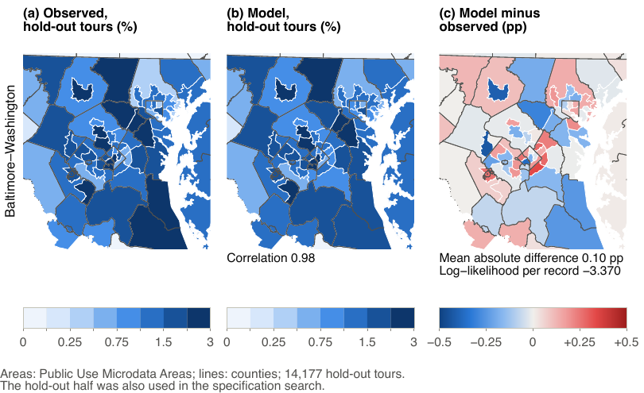
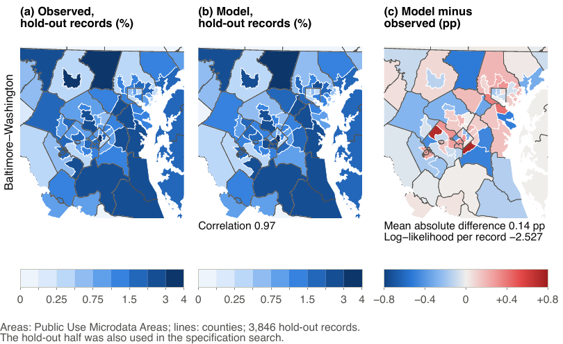
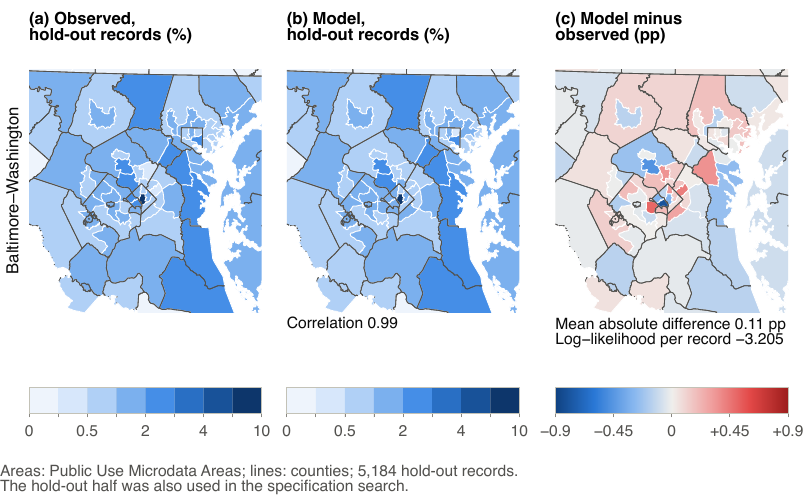
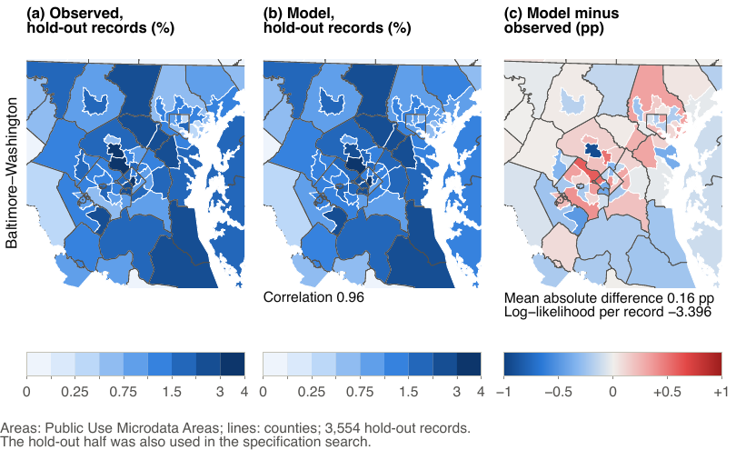
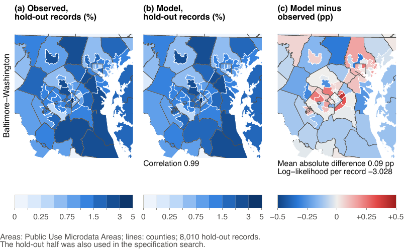
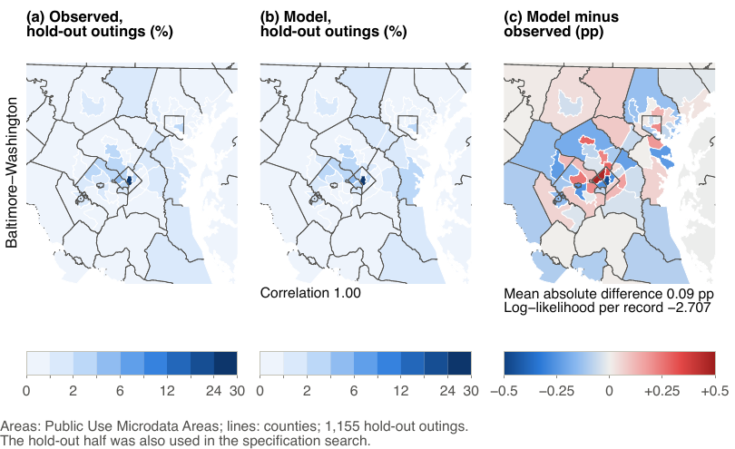
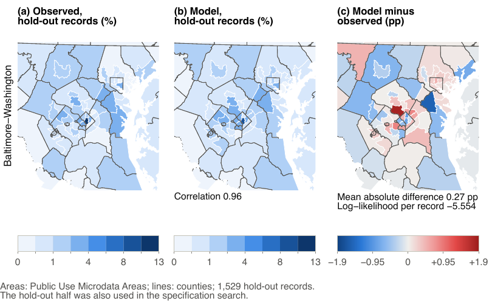
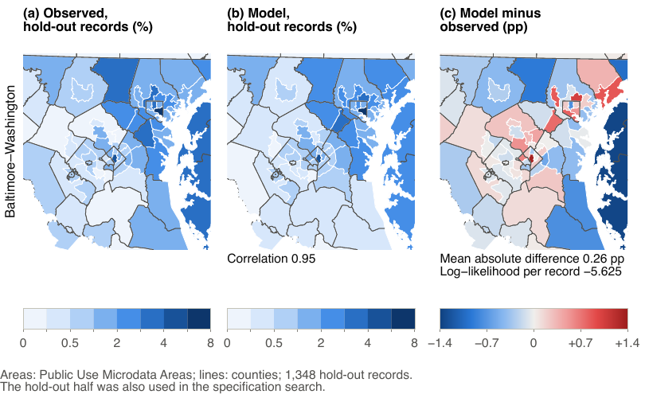
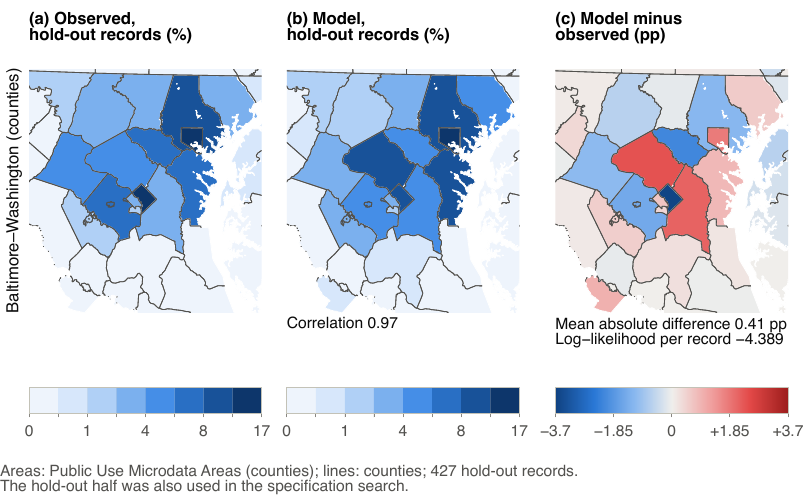
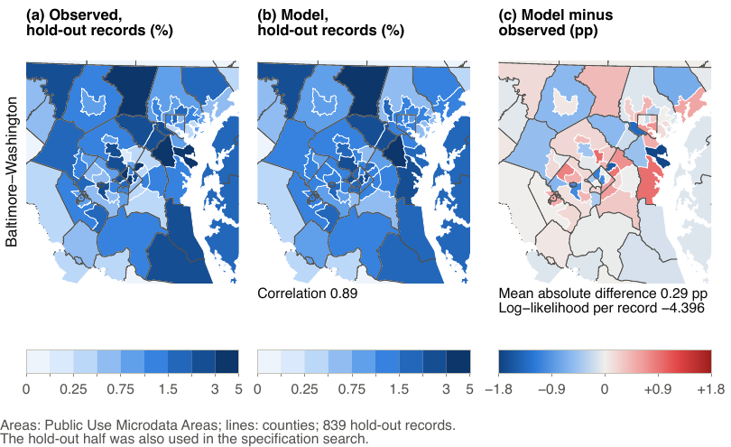

# Destinations and stops

Location models of MAST over the full choice set of 1,588 zones, estimated on the survey estimation half. Each model has one attraction variable, entered as its own log term, β ln(1 + x), and ln zone area where a density term would otherwise be needed.

!!! note "Reading the tables"
    Coefficient: maximum-likelihood estimate, with significance stars \*\*\* p < 0.01, \*\* p < 0.05, \* p < 0.10; robust (sandwich) standard error; two-sided p-value. N: observations; K: estimated parameters; LL(β̂): log-likelihood at the estimates; ρ̄²: adjusted rho-square. Hold-out: fit on the held-out half of the data, which was also used in the specification search. "Reference": the omitted category; "—": removed from the model.

### Main destination of discretionary tours

One logit for shopping, recreation, accompanying and other errands, from home, with a scale for each purpose. Level of service: piecewise car distance and car generalised time.

N = 14,341K = 62LL(β̂) = −49,427.4ρ̄² = 0.532Hold-out: LL per record −3.370

| Variable | Shopping | Recreation | Accompanying | Other |
|---|---:|---:|---:|---:|
| ***Distance and impedance*** |  |  |  |  |
| Distance 0–1 km (per km) | −3.8632\*\*\* (shared) (0.2474) <0.001 |  |  |  |
| Distance 1–2 km | −1.0004\*\*\* (shared) (0.0763) <0.001 |  |  |  |
| Distance 2–5 km | −0.5475\*\*\* (shared) (0.0215) <0.001 |  |  |  |
| Distance 5–10 km | −0.2281\*\*\* (shared) (0.0106) <0.001 |  |  |  |
| Distance 10–20 km | −0.1539\*\*\* (shared) (0.0057) <0.001 |  |  |  |
| Distance 20–50 km | −0.0828\*\*\* (shared) (0.0043) <0.001 |  |  |  |
| Distance > 50 km | 0 (fixed) |  |  |  |
| Car generalised time (min) | −0.0390\*\*\*a (0.0023) <0.001 | −0.0275\*\*\* (0.0025) <0.001 | −0.0537\*\*\* (0.0091) <0.001 | −0.0390\*\*\*a (0.0023) <0.001 |
| ***Same zone*** |  |  |  |  |
| Intrazonal (destination = home zone) | −1.0335\*\*\* (0.0604) <0.001 | −0.5869\*\*\* (0.0714) <0.001 | −0.2913\*\*\* (0.1125) 0.010 | −0.6037\*\*\* (0.0835) <0.001 |
| ***Area*** |  |  |  |  |
| Rest of Maryland | reference |  |  |  |
| Baltimore City | −1.0854\*\*\* (0.1177) <0.001 | −0.1145 (0.1446) 0.428 | −0.3444 (0.2655) 0.194 | 0.1178 (0.1564) 0.451 |
| Washington DC | 0.0738 (0.1472) 0.616 | 0.9144\*\*\* (0.1412) <0.001 | 0.8009\*\*\* (0.2191) <0.001 | 0.5635\*\*\* (0.1465) <0.001 |
| High job-density zone | −0.6292\*\*\* (0.0911) <0.001 | 0.6412\*\*\* (0.0983) <0.001 | 1.1656\*\*\* (0.1964) <0.001 | 0.5052\*\*\* (0.1203) <0.001 |
| Virginia | 0.2944\*\*\* (0.1028) 0.004 | 0.5959\*\*\* (0.1085) <0.001 | 0.8229\*\*\* (0.2493) <0.001 | 0.9775\*\*\* (0.1137) <0.001 |
| Delaware, Pennsylvania, West Virginia | 1.2452\*\*\* (0.1729) <0.001 | 0.2491 (0.2322) 0.283 | 0.3116 (0.7931) 0.694 | 0.4927\* (0.2585) 0.057 |
| ***Land use*** |  |  |  |  |
| Ln(zone area, km²) | 0.2463\*\*\* (0.0260) <0.001 | 0.4519\*\*\* (0.0288) <0.001 | 0.3969\*\*\* (0.0563) <0.001 | 0.3013\*\*\* (0.0325) <0.001 |
| Land-use mix (entropy) | −0.0247 (0.1154) 0.831 | 0.7290\*\*\* (0.1350) <0.001 | 1.2163\*\*\* (0.1991) <0.001 | 0.3604\*\* (0.1571) 0.022 |
| ***Boundaries*** |  |  |  |  |
| Outside the origin county | −0.5356\*\*\* (shared) (0.0363) <0.001 |  |  |  |
| Outside the origin state | −0.6326\*\*\* (shared) (0.0611) <0.001 |  |  |  |
| ***Interactions with ln(distance)*** |  |  |  |  |
| Ln(distance) × cars ≥ drivers | reference |  |  |  |
| Ln(distance) × no car | −0.3730\*\*\* (shared) (0.0533) <0.001 |  |  |  |
| Ln(distance) × cars < drivers | −0.1526\*\*\* (shared) (0.0321) <0.001 |  |  |  |
| Ln(distance) × person 18–64 | reference |  |  |  |
| Ln(distance) × person < 18 | −0.0027 (shared) (0.0404) 0.947 |  |  |  |
| Ln(distance) × person 65+ | −0.0748\*\* (shared) (0.0298) 0.012 |  |  |  |
| Ln(distance) × household with children | −0.2069\*\*\* (shared) (0.0295) <0.001 |  |  |  |
| Ln(distance) × worker | −0.0525\* (shared) (0.0277) 0.058 |  |  |  |
| Ln(distance) × male | −0.0071 (shared) (0.0219) 0.746 |  |  |  |
| Ln(distance) × one-person household | −0.0822\*\* (shared) (0.0320) 0.010 |  |  |  |
| Ln(distance) × midday 9–15 | reference |  |  |  |
| Ln(distance) × AM 6–9 | −0.2476\*\*\* (shared) (0.0392) <0.001 |  |  |  |
| Ln(distance) × PM 15–19 | −0.1183\*\*\* (shared) (0.0263) <0.001 |  |  |  |
| Ln(distance) × evening 19–6 | −0.0011 (shared) (0.0348) 0.975 |  |  |  |
| Ln(distance) × tour with at least one stop | 0.4577\*\*\* (shared) (0.0257) <0.001 |  |  |  |
| ***Attraction*** |  |  |  |  |
| Ln(1 + retail jobs) | 1.0496\*\*\* (0.0216) <0.001 | 0.4880\*\*\* (0.0253) <0.001 | – | 0.5222\*\*\* (0.0265) <0.001 |
| Ln(1 + school enrolment) | – | – | 0.1858\*\*\* (0.0208) <0.001 | – |
| ***Scale*** |  |  |  |  |
| Scale μ_p (p against 1) | 1 (normalised) | 0.8252\*\*\* (0.0204) <0.001 | 0.8197\*\*\* (0.0367) <0.001 | 0.7449\*\*\* (0.0114) <0.001 |

Observations (estimation half): shopping 5,058; recreation 4,159; accompanying 1,593; other 3,531 tours; alternatives: 1,588 zones (full choice set); parameters: 62. LL(β̂) = −49,427.4; BIC = 99,448.2. Hold-out half (14,177 records, used before in the specification search): LL = −47,778.8. Utility of zone j for purpose p: Upj = μ_p Vpj, μ = 1 for shopping; a coefficient marked shared takes the same value in Vp of every purpose that has the variable, so its effect on utility differs across purposes only through the scale; a shared by shopping and other. –: not in the model of this purpose. Estimation: maximum likelihood on the full choice set, robust sandwich covariance, unweighted; estimation half of the Regional Travel Survey. Locations: the survey's traffic zones, spread over the model zones by housing units (home ends) or jobs (activity ends); the likelihood is averaged over the possible zones of the destination and of home (location mixture). Attraction: β_pln(1+xpj), xpj the retail jobs of zone j (school enrolment for accompanying). Zone area in km², at least 0.05 km². Distance: car distance from home (km), piecewise linear with the slope per km in each band; ln(distance) interactions with person, household, arrival-time and tour flags; high job-density zone: at least 10,000 jobs per km²; land-use mix: entropy of the job and population shares (0–1); car generalised time: car time plus cost over the household's value of time (min).

Each cell: coefficient with stars; below it, the robust standard error in brackets and the p-value.

Main destination: hold-out records by PUMA, observed and model, and model minus observed.

### Stop location: shopping

Location of an intermediate shopping stop by its detour between the previous location and the next anchor, with the logsum of the tour mode models over the detour.

N = 3,979K = 23LL(β̂) = −9,982.6ρ̄² = 0.659Hold-out: LL per record −2.527

| Variable | Coefficient | Robust s.e. | p |
|---|---:|---:|---:|
| ***Detour and impedance*** |  |  |  |
| Detour 1–2 km | −0.5052\*\*\* | 0.0781 | <0.001 |
| Detour 2–5 km | −0.2115\*\*\* | 0.0341 | <0.001 |
| Detour 5–10 km | −0.1436\*\*\* | 0.0218 | <0.001 |
| Detour 10–20 km | −0.1566\*\*\* | 0.0163 | <0.001 |
| Detour > 20 km | −0.0386\*\*\* | 0.0084 | <0.001 |
| Mode-choice logsum, detour | 0.4845\*\*\* | 0.0686 | <0.001 |
| Car generalised time, detour (min) | −0.0179\*\*\* | 0.0069 | 0.009 |
| ***Anchor zones*** |  |  |  |
| Stop in the zone of the previous location | 0.3417\*\*\* | 0.0584 | <0.001 |
| Stop in the zone of the next anchor | 0.2971\*\*\* | 0.0614 | <0.001 |
| ***Area*** |  |  |  |
| Rest of Maryland | reference |  |  |
| Baltimore City | −0.8146\*\*\* | 0.1662 | <0.001 |
| Washington DC | −0.3281\*\* | 0.1462 | 0.025 |
| High job-density zone | −0.2294\*\* | 0.1037 | 0.027 |
| Virginia | 0.1816 | 0.1522 | 0.233 |
| Delaware, Pennsylvania, West Virginia | 0.7625 | 0.5170 | 0.140 |
| ***Land use*** |  |  |  |
| Ln(zone area, km²) | 0.3688\*\*\* | 0.0364 | <0.001 |
| Land-use mix (entropy) | −0.4951\*\*\* | 0.1372 | <0.001 |
| ***Boundaries*** |  |  |  |
| Outside the counties of both anchors | −0.7378\*\*\* | 0.0899 | <0.001 |
| Outside the states of both anchors | −0.5983\*\*\* | 0.1896 | 0.002 |
| ***Interactions with ln(1 + detour)*** |  |  |  |
| Ln(1 + detour) × cars ≥ drivers | reference |  |  |
| Ln(1 + detour) × no car | −0.0797 | 0.1326 | 0.548 |
| Ln(1 + detour) × cars < drivers | −0.2765\*\*\* | 0.0674 | <0.001 |
| Ln(1 + detour) × household size (persons) | 0.0537\*\*\* | 0.0168 | 0.001 |
| Ln(1 + detour) × tour mode not car | −0.5520\*\*\* | 0.0900 | <0.001 |
| ***Attraction*** |  |  |  |
| Ln(1 + retail jobs) | 0.9202\*\*\* | 0.0268 | <0.001 |

Observations: 3,979; alternatives: 1,588 zones (full choice set); parameters: 23. LL(β̂) = −9,982.6; BIC = 20,155.9. Hold-out half (3,846 records, used before in the specification search): LL = −9,719.2. Estimation: maximum likelihood on the full choice set, robust sandwich covariance, unweighted; estimation half of the Regional Travel Survey. Locations: the survey's traffic zones, spread over the model zones by housing units (home ends) or jobs (activity ends); the likelihood is averaged over the possible zones of the destination and of the anchors (location mixture). Attraction: βln(1+xj), xj the retail jobs of zone j. Zone area in km², at least 0.05 km². Dependent variable: chosen zone of the stop. Detour: d(a,j) + d(j,b) - d(a,b) by car (km) between the origin a of the trip to the stop and the next anchor b of the tour (the primary destination for an outbound stop, home for an inbound stop), piecewise linear with the slope per km in each band; interactions with person, household, tour and arrival-time flags; land-use mix: entropy of the job and population shares (0–1); logsum: mode-choice logsum of the detour; transit available: bus door-to-door time below 120 min.

Shopping stops: hold-out records by PUMA, observed and model, and model minus observed.

### Stop location: recreation

Location of an intermediate recreation stop.

N = 5,064K = 20LL(β̂) = −15,874.9ρ̄² = 0.574Hold-out: LL per record −3.205

| Variable | Coefficient | Robust s.e. | p |
|---|---:|---:|---:|
| ***Detour and impedance*** |  |  |  |
| Detour 1–2 km | −0.4963\*\*\* | 0.0672 | <0.001 |
| Detour 2–5 km | −0.1625\*\*\* | 0.0277 | <0.001 |
| Detour 5–10 km | −0.0884\*\*\* | 0.0175 | <0.001 |
| Detour 10–20 km | −0.1560\*\*\* | 0.0097 | <0.001 |
| Detour > 20 km | −0.0349\*\*\* | 0.0029 | <0.001 |
| Mode-choice logsum, detour | 1.2926\*\*\* | 0.0813 | <0.001 |
| ***Anchor zones*** |  |  |  |
| Stop in the zone of the previous location | 0.4821\*\*\* | 0.0541 | <0.001 |
| Stop in the zone of the next anchor | 0.3177\*\*\* | 0.0559 | <0.001 |
| ***Area*** |  |  |  |
| Rest of Maryland | reference |  |  |
| Baltimore City | −0.1632 | 0.1098 | 0.137 |
| Washington DC | 0.5772\*\*\* | 0.1036 | <0.001 |
| High job-density zone | 0.8835\*\*\* | 0.0688 | <0.001 |
| Virginia | 0.1881\* | 0.1074 | 0.080 |
| Delaware, Pennsylvania, West Virginia | 0.8807\*\*\* | 0.2259 | <0.001 |
| ***Land use*** |  |  |  |
| Ln(zone area, km²) | 0.4465\*\*\* | 0.0253 | <0.001 |
| Land-use mix (entropy) | 0.0155 | 0.1075 | 0.886 |
| ***Boundaries*** |  |  |  |
| Outside the counties of both anchors | −0.8589\*\*\* | 0.0698 | <0.001 |
| Outside the states of both anchors | −0.4712\*\*\* | 0.1235 | <0.001 |
| ***Interactions with ln(1 + detour)*** |  |  |  |
| Ln(1 + detour) × tour mode not car | −0.3436\*\*\* | 0.0491 | <0.001 |
| Ln(1 + detour) × inbound stop | 0.1343\*\*\* | 0.0300 | <0.001 |
| ***Attraction*** |  |  |  |
| Ln(1 + retail jobs) | 0.4456\*\*\* | 0.0190 | <0.001 |

Observations: 5,064; alternatives: 1,588 zones (full choice set); parameters: 20. LL(β̂) = −15,874.9; BIC = 31,920.5. Hold-out half (5,184 records, used before in the specification search): LL = −16,616.0. Estimation: maximum likelihood on the full choice set, robust sandwich covariance, unweighted; estimation half of the Regional Travel Survey. Locations: the survey's traffic zones, spread over the model zones by housing units (home ends) or jobs (activity ends); the likelihood is averaged over the possible zones of the destination and of the anchors (location mixture). Attraction: βln(1+xj), xj the retail jobs of zone j. Zone area in km², at least 0.05 km². Dependent variable: chosen zone of the stop. Detour: d(a,j) + d(j,b) - d(a,b) by car (km) between the origin a of the trip to the stop and the next anchor b of the tour (the primary destination for an outbound stop, home for an inbound stop), piecewise linear with the slope per km in each band; interactions with person, household, tour and arrival-time flags; land-use mix: entropy of the job and population shares (0–1); logsum: mode-choice logsum of the detour; transit available: bus door-to-door time below 120 min.

Recreation stops: hold-out records by PUMA, observed and model, and model minus observed.

### Stop location: accompanying

Location of an intermediate drop-off or pick-up stop.

N = 3,515K = 22LL(β̂) = −12,488.1ρ̄² = 0.517Hold-out: LL per record −3.396

| Variable | Coefficient | Robust s.e. | p |
|---|---:|---:|---:|
| ***Detour and impedance*** |  |  |  |
| Detour 0–1 km (per km) | 0.4902\*\*\* | 0.1173 | <0.001 |
| Detour 1–2 km | −0.3241\*\*\* | 0.0940 | <0.001 |
| Detour 2–5 km | −0.1870\*\*\* | 0.0307 | <0.001 |
| Detour 5–10 km | −0.0920\*\*\* | 0.0180 | <0.001 |
| Detour 10–20 km | −0.1316\*\*\* | 0.0098 | <0.001 |
| Detour > 20 km | −0.0537\*\*\* | 0.0039 | <0.001 |
| Mode-choice logsum, detour | 1.0272\*\*\* | 0.1208 | <0.001 |
| ***Anchor zones*** |  |  |  |
| Stop in the zone of the previous location | 0.5685\*\*\* | 0.0662 | <0.001 |
| Stop in the zone of the next anchor | 0.3115\*\*\* | 0.0690 | <0.001 |
| ***Area*** |  |  |  |
| Rest of Maryland | reference |  |  |
| Baltimore City | −0.2207\* | 0.1330 | 0.097 |
| Washington DC | −0.1387 | 0.1139 | 0.223 |
| High job-density zone | 1.1162\*\*\* | 0.0972 | <0.001 |
| Virginia | 0.2596\*\* | 0.1140 | 0.023 |
| Delaware, Pennsylvania, West Virginia | −0.1532 | 0.4161 | 0.713 |
| ***Land use*** |  |  |  |
| Ln(zone area, km²) | 0.5396\*\*\* | 0.0290 | <0.001 |
| Land-use mix (entropy) | 0.5783\*\*\* | 0.1014 | <0.001 |
| ***Boundaries*** |  |  |  |
| Outside the counties of both anchors | −1.0163\*\*\* | 0.0791 | <0.001 |
| Outside the states of both anchors | −0.1847 | 0.1359 | 0.174 |
| ***Interactions with ln(1 + detour)*** |  |  |  |
| Ln(1 + detour) × cars ≥ drivers | reference |  |  |
| Ln(1 + detour) × no car | −0.0656 | 0.2623 | 0.802 |
| Ln(1 + detour) × cars < drivers | −0.1051\*\* | 0.0488 | 0.031 |
| Ln(1 + detour) × tour mode not car | −0.3201\*\*\* | 0.0723 | <0.001 |
| ***Attraction*** |  |  |  |
| Ln(1 + school enrolment) | 0.1108\*\*\* | 0.0088 | <0.001 |

Observations: 3,515; alternatives: 1,588 zones (full choice set); parameters: 22. LL(β̂) = −12,488.1; BIC = 25,155.7. Hold-out half (3,554 records, used before in the specification search): LL = −12,070.0. Estimation: maximum likelihood on the full choice set, robust sandwich covariance, unweighted; estimation half of the Regional Travel Survey. Locations: the survey's traffic zones, spread over the model zones by housing units (home ends) or jobs (activity ends); the likelihood is averaged over the possible zones of the destination and of the anchors (location mixture). Attraction: βln(1+xj), xj the school enrolment of zone j. Zone area in km², at least 0.05 km². Dependent variable: chosen zone of the stop. Detour: d(a,j) + d(j,b) - d(a,b) by car (km) between the origin a of the trip to the stop and the next anchor b of the tour (the primary destination for an outbound stop, home for an inbound stop), piecewise linear with the slope per km in each band; interactions with person, household, tour and arrival-time flags; land-use mix: entropy of the job and population shares (0–1); logsum: mode-choice logsum of the detour; transit available: bus door-to-door time below 120 min.

Accompanying stops: hold-out records by PUMA, observed and model, and model minus observed.

### Stop location: other errands

Location of an intermediate stop for other errands.

N = 8,055K = 20LL(β̂) = −24,653.3ρ̄² = 0.584Hold-out: LL per record −3.028

| Variable | Coefficient | Robust s.e. | p |
|---|---:|---:|---:|
| ***Detour and impedance*** |  |  |  |
| Detour 1–2 km | −0.3645\*\*\* | 0.0515 | <0.001 |
| Detour 2–5 km | −0.2202\*\*\* | 0.0221 | <0.001 |
| Detour 5–10 km | −0.0761\*\*\* | 0.0140 | <0.001 |
| Detour 10–20 km | −0.1517\*\*\* | 0.0083 | <0.001 |
| Detour > 20 km | −0.0257\*\*\* | 0.0043 | <0.001 |
| Mode-choice logsum, detour | 1.5476\*\*\* | 0.1019 | <0.001 |
| Car generalised time, detour (min) | −0.0063\* | 0.0034 | 0.065 |
| ***Anchor zones*** |  |  |  |
| Stop in the zone of the previous location | 0.5396\*\*\* | 0.0411 | <0.001 |
| Stop in the zone of the next anchor | 0.1943\*\*\* | 0.0430 | <0.001 |
| ***Area*** |  |  |  |
| Rest of Maryland | reference |  |  |
| Baltimore City | −0.0798 | 0.0867 | 0.358 |
| Washington DC | 0.0757 | 0.0887 | 0.394 |
| High job-density zone | 0.6557\*\*\* | 0.0612 | <0.001 |
| Virginia | 0.1931\*\* | 0.0909 | 0.034 |
| Delaware, Pennsylvania, West Virginia | −0.2740 | 0.2351 | 0.244 |
| ***Land use*** |  |  |  |
| Ln(zone area, km²) | 0.3882\*\*\* | 0.0210 | <0.001 |
| Land-use mix (entropy) | 0.2763\*\*\* | 0.0874 | 0.002 |
| ***Boundaries*** |  |  |  |
| Outside the counties of both anchors | −1.0293\*\*\* | 0.0586 | <0.001 |
| Outside the states of both anchors | −0.2536\*\* | 0.1010 | 0.012 |
| ***Interactions with ln(1 + detour)*** |  |  |  |
| Ln(1 + detour) × tour mode not car | −0.3264\*\*\* | 0.0458 | <0.001 |
| ***Attraction*** |  |  |  |
| Ln(1 + retail jobs) | 0.4635\*\*\* | 0.0147 | <0.001 |

Observations: 8,055; alternatives: 1,588 zones (full choice set); parameters: 20. LL(β̂) = −24,653.3; BIC = 49,486.5. Hold-out half (8,010 records, used before in the specification search): LL = −24,256.6. Estimation: maximum likelihood on the full choice set, robust sandwich covariance, unweighted; estimation half of the Regional Travel Survey. Locations: the survey's traffic zones, spread over the model zones by housing units (home ends) or jobs (activity ends); the likelihood is averaged over the possible zones of the destination and of the anchors (location mixture). Attraction: βln(1+xj), xj the retail jobs of zone j. Zone area in km², at least 0.05 km². Dependent variable: chosen zone of the stop. Detour: d(a,j) + d(j,b) - d(a,b) by car (km) between the origin a of the trip to the stop and the next anchor b of the tour (the primary destination for an outbound stop, home for an inbound stop), piecewise linear with the slope per km in each band; interactions with person, household, tour and arrival-time flags; land-use mix: entropy of the job and population shares (0–1); logsum: mode-choice logsum of the detour; transit available: bus door-to-door time below 120 min.

Other-errand stops: hold-out records by PUMA, observed and model, and model minus observed.

### Outing from the workplace: first stop

Location of the first stop of an outing that starts and ends at the workplace.

N = 1,180K = 10LL(β̂) = −3,112.3ρ̄² = 0.663Hold-out: LL per record −2.707

| Variable | Coefficient | Robust s.e. | p |
|---|---:|---:|---:|
| ***Distance and impedance*** |  |  |  |
| Distance 0–1 km (per km) | −5.9496\*\*\* | 0.4628 | <0.001 |
| Distance 1–2 km | −1.2190\*\*\* | 0.2130 | <0.001 |
| Distance 2–5 km | −0.3562\*\*\* | 0.0810 | <0.001 |
| Distance 5–10 km | −0.3237\*\*\* | 0.0484 | <0.001 |
| Distance 10–20 km | −0.1093\*\*\* | 0.0384 | 0.004 |
| Distance 20–50 km | −0.0505\* | 0.0304 | 0.096 |
| Car generalised time (min) | −0.0691\*\*\* | 0.0239 | 0.004 |
| ***Same zone*** |  |  |  |
| Intrazonal (destination = workplace zone) | −0.2151 | 0.1564 | 0.169 |
| ***Boundaries*** |  |  |  |
| Outside the workplace county | −1.3915\*\*\* | 0.1828 | <0.001 |
| ***Attraction*** |  |  |  |
| Ln(1 + retail jobs) | 0.6934\*\*\* | 0.0476 | <0.001 |

Observations: 1,180; alternatives: 1,588 zones (full choice set); parameters: 10. LL(β̂) = −3,112.3; BIC = 6,295.3. Hold-out half (1,155 records, used before in the specification search): LL = −3,126.1. Estimation: maximum likelihood on the full choice set, robust sandwich covariance, unweighted. Destinations: the survey's census tract, matched to the model zones by the area of their overlap. Estimation half of the Regional Travel Survey. Attraction: βln(1+xj), xj the retail jobs of zone j. Same form and estimator as the other location models with the usual workplace as the anchor: distance from the workplace (km), piecewise linear with the slope per km in each band.

Outing first stops: hold-out records by PUMA, observed and model, and model minus observed.

### Work business: workers with a usual workplace

Location of work-business episodes, with home and workplace as anchors.

N = 1,539K = 18LL(β̂) = −8,432.1ρ̄² = 0.310Hold-out: LL per record −5.554

| Variable | Coefficient | Robust s.e. | p |
|---|---:|---:|---:|
| ***Detour and impedance*** |  |  |  |
| Detour 0–1 km (per km) | 0.8718\*\*\* | 0.1929 | <0.001 |
| Detour 1–2 km | −0.7337\*\*\* | 0.1747 | <0.001 |
| Detour 2–5 km | −0.0933 | 0.0604 | 0.123 |
| Detour 5–10 km | −0.0145 | 0.0316 | 0.646 |
| Detour 10–20 km | −0.0719\*\*\* | 0.0132 | <0.001 |
| Detour > 20 km | −0.0178\*\*\* | 0.0047 | <0.001 |
| Car generalised time, detour (min) | −0.0088\*\* | 0.0042 | 0.037 |
| ***Same zone*** |  |  |  |
| Stop in the home zone | 1.1300\*\*\* | 0.1225 | <0.001 |
| Stop in the workplace zone | −0.5239\*\*\* | 0.1640 | 0.001 |
| ***Land use*** |  |  |  |
| Ln(zone area, km²) | 0.1646\*\*\* | 0.0290 | <0.001 |
| Land-use mix (entropy) | 0.2989 | 0.1949 | 0.125 |
| ***Boundaries*** |  |  |  |
| Outside the counties of both anchors | −0.9945\*\*\* | 0.0819 | <0.001 |
| ***Interactions with ln(1 + detour)*** |  |  |  |
| Ln(1 + detour) × cars ≥ drivers | reference |  |  |
| Ln(1 + detour) × no car | −0.1520 | 0.1165 | 0.192 |
| Ln(1 + detour) × cars < drivers | −0.2870\*\*\* | 0.0712 | <0.001 |
| Ln(1 + detour) × midday 9–15 | reference |  |  |
| Ln(1 + detour) × AM 6–9 | 0.0403 | 0.0528 | 0.445 |
| Ln(1 + detour) × PM 15–19 | −0.2480\*\*\* | 0.0582 | <0.001 |
| Ln(1 + detour) × evening 19–6 | −0.2369\*\* | 0.0994 | 0.017 |
| ***Attraction*** |  |  |  |
| Ln(1 + office jobs) | 0.5580\*\*\* | 0.0251 | <0.001 |

Observations: 1,539; alternatives: 1,588 zones (full choice set); parameters: 18. LL(β̂) = −8,432.1; BIC = 16,996.3. Hold-out half (1,529 records, used before in the specification search): LL = −8,492.8. Estimation: maximum likelihood on the full choice set, robust sandwich covariance, unweighted. Destinations: the survey's census tract, matched to the model zones by the area of their overlap. Estimation half of the Regional Travel Survey. Attraction: βln(1+xj), xj the office jobs of zone j. Zone area in km², at least 0.05 km². Detour: d(h,j) + d(j,w) - d(h,w) by car between home h and the usual workplace w (km), piecewise linear with the slope per km in each band; interactions with household and arrival-time flags; land-use mix: entropy of the job and population shares (0–1); logsum: mode-choice logsum of the stop.

Work business, usual-workplace workers: hold-out records by PUMA, observed and model, and model minus observed.

### Work business: other persons

Location of work-business episodes of persons without a usual workplace.

N = 1,259K = 16LL(β̂) = −6,819.3ρ̄² = 0.292Hold-out: LL per record −5.625

| Variable | Coefficient | Robust s.e. | p |
|---|---:|---:|---:|
| ***Distance and impedance*** |  |  |  |
| Distance 1–2 km | −2.1253\*\*\* | 0.2528 | <0.001 |
| Distance 2–5 km | −0.1183 | 0.0814 | 0.146 |
| Distance 5–10 km | −0.1706\*\*\* | 0.0325 | <0.001 |
| Distance 10–20 km | −0.1145\*\*\* | 0.0138 | <0.001 |
| Distance 20–50 km | −0.0811\*\*\* | 0.0054 | <0.001 |
| Distance > 50 km | −0.0392\*\*\* | 0.0033 | <0.001 |
| ***Same zone*** |  |  |  |
| Intrazonal (destination = home zone) | 0.7504\*\*\* | 0.1792 | <0.001 |
| ***Area*** |  |  |  |
| Rest of Maryland | reference |  |  |
| Baltimore City | −0.2364\*\* | 0.0983 | 0.016 |
| Washington DC | 0.3742\*\*\* | 0.1269 | 0.003 |
| Virginia | 0.2043\* | 0.1197 | 0.088 |
| Delaware, Pennsylvania, West Virginia | −0.2775 | 0.2094 | 0.185 |
| ***Boundaries*** |  |  |  |
| Outside the origin county | −0.3124\*\*\* | 0.0861 | <0.001 |
| ***Interactions with ln(distance)*** |  |  |  |
| Ln(distance) × income \$50–100k | reference |  |  |
| Ln(distance) × income < \$50k | −0.1206\* | 0.0664 | 0.069 |
| Ln(distance) × income ≥ \$100k | 0.1157\* | 0.0634 | 0.068 |
| Ln(distance) × worker | 0.3775\*\*\* | 0.0556 | <0.001 |
| ***Attraction*** |  |  |  |
| Ln(1 + office jobs) | 0.5440\*\*\* | 0.0239 | <0.001 |

Observations: 1,259; alternatives: 1,588 zones (full choice set); parameters: 16. LL(β̂) = −6,819.3; BIC = 13,752.9. Hold-out half (1,348 records, used before in the specification search): LL = −7,583.1. Estimation: maximum likelihood on the full choice set, robust sandwich covariance, unweighted. Destinations: the survey's census tract, matched to the model zones by the area of their overlap. Estimation half of the Regional Travel Survey. Attraction: βln(1+xj), xj the office jobs of zone j. Distance: car distance from the home (km), piecewise linear with the slope per km in each band; ln(distance) interactions with person, household and arrival-time flags; land-use mix: entropy of the job and population shares (0–1).

Work business, other persons: hold-out records by PUMA, observed and model, and model minus observed.

### Work trips of persons who work at home

Location of the work trips of persons whose usual workplace is home.

N = 366K = 5LL(β̂) = −1,640.9ρ̄² = 0.430Hold-out: LL per record −4.389

| Variable | Coefficient | Robust s.e. | p |
|---|---:|---:|---:|
| ***Distance and impedance*** |  |  |  |
| Distance (km) | −0.0183\*\*\* | 0.0050 | <0.001 |
| Ln(distance, km) | −1.4001\*\*\* | 0.1388 | <0.001 |
| ***Same zone*** |  |  |  |
| Intrazonal (destination = home zone) | 1.3040\*\*\* | 0.2615 | <0.001 |
| ***Boundaries*** |  |  |  |
| Outside the origin county | −0.4580\*\* | 0.1903 | 0.016 |
| ***Attraction*** |  |  |  |
| Ln(1 + office jobs) | 0.5299\*\*\* | 0.0466 | <0.001 |

Observations: 366; alternatives: 1,588 zones (full choice set); parameters: 5. LL(β̂) = −1,640.9; BIC = 3,311.3. Hold-out half (427 records, used before in the specification search): LL = −1,874.0. Estimation: maximum likelihood on the full choice set, robust sandwich covariance, unweighted. Destinations: the survey's census tract, matched to the model zones by the area of their overlap. Estimation half of the Regional Travel Survey. Attraction: βln(1+xj), xj the office jobs of zone j. Distance: car distance from home (km).

Work trips of home workers: hold-out records by PUMA, observed and model, and model minus observed.

### School and daycare without a school record

One pooled model for school episodes of persons without a school record and daycare of children under 5, with a purpose scale.

N = 846K = 9LL(β̂) = −3,798.5ρ̄² = 0.440Hold-out: LL per record −4.396

| Variable | Non-student school | Daycare |
|---|---:|---:|
| ***Distance and impedance*** |  |  |
| Ln(distance, km) | −1.0600\*\*\* (shared) (0.0618) <0.001 |  |
| Car generalised time (min) | −0.0447\*\*\* (shared) (0.0043) <0.001 |  |
| ***Land use*** |  |  |
| Ln(zone area, km²) | 0.1238\*\*\* (shared) (0.0463) 0.007 |  |
| Land-use mix (entropy) | 1.2281\*\*\* (shared) (0.2069) <0.001 |  |
| ***Boundaries*** |  |  |
| Outside the origin county | −0.5883\*\*\* (shared) (0.1177) <0.001 |  |
| Outside the origin state | −0.4893\*\*\* (shared) (0.1660) 0.003 |  |
| ***Attraction*** |  |  |
| Ln(1 + school enrolment) | 0.5437\*\*\* (0.0814) <0.001 | 0.1261\*\*\* (0.0334) <0.001 |
| ***Scale*** |  |  |
| Scale (p against 1) | 1 (normalised) | 1.2389\*\*\* (0.0453) <0.001 |

Observations (estimation half): non-student school 567, daycare 279 episodes; alternatives: 1,588 zones (full choice set); parameters: 9. LL(β̂) = −3,798.5; BIC = 7,657.6. Hold-out half (839 records: non-student school 557, daycare 282; used before in the specification search): LL = −3,688.3. Utility of zone j for purpose p: Upj = μ_p Vpj, μ = 1 for non-student school; a coefficient marked shared takes the same value in Vp of both purposes. –: not in the model of this purpose. Estimation: maximum likelihood on the full choice set, robust sandwich covariance, unweighted. Destinations: the survey's census tract, matched to the model zones by the area of their overlap. Estimation half of the Regional Travel Survey. Attraction: β_pln(1+xj), xj the school enrolment of zone j, one coefficient per purpose. Zone area in km², at least 0.05 km². Distance: car distance from home (km); land-use mix: entropy of the job and population shares (0–1).

Each cell: coefficient with stars; below it, the robust standard error in brackets and the p-value.

School and daycare without a record: hold-out records by PUMA, observed and model, and model minus observed.

