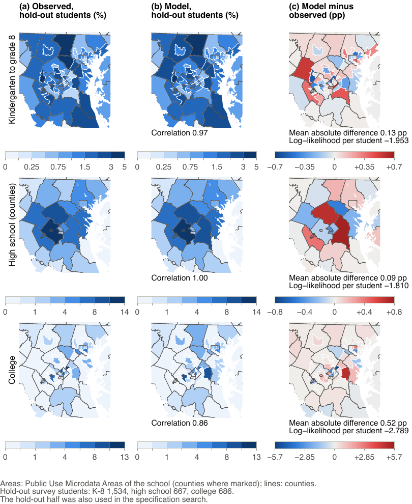

# School location

Three multinomial logits over the zones with enrolment of the student's band (K–8, high school, college), estimated on the survey estimation half with the full choice set.

!!! note "Reading the tables"
    Coefficient: maximum-likelihood estimate, with significance stars \*\*\* p < 0.01, \*\* p < 0.05, \* p < 0.10; robust (sandwich) standard error; two-sided p-value. N: observations; K: estimated parameters; LL(β̂): log-likelihood at the estimates; ρ̄²: adjusted rho-square. Hold-out: fit on the held-out half of the data, which was also used in the specification search. "Reference": the omitted category; "—": removed from the model.

### School location: K–8, high school and college

Size term with public enrolment inside the home's attendance boundary as a separate component, car time, boundary terms and the own-race share of the zone's enrolment; the K–12 models add the charter-or-magnet share, and the K–8 model the test-score quality of the zone's public schools.

| Band | N | K | LL(β̂) | ρ̄² | Hold-out LL per student |
|---|---:|---:|---:|---:|---:|
| K–8 | 1,509 | 13 | −2,885.6 | 0.721 | −1.953 |
| High school | 668 | 6 | −1,217.0 | 0.722 | −1.810 |
| College | 673 | 9 | −1,810.4 | 0.454 | −2.789 |

| Variable | Coefficient | Robust s.e. | p |
|---|---:|---:|---:|
| **K–8** |  |  |  |
| ***Size*** |  |  |  |
| &emsp;size coefficient μ | 0.4947\*\*\* | 0.0480 | <0.001 |
| &emsp;in-boundary public enrolment, log weight | 6.1465\*\*\* | 0.5110 | <0.001 |
| &emsp;private enrolment, log weight | 1.3654\*\*\* | 0.3146 | <0.001 |
| ***Car time*** |  |  |  |
| &emsp;car time (min) | −0.0857\*\*\* | 0.0172 | <0.001 |
| &emsp;ln(1+time) | −1.0211\*\*\* | 0.3478 | 0.003 |
| &emsp;time × no car | −0.0999\*\*\* | 0.0355 | 0.005 |
| &emsp;time × fewer cars than drivers | — |  |  |
| ***Boundaries*** |  |  |  |
| &emsp;same zone | 0.3165\*\*\* | 0.1015 | 0.002 |
| &emsp;other county × public share | −2.3277\*\*\* | 0.1999 | <0.001 |
| ***School zone*** |  |  |  |
| &emsp;charter-or-magnet share | 0.5690\*\*\* | 0.1554 | <0.001 |
| &emsp;quality of the public part (per 10 points, centred) | 0.2047\*\*\* | 0.0326 | <0.001 |
| &emsp;quality × income <\$40k | −0.3536\*\*\* | 0.1184 | 0.003 |
| &emsp;share of public enrolment without a score | 0.8633\*\*\* | 0.2104 | <0.001 |
| &emsp;own-race share of the zone's enrolment | 1.1184\*\*\* | 0.1958 | <0.001 |
| **High school** |  |  |  |
| ***Size*** |  |  |  |
| &emsp;size coefficient μ | 0.6637\*\*\* | 0.0591 | <0.001 |
| &emsp;in-boundary public enrolment, log weight | 4.2834\*\*\* | 0.4414 | <0.001 |
| &emsp;private enrolment, log weight | — |  |  |
| ***Car time*** |  |  |  |
| &emsp;car time (min) | −0.1028\*\*\* | 0.0070 | <0.001 |
| ***Boundaries*** |  |  |  |
| &emsp;other county × public share | −2.5892\*\*\* | 0.2993 | <0.001 |
| ***School zone*** |  |  |  |
| &emsp;charter-or-magnet share | 0.7409\*\*\* | 0.1778 | <0.001 |
| &emsp;own-race share of the zone's enrolment | 1.6429\*\*\* | 0.2582 | <0.001 |
| **College** |  |  |  |
| ***Size*** |  |  |  |
| &emsp;size coefficient μ | 0.5456\*\*\* | 0.0321 | <0.001 |
| &emsp;private 4-year enrolment, log weight | −1.3251\*\*\* | 0.2540 | <0.001 |
| &emsp;2-year enrolment, log weight | −0.8480\*\*\* | 0.2227 | <0.001 |
| ***Car time*** |  |  |  |
| &emsp;car time (min) | −0.0395\*\*\* | 0.0085 | <0.001 |
| &emsp;ln(1+time) | −1.2011\*\*\* | 0.3081 | <0.001 |
| &emsp;time × income <\$40k | — |  |  |
| &emsp;time × income \$125k+ | 0.0195\*\*\* | 0.0053 | <0.001 |
| ***Boundaries*** |  |  |  |
| &emsp;other county | −0.5639\*\*\* | 0.1325 | <0.001 |
| &emsp;other state | −0.6885\*\*\* | 0.1351 | <0.001 |
| ***School zone*** |  |  |  |
| &emsp;own-race share of the zone's enrolment | 1.3986\*\*\* | 0.2061 | <0.001 |

Choice set: all zones with enrolment of the student's band (no sampling). Dependent variable: school zone of students with a school record, estimation half of the Regional Travel Survey 2017/18; hold-out half on the full choice set. Unweighted; robust (sandwich) standard errors. K–8: N = 1,509 students, 1,144 zones with enrolment, K = 13; LL(0) = −10,407.1; LL(β̂) = −2,885.6; ρ² = 0.723; AIC = 5,797.2; BIC = 5,866.4. Hold-out (1,534 students): LL = −2,995.8 (−1.953 per student); without the own-race share −3,016.0. High school: N = 668 students, 719 zones with enrolment, K = 6; LL(0) = −4,394.0; LL(β̂) = −1,217.0; ρ² = 0.723; AIC = 2,445.9; BIC = 2,472.9. Hold-out (667 students): LL = −1,207.5 (−1.810 per student); without the own-race share −1,227.6. College: N = 673 students, 141 zones with enrolment, K = 9; LL(0) = −3,330.5; LL(β̂) = −1,810.4; ρ² = 0.456; AIC = 3,638.7; BIC = 3,679.3. Hold-out (686 students): LL = −1,913.5 (−2.789 per student); without the own-race share −1,938.9. The hold-out half was also used in the specification search, so its fit is not an independent test. Size term μln Sj with the public enrolment of the band outside the home's attendance boundary as reference (college: public 4-year); log weights of the other enrolment types relative to it. Car time: AM-peak car time from the home zone (min). Public share: share of public enrolment in the zone's enrolment of the band. Interactions: no car, reference households with a car; income $125k+, reference all other incomes. Charter-or-magnet share: share of the zone's enrolment of the band in public charter or magnet schools. Quality: enrolment-weighted mean % proficient (ELA and math, Maryland public schools) minus the Maryland mean (38.3), per 10 points, times the share of the zone's enrolment in schools with a score. Own-race share: share of the zone's enrolment of the band that is of the student's race (white, Black, Hispanic, other); it describes the composition of the schools and does not separate preference from information, transport or history. —: K–8 time × fewer cars than drivers and college time × income &lt;$40k: removed (college: BIC); high-school private log weight: fixed at 0 (p = 0.37 when estimated). High school: school quality was tested and not kept (BIC).

School location: schools of the hold-out students, observed and model, and model minus observed.

