# Validation

## Design

**Verification** compares a model with the data it was estimated on; **validation** compares it with data used in
no estimation or calibration step.

| Stage | Test | Measure and criterion | Runs |
|---|---|---|---|
| Population synthesis | Held-out PUMS test split; ACS by PUMA | SRMSE at the sampling floor | 1 |
| Land use | Calibrated on 2017–2020, tested out of sample on 2021–2024 | Rates ±5 %; shares ±5 pp | 5 seeds |
| Location choice | Survey hold-out half | Hold-out log-likelihood; trip-length distribution | – |
| Activities | Estimation half (verification), hold-out half (validation), synthetic population (chain test); 2024 benchmarks | Start times within 2 pp per hour | 10 replications |
| Assignment | 2024 traffic counts and continuous counters | %RMSE by volume group; GEH < 5 for > 85 % of flows | 5 seeds |

Distributions are compared by the total variation distance, \(\mathrm{TVD} = \tfrac12 \sum_k |m_k - o_k|\), in
percentage points: the share of persons, households or activities that would have to change class for the model to
reproduce the observed distribution. Ordered distributions (start times, trip lengths) also get the
Kolmogorov–Smirnov distance \(D\) and its \(p\)-value \(P\).

## Synthetic population, 2016

<figure markdown>
  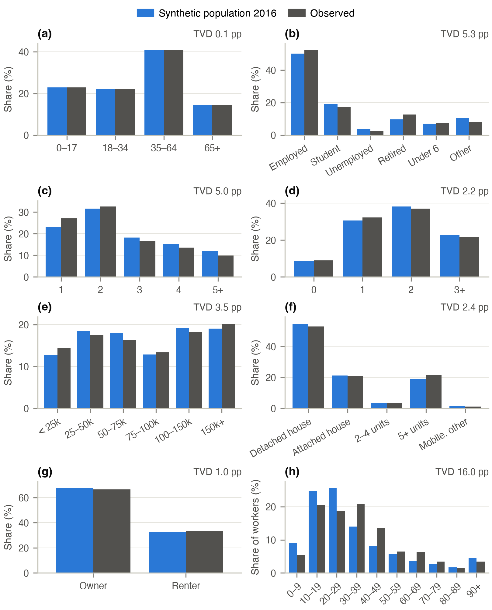
  <figcaption>Synthetic population against observed data, Maryland, 2016: age (controlled), employment, household size, cars, income, dwelling type, tenure and commute time. Observed: ACS PUMS 2014–2018; travel survey 2017/18 (commute).</figcaption>
</figure>

| Level | Measure | Result |
|---|---|---|
| Maryland, ACS PUMS 2014–18 | 8 attributes | TVD 0.1–5.3 pp; every class within 3.9 pp |
| Held-out PUMS test split | Single attributes | TVD ≤ 0.040; household SRMSE 0.019–0.093 (sampling floor 0.022–0.060) |
| | 78 pairs of 13 attributes | Median SRMSE 0.118 (training split 0.033); largest 0.238 |
| | Person combinations | 97 % of 2,240 generated |
| 96 PUMAs, six states | 22 attribute classes | 96.5 % of cells within ±5 pp |
| Maryland | Size by cars, income by cars | Every cell within ±2.3 pp |

The largest differences are single-person households (23.1 % against 27.0 %) and retired persons (9.7 % against
12.6 %). PUMAs are drawn toward their common mean (slopes 0.79–0.90), so differences are largest in the PUMAs of most
extreme composition. The home–work car time of the synthetic workers averages 33.7 min against 34.2 min in the
survey.

<figure markdown>
  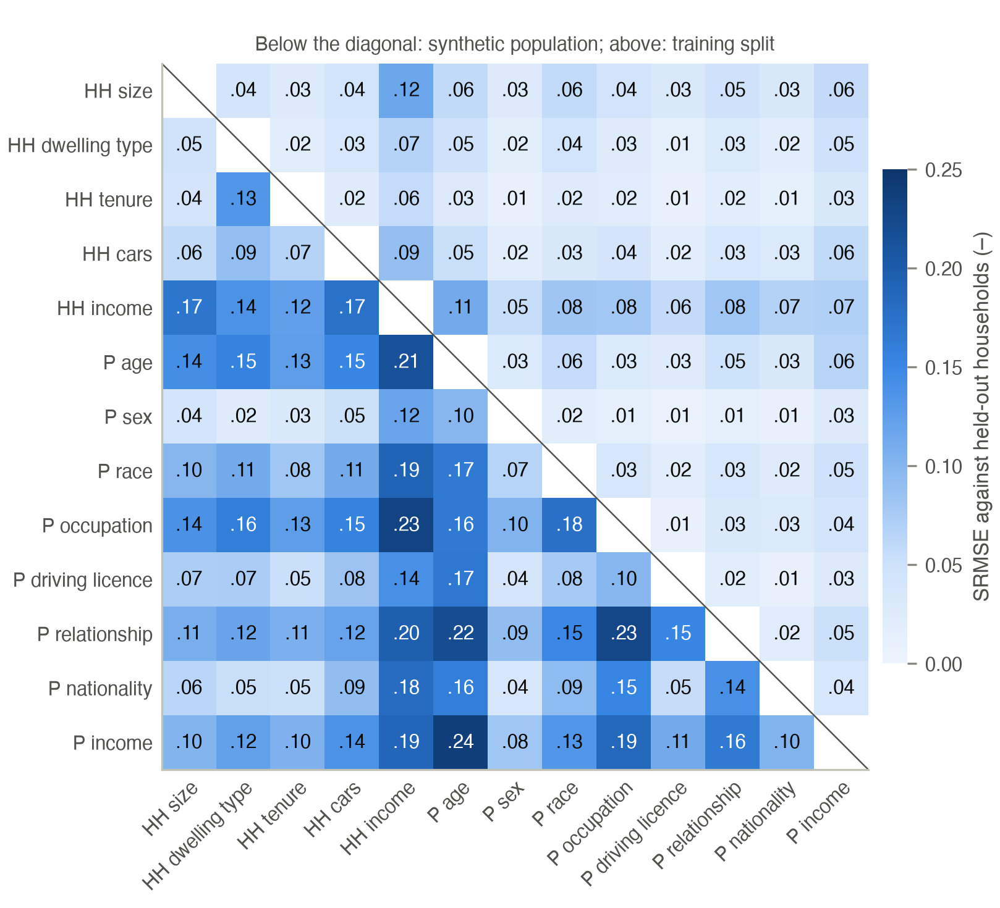
  <figcaption>SRMSE of every pair of attributes against the held-out test split: below the diagonal the synthetic population, above it the training split.</figcaption>
</figure>

## Land use, 2017–2024

Mean of five seeds; window means of the calibration years and of the out-of-sample years.

| Quantity | Model 2017–20 | Observed | Model 2021–24 | Observed |
|---|---:|---:|---:|---:|
| Population / Census estimate | 0.999 | 1 | 0.995 | 1 |
| Job-to-job changes per employed (%) | 24.2 | 25.2 | 23.9 | 25.2 |
| Residents working in Maryland (%) | 83.2 | 82.7 | 82.8 | 84.1 |
| Persons who moved (%) | 12.4 | 12.4 | 12.8 | 10.9 |
| Mover flows, correlation with ACS | 0.970 | – | 0.946 | – |
| Movers staying in their county (%) | 71.9 | 68.9 | 68.0 | 68.9 |
| Births per woman 15–50 | 0.0509 | 0.0510 | 0.0495 | 0.0482 |
| Deaths per person | 0.0079 | 0.0081 | 0.0080 | 0.0091 |
| Households of 1 person (%) | 24.4 | 27.6 | 26.2 | 28.6 |
| Households without a car (%) | 8.4 | 8.7 | 8.2 | 8.7 |
| 2 cars (%) | 37.2 | 36.5 | 35.7 | 35.8 |

- **Commuting is stable**: county-to-county commute flows correlate with the ACS at 0.995.
- **Events**: births, marriages and divorces are within 6 % out of sample; deaths are 12 % low, as the engine's death
  rates do not follow the higher mortality of 2021–2023.
- **Moves** are the largest out-of-sample miss (12.8 % against 10.9 %): the observed rate fell after 2020 while the
  calibrated model kept its 2017–2020 level.
- **2024 composition**: household size, cars, age and income have a TVD of 1.5–3.7 pp from the ACS 2020–2024, and no
  share varies by more than 0.4 pp across seeds.
- **Small areas**: 2020 households by zone against the Census have \(R^2 = 0.978\) and a weighted MAPE of 7.2 %; the
  spatial pattern of change is not reproduced (\(R^2 \le 0.01\) against observed change).

<figure markdown>
  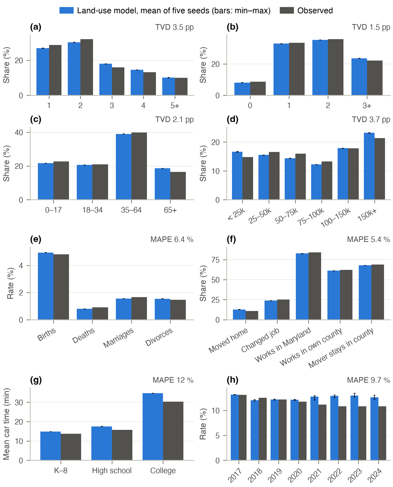
  <figcaption>Land use against observed data, Maryland: composition in 2024, vital rates, moves and work location 2021–2024, car time to school, and movers by year.</figcaption>
</figure>

## Schools

Assigned schools are 1 to 4 minutes too far by car (2024: K–8 14.9 against 13.7 min; high school 17.5 against 15.7;
college 34.7 against 30.3), and home-county shares are 2 to 11 points low.

## Activities

### Survey households

ORIOLE-Day is run with ten replications on the observed households of the estimation half (22,462 persons aged 5+) and
the hold-out half (22,531), and compared with the weighted survey of the same households.

- On the hold-out half the model generates **1.2 % more activities** than observed (76,105 against 75,203), and
  distances are 2.4 % long — the same size and sign as in the verification (+0.3 %, +3.4 %).
- **Start times**: \(D\) between 0.083 and 0.208 and \(P \ge 0.62\) for every activity type in both halves; all types
  except shopping are within 2 pp of the survey in every hour (shopping within 3.2).
- **Durations** follow the survey for work, school and return home; shopping and other activities are short (33
  against 36 min; 50 against 60 min).
- **Chains**: 2.86 trips per home-based chain against 2.82.
- **Tour modes** within 2.1 pp of the survey (train 3.0 % against 5.1 %, because the work model is weighted to the
  ACS).
- **Chain test** on the synthetic population: +3.3 % activities and −0.1 % distance against the hold-out half.

<figure markdown>
  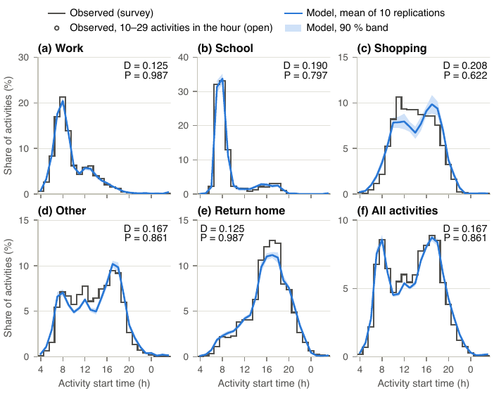
  <figcaption>Activity start times against the survey hold-out half. Band: 90 % range of ten replications; D, P: Kolmogorov–Smirnov statistic and p-value.</figcaption>
</figure>

<figure markdown>
  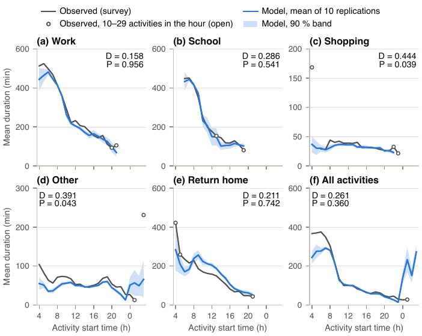
  <figcaption>Mean activity duration by start hour against the survey hold-out half.</figcaption>
</figure>

<figure markdown>
  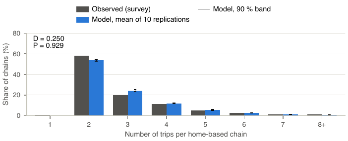
  <figcaption>Trips per home-based chain against the survey hold-out half.</figcaption>
</figure>

### The 2024 population

| Measure | Model | Observed |
|---|---:|---:|
| *Activities per person, residents 15+, weekday (ATUS)* | | |
| Work | 0.597 | 0.399 |
| School | 0.089 | 0.099 |
| Shopping | 0.422 | 0.479 |
| Other | 1.278 | 1.096 |
| *Commute, employed residents 16+ (ACS 2024)* | | |
| Departing 6:00–8:59 (%) | 65.9 | 61.2 |
| Median travel time to work (min) | 23.0 | 30.0 |
| Car driver / transit (%) | 78.1 / 9.0 | 84.1 / 5.8 |
| Working in home county or county group (%) | 54.4 | 54.0 |
| *Car-driver travel, residents of the six counties (survey 2017/18)* | | |
| Miles per resident | 18.7 | 17.3 |
| Mean trip length, tract to tract (km) | 11.4 | 11.5 |

Timing and geography transfer to 2024: county commute flows correlate with LODES at 0.978, and car-driver trips match
the survey in length. Activity levels do not transfer: with the workplace attendance of the base period, more
residents have a work activity than in the ATUS, and discretionary activities do not follow the fall observed after
2019.

<figure markdown>
  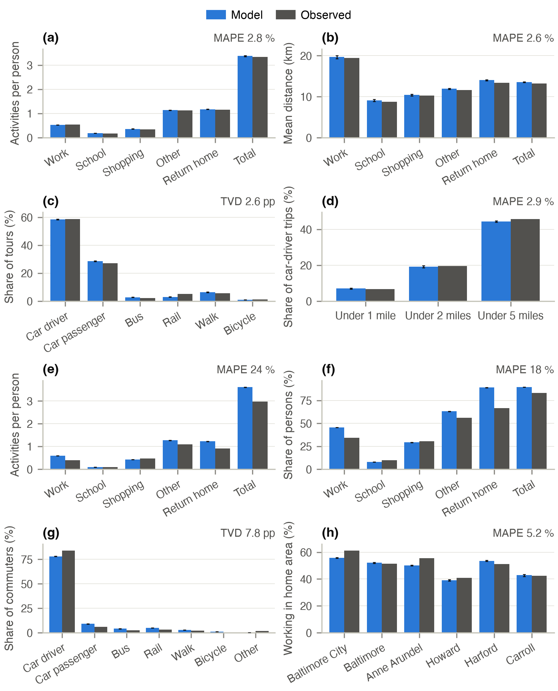
  <figcaption>Activity model against observed data: survey hold-out households (activities, distance, tour mode, short car trips) and the 2024 population (activities, participation, mode to work, work in home county).</figcaption>
</figure>

## Traffic, 2024

!!! tip "Interactive map"
    Every count station with its observed and simulated volumes and matched links: [Validation map](validation-map.md).

The assignment carries residents only, so the ratios below are expected to stay below 1.

**Daily counts.** Over 2,308 mainline count stations the model carries **0.77 of all counted vehicles and 0.81 of
passenger vehicles**, with \(R^2 = 0.89\) and \(0.90\) across stations. On I-695, other freeways and principal arterials
it carries 0.84–0.93 of all vehicles (0.88–0.96 of passenger vehicles); on minor arterials and collectors 0.58–0.69.

<figure markdown>
  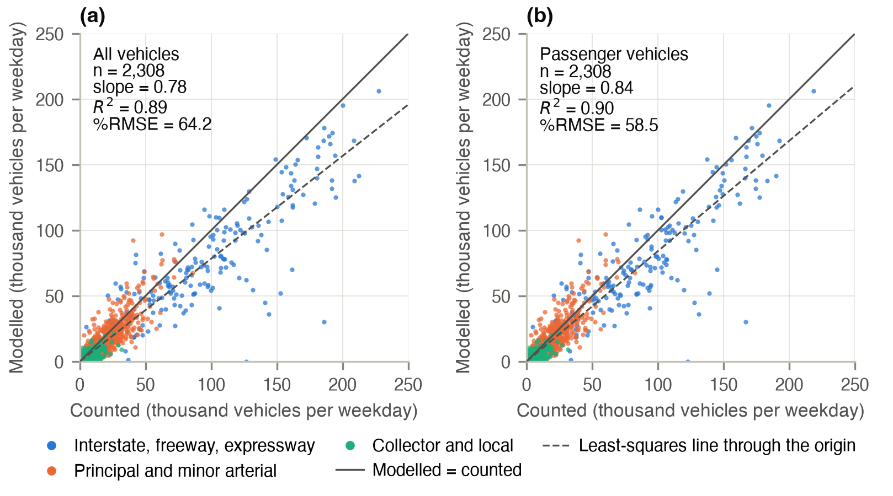
  <figcaption>Modelled against counted daily traffic at 2,308 mainline count stations, 2024: all vehicles and passenger vehicles.</figcaption>
</figure>

**Screenlines.** Seven screenlines were placed before any model result was read. On the four with sufficient count
coverage the model carries 0.77 (Baltimore City cordon), 0.89 (Patapsco River), 0.73 (Beltway cordon) and 0.93
(Carroll County line) of the counted vehicles.

**Hourly counts.** At the 21 continuous count stations the model/count ratio is 1.11 for 6:00–10:00 and 1.03 for
15:00–19:00, but 0.73 at midday and 0.50 at night: the commute peaks, when resident travel dominates, are reproduced,
and the gaps lie where trucks, commercial vehicles and through traffic carry more of the traffic.

<figure markdown>
  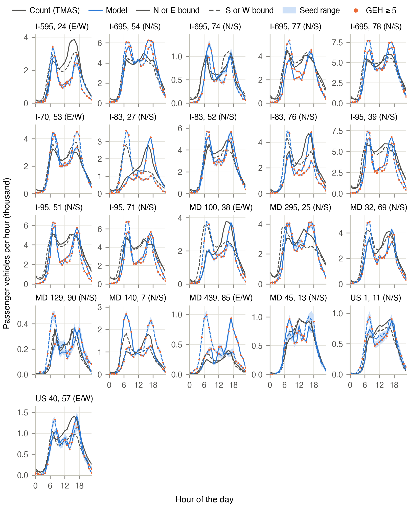
  <figcaption>Weekday hourly passenger-vehicle volumes at the continuous count stations, 2024: count and model by direction. Orange: GEH ≥ 5.</figcaption>
</figure>

**Regional traffic.** Residents carry 0.79 of the weekday passenger-vehicle miles of the six counties, between 0.73
(Howard) and 0.95 (Carroll) by county.

<figure markdown>
  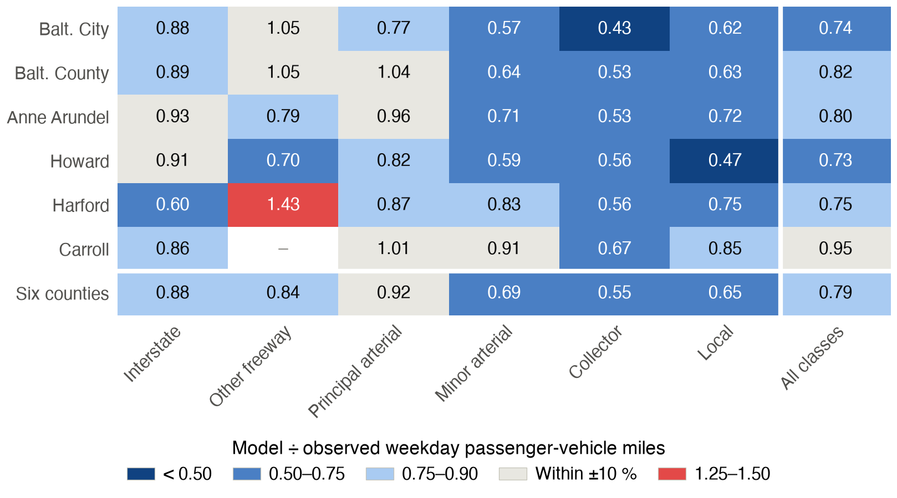
  <figcaption>Weekday passenger-vehicle miles, model ÷ observed, by county and road class, 2024.</figcaption>
</figure>

<figure markdown>
  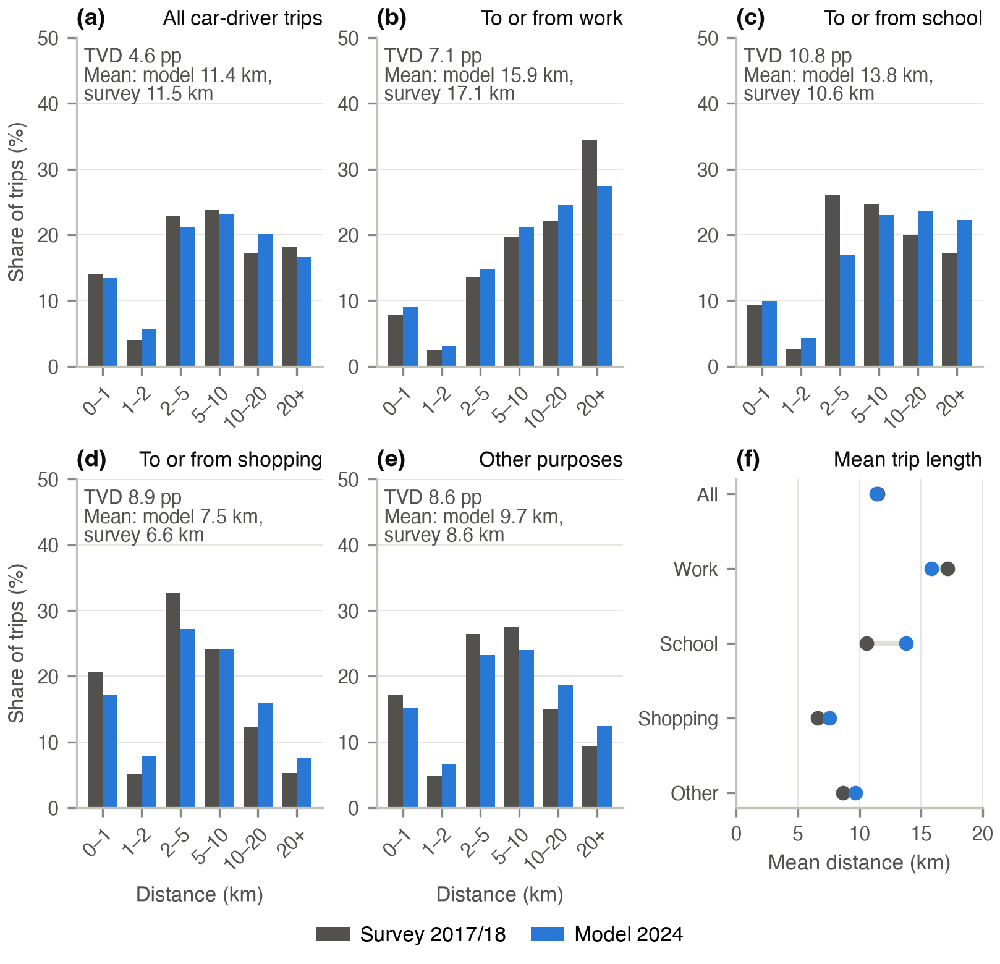
  <figcaption>Car-driver trip length, model against the travel survey, by purpose.</figcaption>
</figure>
