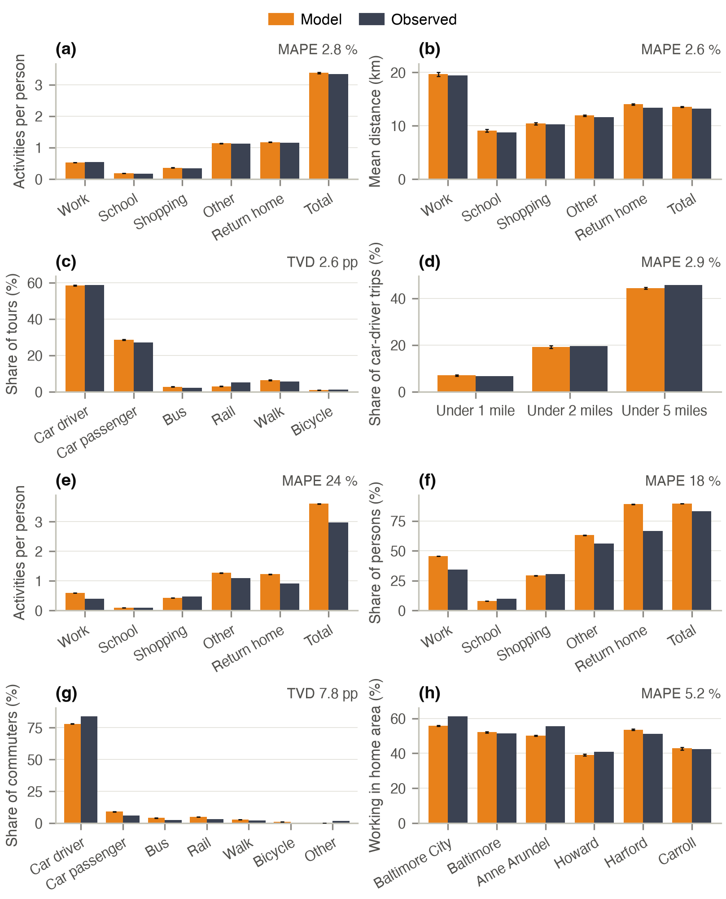
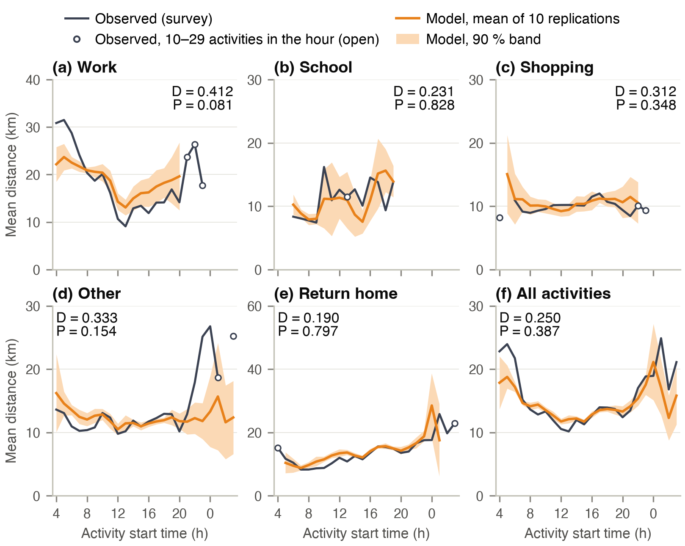
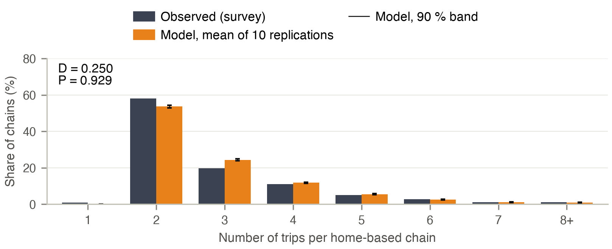
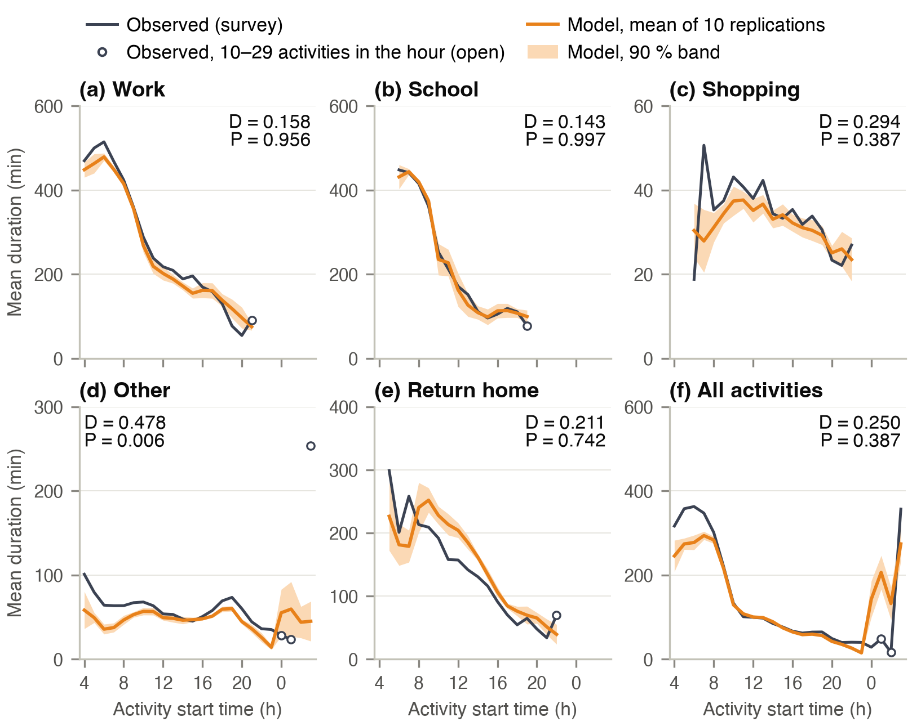
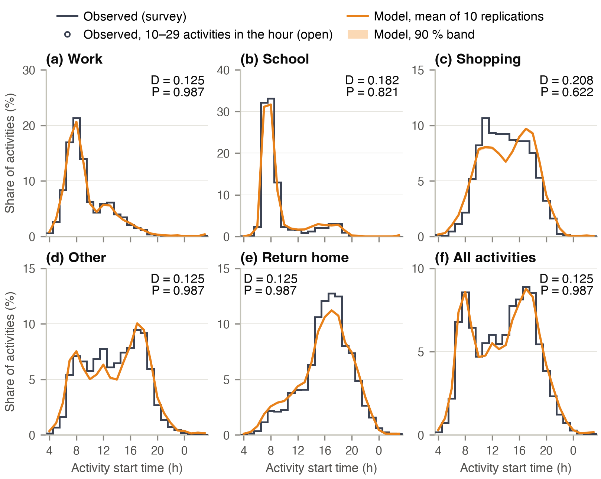
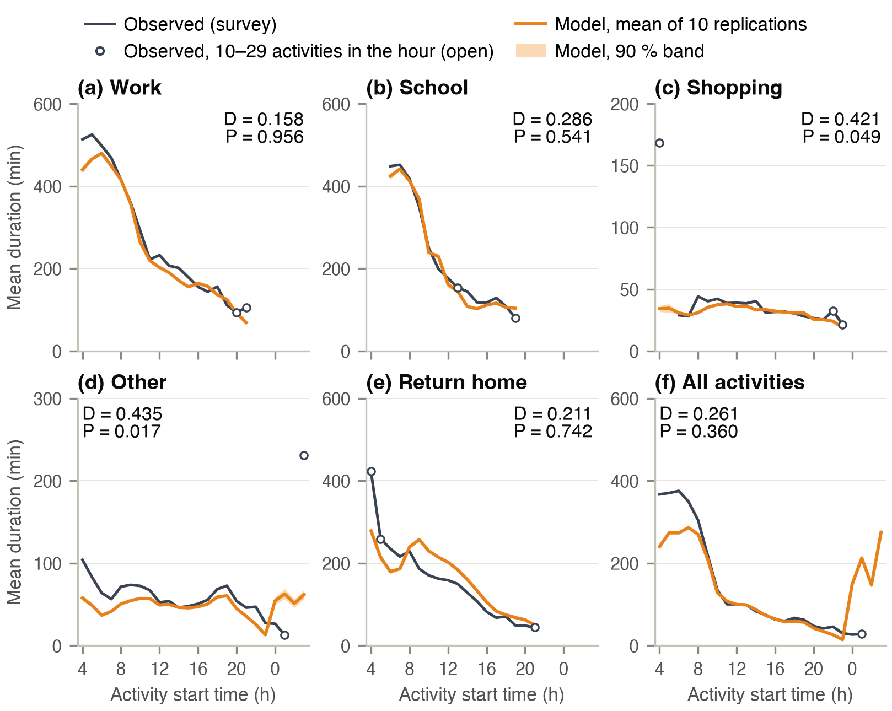
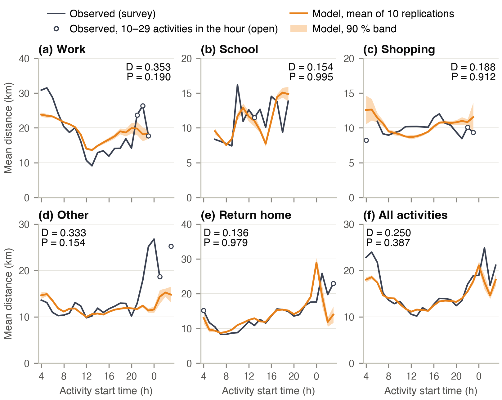
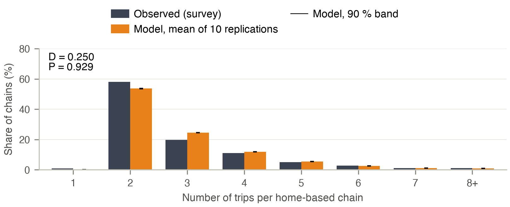
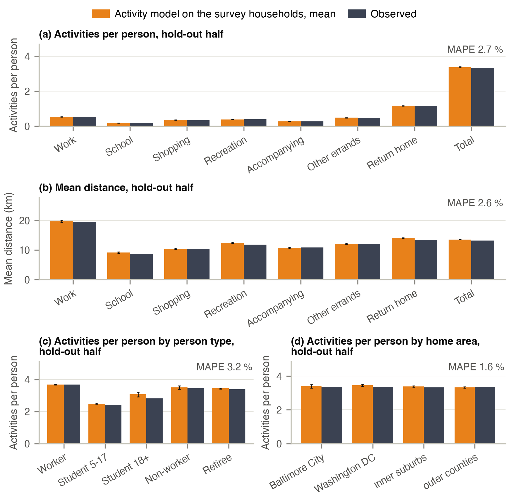
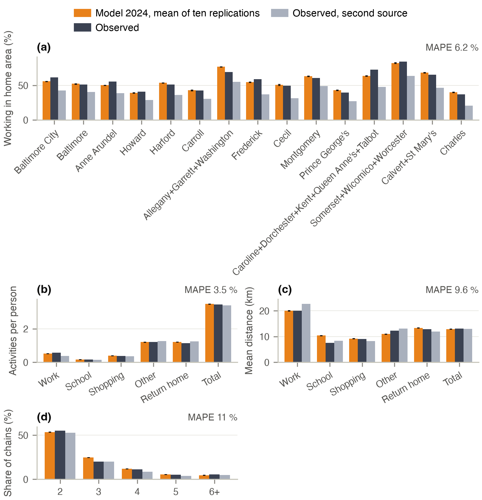

# Activities

MILES-Day is run on the observed households of the **survey hold-out half** (validation) and on the **2024 population** against independent sources: ATUS time-use diaries, the ACS 2024 commute and LODES. Error bars: ten replications.

<b>+1.2 %</b>activities on held-out households

<b>≤ 2 pp</b>start times per hour (all types but shopping)

<b>≤ 2.1 pp</b>tour mode shares, hold-out half

<b>54.4 / 54.0 %</b>work in home county, model / ACS 2024

## Estimation and validation strategy

TASHA was estimated on the 1996 Transportation Tomorrow Survey of Toronto and validated on the 2001 survey, a
different year (Roorda, Miller and Habib, 2008). No regional travel diary has been collected in Baltimore and Washington
since the 2017/18 Regional Travel Survey, so MILES-Day replaces the second survey year with a split of the households
and with independent sources for the forecast year.

| | TASHA (Roorda et al., 2008) | MILES-Day |
|---|---|---|
| Estimation data | Toronto travel survey, 1996 | Regional Travel Survey 2017/18, **estimation half** (10,889 households) |
| Verification | Same survey, same households | Estimation half: the model run on the observed households it was estimated on |
| Validation | Toronto travel survey, 2001 (another year) | **Hold-out half** (10,899 households), drawn at random by home county and household size, used in no estimation or calibration step |
| Chain test | – | The model run on the **synthetic population**, compared with the hold-out half: separates the error of the activity model from that of the population |
| Forecast year | 2001 households | **2024 population** of the land-use model against independent sources: ATUS 2021–24 time use, ACS 2024 commute, LODES flows |
| Replications | – | Ten per test; bands show their 90 % range |
| Measures | Start time, duration by start hour, trips per chain, distance by start hour; Kolmogorov–Smirnov D and P on hourly values | The same four, the same statistic; plus activities, distances and tour modes by type |

Every distribution, frequency and coefficient of MILES-Day comes from the estimation half; none is adjusted to the
hold-out half or to 2024 data. The hold-out half was consulted more than once during the specification search of some
models, so its fit is close to, but not fully, an independent test.

!!! info "How to read the figures"
    Orange: model; dark grey: observed; light grey: a second observed source. Error bars: range of the five land-use seeds or of the ten activity-model replications. Each panel shows one fit measure: for a distribution the total variation distance (TVD, percentage points of the population that would have to change class); for shares that are not one distribution, the mean absolute difference (MAD, percentage points); otherwise the mean absolute percentage error (MAPE).

## Main results

<figure markdown>
  
  <figcaption>Activity model against observed data. (a) activities per person, hold-out half; (b) mean distance, hold-out half; (c) tour mode, hold-out half; (d) car-driver trip length, hold-out half; (e) activities per person, 2024; (f) persons with the activity, 2024; (g) commute mode, 2024; (h) own-county work share, 2024.</figcaption>
</figure>

## TASHA-type validation

The four tests of TASHA's validation, in the same form, for the three settings. Observed: the weighted survey; model:
mean and 90 % band of ten replications; D and P: Kolmogorov–Smirnov statistic on the hourly values (TASHA reported P
above 0.86 for start times).

=== "Validation (hold-out half)"

    <figure markdown>
      
      <figcaption>Activity start times.</figcaption>
    </figure>
    <figure markdown>
      
      <figcaption>Mean activity duration by start hour.</figcaption>
    </figure>
    <figure markdown>
      
      <figcaption>Average distance to the activity by start hour (zone-to-zone distance for model and survey).</figcaption>
    </figure>
    <figure markdown>
      
      <figcaption>Trips per home-based chain.</figcaption>
    </figure>

=== "Verification (estimation half)"

    <figure markdown>
      
      <figcaption>Activity start times.</figcaption>
    </figure>
    <figure markdown>
      
      <figcaption>Mean activity duration by start hour.</figcaption>
    </figure>
    <figure markdown>
      
      <figcaption>Average distance to the activity by start hour.</figcaption>
    </figure>
    <figure markdown>
      
      <figcaption>Trips per home-based chain.</figcaption>
    </figure>

=== "Chain test (synthetic population)"

    <figure markdown>
      
      <figcaption>Activity start times, model on the synthetic population against the hold-out half.</figcaption>
    </figure>
    <figure markdown>
      
      <figcaption>Mean activity duration by start hour.</figcaption>
    </figure>
    <figure markdown>
      
      <figcaption>Average distance to the activity by start hour.</figcaption>
    </figure>
    <figure markdown>
      
      <figcaption>Trips per home-based chain.</figcaption>
    </figure>

### Kolmogorov–Smirnov statistics

P ≥ 0.05: the model's hourly distribution is not distinguishable from the survey's at the 5 %
level. Durations of shopping and other activities are the exception: gaps between episodes follow from independently
drawn start times, and stays at home between tours are long.

| Measure | Activity | Verification (estimation half) | Validation (hold-out half) | Chain test (synthetic population) |
|---|---|---|---|---|
| Start time | Work | D 0.083 · P 1.00 | D 0.125 · P 0.99 | D 0.125 · P 0.99 |
| Start time | School | D 0.136 · P 0.98 | D 0.190 · P 0.80 | D 0.182 · P 0.82 |
| Start time | Shopping | D 0.208 · P 0.62 | D 0.208 · P 0.62 | D 0.208 · P 0.62 |
| Start time | Other | D 0.167 · P 0.86 | D 0.167 · P 0.86 | D 0.125 · P 0.99 |
| Start time | Return home | D 0.125 · P 0.99 | D 0.125 · P 0.99 | D 0.125 · P 0.99 |
| Start time | All activities | D 0.125 · P 0.99 | D 0.167 · P 0.86 | D 0.125 · P 0.99 |
| Duration by start hour | Work | D 0.158 · P 0.96 | D 0.158 · P 0.96 | D 0.158 · P 0.96 |
| Duration by start hour | School | D 0.143 · P 1.00 | D 0.286 · P 0.54 | D 0.286 · P 0.54 |
| Duration by start hour | Shopping | D 0.294 · P 0.39 | D 0.444 · P 0.04 | D 0.421 · P 0.05 |
| Duration by start hour | Other | D 0.478 · P 0.01 | D 0.391 · P 0.04 | D 0.435 · P 0.02 |
| Duration by start hour | Return home | D 0.211 · P 0.74 | D 0.211 · P 0.74 | D 0.211 · P 0.74 |
| Duration by start hour | All activities | D 0.250 · P 0.39 | D 0.261 · P 0.36 | D 0.261 · P 0.36 |
| Distance by start hour | All activities | D 0.208 · P 0.62 | D 0.250 · P 0.39 | D 0.250 · P 0.39 |
| Trips per home-based chain | All activities | D 0.250 · P 0.93 | D 0.250 · P 0.93 | D 0.250 · P 0.93 |

## In detail

=== "Hold-out households"

    <figure markdown>
      
      <figcaption>(a) activities per person, hold-out half; (b) mean distance, hold-out half; (c) activities per person by person type, hold-out half; (d) activities per person by home area, hold-out half.</figcaption>
    </figure>
    

=== "Hold-out, more"

    <figure markdown>
      
      <figcaption>(a) mean distance by person type, hold-out half; (b) mean distance by home area, hold-out half; (c) activity start time, hold-out half; (d) mean activity duration, hold-out half; (e) trips per person, hold-out half; (f) mean trip length, hold-out half.</figcaption>
    </figure>
    

=== "Modes"

    <figure markdown>
      
      <figcaption>(a) tour mode, work, hold-out half; (b) tour mode, school, hold-out half; (c) tour mode, shopping, hold-out half; (d) tour mode, recreation, hold-out half; (e) tour mode, accompanying, hold-out half; (f) tour mode, other errands, hold-out half.</figcaption>
    </figure>
    

=== "Modes, more"

    <figure markdown>
      
      <figcaption>(a) car-driver share of tours by household cars; (b) car-driver share of tours by distance; (c) car-driver trip length, hold-out half; (d) discretionary activities of workers on workdays, hold-out half; (e) discretionary activities on separate tours, hold-out half.</figcaption>
    </figure>
    

=== "2024 activities"

    <figure markdown>
      
      <figcaption>(a) activities per person, 2024; (b) persons with the activity, 2024; (c) mean activity duration, 2024; (d) activity start time, 2024; (e) trip mode, all trips, 2024; (f) commute mode, 2024.</figcaption>
    </figure>
    

=== "2024 geography"

    <figure markdown>
      
      <figcaption>(a) own-county work share, 2024; (b) activities per person, Baltimore area, 2024; (c) mean distance, Baltimore area, 2024; (d) trips per home-based chain, 2024.</figcaption>
    </figure>
    

=== "2024 commute"

    <figure markdown>
      
      <figcaption>(a) departure from home to work, 2024; (b) travel time to work, 2024; (c) commute shares, 2024; (d) travel time to work, 2024.</figcaption>
    </figure>
    

## Scorecard

<b>43</b> comparisons · 25 within 13 close 5 outside

| Compared variable | Fit | Result | Note |
|---|---:|:---:|---|
| Activities per person, hold-out half | MAPE 2.8 % | within |  |
| Mean distance, hold-out half | MAPE 2.6 % | within |  |
| Tour mode, hold-out half | TVD 2.6 pp | within |  |
| Car-driver trip length, hold-out half | MAD 0.6 pp | within |  |
| Activities per person, 2024 | MAPE 24 % | outside | ATUS: 279 Maryland diaries |
| Persons with the activity, 2024 | MAD 8.4 pp | close | ATUS: 279 Maryland diaries |
| Commute mode, 2024 | TVD 7.8 pp | close |  |
| Own-county work share, 2024 | MAD 2.8 pp | within |  |
| Activities per person, hold-out half | MAPE 2.7 % | within |  |
| Mean distance, hold-out half | MAPE 2.6 % | within |  |
| Activities per person by person type, hold-out half | MAPE 3.2 % | within |  |
| Activities per person by home area, hold-out half | MAPE 1.6 % | within |  |
| Mean distance by person type, hold-out half | MAPE 7.1 % | close |  |
| Mean distance by home area, hold-out half | MAPE 6.1 % | close |  |
| Activity start time, hold-out half | TVD 4.0 pp | within |  |
| Mean activity duration, hold-out half | MAPE 11 % | outside |  |
| Trips per person, hold-out half | MAPE 0.7 % | within |  |
| Mean trip length, hold-out half | MAPE 5.2 % | close |  |
| Tour mode, work, hold-out half | TVD 6.4 pp | close |  |
| Tour mode, school, hold-out half | TVD 1.8 pp | within |  |
| Tour mode, shopping, hold-out half | TVD 5.1 pp | close |  |
| Tour mode, recreation, hold-out half | TVD 2.5 pp | within |  |
| Tour mode, accompanying, hold-out half | TVD 5.0 pp | within |  |
| Tour mode, other errands, hold-out half | TVD 1.5 pp | within |  |
| Car-driver share of tours by household cars | MAD 1.7 pp | within |  |
| Car-driver share of tours by distance | MAD 2.2 pp | within |  |
| Car-driver trip length, hold-out half | MAD 0.6 pp | within |  |
| Discretionary activities of workers on workdays, hold-out half | TVD 3.1 pp | within |  |
| Discretionary activities on separate tours, hold-out half | MAD 0.7 pp | within |  |
| Activities per person, 2024 | MAPE 24 % | outside | ATUS: 279 Maryland diaries |
| Persons with the activity, 2024 | MAD 8.4 pp | close | ATUS: 279 Maryland diaries |
| Mean activity duration, 2024 | MAPE 9.6 % | close |  |
| Activity start time, 2024 | TVD 4.5 pp | within |  |
| Trip mode, all trips, 2024 | TVD 2.5 pp | within |  |
| Commute mode, 2024 | TVD 7.8 pp | close |  |
| Departure from home to work, 2024 | TVD 7.7 pp | close |  |
| Travel time to work, 2024 | TVD 16.1 pp | outside | ACS: self-reported door-to-door time, rounded |
| Commute shares, 2024 | MAD 8.5 pp | close |  |
| Travel time to work, 2024 | MAPE 14 % | outside | ACS: self-reported door-to-door time, rounded |
| Own-county work share, 2024 | MAD 3.6 pp | within |  |
| Activities per person, baltimore area, 2024 | MAPE 3.5 % | within |  |
| Mean distance, baltimore area, 2024 | MAPE 9.6 % | close |  |
| Trips per home-based chain, 2024 | MAD 1.7 pp | within |  |
