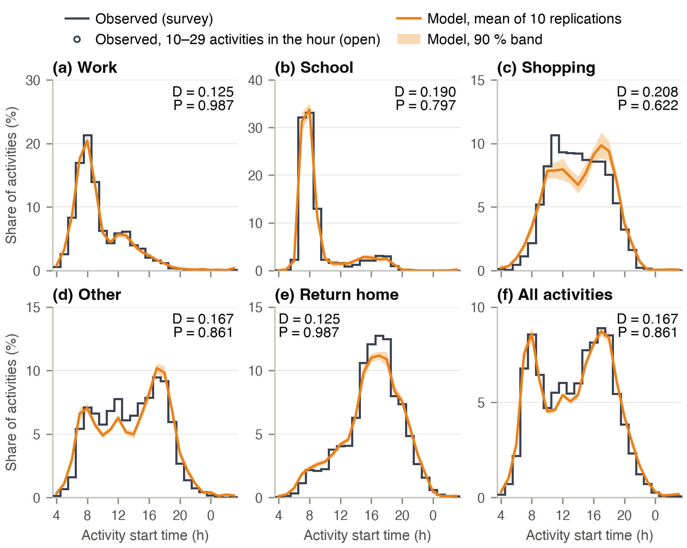
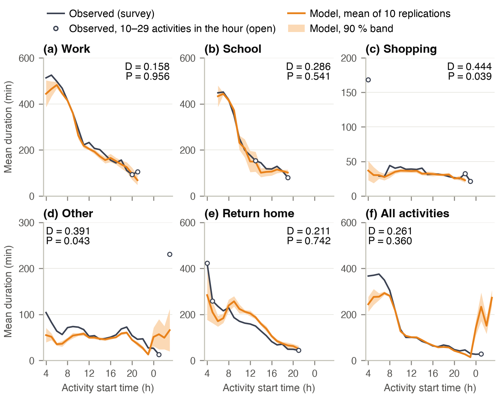
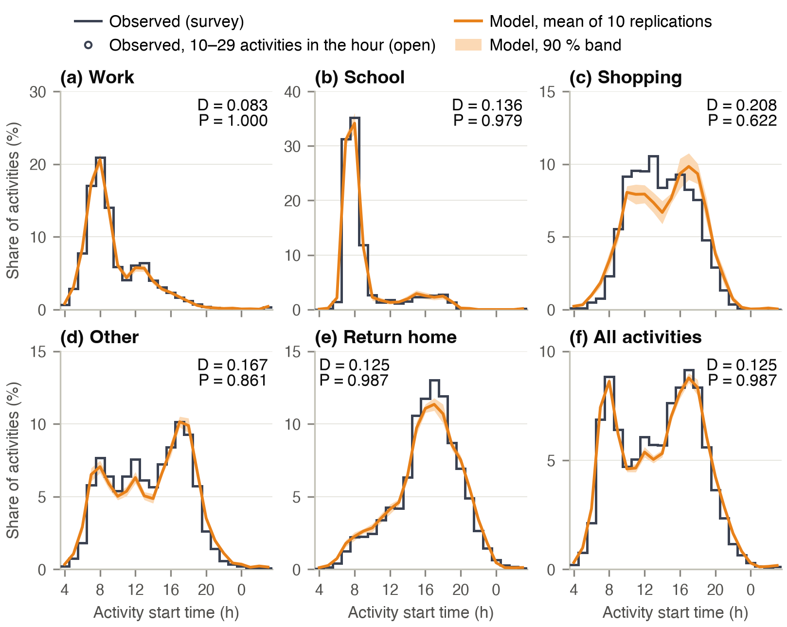
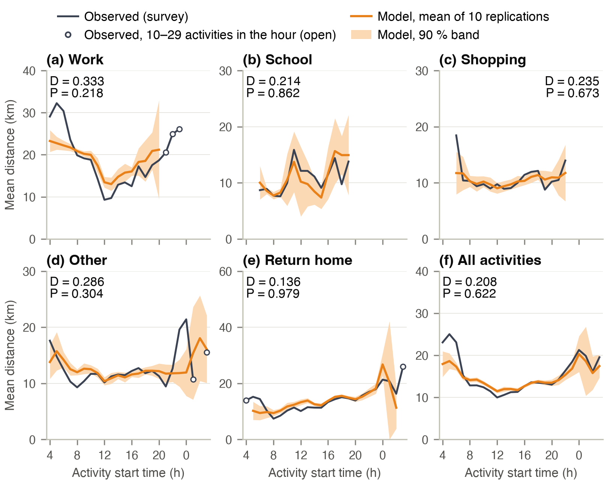
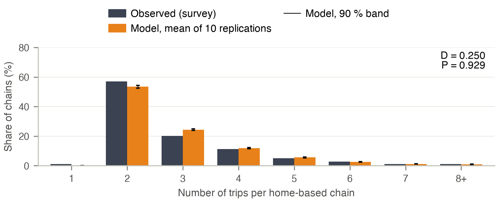
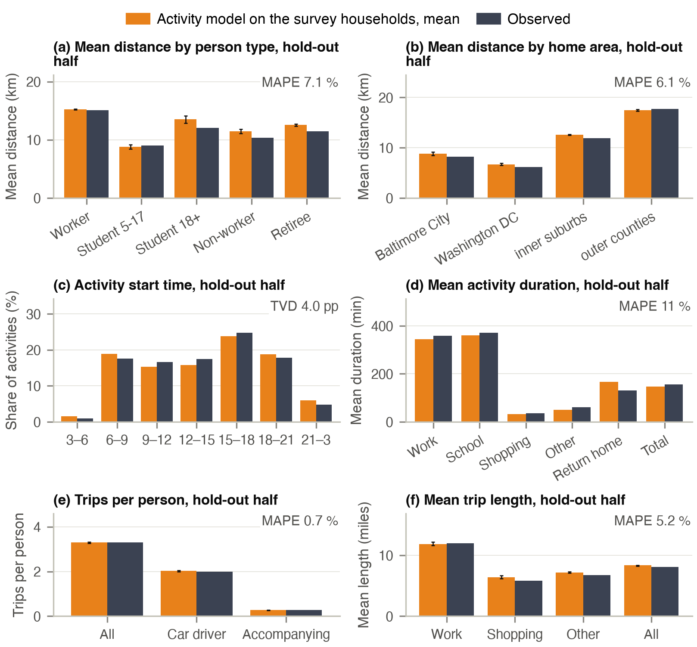
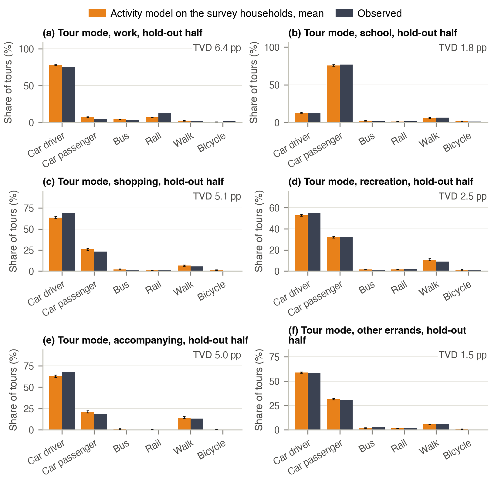
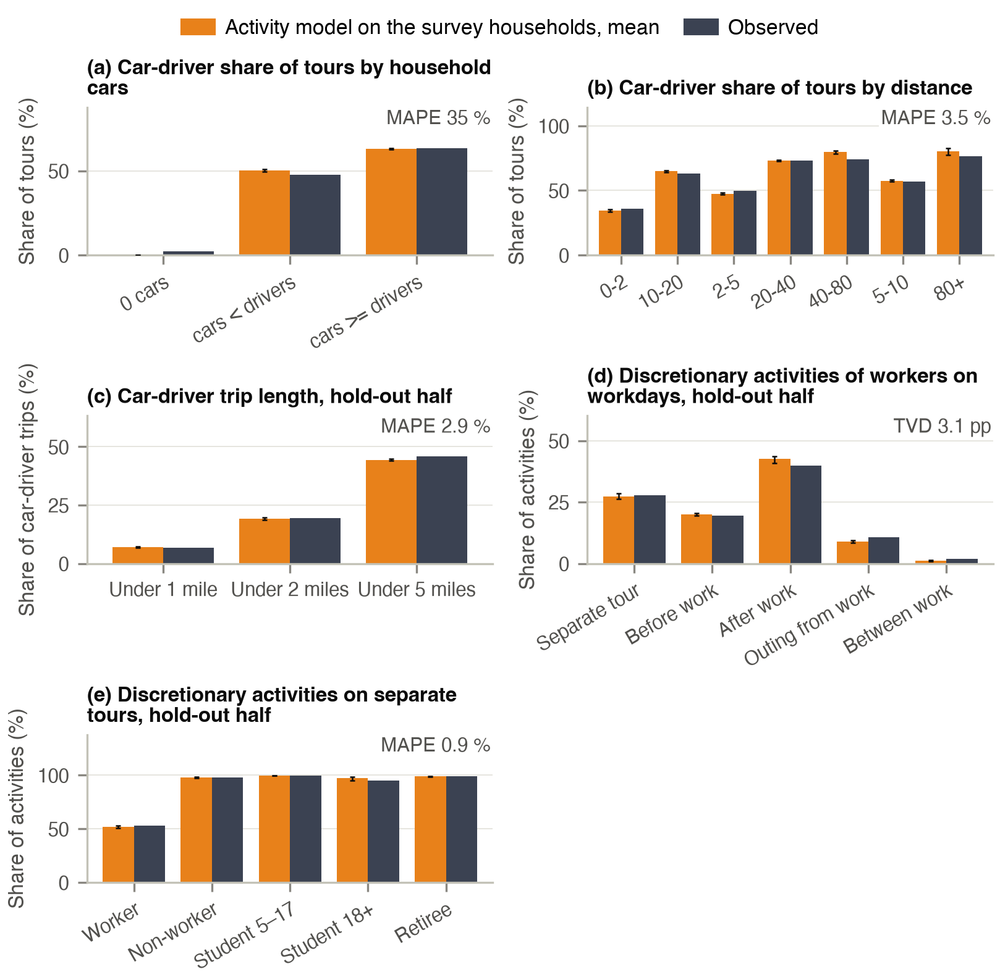
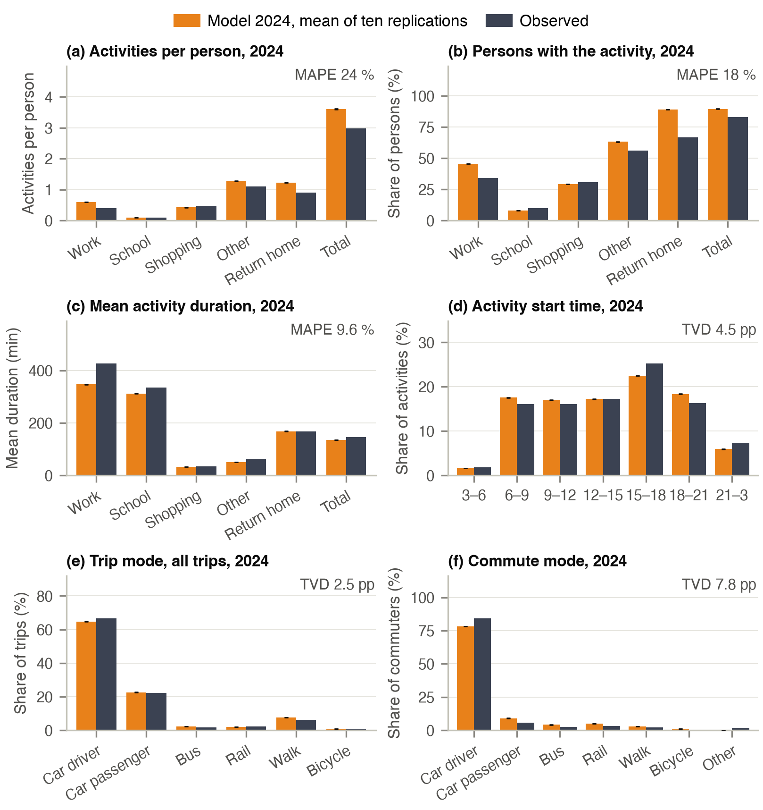
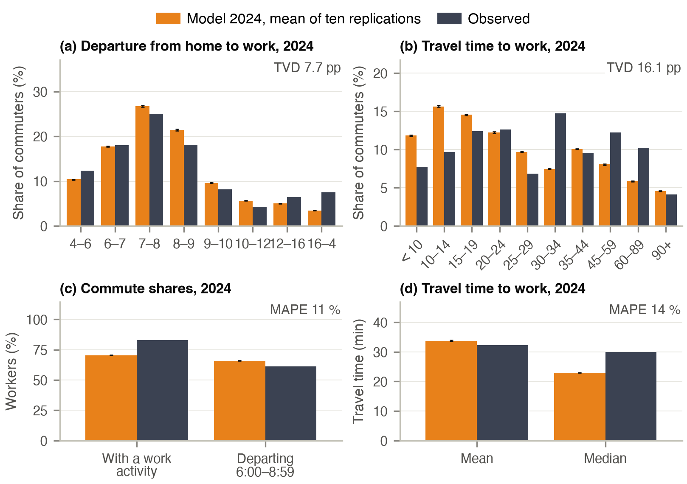

# Activities

MAST is run on the observed households of the **survey hold-out half** (validation) and on the **2024 population**
against independent sources: ATUS time-use diaries, the ACS 2024 commute and LODES. Error bars: ten replications.

<b>+1.2 %</b>more activities than the survey reports for the hold-out households (76,105 against 75,203)

<b>≤ 2 pp</b>difference in the share of activities starting in each hour (all types except shopping: 3.2 pp)

<b>≤ 2.1 pp</b>difference in each tour mode share, hold-out households

<b>54.4 %</b>of workers work in their home county or county group, 2024 (ACS: 54.0 %)

## Estimation and validation strategy

TASHA was estimated on the 1996 Transportation Tomorrow Survey of Toronto and validated on the 2001 survey, a
different year (Roorda, Miller and Habib, 2008). No regional travel diary has been collected in Baltimore and Washington
since the 2017/18 Regional Travel Survey, so MAST replaces the second survey year with a split of the households and
with independent sources for the forecast year.

| | TASHA (Roorda et al., 2008) | MAST |
|---|---|---|
| Estimation data | Toronto travel survey, 1996 | Regional Travel Survey 2017/18, **estimation half** (10,889 households) |
| Verification | Same survey, same households | Estimation half: the model run on the observed households it was estimated on (22,462 persons aged 5+) |
| Validation | Toronto travel survey, 2001 (another year) | **Hold-out half** (10,899 households, 22,531 persons aged 5+), drawn at random by home county and household size, used in no estimation or calibration step |
| Chain test | – | The model run on the **synthetic population** of 2016, compared with the hold-out half: separates the error of the activity model from that of the population |
| Forecast year | 2001 households | **2024 population** of the land-use model against ATUS 2021–24 time use, the ACS 2024 commute and LODES flows |
| Replications | – | Ten per test; bands show their 90 % range |
| Measures | Start time, duration by start hour, trips per chain, distance by start hour; Kolmogorov–Smirnov D and P on hourly values | The same four, the same statistic; plus activities, distances and tour modes by type |

Every distribution, frequency and coefficient of MAST comes from the estimation half; none is adjusted to the
hold-out half or to 2024 data. The hold-out half was consulted during the specification search of some models, so its
fit is close to, but not fully, an independent test.

<i style="background:#e8811a"></i>Model<i style="background:#3b4252"></i>Observed<i style="background:#b5b3ab"></i>Second observed source<i class="bar"></i>Range of the ten activity-model replications

| Fit measure in the panel title | Used for | Meaning |
|---|---|---|
| **TVD**, percentage points | a distribution (the classes add up to 100 %) | share of the population that would have to change class to match the observed |
| **MAPE**, % | rates, means and counts | mean absolute difference as a percentage of the observed value |

## Main results

<figure markdown>
  
  <figcaption>Activity model against observed data. Survey hold-out households: (a) activities per person; (b) mean distance; (c) tour mode; (d) short car-driver trips. 2024 population: (e) activities per person; (f) persons with the activity; (g) mode to work; (h) work in home county. Observed: travel survey 2017/18 (a–d); ATUS 2021–2024 (e, f); ACS 2024 (g, h).</figcaption>
</figure>

On the hold-out half the model generates 1.2 % more activities than observed and distances are 2.4 % long, errors of
the same size and sign as in the verification (+0.3 % activities, +3.4 % distance): the model loses little precision on
unseen households. Activities per person by type are within 5.7 % of the survey, mean distances within 5.8 %, tour mode
shares within 2.1 points (rail 3.0 against 5.1 %) and the shares of car-driver trips under 1, 2 and 5 miles within 1.4
points. In the chain test, on the synthetic population of 2016, the model gives +3.3 % activities and −0.1 % distance
against the hold-out half, so the synthetic population adds about two points of activities.

| Activity type | Model, activities | Observed | Difference (%) | Model, mean distance (km) | Observed (km) | Difference (%) |
|---|---:|---:|---:|---:|---:|---:|
| Work | 11,895 | 12,216 | −2.6 | 19.68 | 19.45 | +1.2 |
| School | 4,178 | 3,952 | +5.7 | 9.10 | 8.75 | +4.1 |
| Shopping | 8,090 | 7,744 | +4.5 | 10.43 | 10.30 | +1.3 |
| Other | 25,575 | 25,413 | +0.6 | 11.93 | 11.66 | +2.3 |
| Return home | 26,367 | 25,880 | +1.9 | 14.02 | 13.42 | +4.5 |
| Total | 76,105 | 75,203 | +1.2 | 13.55 | 13.23 | +2.4 |

Hold-out half of the travel survey. Model: mean of ten replications on the observed households (persons aged 5 and
over); observed: weighted survey activities scaled to the 22,531 persons simulated. Distance: car-distance skim between
the zones of origin and destination, on both sides.

## TASHA-type validation

The four tests of TASHA's validation, in the same form. Observed: the weighted survey; model: mean and 90 % band of ten
replications; D and P: Kolmogorov–Smirnov statistic and p-value on the hourly values (TASHA reported P above 0.86 for
start times).

=== "Validation (hold-out half)"

    <figure markdown>
      
      <figcaption>Activity start times. (a) work; (b) school; (c) shopping; (d) other; (e) return home; (f) all activities.</figcaption>
    </figure>
    <figure markdown>
      
      <figcaption>Mean activity duration by start hour.</figcaption>
    </figure>
    <figure markdown>
      
      <figcaption>Average distance to the activity by start hour (zone-to-zone distance for model and survey).</figcaption>
    </figure>
    <figure markdown>
      
      <figcaption>Trips per home-based chain.</figcaption>
    </figure>

=== "Verification (estimation half)"

    <figure markdown>
      
      <figcaption>Activity start times. (a) work; (b) school; (c) shopping; (d) other; (e) return home; (f) all activities.</figcaption>
    </figure>
    <figure markdown>
      
      <figcaption>Mean activity duration by start hour.</figcaption>
    </figure>
    <figure markdown>
      
      <figcaption>Average distance to the activity by start hour.</figcaption>
    </figure>
    <figure markdown>
      
      <figcaption>Trips per home-based chain.</figcaption>
    </figure>

### Kolmogorov–Smirnov statistics

| Measure | Activity | Verification (estimation half) | Validation (hold-out half) |
|---|---|---|---|
| Start time | Work | D 0.083, P 1.00 | D 0.125, P 0.99 |
| Start time | School | D 0.136, P 0.98 | D 0.190, P 0.80 |
| Start time | Shopping | D 0.208, P 0.62 | D 0.208, P 0.62 |
| Start time | Other | D 0.167, P 0.86 | D 0.167, P 0.86 |
| Start time | Return home | D 0.125, P 0.99 | D 0.125, P 0.99 |
| Start time | All activities | D 0.125, P 0.99 | D 0.167, P 0.86 |
| Duration by start hour | Work | D 0.158, P 0.96 | D 0.158, P 0.96 |
| Duration by start hour | School | D 0.143, P 1.00 | D 0.286, P 0.54 |
| Duration by start hour | Shopping | D 0.294, P 0.39 | D 0.444, P 0.04 |
| Duration by start hour | Other | D 0.478, P 0.01 | D 0.391, P 0.04 |
| Duration by start hour | Return home | D 0.211, P 0.74 | D 0.211, P 0.74 |
| Duration by start hour | All activities | D 0.250, P 0.39 | D 0.261, P 0.36 |
| Distance by start hour | Work | – | D 0.412, P 0.08 |
| Distance by start hour | School | – | D 0.231, P 0.83 |
| Distance by start hour | Shopping | – | D 0.312, P 0.35 |
| Distance by start hour | Other | – | D 0.333, P 0.15 |
| Distance by start hour | Return home | – | D 0.190, P 0.80 |
| Distance by start hour | All activities | D 0.208, P 0.62 | D 0.250, P 0.39 |
| Trips per home-based chain | All activities | D 0.250, P 0.93 | D 0.250, P 0.93 |

D and P use the hours with at least 10 (durations) or 30 (distances) observed activities. –: not reported by type.

Start times are within 2 percentage points of the survey in every hour for all types except shopping (within 3.2).
Durations by start hour follow the survey for work, school, return home and all activities, but not for shopping and
other activities: the mean durations on the hold-out half are 345 against 358 min (work), 33 against 36 min (shopping)
and 50 against 60 min (other), and stays at home between tours are long (167 against 131 min), because gaps between
episodes follow from independently drawn start times. Home-based chains carry 2.86 trips against 2.82 on the hold-out
half; the model forms fewer two-trip chains (53.7 against 58.0 %) and more three-trip chains (24.4 against 19.8 %). Work
trips are long at some hours.

## The 2024 population

The unchanged activity model, with the workplace attendance of the base period, is applied to the 2024 land-use
population (seed closest to the five-seed mean, 10 % household sample, ten replications).

| Measure | Model | Observed |
|---|---:|---:|
| *Activities per person, residents 15+, weekday (ATUS)* | | |
| Work | 0.597 | 0.399 |
| School | 0.089 | 0.099 |
| Shopping | 0.422 | 0.479 |
| Other | 1.278 | 1.096 |
| Return home | 1.224 | 0.909 |
| Persons with a work activity (%) | 45.5 | 34.2 |
| *Commute, employed residents 16+ (ACS 2024)* | | |
| Workers with a work activity (%)¹ | 70.4 | 82.8 |
| Departing 6:00–8:59 (%) | 65.9 | 61.2 |
| Median travel time to work (min) | 23.0 | 30.0 |
| Car driver / transit (%) | 78.1 / 9.0 | 84.1 / 5.8 |
| Working in home county or county group (%) | 54.4 | 54.0 |
| *Car-driver travel of residents of the six counties (travel survey 2017/18)* | | |
| Miles per resident | 18.7 | 17.3 |
| Mean trip length, tract to tract (km) | 11.4 | 11.5 |

Model: mean of ten replications; standard deviation over replications at most 0.004 activities per person and 0.1
percentage points or minutes. ATUS: weekday diaries 2021–2024, Maryland residents 15+ (n = 279). ACS: commuters;
transit: bus and rail. Car-driver travel: executed car trips of the assignment, mean of five seeds; survey weighted; trip
length: straight line between the tracts of the trip ends, for model and survey alike. ¹ Workplace attendance of the base
period. Sources: ATUS, ACS PUMS, LODES.

**Timing and geography transfer to 2024.** Departure to work gives D = 0.292, P = 0.216 against the ACS 2024, and ATUS
start times are not rejected at 5 % except for school (D = 0.739, P < 0.001). The own-county work share is 54.4 % against
54.0 % (ACS), county flows correlate with LODES at 0.978 (ACS: 0.979), and car-driver trips match the survey in length
when measured alike, while the residents drive 8 % more miles per head than in the survey.

**Activity levels do not transfer.** With the attendance of the base period, 70.4 % of workers make a work activity,
12.4 points fewer than the ACS share of workers neither at home nor absent and 23.3 points more than the ATUS diaries
(47.1 %); 45.5 % of residents aged 15 and over have a work activity, about 11 points above the ATUS (34.2 %).
Return-home activities are 34.7 % above the ATUS. Between 2017–2019 and 2021–2024 other activities fell by 24.0 % in the
ATUS, while the model, whose discretionary frequencies depend on the day's work or school episode but not on time,
changes them by +3.4 %. The ATUS sample is small, so the level comparison is uncertain; the direction of the change is
not.

**Destinations.** Against LODES 2022 jobs by zone, work arrivals have a TVD of 8.4 percentage points over 599 zones (3.9
over 21 districts) and shopping against retail and food-service jobs 14.3; recreation (29.6) and other activities (42.2)
follow no single employment sector. Home–work flows between the 21 districts have R² = 0.921 (land-use workplaces
0.937); commutes are 18.6 against 23.5 km and 29 % against 21 % within the home district, and the distance
distributions coincide at 0.77.

**Commute mode.** The commute is longer and more transit-oriented than in the ACS: mean travel time 33.8 against
32.3 min, car driver 78.1 against 84.1 % and rail 4.9 against 3.2 %. The rail excess lies in the Baltimore region (4.0
against 1.5 %). It is consistent with the fall in rail ridership after 2019, which the 2017/18 mode choice cannot
reflect, and with coding a tour as rail when any of its trips uses rail. Over all tours of 2024 the mode shares stay
close to the 2017/18 survey: car driver 62.9 against 65.3 %, car passenger 24.2 against 23.6 %, walk 6.6 against 4.6 %
and transit 5.4 against 5.8 %.

## In detail

On the survey households the model is compared with the hold-out half (distances on the zone-to-zone car skim on both
sides). In 2024 it is compared with the ATUS 2021–2024 weekday diaries of Maryland residents aged 15 and over (279
diaries), the ACS 2024 commuters, LODES 2022 and, for the Baltimore metropolitan area, the travel survey 2017/18 and the
NHTS 2017. Recreation, accompanying and other errands are the parts of other activities.

=== "Hold-out households"

    <figure markdown>
      
      <figcaption>(a) activities per person and (b) mean trip distance by activity type; (c) activities per person by person type and (d) by home area.</figcaption>
    </figure>

=== "Hold-out, more"

    <figure markdown>
      
      <figcaption>Mean distance (a) by person type and (b) by home area; (c) start time by three-hour period; (d) mean duration by type; (e) trips per person; (f) mean trip length by purpose.</figcaption>
    </figure>

=== "Modes"

    <figure markdown>
      
      <figcaption>Tour mode shares by purpose of the main activity, hold-out half: (a) work; (b) school; (c) shopping; (d) recreation; (e) accompanying; (f) other errands.</figcaption>
    </figure>

=== "Modes, more"

    <figure markdown>
      
      <figcaption>Car use on the survey households, hold-out half: car-driver share of tours (a) by household cars and (b) by tour distance; (c) car-driver trips under 1, 2 and 5 miles; (d) placement of workers' discretionary activities; (e) share on a separate tour, by person type.</figcaption>
    </figure>

=== "2024 activities"

    <figure markdown>
      
      <figcaption>Maryland residents, 2024: (a) activities per person, (b) participation, (c) mean duration and (d) start time by period against the ATUS 2021–2024; (e) trip mode against the travel survey 2017/18; (f) mode to work against the ACS 2024.</figcaption>
    </figure>

=== "2024 geography"

    <figure markdown>
      
      <figcaption>2024: (a) workers employed in their home county or county group against the ACS 2024 and LODES 2022; (b) activities per person, (c) mean distance and (d) trips per chain, Baltimore metropolitan area, against the travel survey 2017/18 and NHTS 2017.</figcaption>
    </figure>

=== "2024 commute"

    <figure markdown>
      
      <figcaption>Journey to work, employed Maryland residents, against the ACS 2024: (a) departure period; (b) travel time (min); (c) workers with a work activity and commuters departing 6:00–8:59; (d) mean and median travel time.</figcaption>
    </figure>

In 2024 work durations are 348 min against 426 min in the ATUS, other activities 49 against 64 min. In the Baltimore
metropolitan area the model generates 3.34 to 3.40 activities per person aged 5 and over against 3.46 in the travel
survey of 2017/18 and 3.40 in the NHTS 2017, and school trips are 10.6 km long against 7.5 and 8.3 km reported. The
own-county work shares are within 5 points of the ACS 2024 in 13 of the 15 county areas; the exceptions are the Eastern
Shore counties (−10.7 points) and Western Maryland (+7.2).
