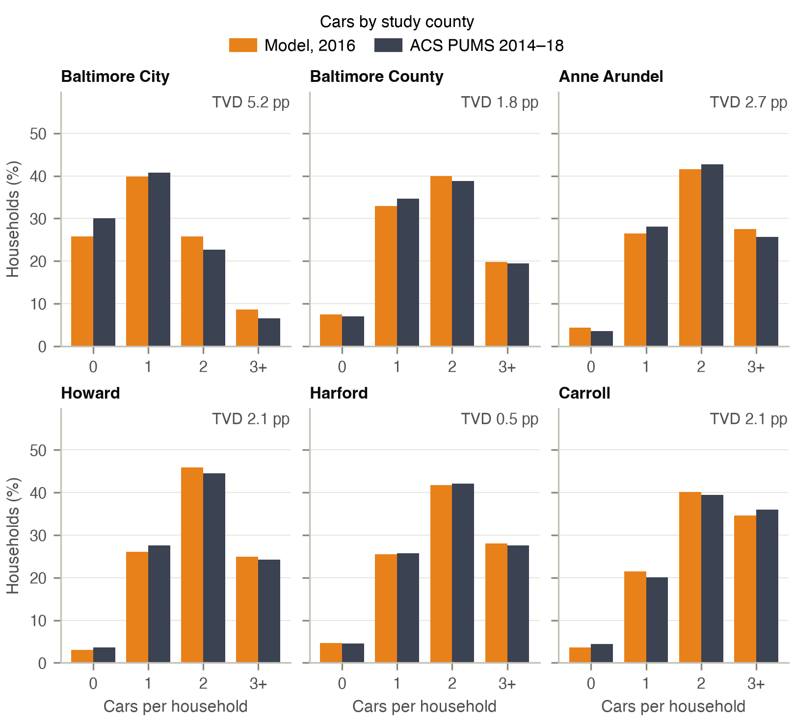

# County view

The validation county by county: all 24 Maryland counties for the synthetic population, with every variable shown for the
six counties of the study area (Baltimore City and the counties of Baltimore, Anne Arundel, Howard, Harford and Carroll).

<i style="background:#e8811a"></i>Model<i style="background:#3b4252"></i>Observed (ACS)

| Figure | What it shows |
|---|---|
| Heatmap | total variation distance (TVD) between model and ACS for each county and variable, in percentage points: the share of households (or persons) that would have to change class to match the ACS; darker = larger; the six study counties (bold) are above the line |
| Bars by county | the distribution of one variable in each study county, model next to ACS |

County samples of the ACS are small: differences of a few points in the smaller counties are within its sampling error.

## Synthetic population, 2016

The base population against the ACS PUMS 2014–2018, by county. Median TVD over all county × variable cells **1.8 pp**
(study counties 2.0 pp); by variable from 0.4 pp (age, sex) to 3.4 pp (household income). The largest gap is household size in
Baltimore City, where one-person households are too few.

<figure markdown>
  
  <figcaption>Synthetic population of 2016 against the ACS PUMS 2014–2018: total variation distance by county and variable.</figcaption>
</figure>

### Every variable in the study counties

=== "Household size"

    

=== "Cars"

    

=== "Household income"

    

=== "Age"

    

=== "Employment, 16+"

    

=== "Sex"

    

=== "Adults 18–34 with parents"

    

## Land use, 2024, and all stages in the study counties

Results of this section are updated after the final runs. Traffic and vehicle-miles by county are on the
[Traffic](traffic.md#regional-traffic) page.
