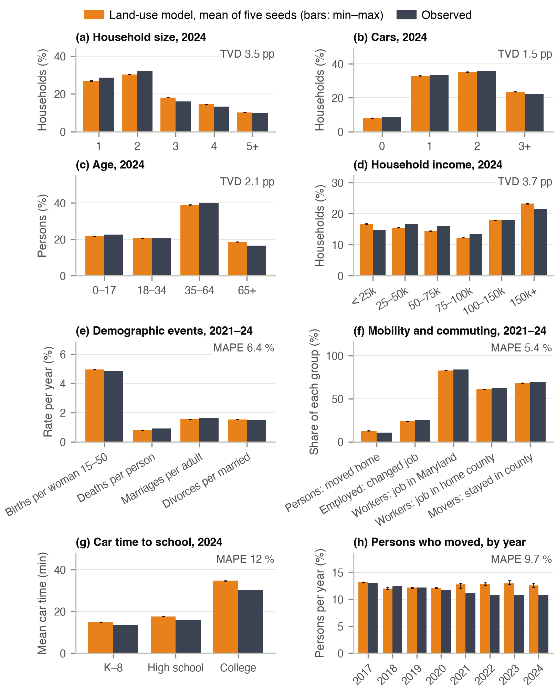
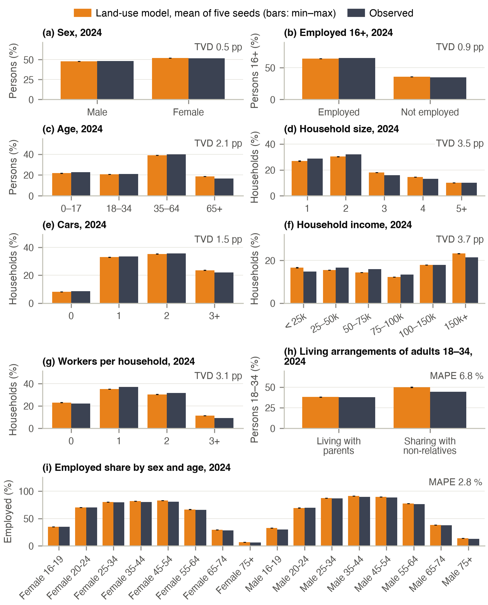

# Land use

The land-use model is calibrated on 2017–2020 and tested **out of sample on 2021–2024** against the ACS, the Census
population estimates and components of change, JOLTS, building permits and the ACS county-to-county flows. Model: mean
of five seeds.

<b>0.995</b>correlation between the modelled and the ACS county-to-county commuting flows, 2021–24

<b>1.5–3.7 pp</b>TVD of household size, cars, age and household income from the ACS 2020–24; every class within 2.1 pp

<b>≤ 6 %</b>difference of the birth, marriage and divorce rates from the observed rates, 2021–24

<b>12.8 %</b>of persons moved home in a year, 2021–24 (ACS: 10.9 %)

<i style="background:#e8811a"></i>Model<i style="background:#3b4252"></i>Observed<i style="background:#b5b3ab"></i>Second observed source<i class="bar"></i>Range of the five land-use seeds

| Fit measure in the panel title | Used for | Meaning |
|---|---|---|
| **TVD**, percentage points | a distribution (the classes add up to 100 %) | share of the population that would have to change class to match the observed |
| **MAPE**, % | rates, means and counts | mean absolute difference as a percentage of the observed value |

## Main results

<figure markdown>
  
  <figcaption>Land use against observed data, Maryland. (a) household size, 2024; (b) cars, 2024; (c) age, 2024; (d) household income, 2024; (e) demographic events, 2021–24; (f) mobility and commuting, 2021–24; (g) car time to school, 2024; (h) persons who moved, by year. Observed: ACS PUMS 2020–2024 (a–d); sources of the table below (e, f, h); travel survey 2017/18 (g).</figcaption>
</figure>

In 2024 household size, cars, age and household income are within 2.1 points of the ACS 2020–2024 in every class, and
no share varies by more than 0.4 points across the seeds. Commuting is stable: 82.8 % of Maryland residents work in
Maryland in 2021–2024 (ACS 84.1 %). Births, marriages and divorces are within 6 % of the observed rates out of sample,
but deaths are 12 % low, as the death rates do not follow the higher mortality of 2021–2023. The move rate is the
largest out-of-sample miss: 12.6 to 12.9 % in each year of 2021–2024 against 10.8 to 11.2 % observed, after agreeing
within 0.5 points in 2017–2020; the observed rate fell after 2020 while the calibrated model kept its 2017–2020 level.
One-person households are 2.4 points too few, an error inherited from the base population, and car ownership is within
1.3 points of the ACS in every class.

## Out-of-sample table

| Quantity | Model 2017–20 | Observed | Model 2021–24 | Observed |
|---|---:|---:|---:|---:|
| *Consistency checks (imposed)* | | | | |
| Population / Census estimate | 0.999 | 1 | 0.995 | 1 |
| Counties within ±2 % of the estimate (of 24) | 24.0 | 24 | 22.2 | 24 |
| Employed share of persons 16+ (%) | 64.9 | 65.3 | 63.3 | 65.2 |
| Vacant share of jobs, year end (%) | 4.3 | 4.6 | 4.8 | 6.4 |
| New dwellings / permits | 1.000 | 1 | 1.000 | 1 |
| *Tests* | | | | |
| Job-to-job changes per employed (%) | 24.2 | 25.2 | 23.9 | 25.2 |
| Mean car time to work (min)¹ | 30.1 | 32.7 | 30.4 | 31.2 |
| Residents working in Maryland (%) | 83.2 | 82.7 | 82.8 | 84.1 |
| Same county, of in-state workplaces (%)² | 61.7 | 62.2 | 61.2 | 62.2 |
| Persons who moved (%) | 12.4 | 12.4 | 12.8 | 10.9 |
| Mover flows, correlation with ACS 2016–20 | 0.970 | – | 0.946 | – |
| Movers staying in their county (%) | 71.9 | 68.9 | 68.0 | 68.9 |
| Births per woman 15–50 | 0.0509 | 0.0510 | 0.0495 | 0.0482 |
| Deaths per person | 0.0079 | 0.0081 | 0.0080 | 0.0091 |
| Marriages per adult | 0.0169 | 0.0169 | 0.0156 | 0.0166 |
| Divorces per married person | 0.0155 | 0.0154 | 0.0154 | 0.0147 |
| Households of 1 person (%) | 24.4 | 27.6 | 26.2 | 28.6 |
| 2 persons | 30.8 | 32.5 | 30.4 | 32.1 |
| 3 persons | 18.5 | 16.4 | 18.2 | 16.0 |
| 4 persons | 15.1 | 13.5 | 14.8 | 13.3 |
| 5 or more persons | 11.2 | 10.1 | 10.4 | 10.1 |
| Households without a car (%) | 8.4 | 8.7 | 8.2 | 8.7 |
| 1 car | 31.5 | 32.4 | 32.7 | 33.5 |
| 2 cars | 37.2 | 36.5 | 35.7 | 35.8 |
| 3 or more cars | 23.0 | 22.4 | 23.4 | 22.1 |

Model: mean of five seeds; window means of the calibration years 2017–2020 and the out-of-sample years 2021–2024.
Mover flows: correlation of the county-to-county flows of all pairs. ¹ Model: AM-peak car skim; observed: ACS
door-to-door time of all modes, a different measure. ² ACS 2016–20, without work at home. Sources: Census population
estimates and components of change (population, births, deaths); ACS PUMS (employment, moves, marriages, divorces,
households, cars, commute); JOLTS (vacancies, quits); Building Permits Survey; ACS county-to-county migration and
commuting flows.

**Consistency checks.** The imposed quantities hold, with three exceptions that are model results. In 2024 county
populations are within ±2 % of the Census estimates in 20.4 of 24 counties, because some counties run out of vacant
dwellings. The employed share is 1.9 points low in 2021–2024, because the alignment uses the ACS rates of the year before
the simulated year, and the vacant share of jobs inherits this lag (4.8 against 6.4 %). In 2021 the model leaves 2.7 % of
jobs vacant against 7.0 % in JOLTS, when openings surged after the pandemic, a surge that is in no input.

## Residential location in the simulation

The housing stock runs tight in some counties with little vacancy. In a 2016–2024 run with one seed, the 2024 population
is below the Census estimate in Carroll (−4.0 %), Caroline (−3.8 %), Wicomico (−3.6 %), Queen Anne's (−3.1 %), Calvert
(−1.9 %), Cecil (−1.9 %) and Frederick (−1.6 %) counties, because no vacant dwelling is left there for the in-migrants
that the population control would add. The racial composition drifts toward stronger local majorities: from 2016 to
2024 the white share of persons in Baltimore County rises from 60.3 to 62.7 % (ACS 2020–2024: 53.0 %), and the Black
share rises from 60.0 to 61.4 % in Baltimore City (53.9 %) and from 63.6 to 66.7 % in Prince George's County (61.7 %).
With the own-race shares held at their 2016 values these differences are only about 0.7 points smaller, so the drift
comes from the own-race term itself, not from its yearly update.

## Small areas

At the scale of the model zones the 2020 population is close to the Census: households R² = 0.978, weighted MAPE 7.2 %,
88 % of the zones within ±20 % (persons 9.6 %, 83 %). In 2024, on 414 tract–zone clusters, 85 % of the clusters are
within ±20 % of the ACS (weighted MAPE 9.9 %). The 2016 base, which placed households by the Census counts, already
scores a weighted MAPE of 6.7 % against Census 2020. The model's spatial change is not reproduced: R² ≤ 0.01 against the
Census and ACS changes of households, and the zones with the top decile of observed growth receive 18 % of their growth,
while new dwellings match the permits by county. Car ownership and dwelling type by cluster fit no better than the
PUMA's observed share (R² 0.54 against 0.62 for households without a car, 0.51 against 0.53 for single-family detached),
and the R² of median income by cluster falls from 0.47 in 2016 to 0.32 in 2024.

## In detail

Composition is compared with the ACS PUMS 5-year file centred on the simulated year (for 2024: 2020–2024), events and
commuting by year with the sources of the table above; quantities marked *imposed* are consistency checks, not tests.

=== "Composition 2024"

    <figure markdown>
      
      <figcaption>(a) sex; (b) employed, 16+; (c) age; (d) household size; (e) cars; (f) household income; (g) workers per household; (h) adults 18–34 with a parent or non-relatives; (i) employed share by sex and age. Observed: ACS PUMS 2020–2024.</figcaption>
    </figure>

=== "Events by year"

    <figure markdown>
      
      <figcaption>Calibration window 2017–2020. (a) births per woman 15–50; (b) deaths per person; (c) marriages per adult; (d) divorces per married person; (e) persons who moved; (f) job changes per employed; (g) employed share 16+ (imposed); (h) vacant share of jobs (imposed); (i) residents working in Maryland; (j) same-county workplace; (k) movers staying in their county; (l) time to work (model: AM-peak car time; ACS: door-to-door time of all modes).</figcaption>
    </figure>

=== "Counties"

    <figure markdown>
      
      <figcaption>(a) population, 2024, against the Census estimate; (b) filled jobs, 2024, against LODES 2023; (c) dwellings built 2021–2024 against permits (imposed).</figcaption>
    </figure>

=== "Workplaces, vacancy, migration"

    <figure markdown>
      
      <figcaption>2024. (a) in-state workers in the home county against LODES 2023; (b) vacant dwellings by county against the ACS 2024; (c) filled jobs by type against LODES 2023; (d) movers leaving Maryland against the ACS flows 2016–2020.</figcaption>
    </figure>

The model's jobs follow the QCEW and include jobs that LODES does not cover.
