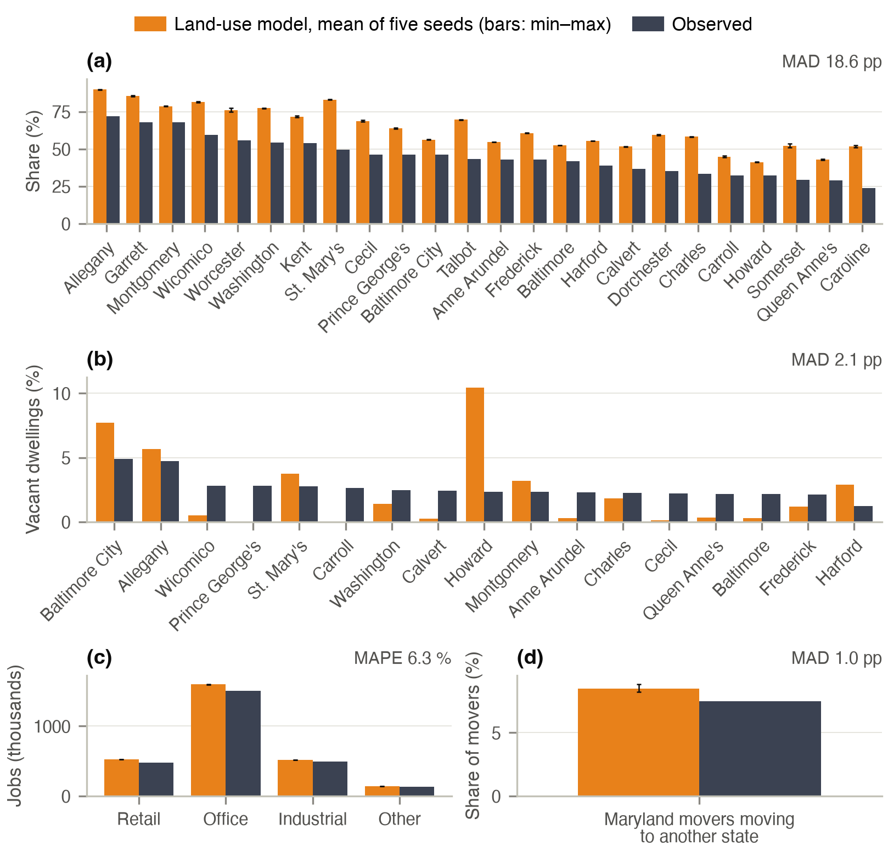

# Land use

The land-use model is calibrated on 2017–2020 and tested **out of sample on 2021–2024** against the ACS, the Census population estimates and components of change, JOLTS, building permits and the ACS county-to-county flows. Model: mean of five seeds.

<b>0.995</b>county commute flows, correlation with the ACS

<b>≤ 2.1 pp</b>household size, cars, age, income in 2024

<b>≤ 6 %</b>births, marriages, divorces out of sample

<b>12.8 / 10.9 %</b>persons who moved, model / observed

!!! info "How to read the figures"
    Orange: model; dark grey: observed; light grey: a second observed source. Error bars: range of the five land-use seeds or of the ten activity-model replications. Each panel shows one fit measure: for a distribution the total variation distance (TVD, percentage points of the population that would have to change class); for shares that are not one distribution, the mean absolute difference (MAD, percentage points); otherwise the mean absolute percentage error (MAPE).

## Main results

<figure markdown>
  
  <figcaption>Land use against observed data, Maryland. (a) household size, 2024; (b) cars, 2024; (c) age, 2024; (d) household income, 2024; (e) demographic events, 2021–24; (f) mobility and commuting, 2021–24; (g) car time to school, 2024; (h) persons who moved, by year.</figcaption>
</figure>

## In detail

=== "Composition 2024"

    <figure markdown>
      
      <figcaption>(a) sex, 2024; (b) employed 16+, 2024; (c) age, 2024; (d) household size, 2024; (e) cars, 2024; (f) household income, 2024; (g) workers per household, 2024; (h) living arrangements of adults 18–34, 2024; (i) employed share by sex and age, 2024.</figcaption>
    </figure>
    

=== "Events by year"

    <figure markdown>
      
      <figcaption>(a) births per woman 15–50; (b) deaths per person; (c) marriages per adult; (d) divorces per married person; (e) persons who moved; (f) job changes per employed; (g) employed share 16+ (imposed); (h) vacant share of jobs (imposed); (i) residents working in Maryland; (j) same-county workplace; (k) movers staying in their county; (l) time to work.</figcaption>
    </figure>
    

=== "Counties"

    <figure markdown>
      
      <figcaption>(a) population by county, 2024; (b) filled jobs by county, 2024; (c) new dwellings by county, 2021–24 (imposed).</figcaption>
    </figure>
    

=== "Counties, jobs, vacancies"

    <figure markdown>
      
      <figcaption>(a) home-county workplace share by county, 2024; (b) dwelling vacancy by county, 2024; (c) filled jobs by type, 2024; (d) movers leaving Maryland, 2024.</figcaption>
    </figure>
    

## Out-of-sample table

| Quantity | Model 2017–20 | Observed | Model 2021–24 | Observed |
|---|---:|---:|---:|---:|
| Population / Census estimate | 0.999 | 1 | 0.995 | 1 |
| Job-to-job changes per employed (%) | 24.2 | 25.2 | 23.9 | 25.2 |
| Residents working in Maryland (%) | 83.2 | 82.7 | 82.8 | 84.1 |
| Persons who moved (%) | 12.4 | 12.4 | 12.8 | 10.9 |
| Mover flows, correlation with ACS | 0.970 | – | 0.946 | – |
| Movers staying in their county (%) | 71.9 | 68.9 | 68.0 | 68.9 |
| Births per woman 15–50 | 0.0509 | 0.0510 | 0.0495 | 0.0482 |
| Deaths per person | 0.0079 | 0.0081 | 0.0080 | 0.0091 |
| Households of 1 person (%) | 24.4 | 27.6 | 26.2 | 28.6 |
| Households without a car (%) | 8.4 | 8.7 | 8.2 | 8.7 |
| 2 cars (%) | 37.2 | 36.5 | 35.7 | 35.8 |

Model: mean of five seeds; calibration window 2017–2020, out-of-sample years 2021–2024.

## Why some comparisons are outside

**Home-county workplace share by county** (18.6 points). The model keeps 41–90 % of each county's employed residents
working in their home county, against 24–72 % in LODES; the difference averages 18.6 points and is the same in the base
year (17.2 points in 2016), so it does not grow during the simulation. The two measure different things: LODES counts
*jobs* from employer records, and multi-establishment employers can report jobs at one address; the model's workplace
choice is estimated on the travel survey, which records where *workers* go. Against the ACS, which also asks workers,
the commute agrees: county-to-county flows correlate at 0.995, and the 2024 activity model sends 54.4 % of commuters to
their home county or county group against 54.0 % in the ACS. 

**Dwelling vacancy by county** (2.1 points on average). This is a weakness of the land-use model. County populations are held to the
Census estimates and new dwellings follow the county building permits, so vacancy is what is left between the two.
Where the residential-location model sends more households than there are dwellings, vacancy runs to zero and the county
falls short of its population: Carroll (0 % vacant, 5.6 % short of the Census) and Prince George's (0 %, 2.5 % short).
Where it sends fewer, vacant dwellings accumulate: Howard 10.4 % and Baltimore City 7.7 % against 2.3 % and 4.9 % in the
ACS. Construction does not respond to vacancy, and prices respond too weakly to
rebalance demand across counties.

**Vacant share of jobs** (imposed; 1.2 points on average, 4.3 points in 2021). Jobs follow the job inputs (LODES, QCEW) year by year, while employment is
aligned to the ACS rate of the year before the simulated year. The vacancy is the difference, so it inherits that lag:
in 2021 the model leaves 2.7 % of jobs vacant against 7.0 % in JOLTS, when openings surged after the pandemic, a surge
that is in no input. By 2024 the two are close again (5.5 against 5.1 %).

## Scorecard

<b>36</b> comparisons · 27 within 6 close 3 outside

| Compared variable | Fit | Result | Note |
|---|---:|:---:|---|
| Household size, 2024 | TVD 3.5 pp | within |  |
| Cars, 2024 | TVD 1.5 pp | within |  |
| Age, 2024 | TVD 2.1 pp | within |  |
| Household income, 2024 | TVD 3.7 pp | within |  |
| Demographic events, 2021–24 | MAPE 6.4 % | close |  |
| Mobility and commuting, 2021–24 | MAD 1.3 pp | within |  |
| Car time to school, 2024 | MAPE 12 % | outside |  |
| Persons who moved, by year | MAPE 9.7 % | close |  |
| Sex, 2024 | TVD 0.5 pp | within |  |
| Employed 16+, 2024 | TVD 0.9 pp | within |  |
| Age, 2024 | TVD 2.1 pp | within |  |
| Household size, 2024 | TVD 3.5 pp | within |  |
| Cars, 2024 | TVD 1.5 pp | within |  |
| Household income, 2024 | TVD 3.7 pp | within |  |
| Workers per household, 2024 | TVD 3.1 pp | within |  |
| Living arrangements of adults 18–34, 2024 | MAD 3.0 pp | within |  |
| Employed share by sex and age, 2024 | MAD 1.0 pp | within |  |
| Births per woman 15–50 | MAPE 1.7 % | within |  |
| Deaths per person | MAPE 8.7 % | close |  |
| Marriages per adult | MAPE 4.0 % | within |  |
| Divorces per married person | MAPE 2.9 % | within |  |
| Persons who moved | MAPE 9.7 % | close |  |
| Job changes per employed | MAPE 4.5 % | within |  |
| Employed share 16+ (imposed) | MAD 1.1 pp | within |  |
| Vacant share of jobs (imposed) | MAD 1.2 pp | within | imposed; follows the inputs with a one-year lag |
| Residents working in maryland | MAD 0.9 pp | within |  |
| Same-county workplace | MAD 0.8 pp | within |  |
| Movers staying in their county | MAD 2.0 pp | within |  |
| Time to work | MAPE 5.3 % | close |  |
| Population by county, 2024 | MAPE 0.7 % | within |  |
| Filled jobs by county, 2024 | MAPE 11 % | outside |  |
| New dwellings by county, 2021–24 (imposed) | MAPE 0.1 % | within |  |
| Home-county workplace share by county, 2024 | MAD 18.6 pp | outside | LODES counts jobs, not workers; against the ACS the share agrees (County view) |
| Dwelling vacancy by county, 2024 | MAD 2.1 pp | within | model weakness, see below |
| Filled jobs by type, 2024 | MAPE 6.3 % | close |  |
| Movers leaving maryland, 2024 | MAD 1.0 pp | within |  |
