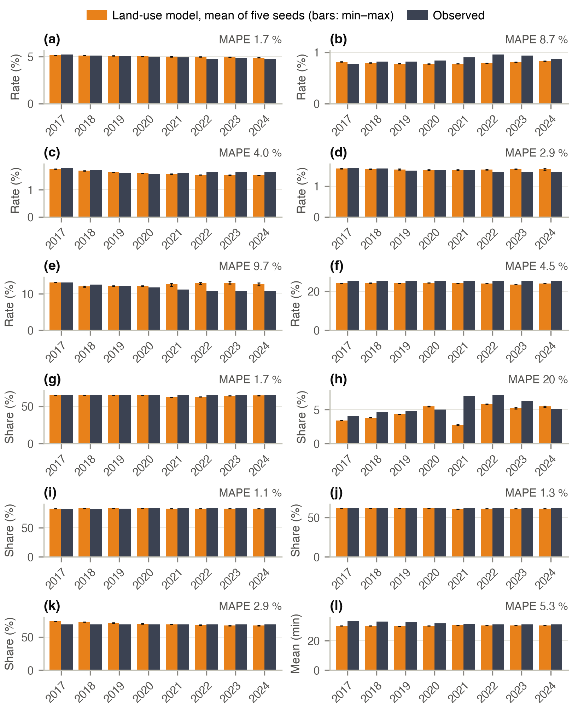
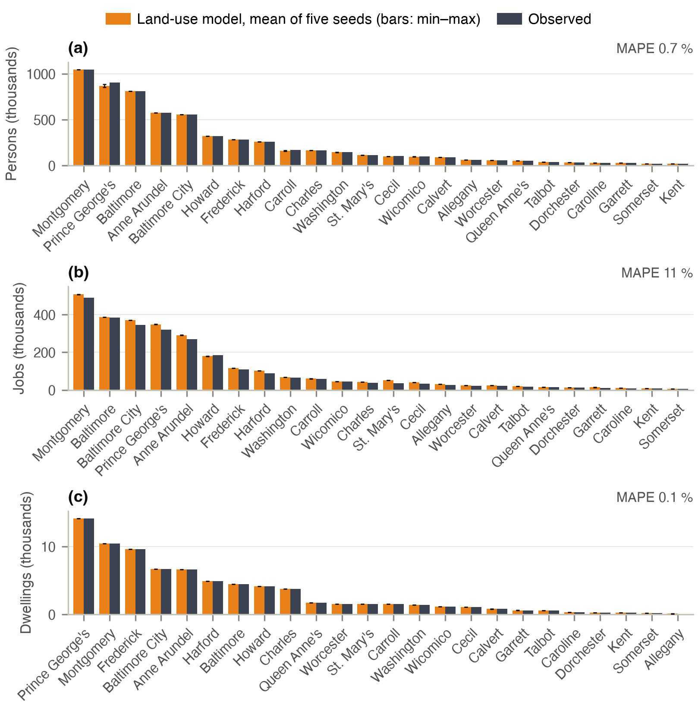

# Land use

The land-use model is calibrated on 2017–2020 and tested **out of sample on 2021–2024** against the ACS, the Census population estimates and components of change, JOLTS, building permits and the ACS county-to-county flows. Model: mean of five seeds.

<b>0.995</b>county commute flows, correlation with the ACS

<b>≤ 2.1 pp</b>household size, cars, age, income in 2024

<b>≤ 6 %</b>births, marriages, divorces out of sample

<b>12.8 / 10.9 %</b>persons who moved, model / observed

!!! info "How to read the figures"
    Orange: model; dark grey: observed; light grey: a second observed source. Error bars: range of the five land-use seeds or of the ten activity-model replications. Each panel shows one fit measure: for a distribution the total variation distance (TVD, percentage points of the population that would have to change class), otherwise the mean absolute percentage error (MAPE).

## Main results

<figure markdown>
  
  <figcaption>Land use against observed data, Maryland. (a) household size, 2024; (b) cars, 2024; (c) age, 2024; (d) household income, 2024; (e) demographic events, 2021–24; (f) mobility and commuting, 2021–24; (g) car time to school, 2024; (h) persons who moved, by year.</figcaption>
</figure>

## In detail

=== "Composition 2024"

    <figure markdown>
      
      <figcaption>(a) sex, 2024; (b) employed 16+, 2024; (c) age, 2024; (d) household size, 2024; (e) cars, 2024; (f) household income, 2024; (g) workers per household, 2024; (h) living arrangements of adults 18–34, 2024; (i) employed share by sex and age, 2024.</figcaption>
    </figure>
    

=== "Events by year"

    <figure markdown>
      
      <figcaption>(a) births per woman 15–50; (b) deaths per person; (c) marriages per adult; (d) divorces per married person; (e) persons who moved; (f) job changes per employed; (g) employed share 16+ (imposed); (h) vacant share of jobs (imposed); (i) residents working in Maryland; (j) same-county workplace; (k) movers staying in their county; (l) time to work.</figcaption>
    </figure>
    

=== "Counties"

    <figure markdown>
      
      <figcaption>(a) population by county, 2024; (b) filled jobs by county, 2024; (c) new dwellings by county, 2021–24 (imposed).</figcaption>
    </figure>
    

=== "Counties, jobs, vacancies"

    <figure markdown>
      
      <figcaption>(a) home-county workplace share by county, 2024; (b) dwelling vacancy by county, 2024; (c) filled jobs by type, 2024; (d) movers leaving Maryland, 2024.</figcaption>
    </figure>
    

## Out-of-sample table

| Quantity | Model 2017–20 | Observed | Model 2021–24 | Observed |
|---|---:|---:|---:|---:|
| Population / Census estimate | 0.999 | 1 | 0.995 | 1 |
| Job-to-job changes per employed (%) | 24.2 | 25.2 | 23.9 | 25.2 |
| Residents working in Maryland (%) | 83.2 | 82.7 | 82.8 | 84.1 |
| Persons who moved (%) | 12.4 | 12.4 | 12.8 | 10.9 |
| Mover flows, correlation with ACS | 0.970 | – | 0.946 | – |
| Movers staying in their county (%) | 71.9 | 68.9 | 68.0 | 68.9 |
| Births per woman 15–50 | 0.0509 | 0.0510 | 0.0495 | 0.0482 |
| Deaths per person | 0.0079 | 0.0081 | 0.0080 | 0.0091 |
| Households of 1 person (%) | 24.4 | 27.6 | 26.2 | 28.6 |
| Households without a car (%) | 8.4 | 8.7 | 8.2 | 8.7 |
| 2 cars (%) | 37.2 | 36.5 | 35.7 | 35.8 |

Model: mean of five seeds; calibration window 2017–2020, out-of-sample years 2021–2024.

## Scorecard

<b>36</b> comparisons · 22 within 8 close 6 outside

| Compared variable | Fit | Result |
|---|---:|:---:|
| Household size, 2024 | TVD 3.5 pp | within |
| Cars, 2024 | TVD 1.5 pp | within |
| Age, 2024 | TVD 2.1 pp | within |
| Household income, 2024 | TVD 3.7 pp | within |
| Demographic events, 2021–24 | MAPE 6.4 % | close |
| Mobility and commuting, 2021–24 | MAPE 5.4 % | close |
| Car time to school, 2024 | MAPE 12 % | outside |
| Persons who moved, by year | MAPE 9.7 % | close |
| Sex, 2024 | TVD 0.5 pp | within |
| Employed 16+, 2024 | TVD 0.9 pp | within |
| Age, 2024 | TVD 2.1 pp | within |
| Household size, 2024 | TVD 3.5 pp | within |
| Cars, 2024 | TVD 1.5 pp | within |
| Household income, 2024 | TVD 3.7 pp | within |
| Workers per household, 2024 | TVD 3.1 pp | within |
| Living arrangements of adults 18–34, 2024 | MAPE 6.8 % | close |
| Employed share by sex and age, 2024 | MAPE 2.8 % | within |
| Births per woman 15–50 | MAPE 1.7 % | within |
| Deaths per person | MAPE 8.7 % | close |
| Marriages per adult | MAPE 4.0 % | within |
| Divorces per married person | MAPE 2.9 % | within |
| Persons who moved | MAPE 9.7 % | close |
| Job changes per employed | MAPE 4.5 % | within |
| Employed share 16+ (imposed) | MAPE 1.7 % | within |
| Vacant share of jobs (imposed) | MAPE 20 % | outside |
| Residents working in maryland | MAPE 1.1 % | within |
| Same-county workplace | MAPE 1.3 % | within |
| Movers staying in their county | MAPE 2.9 % | within |
| Time to work | MAPE 5.3 % | close |
| Population by county, 2024 | MAPE 0.7 % | within |
| Filled jobs by county, 2024 | MAPE 11 % | outside |
| New dwellings by county, 2021–24 (imposed) | MAPE 0.1 % | within |
| Home-county workplace share by county, 2024 | MAPE 45 % | outside |
| Dwelling vacancy by county, 2024 | MAPE 86 % | outside |
| Filled jobs by type, 2024 | MAPE 6.3 % | close |
| Movers leaving maryland, 2024 | MAPE 14 % | outside |
