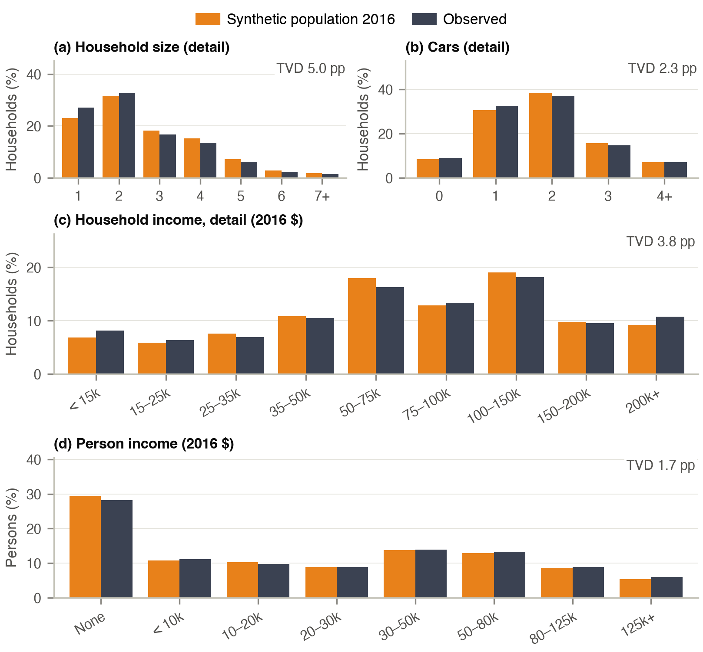
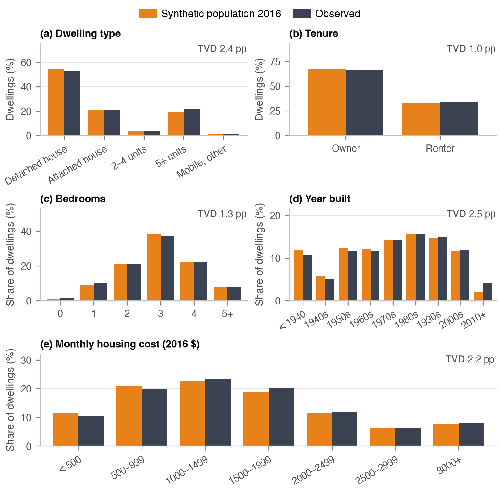
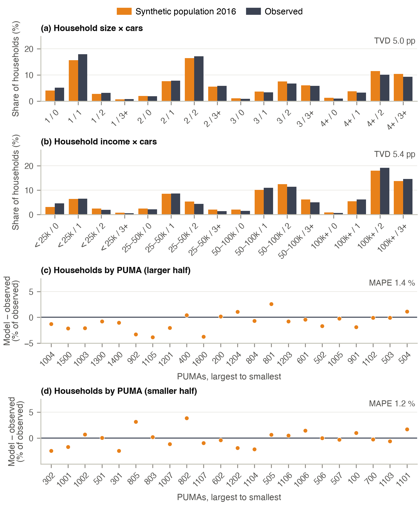

# Synthetic population

The 2016 synthetic population against the ACS PUMS 2014–2018 of Maryland, the held-out PUMS test split, county estimates, LODES jobs and the reported commutes of the travel survey.

<b>≤ 5.3 pp</b>TVD of every attribute, Maryland

<b>97 %</b>of held-out person combinations generated

<b>96.5 %</b>of PUMA × class cells within ±5 pp

<b>33.7 / 34.2</b>min home–work car time, model / survey

!!! info "How to read the figures"
    Orange: model; dark grey: observed; light grey: a second observed source. Error bars: range of the five land-use seeds or of the ten activity-model replications. Each panel shows one fit measure: for a distribution the total variation distance (TVD, percentage points of the population that would have to change class); for shares that are not one distribution, the mean absolute difference (MAD, percentage points); otherwise the mean absolute percentage error (MAPE).

## Main results

<figure markdown>
  
  <figcaption>Synthetic population of 2016 against observed data, Maryland. (a) persons by age; (b) employment status; (c) household size; (d) cars; (e) household income (2016 $); (f) dwelling type; (g) tenure; (h) home–work car time, 2016.</figcaption>
</figure>

## In detail

=== "Persons"

    <figure markdown>
      
      <figcaption>(a) persons by 5-year age; (b) sex; (c) employed (16+); (d) race and ethnicity; (e) nationality; (f) relationship.</figcaption>
    </figure>
    

=== "Households"

    <figure markdown>
      
      <figcaption>(a) household size (detail); (b) cars (detail); (c) household income, detail (2016 $); (d) person income (2016 $).</figcaption>
    </figure>
    

=== "Dwellings"

    <figure markdown>
      
      <figcaption>(a) dwelling type; (b) tenure; (c) bedrooms; (d) year built; (e) monthly housing cost (2016 $).</figcaption>
    </figure>
    

=== "Counties and commute"

    <figure markdown>
      
      <figcaption>(a) persons by county; (b) filled jobs by county; (c) home–work car time, 2016; (d) home–work distance, 2016.</figcaption>
    </figure>
    

=== "Joint tables and PUMAs"

    <figure markdown>
      
      <figcaption>(a) household size × cars; (b) household income × cars; (c) households by PUMA (larger half); (d) households by PUMA (smaller half).</figcaption>
    </figure>
    

## Generative quality on held-out households

<figure markdown>
  
  <figcaption>SRMSE of every pair of attributes against the held-out test split: below the diagonal the synthetic population, above it the training split (the sampling floor).</figcaption>
</figure>

## Scorecard

<b>31</b> comparisons · 25 within 3 close 3 outside

| Compared variable | Fit | Result | Note |
|---|---:|:---:|---|
| Persons by age | TVD 0.1 pp | within |  |
| Employment status | TVD 5.3 pp | close |  |
| Household size | TVD 5.0 pp | within |  |
| Cars | TVD 2.2 pp | within |  |
| Household income (2016 $) | TVD 3.5 pp | within |  |
| Dwelling type | TVD 2.4 pp | within |  |
| Tenure | TVD 1.0 pp | within |  |
| Home–work car time, 2016 | TVD 16.0 pp | outside |  |
| Persons by 5-year age | TVD 2.9 pp | within |  |
| Sex | TVD 0.5 pp | within |  |
| Employed (16+) | TVD 2.5 pp | within |  |
| Race and ethnicity | TVD 3.2 pp | within |  |
| Nationality | TVD 1.8 pp | within |  |
| Relationship | TVD 1.4 pp | within |  |
| Household size (detail) | TVD 5.0 pp | within |  |
| Cars (detail) | TVD 2.3 pp | within |  |
| Household income, detail (2016 $) | TVD 3.8 pp | within |  |
| Person income (2016 $) | TVD 1.7 pp | within |  |
| Dwelling type | TVD 2.4 pp | within |  |
| Tenure | TVD 1.0 pp | within |  |
| Bedrooms | TVD 1.3 pp | within |  |
| Year built | TVD 2.5 pp | within |  |
| Monthly housing cost (2016 $) | TVD 2.2 pp | within |  |
| Persons by county | MAPE 5.0 % | within |  |
| Filled jobs by county | MAPE 7.2 % | close |  |
| Home–work car time, 2016 | TVD 16.0 pp | outside |  |
| Home–work distance, 2016 | TVD 11.4 pp | outside |  |
| Household size × cars | TVD 5.0 pp | within |  |
| Household income × cars | TVD 5.4 pp | close |  |
| Households by puma (larger half) | MAPE 1.4 % | within |  |
| Households by puma (smaller half) | MAPE 1.2 % | within |  |
