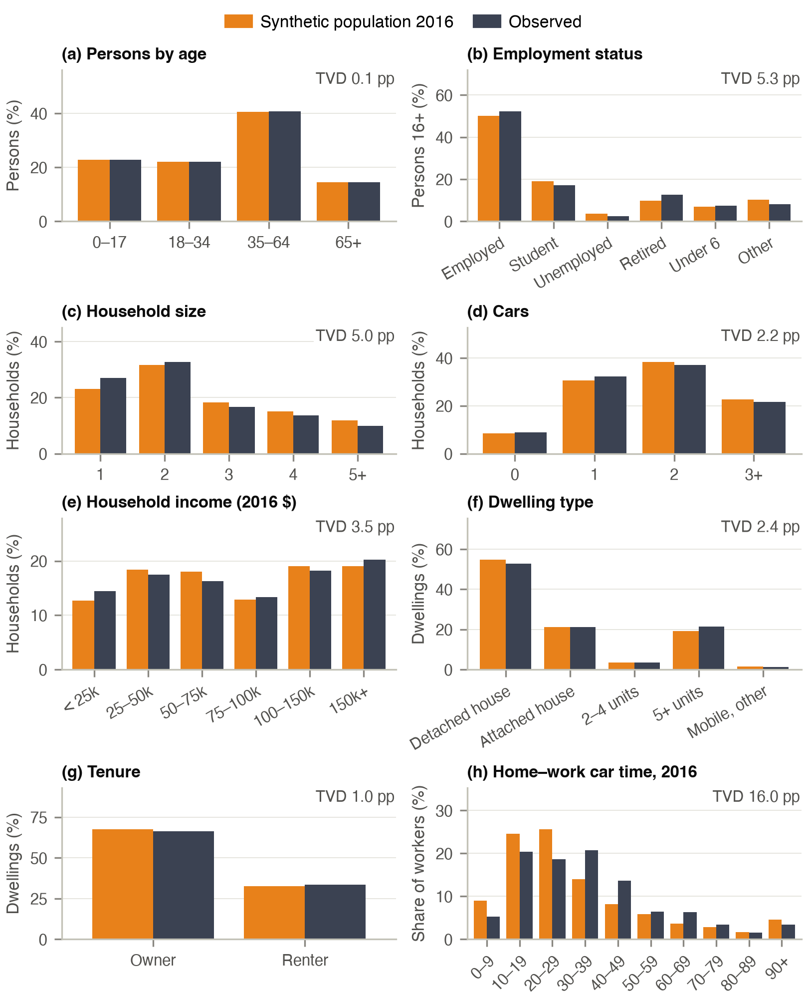
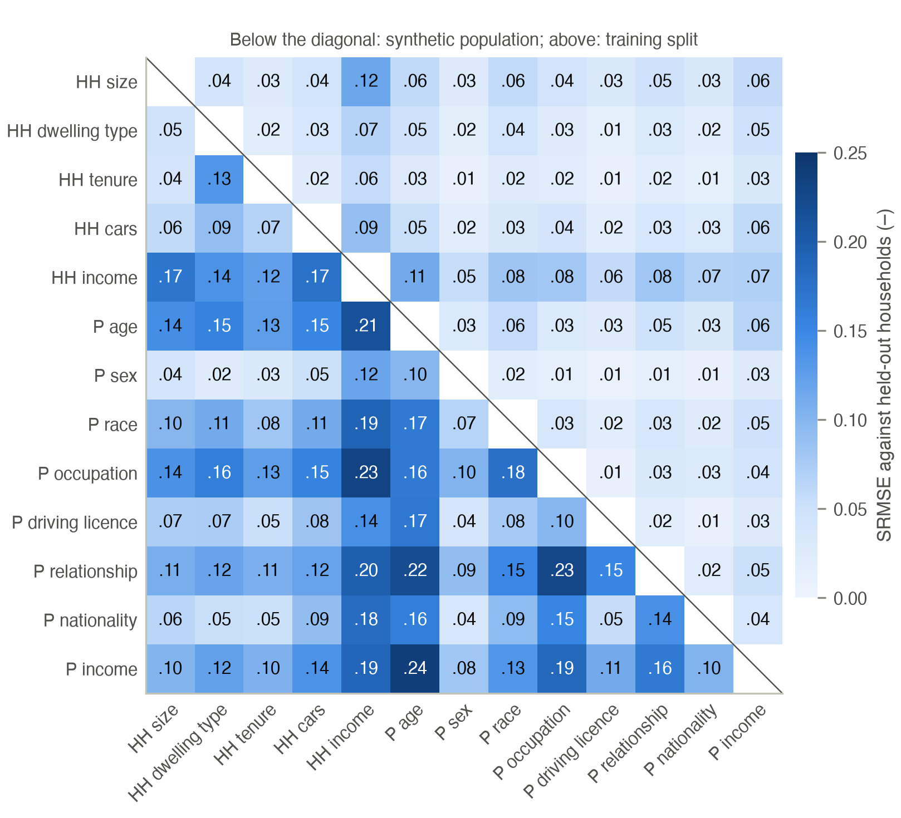
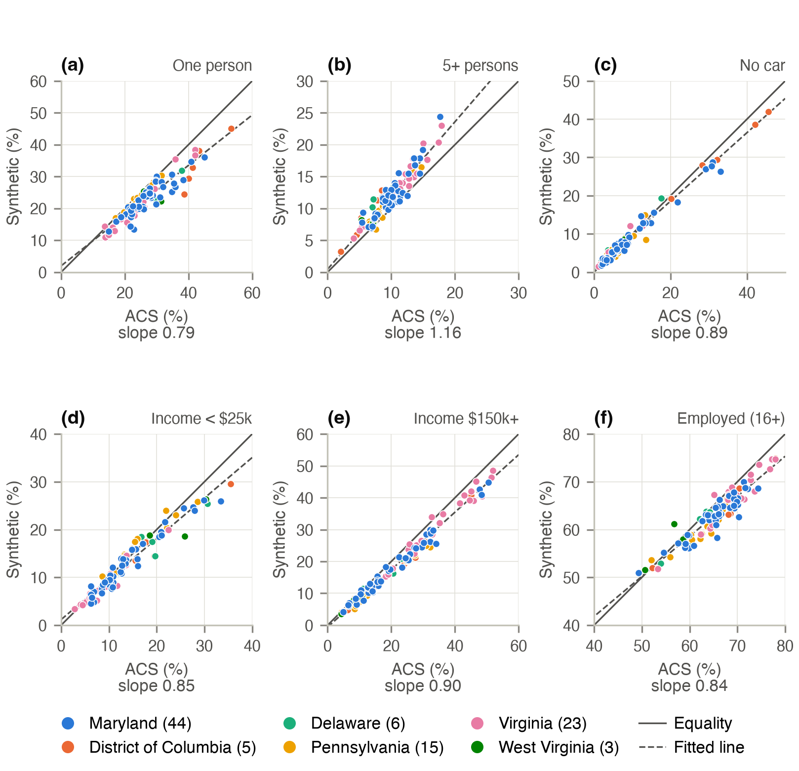
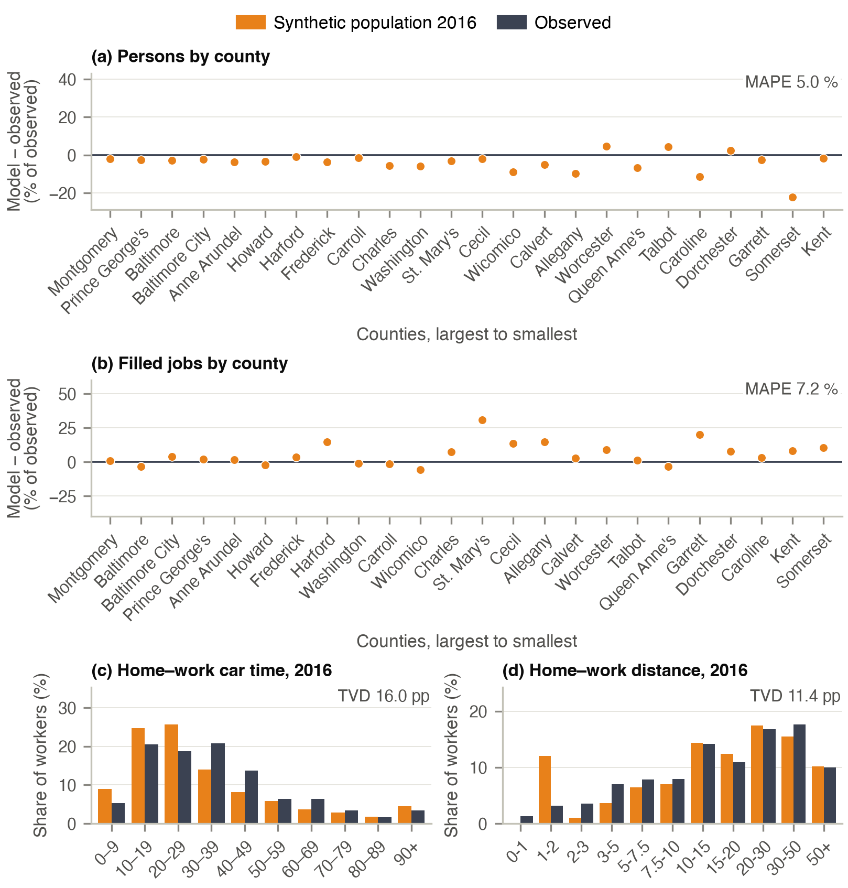

# Synthetic population

The synthetic population of 2016 is compared with three sets of observed data: the ACS PUMS 2014–2018 of Maryland, the
**held-out test split** of the PUMS 2012–2016 sample (households set aside before training and never used to fit the
generator), and the ACS PUMS 2014–2018 of all 96 PUMAs of the six states. Persons by age and sex and the household count
of each PUMA are controlled ([model design](../../model-design/population.md)); the other attributes are not.

<b>0.1–5.3 pp</b>TVD from the ACS PUMS 2014–18 for the household, person and dwelling attributes; every class within 3.9 pp

<b>33.7 min</b>mean home–work car time of the synthetic workers (travel survey: 34.2 min)

<b>0.118</b>median SRMSE of the 78 pairs of 13 attributes against the held-out test split (training split: 0.033)

<b>96.5 %</b>of the PUMA × attribute-class cells within ±5 pp of the ACS, 96 PUMAs

<i style="background:#e8811a"></i>Model<i style="background:#3b4252"></i>Observed<i style="background:#b5b3ab"></i>Second observed source

| Measure | Used for | Meaning |
|---|---|---|
| **TVD**, percentage points | a distribution (the classes add up to 100 %) | share of the population that would have to change class to match the observed |
| **MAPE**, % | rates, means and counts | mean absolute difference as a percentage of the observed value |
| **SRMSE** | cells of a one-, two- or three-way table | root-mean-square difference of the cell shares divided by the mean cell share |

## Main results

<figure markdown>
  
  <figcaption>Synthetic population against observed data, Maryland, 2016. (a) age (controlled); (b) employment status; (c) household size; (d) cars per household; (e) household income; (f) dwelling type; (g) tenure; (h) commute time. Observed: ACS PUMS 2014–2018 (a–g); travel survey 2017/18 (h).</figcaption>
</figure>

The largest differences from the ACS are single-person households (23.1 against 27.0 %) and retired persons (9.7
against 12.6 %). The home–work car time of the synthetic workers averages 33.7 min against 34.2 min reported in the
survey, with 50.2 % of the commutes between 10 and 29 min against 39.1 %.

| Level | Observed | Measure | Result |
|---|---|---|---|
| Maryland | ACS PUMS 2014–18 | 8 attributes | TVD 0.1–5.3 pp; every class within 3.9 pp |
| Held-out households | PUMS 2012–16 test split | Single attributes | TVD ≤ 0.040; household SRMSE 0.019–0.093 (floor 0.022–0.060) |
| | | 78 pairs of 13 attributes | Median SRMSE 0.118 (training split 0.033); largest 0.238 |
| | | Three-way person tables | Mean SRMSE 0.224 |
| | | Person combinations | 97 % of 2,240 generated |
| PUMAs, six states (96) | ACS PUMS 2014–18 | 22 attribute classes | 96.5 % of cells within ±5 pp; slope 0.79–0.90 (five or more persons 1.16) |
| Maryland PUMAs (44) | ACS PUMS 2014–18 | Household size | Median PUMA: one person −14 %, five or more +18 % |
| | | Size by cars, income by cars | Every cell within ±2.3 pp |

TVD: total variation distance; SRMSE: standardised root-mean-square error; floor: SRMSE between two random halves of the
test split; pp: percentage points. Source: ACS PUMS.

## Held-out households

On the held-out test split the TVD of every attribute is at most 0.040, and the SRMSE of the household attributes is
0.019 to 0.093 against a sampling floor of 0.022 to 0.060. Over all 78 pairs of the 13 attributes the median SRMSE is
0.118, against 0.033 for the training split, a second sample of the same population; 29 pairs are at or below 0.10. The
largest are person age by person income (0.238), occupation by relationship (0.227) and age by relationship (0.219). The
pairs with household income, person age and occupation carry the largest errors; those with sex, tenure and dwelling
type the smallest. Of the 2,240 combinations of age, occupation, income and relationship in the test split, 97 % are
generated. Partners differ in age by 7.55 years against 3.69 in the test split.

<figure markdown>
  
  <figcaption>SRMSE of every pair of attributes against the held-out PUMS test split: below the diagonal the synthetic population (150,000 households generated from the training split), above it the training split. Pairs with a person attribute are formed over persons, with the household attributes of their household. HH: household; P: person attribute.</figcaption>
</figure>

## PUMAs

Across the 96 PUMAs of the six states the synthetic shares follow the ACS (correlation 0.93 to 0.99 for the six classes
shown), and 96.5 % of the cells of PUMA and attribute class are within ±5 percentage points. The PUMAs are drawn toward
their common mean: the slope of the synthetic on the observed share is 0.79 for one-person households, 0.84 for employed
persons, 0.85 for incomes under $25k, 0.89 for households without a car and 0.90 for incomes of $150k or more, and 1.16
for households of five or more persons. The differences are therefore largest in the PUMAs of most extreme composition,
such as those of the District of Columbia. On average over the PUMAs, one-person households are 3.7 points too few,
households of five or more 2.0 points too many, households with $150k or more 2.8 points too few and employed persons
2.3 points too few. The tables of household size by cars and of income by cars are within ±2.3 percentage points in
every cell.

<figure markdown>
  
  <figcaption>Synthetic population of 2016 against the ACS PUMS 2014–2018 by PUMA, all 96 PUMAs of the six states: share of (a) one-person households; (b) households of five or more persons; (c) households without a car; (d) household income under $25k; (e) household income $150k or more; (f) employed persons aged 16 and over. Dashed: least-squares line of the synthetic on the observed share, with its slope.</figcaption>
</figure>

## In detail

Maryland homes against the ACS PUMS 2014–2018 (households and persons in households, weighted), the Census population
estimates of 2016, LODES 2016 and the home–work car trips of the travel survey 2017/18. Dollar amounts are in 2016
dollars. Bedrooms, year built and monthly housing cost are taken from PUMS donor records of the same PUMA, dwelling type,
tenure and income class and are not modelled. The Census estimate includes group quarters (2.3 % of Maryland's
population), which the synthesis does not contain.

=== "Persons"

    <figure markdown>
      
      <figcaption>(a) five-year age group; (b) sex; (c) employed, 16+; (d) race and ethnicity; (e) nationality; (f) relationship to the householder.</figcaption>
    </figure>

=== "Households and incomes"

    <figure markdown>
      
      <figcaption>(a) household size; (b) cars per household; (c) household income; (d) personal income.</figcaption>
    </figure>

=== "Dwellings"

    <figure markdown>
      
      <figcaption>(a) dwelling type; (b) tenure; (c) bedrooms; (d) year built; (e) monthly housing cost.</figcaption>
    </figure>

=== "Totals and commutes"

    <figure markdown>
      
      <figcaption>(a) persons in households by county against the Census estimate; (b) filled jobs by county against LODES 2016; (c) home–work car time and (d) distance against the travel survey 2017/18.</figcaption>
    </figure>

=== "Joint tables and PUMAs"

    <figure markdown>
      
      <figcaption>(a) household size × cars; (b) household income × cars (labels: size or income / cars); (c, d) households by PUMA.</figcaption>
    </figure>

Each Maryland county is compared in the [county view](county.md).
