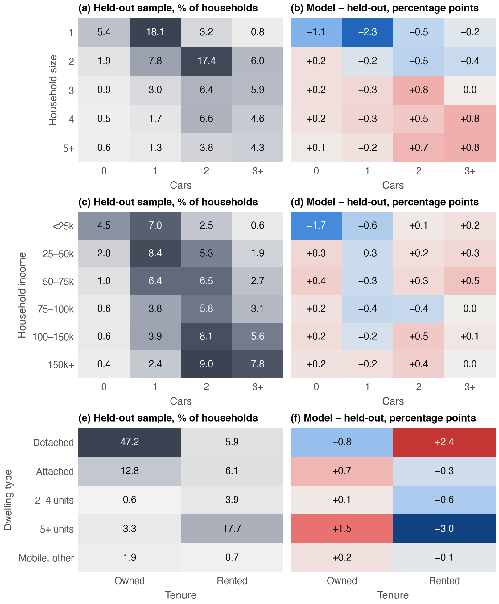
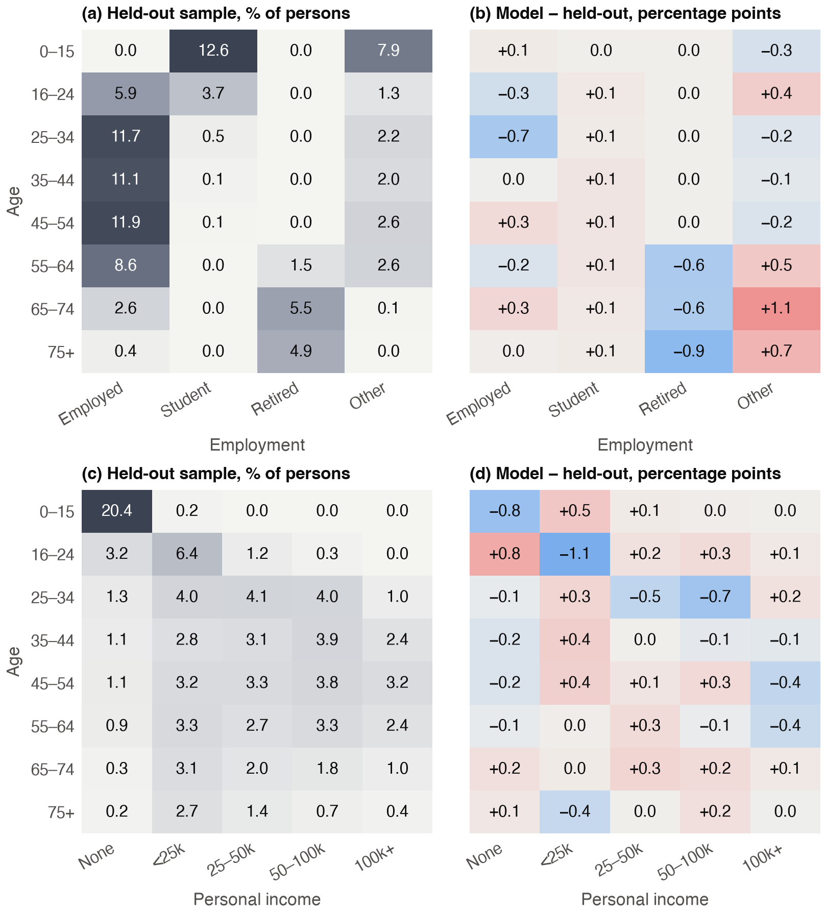
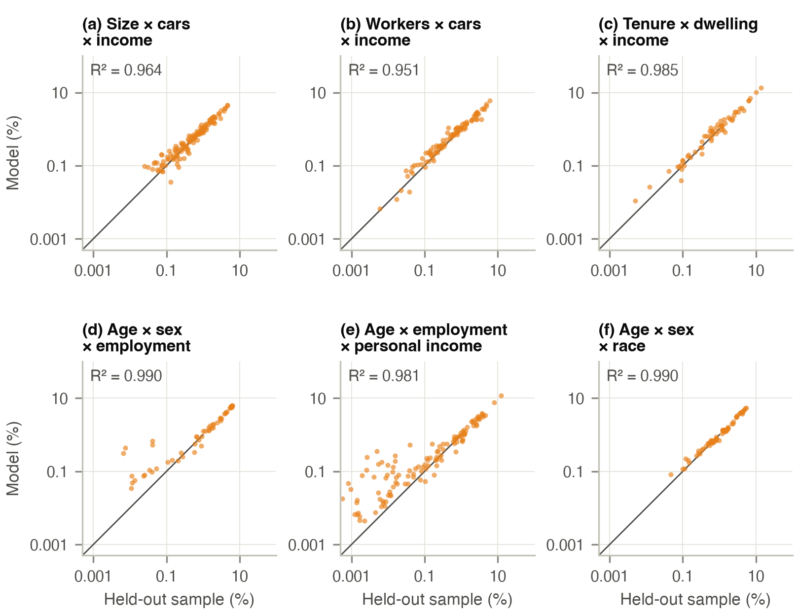
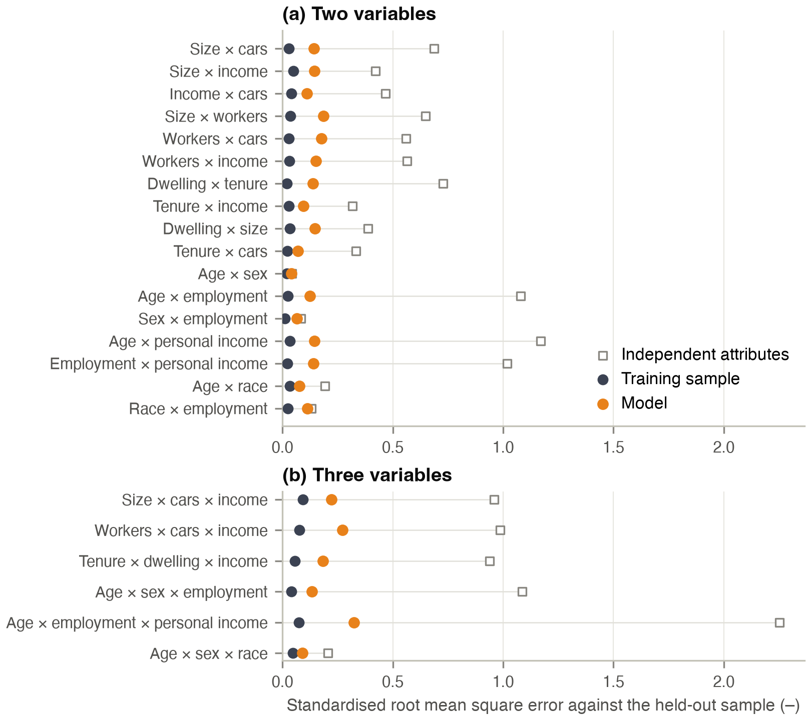
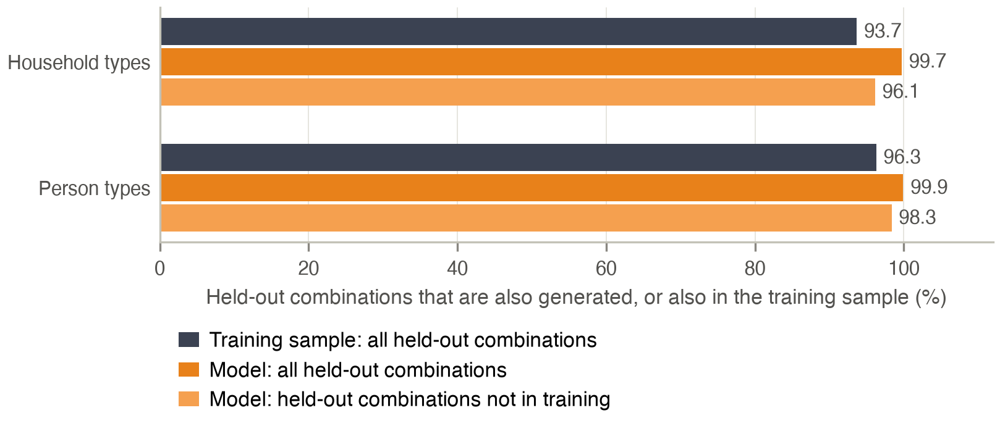
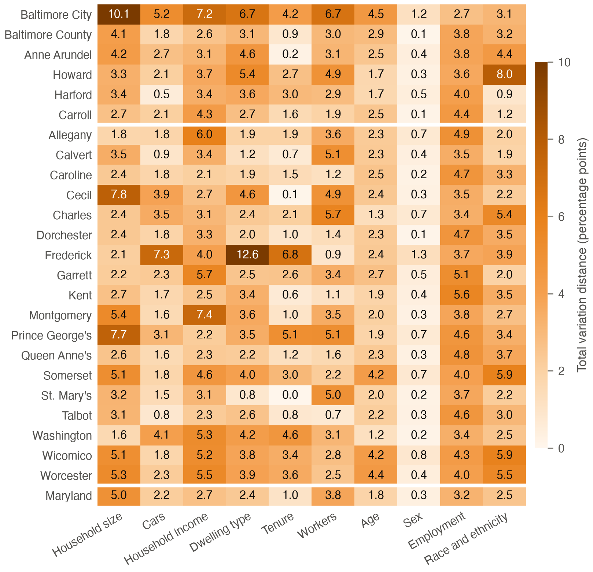
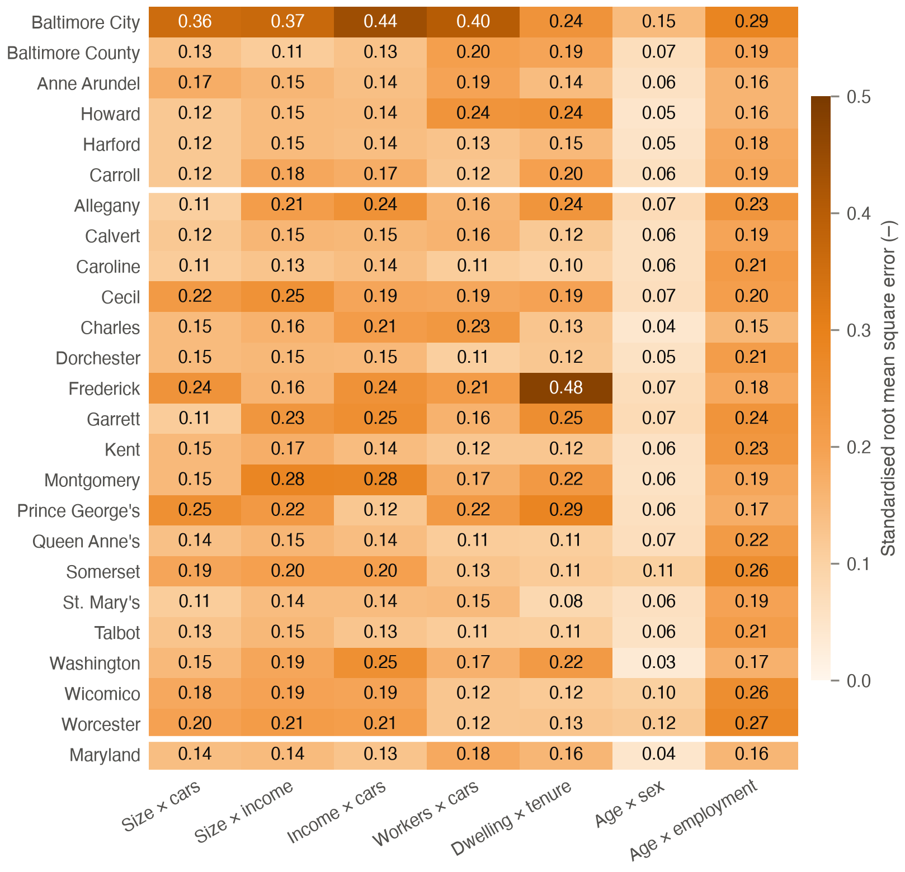

# Synthetic population

The 2016 population is compared with data the generator has not seen: the **held-out test split** of the PUMS 2012–2016
sample, 10 % of the households of every PUMA (25,298 households, 62,467 persons) set aside
before training and never used to fit or stop it. The comparison covers all 96 PUMAs and is weighted by the PUMS weights.
The tests are joint distributions of two and three attributes, the combinations of attributes the model generates, and
each Maryland county against the ACS PUMS 2014–2018.

The population compared is the 2016 base that enters the model chain. Household counts by PUMA and size are inputs of
the generator, and households are redrawn so that persons by age band, and employment by age and sex, match the ACS
([model design](../../model-design/population.md)); those one-way distributions are therefore controlled, not predicted,
and they follow the ACS 2014–2018 rather than the 2012–2016 sample. The joint distributions are not controlled.

Measures, computed on the cell shares of each table (all cells of the cross-classification, empty ones included):

- **SRMSE**, standardised root mean square error: the root mean square difference of the cell shares divided by the mean cell share.
- **TVD**, total variation distance: half the sum of the absolute differences of the shares, in percentage points of the population.
- **Hellinger distance**: \(\sqrt{1-\sum_k \sqrt{m_k o_k}}\), between 0 (equal) and 1 (disjoint).
- **R²**: one minus the sum of squared differences over the total sum of squares of the held-out shares (fit to the 45° line).

Two references are given with each measure. **Training sample**: the same measure for the training split (80 % of the
sample) against the held-out split; it shows how far two samples of the same
population differ, mostly through the sampling error of the held-out split. **Independent attributes**: the product of the
training marginals, a table without any association between the attributes.

Median of each measure over the tables of one, two and three variables:

| Order | Tables | SRMSE model | SRMSE training | TVD model (pp) | TVD training (pp) | Hellinger model | R² model |
|:---|---:|---:|---:|---:|---:|---:|---:|
| One | 11 | 0.047 | 0.012 | 2.0 | 0.5 | 0.016 | 0.989 |
| Two | 17 | 0.138 | 0.028 | 4.9 | 1.1 | 0.044 | 0.985 |
| Three | 6 | 0.202 | 0.065 | 6.4 | 1.8 | 0.076 | 0.983 |

Categories: household size 1–5+; cars 0–3+; household income in six bands (2016 $); dwelling type in five classes; tenure;
workers 0–3+; age in eight bands; sex; employment (employed, student, retired, other); race and ethnicity in four groups;
personal income in five bands.

## Two variables

<figure markdown>
  
  <figcaption>Household tables, held-out sample and difference of the model. Colours of the differences are bounded at ±3 percentage points.</figcaption>
</figure>

<figure markdown>
  
  <figcaption>Person tables, held-out sample and difference of the model. Colours of the differences are bounded at ±3 percentage points.</figcaption>
</figure>

| Table | Cells | SRMSE model | SRMSE training | SRMSE independent | TVD model (pp) | TVD training (pp) | R² model |
|:---|---:|---:|---:|---:|---:|---:|---:|
| Size × cars | 20 | 0.142 | 0.029 | 0.686 | 5.1 | 1.1 | 0.978 |
| Size × income | 30 | 0.144 | 0.049 | 0.421 | 6.1 | 1.9 | 0.945 |
| Income × cars | 24 | 0.111 | 0.040 | 0.467 | 4.0 | 1.6 | 0.971 |
| Size × workers | 20 | 0.187 | 0.037 | 0.648 | 5.3 | 1.3 | 0.962 |
| Workers × cars | 16 | 0.177 | 0.028 | 0.561 | 5.5 | 1.1 | 0.961 |
| Workers × income | 24 | 0.152 | 0.031 | 0.565 | 5.5 | 1.1 | 0.958 |
| Dwelling × tenure | 10 | 0.138 | 0.019 | 0.728 | 4.9 | 0.7 | 0.989 |
| Tenure × income | 12 | 0.094 | 0.028 | 0.317 | 3.1 | 1.2 | 0.962 |
| Dwelling × size | 25 | 0.148 | 0.033 | 0.388 | 5.0 | 1.2 | 0.983 |
| Tenure × cars | 8 | 0.069 | 0.022 | 0.334 | 2.8 | 0.9 | 0.989 |
| Age × sex | 16 | 0.041 | 0.019 | 0.043 | 1.4 | 0.8 | 0.986 |
| Age × employment | 32 | 0.125 | 0.024 | 1.079 | 4.1 | 0.8 | 0.991 |
| Sex × employment | 8 | 0.065 | 0.011 | 0.085 | 2.8 | 0.4 | 0.990 |
| Age × personal income | 40 | 0.145 | 0.035 | 1.170 | 5.2 | 1.2 | 0.987 |
| Employment × personal income | 20 | 0.141 | 0.022 | 1.019 | 5.2 | 0.7 | 0.985 |
| Age × race | 32 | 0.077 | 0.033 | 0.192 | 3.1 | 1.2 | 0.993 |
| Race × employment | 16 | 0.114 | 0.024 | 0.131 | 3.5 | 0.9 | 0.991 |

## Three variables

<figure markdown>
  
  <figcaption>Cell shares of six three-way tables, model against held-out sample (logarithmic axes; cells empty in either are not drawn). Line: equality.</figcaption>
</figure>

| Table | Cells | SRMSE model | SRMSE training | SRMSE independent | TVD model (pp) | TVD training (pp) | R² model |
|:---|---:|---:|---:|---:|---:|---:|---:|
| Size × cars × income | 120 | 0.221 | 0.092 | 0.958 | 7.1 | 3.2 | 0.964 |
| Workers × cars × income | 96 | 0.271 | 0.077 | 0.986 | 7.2 | 2.4 | 0.951 |
| Tenure × dwelling × income | 60 | 0.183 | 0.056 | 0.940 | 5.8 | 2.0 | 0.985 |
| Age × sex × employment | 64 | 0.133 | 0.040 | 1.087 | 4.3 | 1.1 | 0.990 |
| Age × employment × personal income | 160 | 0.325 | 0.075 | 2.253 | 8.8 | 1.6 | 0.981 |
| Age × sex × race | 64 | 0.090 | 0.048 | 0.205 | 3.5 | 1.7 | 0.990 |

<figure markdown>
  
  <figcaption>SRMSE of every two- and three-way table against the held-out sample: model, training sample and independent attributes.</figcaption>
</figure>

## Combinations

A household type combines size (1–6+), cars, household income in 22 bands, dwelling type, tenure and workers; a person
type combines five-year age band, sex, race and ethnicity, employment in five classes, personal income in 16 bands and
relationship (single, married, child). A copy of the sample can only reproduce combinations of the training sample. Held-out
combinations absent from the training sample (**sampling zeros**) test whether the model generates plausible households
it has never seen.

<figure markdown>
  
  <figcaption>Share of the combinations present in the held-out sample that also occur in the training sample or in the model; last bar: the held-out combinations absent from the training sample.</figcaption>
</figure>

|  | Household types | Person types |
|:---|---:|---:|
| Possible combinations | 21,120 | 34,560 |
| Combinations in the held-out sample | 4,079 | 4,865 |
| … also in the training sample (%) | 93.7 | 96.3 |
| … generated by the model (%) | 99.7 | 99.9 |
| Held-out records whose combination is generated (%) | 99.96 | 99.99 |
| Sampling zeros: held-out combinations not in training | 258 | 181 |
| … generated by the model (%) | 96.1 | 98.3 |
| … weighted share of their held-out records generated (%) | 97.3 | 98.5 |
| Generated combinations not in training | 6,235 | 7,911 |
| … found in the held-out sample (%) | 4.0 | 2.3 |
| Generated records with a combination not in training (%) | 2.0 | 2.6 |
| Generated records with a combination in neither sample (%) | 1.8 | 2.5 |

**Structural zeros**, combinations that cannot occur, are checked with logical rules. Before the generator imposes its
five rules on age (see [model design](../../model-design/population.md)), 7.3 % of the decoded persons break one of
them; after, none. The employed persons under 16, all aged 15, come from the later adjustment of employment by single
year of age, not from the generator.

| Rule | Held-out sample (%) | Model (%) |
|:---|---:|---:|
| Employed, under 16 | 0.00 | 0.05 |
| Retired, under 62 | 0.00 | 0.00 |
| Married, under 16 | 0.00 | 0.00 |
| Household without a person aged 16+ | 0.00 | 0.01 |

## Counties

Every Maryland county against the ACS PUMS 2014–2018. The PUMS identifies PUMAs, not counties: a county is compared with
the PUMS records of its PUMAs weighted by the county's share of their zones, so a county that shares a PUMA with its
neighbours is compared with that PUMA (Garrett and Allegany; Calvert and St. Mary's; the five upper and the three lower
Eastern Shore counties). The PUMS samples of the counties' PUMAs range from 1,798 to 19,679 households. The six study counties are at the top,
Maryland at the bottom. More county comparisons are in the [county view](county.md).

<figure markdown>
  
  <figcaption>TVD of each attribute by county, model against the ACS PUMS 2014–2018, percentage points (colours bounded at 10).</figcaption>
</figure>

<figure markdown>
  
  <figcaption>SRMSE of seven two-way tables by county, model against the ACS PUMS 2014–2018 (colours bounded at 0.5).</figcaption>
</figure>

| Study county | Largest TVD (pp) | Attribute | Median SRMSE | Largest SRMSE | Table | PUMS households of its PUMAs |
|:---|---:|:---|---:|---:|:---|---:|
| Baltimore City | 10.1 | Household size | 0.357 | 0.441 | Income × cars | 12,578 |
| Baltimore County | 4.1 | Household size | 0.132 | 0.203 | Workers × cars | 16,258 |
| Anne Arundel | 4.6 | Dwelling type | 0.155 | 0.192 | Workers × cars | 8,924 |
| Howard | 8.0 | Race and ethnicity | 0.145 | 0.245 | Dwelling × tenure | 5,128 |
| Harford | 4.0 | Employment | 0.139 | 0.181 | Age × employment | 4,798 |
| Carroll | 4.4 | Employment | 0.172 | 0.201 | Dwelling × tenure | 3,474 |

Over the 24 counties the median TVD of an attribute is 2.7 pp (87 % of the
county × attribute cells at 5 pp or less) and the median SRMSE of a two-way table is 0.153.
Maryland as a whole: largest TVD 5.0 pp (household size), median SRMSE 0.145.
