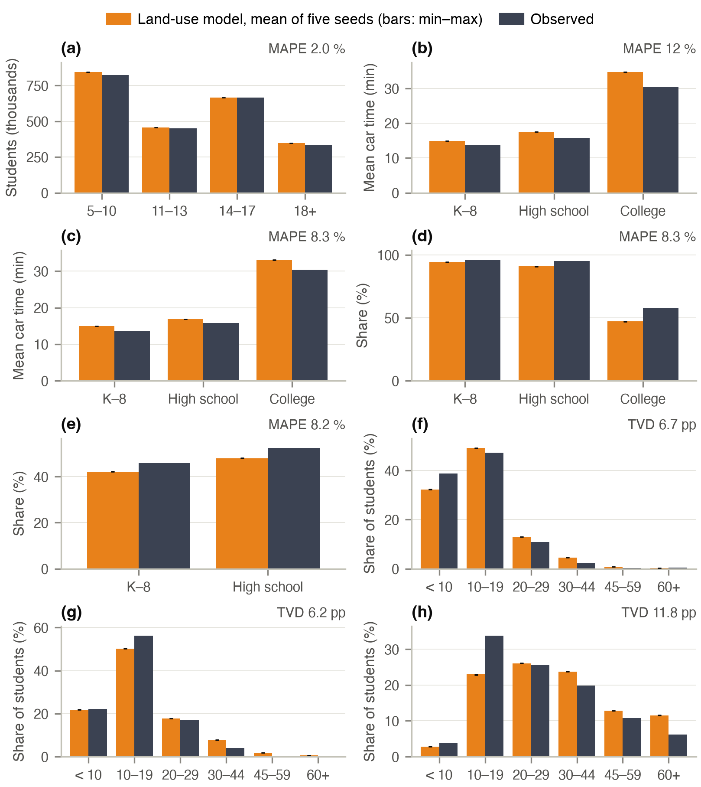

# School location

Students assigned to schools in every simulated year, against the survey students of the same counties and the ACS enrolment.

<b>2 %</b>students by age, error against the ACS

<b>1–4 min</b>assigned schools farther than surveyed

<b>420×</b>weight of an in-boundary K–8 seat

!!! info "How to read the figures"
    Orange: model; dark grey: observed; light grey: a second observed source. Error bars: range of the five land-use seeds or of the ten activity-model replications. Each panel shows one fit measure: for a distribution the total variation distance (TVD, percentage points of the population that would have to change class); for shares that are not one distribution, the mean absolute difference (MAD, percentage points); otherwise the mean absolute percentage error (MAPE).

<figure markdown>
  
  <figcaption>Schools, 2024 (2016 where stated). (a) students by age, 2024; (b) car time to school, 2024; (c) car time to school, 2016; (d) school in home county, 2024; (e) school zone holds the attendance-zone school, 2024; (f) car time to school, K–8, 2024; (g) car time to school, high school, 2024; (h) car time to school, college, 2024.</figcaption>
</figure>

## Why the car time to school is too long

The assigned schools are 1 to 4 minutes farther than the schools of the survey students (2024: K–8 14.9 against
13.7 min, high school 17.5 against 15.7, college 34.7 against 30.3). Most of the gap is present in the base year (2016:
14.9, 16.8 and 33.0 min), and it grows slowly for high school and college as the population moves while the school
inventory and its capacities stay fixed. Enrolment is an upper limit, enforced by shadow prices, so students who do not
find a seat at a near school are sent to a farther one. The observed times are those of the 2017/18 survey students,
so the 2024 comparison also carries seven years of change in where students live.

## Scorecard

8 comparisons: 2 within the limit, 4 close, 2 outside.

| Compared variable | Fit | Result | Note |
|---|---:|:---:|---|
| Students by age, 2024 | MAPE 2.0 % | Within |  |
| Car time to school, 2024 | MAPE 12 % | Outside |  |
| Car time to school, 2016 | MAPE 8.3 % | Close |  |
| School in home county, 2024 | MAD 5.6 pp | Close |  |
| School zone holds the attendance-zone school, 2024 | MAD 4.0 pp | Within |  |
| Car time to school, k–8, 2024 | TVD 6.7 pp | Close |  |
| Car time to school, high school, 2024 | TVD 6.2 pp | Close |  |
| Car time to school, college, 2024 | TVD 11.8 pp | Outside |  |
