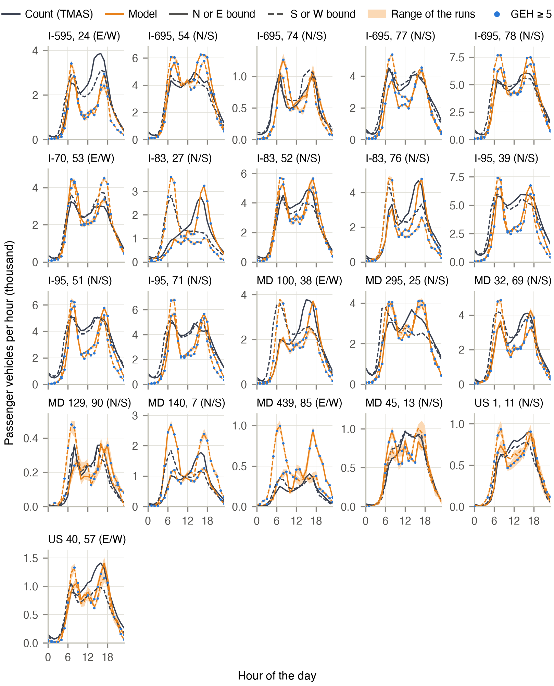
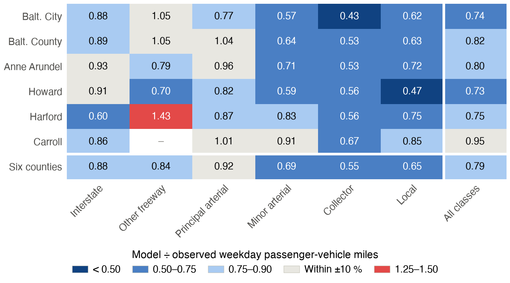
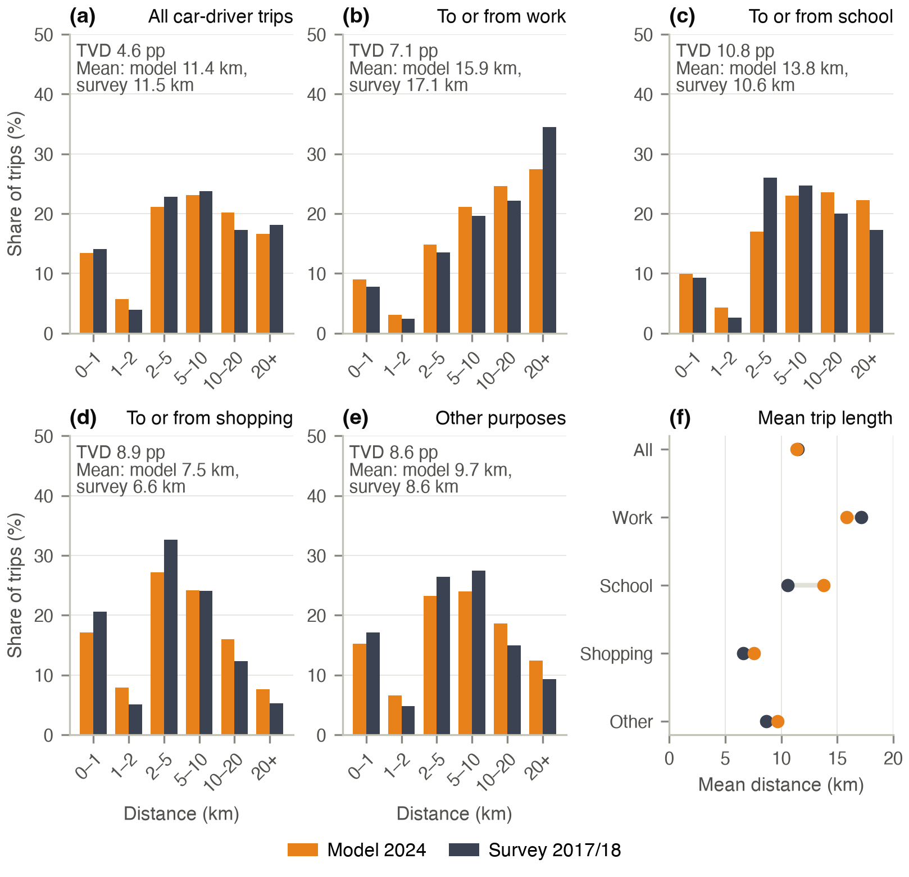

# Traffic

The 2024 assignment against the MDOT SHA counts (average annual weekday traffic, AAWDT), the FHWA continuous count
stations (TMAS), the screenlines and the MDOT SHA mileage. The assignment carries only the **residents' cars** with a
tour touching the six counties: trucks, commercial vehicles and through traffic are not simulated, so ratios below 1 are
expected, most of all off-peak and on roads with much freight. No count was used to set any speed or capacity. Model:
mean of five assignment seeds.

<b>0.81</b>model ÷ count, passenger vehicles, 2,308 mainline stations

<b>0.91</b>on I-695, passenger vehicles

<b>R² 0.90</b>across stations, passenger vehicles

<b>1.11 / 1.03</b>model ÷ count in the morning / evening peak, continuous count stations

[:material-map-marker-radius: Open the interactive validation map](map.md){ .md-button .md-button--primary }

!!! info "How to read the figures"
    Orange: model; dark grey: counts. Bands and error bars: range of the five assignment seeds. Ratios are model ÷ count.

## Counts at every station

Stations are matched to network links by road identity; 3,437 of 3,797 stations are matched unambiguously, 2,308 of them
on the mainline. Every interstate station, including the Baltimore Beltway (I-695) and the Capital Beltway (I-495), is
listed in [Interstates by station](interstates.md).

<figure markdown>
  
  <figcaption>Modelled against counted daily traffic at the 2,308 mainline stations, 2024: (a) all vehicles; (b) passenger vehicles, by road class. Dashed: least-squares line through the origin.</figcaption>
</figure>

Across stations the modelled volumes follow the counts with R² = 0.89 and a slope of 0.78 for all vehicles and R² = 0.90
and a slope of 0.84 for passenger vehicles. Two random halves of the stations give the same ratio (0.77 and 0.77).

| Facility class | Stations | Tolerance (%) | Model ÷ count, all | Model ÷ count, passenger | %RMSE, all | %RMSE, passenger |
|---|---:|---:|---:|---:|---:|---:|
| Interstate I-695 | 41 | ±7 | 0.84 | 0.91 | 18.9 | 14.3 |
| Other interstate | 77 | ±7 | 0.72 | 0.80 | 40.8 | 36.3 |
| Other freeway or expressway | 82 | ±7 | 0.86 | 0.88 | 38.3 | 37.5 |
| Principal arterial | 323 | ±15 | 0.93 | 0.96 | 37.7 | 38.7 |
| Minor arterial | 601 | ±15 | 0.69 | 0.71 | 52.5 | 51.8 |
| Major collector | 801 | ±25 | 0.58 | 0.60 | 68.4 | 67.4 |
| Minor collector or local | 383 | ±25 | 0.60 | 0.63 | 82.6 | 81.6 |
| All classes | 2,308 | – | 0.77 | 0.81 | 64.2 | 58.5 |

Mainline count stations of the six counties; ratio: model ÷ count of the summed volumes. Counts: MDOT SHA 2024 AAWDT,
both directions; passenger vehicles: count × (1 − truck and bus share of the station's classification counts, or of its
class where the station has none). Model: link volumes of residents' cars, mean of the last five iterations, scaled from
the 10 % sample. Tolerance: model ÷ count band by facility class (FDOT, 2008).

On I-695, other freeways and principal arterials the model carries 0.84 to 0.93 of all vehicles and 0.88 to 0.96 of
passenger vehicles, and principal arterials are within their tolerance; on minor arterials and collectors it carries
0.58 to 0.69. Only the volume group below 5,000 vehicles a day meets the %RMSE guideline.

<figure markdown>
  
  <figcaption>(a) Model ÷ count by road class; (b) root-mean-square error of passenger vehicles by volume group, with the guideline value of each group.</figcaption>
</figure>

## Through the day

The 21 of the 25 TMAS continuous count stations of the six counties with complete 2024 weekdays (42 station
directions): 15 freeway stations and 6 arterial and collector stations.

<figure markdown>
  
  <figcaption>Weekday hourly passenger-vehicle volumes at the TMAS continuous count stations of the six counties, 2024: count and model by direction. Panel title: road and TMAS station number. Blue dots: hours with GEH ≥ 5.</figcaption>
</figure>

| Period | Model ÷ count, freeways | Other | All | GEH < 5 (%), freeways | Other | All |
|---|---:|---:|---:|---:|---:|---:|
| Morning peak, 6:00–10:00 | 1.09 | 1.34 | 1.11 | 30 | 29 | 30 |
| Midday, 10:00–15:00 | 0.72 | 0.87 | 0.73 | 13 | 50 | 24 |
| Evening peak, 15:00–19:00 | 1.02 | 1.11 | 1.03 | 22 | 48 | 30 |
| Evening, 19:00–24:00 | 0.77 | 1.26 | 0.80 | 25 | 47 | 31 |
| Night, 0:00–6:00 | 0.48 | 0.98 | 0.50 | 11 | 57 | 24 |
| Whole day | 0.88 | 1.10 | 0.89 | 19 | 47 | 27 |

Observed: average weekday of 2024 by station, direction and hour, Monday to Friday without federal holidays, days with
every lane reporting all 24 hours, converted to passenger vehicles with the station's truck and bus shares. Ratio: model
÷ count of the volumes summed over the stations and hours of the period. GEH < 5: share of the station-direction-hours
of the period (guideline: 85 %). Source: FHWA Travel Monitoring Analysis System 2024.

The commute peaks, when residents' travel dominates, are reproduced; the gaps lie where the unmodelled trucks,
commercial vehicles and through traffic carry more of the traffic. Neither a class-based coding of speeds and capacities
(all-class ratio within 0.01) nor matching stations by proximity alone (ratios by class within 0.03) changes the result.

## Screenlines

Seven screenlines were placed on the region's rivers, county lines and cordons before any model result was read. The
table shows the four whose counted crossings carry at least 70 % of the motorway, trunk and primary capacity crossing
them; the southern regional boundary, the Little Gunpowder Falls and the rest of the regional boundary have less count
coverage.

| Screenline | Counted crossings | Count, all vehicles (thousand) | Model ÷ count, all | Model ÷ count, passenger | Maximum deviation (%) |
|---|---:|---:|---:|---:|---:|
| S1 Baltimore City cordon | 67 | 1,561 | 0.77 | 0.82 | ±10 |
| S2 Patapsco River | 21 | 941 | 0.89 | 0.97 | ±10 |
| Harbor and tidal river | 9 | 455 | 1.02 | 1.10 | ±10 |
| Upper river | 12 | 486 | 0.77 | 0.84 | ±10 |
| S3 Beltway cordon | 55 | 1,649 | 0.73 | 0.77 | ±10 |
| S6 Carroll County line | 12 | 203 | 0.93 | 1.01 | ±10 |

Counted: a matched mainline count station on the same road within 3 km of the line (6 km on motorways and trunk roads);
count and model are compared on the counted crossings only. Maximum deviation of a screenline total by its volume
(Wegmann, 2016; FDOT, 2008).

## Regional traffic

| Measure | Model | Observed | Fit |
|---|---:|---:|---|
| Weekday passenger-vehicle miles, six counties (million) | 54.8 | 69.3 | ratio 0.79; MAPE 20 % (counties) |
| Travel time to work, all modes (distribution) | 40.0 min | 29.3 min | TVD 15.2 pp |
| Travel time to work, drivers alone (distribution) | 26.7 min | 28.9 min | TVD 17.0 pp |
| Time leaving home for work, share 6:00–8:59 (distribution) | 65 % | 62 % | TVD 8.9 pp |
| Means of transport to work, public transport share (5 classes) | 8.3 % | 4.2 % | TVD 6.4 pp |
| Morning-peak car time, assigned vs. upstream skim (mean) | 23.3 min | 28.4 min | median ratio 0.78; 51 % within ±25 % |
| Weekday boardings, five MTA modes (thousand): NTD 2024 / 2017/18 equivalent | 456 | 174 / 255 | ratio 2.62 / 1.79 |
| Car-driver trip distance (distribution) | 15.3 km | 14.4 km | TVD 9.6 pp |
| Car-driver trip time (distribution) | 15.5 min | 22.0 min | TVD 21.7 pp |
| Passenger vehicles at 2,308 mainline count stations (sum, million) | 31.0 | 38.1 | gap 19 % |
| Home-to-work county flows (shares by home county) | 975 k | 1,380 k | TVD 5.7 pp; R² 0.98 |

Model: Maryland residents with a tour touching the region, mean of five assignment seeds. Observed: MDOT SHA 2024
vehicle miles, converted to weekday passenger vehicles with the region's count stations; ACS 2024 and 2020–2024; NTD
2024 average typical weekday boardings and their 2017/18 equivalent; travel survey 2017/18 (weighted); ACS 2016–2020
county-to-county flows.

The residents carry 0.79 of the weekday passenger-vehicle miles of the six counties, between 0.73 (Howard) and 0.95
(Carroll) by county and between 0.55 (collectors) and 0.92 (principal arterials) by road class. The modelled transit
boardings are 2.6 times the NTD 2024 count and 1.8 times its 2017/18 equivalent, the period of the survey on which the
mode choice is estimated (local bus 2.1, light rail 2.3, Metro subway 1.3, MARC and commuter bus 0.5). Transit carries
3.5 % of the residents' trips against 3.2 % in the survey, with 1.72 boardings per transit trip. The assigned
morning-peak car times are a median 0.78 of the fixed skim times on which the land-use and activity models chose
locations.

<figure markdown>
  
  <figcaption>Weekday passenger-vehicle miles, model ÷ observed, by county and road class, 2024. Observed: MDOT SHA Mileage Reports, converted to weekday passenger vehicles with the region's count stations. Blank: no mileage reported.</figcaption>
</figure>

## Residents' travel and road traffic

| Home county | By the residents: model | Survey | Ratio | On the roads: model | Observed | Ratio |
|---|---:|---:|---:|---:|---:|---:|
| Baltimore City | 10.7 | 9.5 | 1.13 | 11.5 | 15.4 | 0.74 |
| Baltimore County | 18.3 | 17.8 | 1.03 | 21.3 | 26.0 | 0.82 |
| Anne Arundel | 21.4 | 19.5 | 1.10 | 21.8 | 27.1 | 0.80 |
| Howard | 20.7 | 19.5 | 1.06 | 24.5 | 33.5 | 0.73 |
| Harford | 23.7 | 21.1 | 1.13 | 19.6 | 26.1 | 0.75 |
| Carroll | 25.3 | 24.8 | 1.02 | 19.9 | 21.1 | 0.95 |
| Six counties | 18.7 | 17.3 | 1.08 | 19.5 | 24.7 | 0.79 |

Weekday passenger-vehicle miles per resident, 2024. By the residents: car-driver distance of the executed trips of the
county's residents wherever driven, against the travel survey 2017/18 (weighted). On the roads: all modelled car traffic
on the network of the county, against the MDOT SHA vehicle miles.

The residents drive slightly more than in the survey, while the traffic on the roads falls short: the gap lies in
traffic the model does not carry. The simulated car trips drive 74 % of their route on secondary, tertiary and local
roads when start and end lie less than 1 km apart and 14 % when they lie more than 20 km apart. For short trips, 0.2 to
5 km apart, the simulated route is 4 % longer than the fastest route on empty roads and 9 % longer than the shortest
route.

## Trip lengths

Measured alike, between census tracts, the residents' car-driver trips average 11.4 km against 11.5 km in the survey,
with a TVD of 4.6 percentage points; trips to or from shopping are longer than in the survey (7.6 against 6.6 km) and
trips to or from work shorter (15.9 against 17.2 km).

<figure markdown>
  
  <figcaption>Car-driver trip length, model 2024 against the travel survey 2017/18: (a) all trips; (b)–(e) by purpose; (f) mean length. Distance: straight line between the internal points of the census tracts of the two trip ends, for model and survey alike; residents of the six counties, survey weighted.</figcaption>
</figure>
