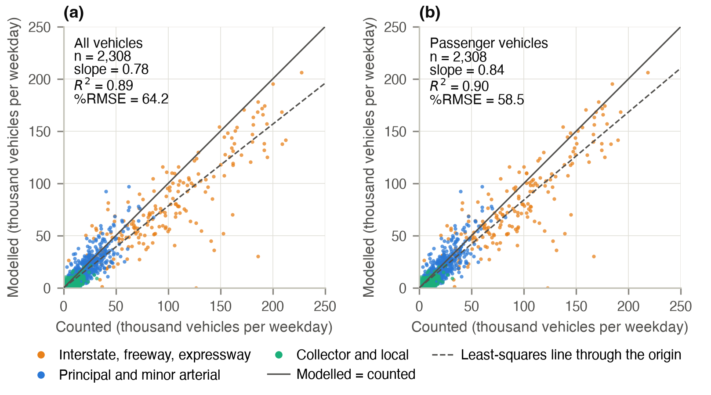
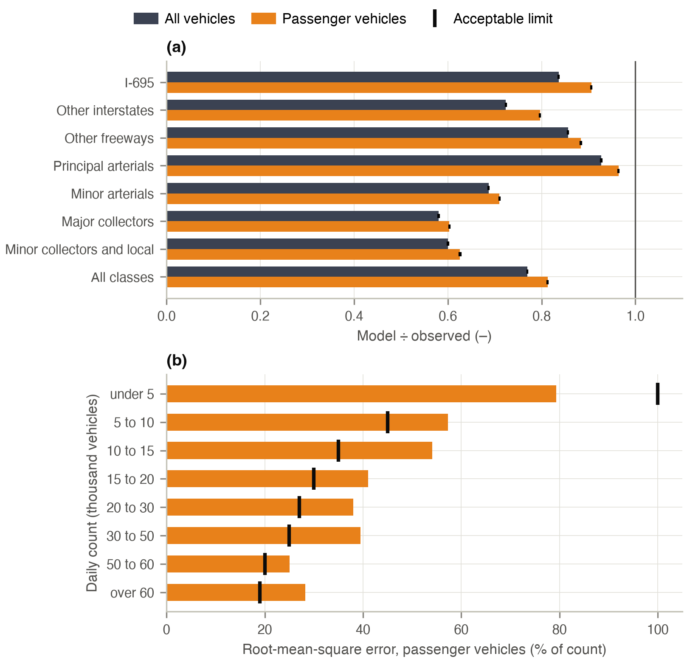
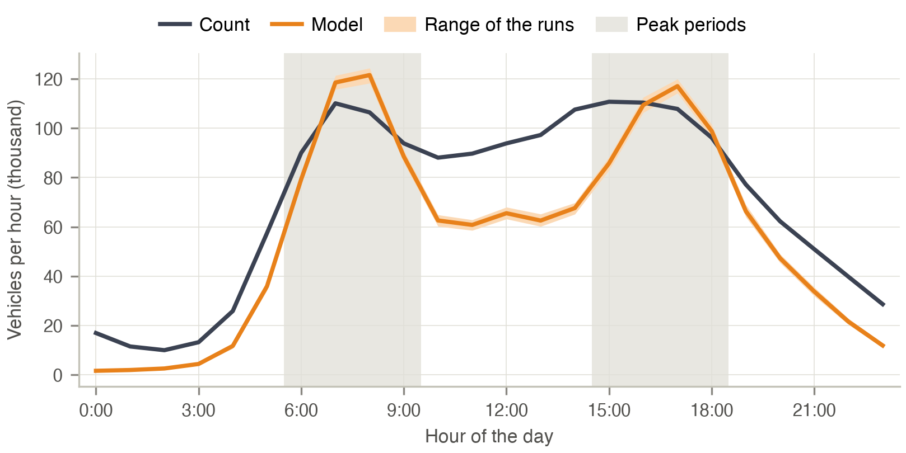
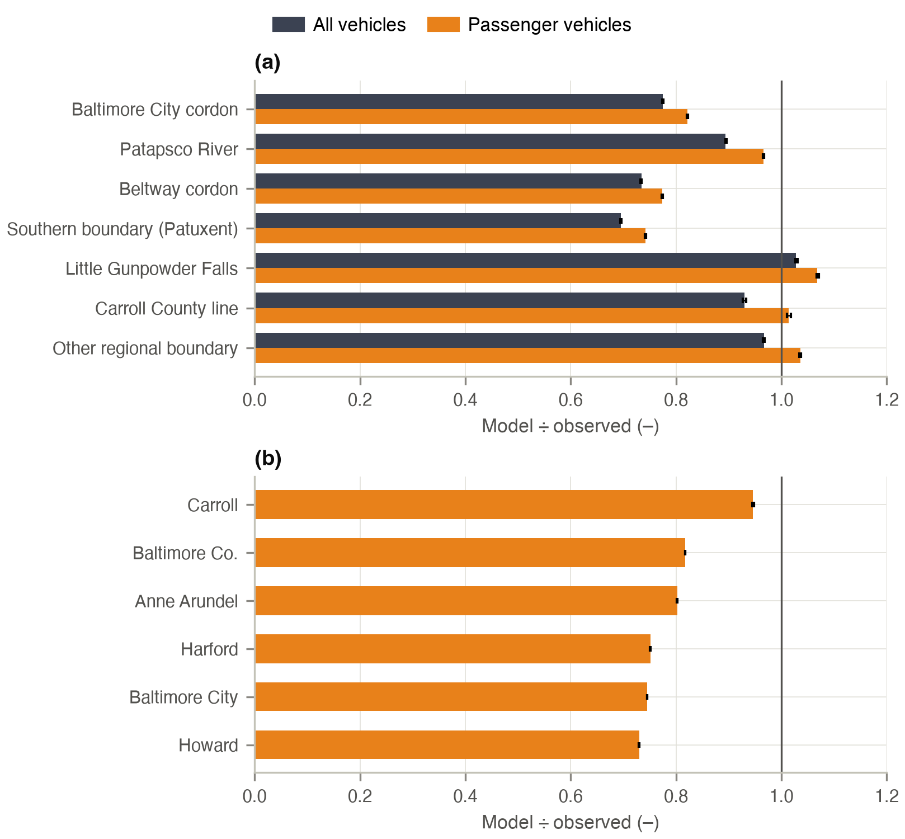

# Traffic

The 2024 assignment against the MDOT SHA counts (average annual weekday traffic), the FHWA continuous count stations,
seven screenlines and the MDOT SHA mileage. The model carries **residents only**: trucks, commercial vehicles and through
traffic are not simulated, so ratios below 1 are expected, most of all off-peak and on roads with much freight.
Model: mean of five seeds.

<b>0.81</b>model ÷ count, passenger vehicles, 2,308 mainline stations

<b>0.91</b>on I-695, passenger vehicles

<b>R² 0.90</b>across stations, passenger vehicles

<b>1.02 / 0.97</b>model ÷ count in the morning / evening peak, continuous counters

[:material-map-marker-radius: Open the interactive validation map](map.md){ .md-button .md-button--primary }

!!! info "How to read the figures"
    Orange: model; dark grey: counts. Bands and error bars: range of the five runs. Ratios are model ÷ count.

## Counts at every station

<figure markdown>
  
  <figcaption>Modelled against counted daily traffic at the 2,308 mainline stations: (a) all vehicles, (b) passenger vehicles, by road
  class; least-squares line through the origin.</figcaption>
</figure>

<figure markdown>
  
  <figcaption>(a) Model ÷ count by road class; (b) root-mean-square error of passenger vehicles by volume group against the
  acceptable limit of the FDOT standard.</figcaption>
</figure>

| Road class | Stations | Model ÷ count, all | Model ÷ count, passenger | %RMSE, passenger |
|---|---:|---:|---:|---:|
| Interstate: I-695 | 41 | 0.84 | 0.91 | 14.3 |
| Interstate: other | 77 | 0.72 | 0.80 | 36.3 |
| Other freeway / expressway | 82 | 0.86 | 0.88 | 37.5 |
| Principal arterial | 323 | 0.93 | 0.96 | 38.7 |
| Minor arterial | 601 | 0.69 | 0.71 | 51.8 |
| Major collector | 801 | 0.58 | 0.60 | 67.4 |
| Minor collector / local | 383 | 0.60 | 0.63 | 81.6 |
| **All classes** | **2,308** | **0.77** | **0.81** | **58.5** |

## Through the day

<figure markdown>
  
  <figcaption>Weekday vehicles per hour, summed over the MDOT SHA continuous count stations of the region and I-695
  (22 station directions). Model ÷ count: 1.02 at 6:00–10:00, 0.97 at 15:00–19:00, 0.67 at midday, 0.70 in the evening and
  0.43 at night (0.81 over the day). The peaks, when residents' travel dominates, are reproduced; the gaps lie where trucks,
  commercial vehicles and through traffic carry more of the traffic.</figcaption>
</figure>

## Screenlines and vehicle-miles

<figure markdown>
  
  <figcaption>(a) Model ÷ count on the counted crossings of the seven screenlines; (b) weekday passenger-vehicle miles by county,
  model ÷ MDOT SHA mileage.</figcaption>
</figure>

| Screenline | Counted crossings | Model ÷ count, all | Model ÷ count, passenger | Within FHWA deviation |
|---|---:|---:|---:|:---:|
| S1 Baltimore City cordon | 67 | 0.77 | 0.82 | no |
| S2 Patapsco River | 21 | 0.89 | 0.97 | yes |
| S3 Beltway cordon | 55 | 0.73 | 0.77 | no |
| S4 Southern boundary (Patuxent) | 10 | 0.70 | 0.74 | no |
| S5 Little Gunpowder Falls | 7 | 1.03 | 1.07 | yes |
| S6 Carroll County line | 12 | 0.93 | 1.01 | yes |
| S7 Other regional boundary | 19 | 0.97 | 1.04 | yes |

S4, S5 and S7 have counts on less than 70 % of the major-road capacity crossing them.

## Trip lengths

<figure markdown>
  
  <figcaption>Car-driver trip length of the residents against the 2017/18 travel survey, measured alike (straight line between the
  census tracts of the trip ends).</figcaption>
</figure>
