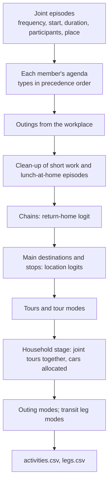

# ORIOLE-Day engine

ORIOLE-Day runs on the ABIT engine ([msmobility/abit](https://github.com/msmobility/abit)). Its own code is the
package `abm.models.maryland` and the run class `abm.RunAbitMarylandLos`, in `activity/java/ABIT/src/main/java`.

## Classes

| Class | Role |
|---|---|
| `abm.RunAbitMarylandLos` | entry point; `args[0]` = properties file; seed from `-Dabit.seed` |
| `abm.models.ModelSetupMaryland` | wires the sub-models; `mode.choice.model = tour_nl` selects the tour mode model |
| `abm.io.input.MarylandLosDataReader` | reads zones, skims, the land-use households, persons, jobs, dwellings, schools and workplaces |
| `MarylandTashaGenerator` | generation and scheduling from the survey distributions; outings, return home, stop relocation, tours (`tasha.generation=true`) |
| `MarylandDestinationChoice` | destination and stop logits over all zones (`dest.choice.model=mnl`) |
| `MarylandTourNestedModeChoice` | tour mode choice by segment; household stage (joint tours, car allocation) |
| `WorkAttendance` | daily work attendance |
| `MarylandFullModeChoice`, `MarylandTourModeChoice`, `MarylandFrequencyGenerator`, `MarylandStopModel`, … | earlier paths, kept but switched off |

## What happens per household

Households run in parallel, each with its own random stream.



Agenda order: WB, WAHB, PW, SW, RHW, SCH, JO_REC, JO_OTH, JS, IO_REC, IO_ACC, IO_OTH, IS. A conflict is resolved by
shifting the episode (up to 30 min), then shortening it (to half), then redrawing it (up to 10 times).

## Coefficient set: `activity/coef_respec/`

| File | Holds |
|---|---|
| `run_params.csv` | model switches appended to the properties |
| `tour_mode_choice.csv` | tour mode coefficients: work, school, shopping, other, joint shopping, joint other |
| `parking_paid_share.csv` | paid-parking share by destination area |
| `dest_choice_mnl.csv` | destination and stop logits (primary, stops, school/daycare, work business, home workers, outings) |
| `tasha/tasha_frequency.csv`, `tasha_start.csv`, `tasha_duration.csv` | survey distributions |
| `tasha/tasha_joint_*.csv` | joint episodes: participants and propensity |
| `tasha/tasha_return_home.csv` | return-home logit |
| `tasha/tasha_subtour.csv` | outing generation and mode |
| `tasha/tasha_transit_legs.csv` | transit leg modes |
| `tasha/tasha_params.csv` | scheduler parameters, worker-type shares, file names |
| `TERM_MAP.csv` | every estimated term → engine file and variable |

`activity/build_coef_respec.py` writes this set from the estimation outputs and records a checksum of every source in
`RESPEC_STATE.json`.

## Run

```bash
python activity/run_abit.py myrun --coef activity/coef_respec --seed 1 --sample 0.1 --threads 6 --xmx 13g --year 2024
```

This copies the coefficient set into the run folder and starts
`java -Dabit.seed=N -Djava.library.path=… abm.RunAbitMarylandLos <properties>`.
