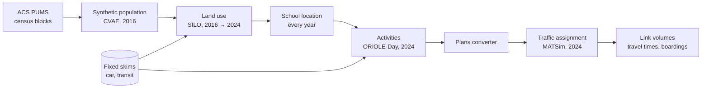

# Get started

ORIOLE runs as five stages. Each stage can be run on its own from the outputs of the previous one, or the whole chain
can be driven by the pipeline.

-   :material-download: **[Installation](installation.md)**

    Python environments, Java 21, Maven and the three engines.

-   :material-file-tree: **[Repository layout](repository.md)**

    Where each component lives.

-   :material-play-circle: **[Run the chain](running.md)**

    The commands, stage by stage.

-   :material-timer-sand: **[Runtime and storage](runtime.md)**

    How long each stage takes and how much memory and disk it needs.

## The chain in one view

