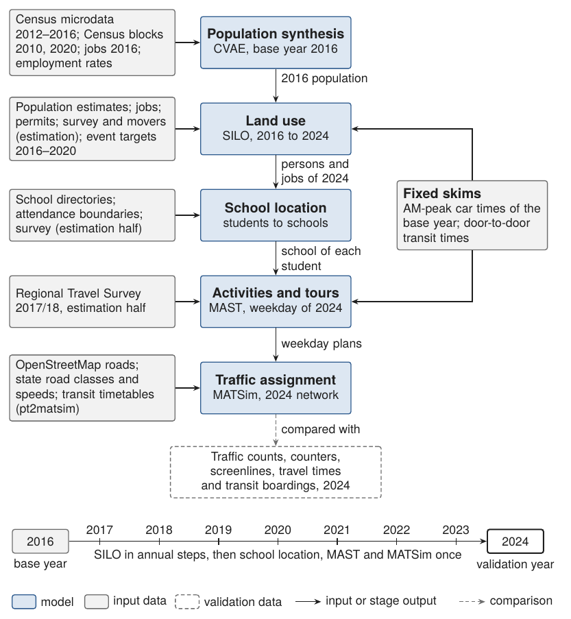
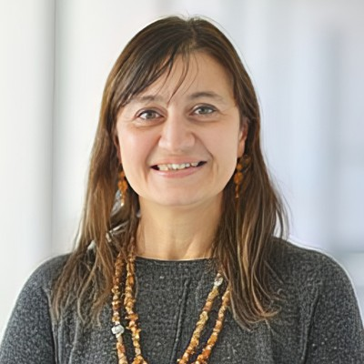

---
hide:
  - navigation
  - toc
---

# ORIOLE — from census records to cars on the road

An agent-based modelling platform for Maryland. ORIOLE synthesises every household of the
region, moves it through the housing and job markets year by year, plans each person's weekday, and simulates the
resulting traffic on the road and transit networks.

[Get started](get-started/index.md){ .md-button .md-button--primary }
[How it works](model-design/index.md){ .md-button }
[:fontawesome-brands-github: Code](https://github.com/Tomal121186621){ .md-button }

<b>Population</b>Conditional VAE trained on census microdata

<b>Land use</b>SILO: moves, jobs, cars, 2016 → 2024

<b>Schools</b>Every student to a school, every year

<b>Activities</b>ORIOLE-Day: a weekday plan per person

<b>Traffic</b>MATSim on the 2024 road and transit networks

<b>12.5 M</b>synthetic persons

<b>1,588</b>zones, six states

<b>28</b>estimated choice models

<b>3,946</b>activity distributions

<b>3,437</b>count stations tested

## Why ORIOLE

-   :material-account-group:{ .lg .middle } **Every person is an agent**

    ---

    Households, persons, dwellings, jobs and schools are simulated individually, so results can be split by income,
    age, place of residence or any other attribute.

-   :material-brain:{ .lg .middle } **Deep generative population**

    ---

    A conditional variational autoencoder generates households beyond the combinations seen in the sample, with
    PUMA and household size as conditions.

-   :material-home-city:{ .lg .middle } **Land use that evolves**

    ---

    Residential moves, job changes, births, deaths, marriages and car ownership update the population every year
    from 2016 to 2024.

-   :material-calendar-clock:{ .lg .middle } **A full weekday for everyone**

    ---

    ORIOLE-Day draws activities from survey distributions, schedules them, locates them with estimated logit models
    and chooses tour modes with household car allocation and joint tours.

-   :material-road-variant:{ .lg .middle } **Dynamic traffic**

    ---

    MATSim routes every trip and shifts departure times on an OpenStreetMap network with the region's transit
    timetables and income-based values of time.

-   :material-check-decagram:{ .lg .middle } **Estimated and tested, not tuned**

    ---

    28 choice models estimated with Biogeme; every stage tested on data it never saw. Traffic counts play no role in
    estimation or calibration.

## How it works

<figure markdown>
  { width="560" }
  <figcaption>The model chain: each stage's output is the next stage's input. Land use runs in annual steps; activities and
  traffic are simulated for a weekday of 2024.</figcaption>
</figure>

## What you can do with it

-   :material-cash-multiple: **Road pricing**

    Toll schemes on the Baltimore Beltway (I-695): who pays, who diverts, and where traffic goes.
    [Case study](applying/i695.md)

-   :material-bus-multiple: **Transit service**

    Changes to timetables or routes, with door-to-door transit times feeding mode choice.

-   :material-office-building-marker: **Land-use change**

    New housing or jobs in a zone, and how households and workers re-sort over the years.

-   :material-chart-bell-curve: **Equity analysis**

    Effects by household income, car ownership or home location, person by person.

## Start here

-   :material-download: **[Install](get-started/installation.md)**

    Python, Java and the three engines.

-   :material-play-circle: **[Run the chain](get-started/running.md)**

    From the base population to link volumes, step by step.

-   :material-file-tree: **[Repository layout](get-started/repository.md)**

    Where each component lives in the code.

-   :material-function-variant: **[Re-estimate a model](developers/estimation-package.md)**

    Notebooks that rebuild every estimate with Biogeme.

Developed at the <b>Center for MultiModal Mobility in Urban, Rural and Tribal Areas (CMMM)</b>, University of Maryland,
College Park, by <b>Raas Sarker Tomal</b> (<a href="mailto:rtomal@umd.edu">rtomal@umd.edu</a>) under the supervision of
<b>Dr. Cinzia Cirillo</b>, Director of CMMM (<a href="mailto:ccirillo@umd.edu">ccirillo@umd.edu</a>). <a href="about/team/">Team</a>

