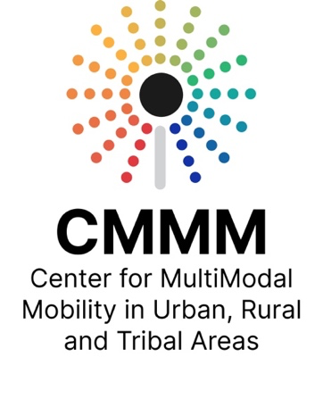

---
hide:
  - navigation
  - toc
---

MILES · Maryland Integrated Land-use and Everyday-travel Simulator

# From census records to cars on the road

<b>MILES</b> (<b>M</b>aryland <b>I</b>ntegrated <b>L</b>and-use and <b>E</b>veryday-travel <b>S</b>imulator) is an agent-based modelling platform for Maryland. It synthesises every household of the region, moves it through the housing and job markets year by year, plans each person's weekday, and simulates the
resulting traffic on the road and transit networks.

[Get started](get-started/index.md){ .md-button .md-button--primary }
[How it works](model-design/index.md){ .md-button }
[:material-map-marker-radius: Traffic validation map](calibration-validation/validation/map.md){ .md-button }
[:fontawesome-brands-github: Code](https://github.com/Tomal121186621/MILES){ .md-button }

<b>12.5 M</b>synthetic persons

<b>1,588</b>zones, six states

<b>28</b>estimated choice models

<b>3,946</b>activity distributions

<b>2,308</b>mainline count stations tested

## Why MILES

-   :material-account-group:{ .lg .middle } **Every person is an agent**

    ---

    Households, persons, dwellings, jobs and schools are simulated individually, so results can be split by income,
    age, place of residence or any other attribute.

-   :material-brain:{ .lg .middle } **Deep generative population**

    ---

    A conditional variational autoencoder generates households beyond the combinations seen in the sample, with
    PUMA and household size as conditions.

-   :material-home-city:{ .lg .middle } **Land use that evolves**

    ---

    Residential moves, job changes, births, deaths, marriages and car ownership update the population every year
    from 2016 to 2024.

-   :material-calendar-clock:{ .lg .middle } **A full weekday for everyone**

    ---

    MILES-Day draws activities from survey distributions, schedules them, locates them with estimated logit models
    and chooses tour modes with household car allocation and joint tours.

-   :material-road-variant:{ .lg .middle } **Dynamic traffic**

    ---

    MATSim routes every trip and shifts departure times on an OpenStreetMap network with the region's transit
    timetables and income-based values of time.

-   :material-check-decagram:{ .lg .middle } **Estimated and tested, not tuned**

    ---

    28 choice models estimated with Biogeme; every stage tested on data it never saw. Traffic counts play no role in
    estimation or calibration.

## How it works

Each stage hands its output to the next. Land use runs year by year; activities and traffic are simulated for a
weekday of 2024. [Full model design](model-design/index.md)

ACS microdata · Census blocks<b>Population</b>4.7 M households, 2016

Population estimates · jobs · permits<b>Land use</b>households, jobs, dwellings 2017–2024

School directories · boundaries<b>Schools</b>a school for every student

Travel survey · skims<b>Activities</b>a weekday plan per person

OpenStreetMap · GTFS<b>Traffic</b>routes, link volumes, travel times

## What you can do with it

-   :material-cash-multiple: **Road pricing**

    Toll schemes on the Baltimore Beltway (I-695): who pays, who diverts, and where traffic goes.
    [Case study](applying/i695.md)

-   :material-bus-multiple: **Transit service**

    Changes to timetables or routes, with door-to-door transit times feeding mode choice.

-   :material-office-building-marker: **Land-use change**

    New housing or jobs in a zone, and how households and workers re-sort over the years.

-   :material-chart-bell-curve: **Equity analysis**

    Effects by household income, car ownership or home location, person by person.

## Start here

-   :material-download: **[Install](get-started/installation.md)**

    Python, Java and the three engines.

-   :material-play-circle: **[Run the chain](get-started/running.md)**

    From the base population to link volumes, step by step.

-   :material-file-tree: **[Repository layout](get-started/repository.md)**

    Where each component lives in the code.

-   :material-function-variant: **[Re-estimate a model](developers/estimation-package.md)**

    Notebooks that rebuild every estimate with Biogeme.

-   :material-map-marker-radius: **[Validation map](calibration-validation/validation/map.md)**

    Every count station against the simulated 2024 traffic.

Developed at the <b>Center for MultiModal Mobility in Urban, Rural and Tribal Areas (CMMM)</b>, University of Maryland,
College Park, by <b>Raas Sarker Tomal</b> (<a href="mailto:rtomal@umd.edu">rtomal@umd.edu</a>) under the supervision of
<b>Dr. Cinzia Cirillo</b>, Director of CMMM (<a href="mailto:ccirillo@umd.edu">ccirillo@umd.edu</a>). <a href="about/team/">Team</a>

