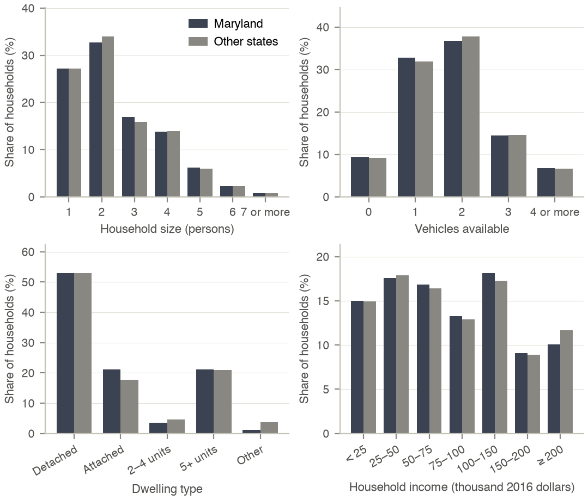
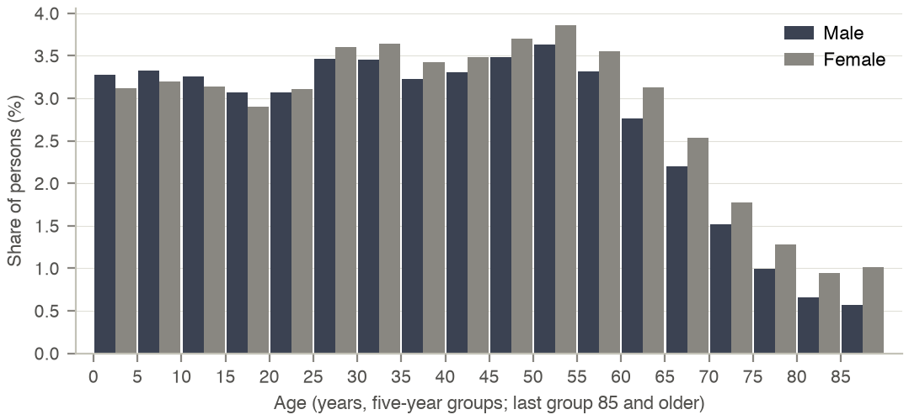
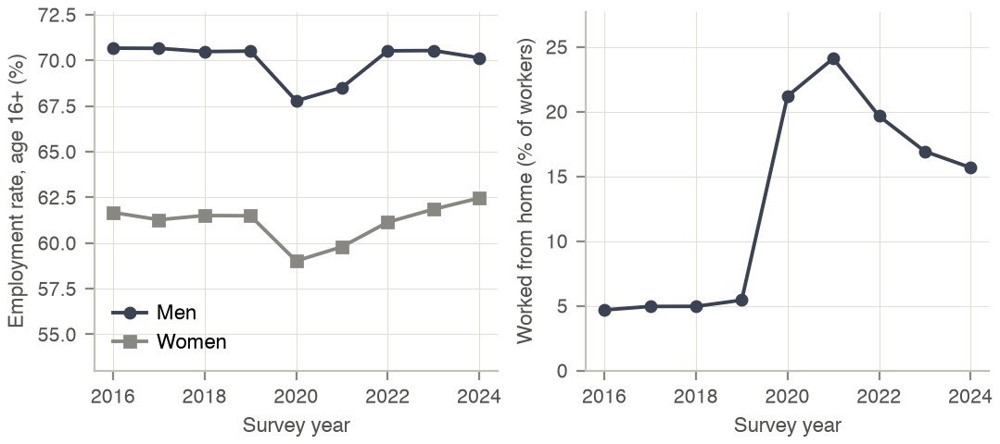

# American Community Survey microdata

The American Community Survey Public Use Microdata Sample (PUMS) [[1]](../inputs.md#sources) is the main source of household and person attributes in MILES. The Census Bureau releases it as one household and one person file per state and vintage; the files are public and are read directly from the downloaded zip archives. MILES uses several vintages, each for a different purpose. All shares below are weighted with the PUMS household (`WGTP`) or person (`PWGTP`) weights unless stated otherwise; dollar values are in 2016 dollars. Variable names are those of the PUMS data dictionaries of the Census Bureau.

| File | Unit | Area | Used for | Role |
|---|---|---|---|---|
| 2012–16 5-year | Household, person | Six states, model-area PUMAs | Training of the population generator | Estimation; test (held-out split) |
| 2014–18 5-year | Household, person | Six states; Maryland | Population controls; car ownership; population test | Input; estimation; test |
| 2014–18 and 2017–21 5-year, movers | Household | Six states | Residential location (region, zone, dwelling) | Estimation (2014–18); test (2019–21) |
| 2013–17 5-year | Household, person | Maryland | Vacant units on the market by PUMA; base employment rates by age and sex | Input |
| 5-year files 2014–18 to 2020–24 | Household, person | Maryland | Yearly land-use tests: households, workers, events, commute time | Test |
| 2015–19 5-year (2017–19) | Person | DC, MD, VA, WV | Commute-mode shares for choice-based weights | Target |
| 1-year, 2016–24 | Person | Six states | Employment rates by age, sex and year | Target |
| 1-year 2024; 2020–24 5-year | Household, person | Maryland | Commute and household benchmarks of 2024 | Test |

## 2012–16 5-year file: population synthesis

The generator of the synthetic population (a conditional variational autoencoder) is trained on the households and persons of the 2012–16 5-year PUMS [[1]](../inputs.md#sources) of the six states that the zone system touches: Delaware, the District of Columbia, Maryland, Pennsylvania, Virginia and West Virginia. Only the Public Use Microdata Areas (PUMAs) that contain a model zone are kept (96 PUMAs). The files are the standard state household (`csv_h<st>.zip`) and person (`csv_p<st>.zip`) files of the Census Bureau.

### Codebook

| Variable | Description | Type | Values / categories / units | Used in |
|---|---|---|---|---|
| `SERIALNO` | Housing unit identifier; joins persons to households | string | 13 characters; the first four give the survey year | all |
| `PUMA` | Public Use Microdata Area (2010 definition) | string | 5 digits; with the state code gives `puma_key` | conditioning variable; zone allocation |
| `TYPE` | Type of unit | integer | 1 housing unit; 2, 3 group quarters (dropped) | filter |
| `WGTP` | Household weight | integer | households; clipped to 0–200 | training weights |
| `NP` | Number of persons | integer | 1–20; 7 or more pooled for conditioning | household size |
| `VEH` | Vehicles available | integer | 0–6; recoded 0, 1, 2, 3, 4 or more | household autos |
| `HINCP`, `ADJINC` | Household income; inflation factor | integer | dollars, × `ADJINC`/10⁶ to 2016 dollars; 22 bins, open top bin | household income |
| `BLD` | Units in structure | integer | 1–10; recoded to 5 dwelling types | dwelling type |
| `YBL` | Year structure built | integer | 1–20 (decades to 2004, then single years 2005–16); recoded to a year | dwelling year built |
| `BDSP` | Bedrooms | integer | 0–5 or more | dwelling bedrooms |
| `GRNTP`, `SMOCP` | Gross rent; selected monthly owner costs | integer | dollars per month; summed, clipped to 0–10,000 | dwelling monthly cost |
| `TEN` | Tenure | integer | 1, 2 owned; 3, 4 rented or occupied without rent | dwelling tenure |
| `SPORDER` | Person number in the household | integer | 1–20 | household roster |
| `PWGTP` | Person weight | integer | persons; clipped to 0–500 | training weights |
| `AGEP` | Age | integer | years, 0–96 (top-coded); 18 five-year bins | person age |
| `SEX` | Sex | integer | 1 male, 2 female | person gender |
| `RAC1P`, `HISP` | Race; Hispanic origin | integer | recoded to 5 groups (Hispanic of any race first) | person race |
| `ESR` | Employment status recode | integer | 1–6; with `SCHG` and age gives occupation | person occupation |
| `SCHG` | Grade level attending | integer | 1–16; any grade = student | person occupation |
| `PINCP` | Person income | integer | dollars, × `ADJINC`/10⁶; 16 bins, bin 0 = no income | person income |
| `NATIVITY`, `CIT` | Nativity; citizenship | integer | recoded native, naturalised, not a citizen | person nationality |
| `RELP` | Relationship to the reference person | integer | 0–17; recoded to 8 roles | person relationship |
| `JWTR` | Means of transportation to work | integer | 1–12; bicycle, walked, other (9, 10, 12) = no licence | driver's licence proxy |
| `POWPUMA`, `POWSP` | Place-of-work PUMA and state | string | PUMA of work | workplace assignment |

### Records

| State | Household records | Person records | In model-area PUMAs | Housing units kept | Persons kept |
|---|---:|---:|---:|---:|---:|
| Delaware | 22,502 | 44,486 | 22,502 | 17,991 | 42,864 |
| District of Columbia | 18,379 | 32,648 | 18,379 | 14,333 | 29,598 |
| Maryland | 134,588 | 295,066 | 134,588 | 113,205 | 281,513 |
| Pennsylvania | 317,416 | 640,261 | 43,786 | 36,792 | 91,166 |
| Virginia | 194,229 | 416,279 | 67,356 | 61,150 | 159,293 |
| West Virginia | 48,662 | 90,734 | 12,623 | 9,558 | 21,767 |
| **Total** | **735,776** | **1,519,474** | **299,234** | **253,029** | **626,201** |

After the coverage scaling, the sample represents 4,704,934 households and 12,491,069 persons in households (253,029 household and 626,201 person records; mean weighted household size 2.52). The households are split by PUMA into a training (202,427), a validation (25,304) and a held-out test set (25,298 households); the test set is used only for the validation of the generator.

Missing values among the kept records (share of records): `VEH` 0.0 %; `HINCP` 0.0 %; `GRNTP` 73.9 %; `SMOCP` 27.6 %; `TEN` 0.0 %; `ESR` 19.2 %; `SCHG` 76.2 %; `PINCP` 17.9 %; `JWTR` 49.6 %; `POWPUMA` 49.6 %. Vacant units and group quarters are not kept, so vehicles, income and tenure are complete; `GRNTP` is reported for renters and `SMOCP` for owners only. `ESR` is missing for persons under 16, `PINCP` for persons under 15, `SCHG` for persons not attending school, and `JWTR` and `POWPUMA` for persons who did not work in the reference week.

### Households

Weighted shares (%) of the kept households, by state of the PUMA.

| Variable | Category | MD | DC | VA | PA | DE | WV | All |
|---|---|---:|---:|---:|---:|---:|---:|---:|
| Household size | 1 | 27.2 | 43.7 | 24.3 | 24.9 | 26.8 | 29.1 | 27.2 |
|  | 2 | 32.7 | 30.6 | 31.8 | 36.8 | 36.4 | 35.8 | 33.4 |
|  | 3 | 16.9 | 12.1 | 17.0 | 16.0 | 15.3 | 15.6 | 16.3 |
|  | 4 | 13.8 | 8.4 | 16.2 | 13.7 | 12.9 | 11.5 | 13.9 |
|  | 5 | 6.3 | 3.3 | 7.0 | 5.9 | 5.5 | 5.6 | 6.1 |
|  | 6 | 2.3 | 1.3 | 2.8 | 2.1 | 2.2 | 2.1 | 2.3 |
|  | 7 or more | 0.8 | 0.5 | 1.0 | 0.7 | 0.9 | 0.4 | 0.8 |
| Vehicles available | 0 | 9.3 | 36.4 | 5.1 | 6.7 | 6.4 | 5.9 | 9.3 |
|  | 1 | 32.8 | 43.7 | 30.4 | 28.4 | 33.9 | 32.8 | 32.3 |
|  | 2 | 36.7 | 16.0 | 40.9 | 40.5 | 39.8 | 37.5 | 37.3 |
|  | 3 | 14.4 | 3.0 | 16.3 | 16.7 | 13.8 | 16.3 | 14.5 |
|  | 4 or more | 6.8 | 0.9 | 7.4 | 7.6 | 6.0 | 7.5 | 6.7 |
| Dwelling type | Single-family detached | 52.9 | 12.1 | 50.5 | 64.6 | 61.3 | 71.0 | 52.9 |
|  | Single-family attached | 21.1 | 25.5 | 20.2 | 14.9 | 14.0 | 6.1 | 19.3 |
|  | 2–4 units | 3.6 | 10.2 | 2.4 | 6.5 | 3.8 | 3.2 | 4.2 |
|  | 5 or more units | 21.2 | 52.1 | 25.5 | 8.8 | 13.3 | 6.5 | 21.0 |
|  | Mobile home, other | 1.3 | 0.0 | 1.4 | 5.2 | 7.5 | 13.2 | 2.6 |
| Tenure | Owner | 66.2 | 40.4 | 65.6 | 73.0 | 70.5 | 70.7 | 66.1 |
|  | Renter | 33.8 | 59.6 | 34.4 | 27.0 | 29.5 | 29.3 | 33.9 |
| Household income (2016 \$) | Under \$25,000 | 15.0 | 21.3 | 9.0 | 17.6 | 18.4 | 24.1 | 15.0 |
|  | \$25,000–49,999 | 17.6 | 16.2 | 12.6 | 22.8 | 22.6 | 24.3 | 17.8 |
|  | \$50,000–74,999 | 16.9 | 13.1 | 14.3 | 19.2 | 18.7 | 18.5 | 16.6 |
|  | \$75,000–99,999 | 13.2 | 10.8 | 12.7 | 13.4 | 13.7 | 13.6 | 13.1 |
|  | \$100,000–149,999 | 18.1 | 15.5 | 20.8 | 15.1 | 14.8 | 12.0 | 17.7 |
|  | \$150,000–199,999 | 9.1 | 8.6 | 12.7 | 5.7 | 6.1 | 4.2 | 9.0 |
|  | \$200,000 or more | 10.1 | 14.5 | 17.9 | 6.2 | 5.7 | 3.1 | 10.9 |

### Persons

Weighted shares (%) of the persons in the kept households.

| Variable | Category | MD | DC | VA | PA | DE | WV | All |
|---|---|---:|---:|---:|---:|---:|---:|---:|
| Age | 0–5 | 7.6 | 7.9 | 8.3 | 7.3 | 7.3 | 7.2 | 7.7 |
|  | 6–17 | 15.5 | 10.5 | 16.3 | 16.0 | 15.1 | 15.1 | 15.5 |
|  | 18–34 | 22.3 | 32.5 | 22.8 | 19.6 | 21.7 | 21.1 | 22.4 |
|  | 35–64 | 41.0 | 37.5 | 41.8 | 40.9 | 39.5 | 41.4 | 40.9 |
|  | 65 or older | 13.6 | 11.6 | 10.8 | 16.2 | 16.4 | 15.3 | 13.5 |
| Sex | Male | 48.2 | 47.2 | 49.4 | 49.1 | 48.2 | 49.6 | 48.6 |
|  | Female | 51.8 | 52.8 | 50.6 | 50.9 | 51.8 | 50.4 | 51.4 |
| Race and ethnicity | White, non-Hispanic | 52.6 | 35.7 | 56.3 | 85.6 | 63.7 | 88.9 | 59.4 |
|  | Black, non-Hispanic | 29.0 | 47.5 | 11.9 | 3.8 | 20.8 | 4.9 | 20.8 |
|  | Hispanic | 9.3 | 10.8 | 15.6 | 6.6 | 8.9 | 3.1 | 10.3 |
|  | Asian or Pacific Islander, non-Hispanic | 6.1 | 3.5 | 12.3 | 2.2 | 3.8 | 1.0 | 6.5 |
|  | Other, non-Hispanic | 3.0 | 2.5 | 3.8 | 1.8 | 2.8 | 2.2 | 3.0 |
| Occupation | Employed | 51.8 | 54.9 | 54.5 | 49.6 | 48.0 | 46.0 | 51.8 |
|  | Student | 17.6 | 14.0 | 18.2 | 16.6 | 17.0 | 17.4 | 17.3 |
|  | Retired | 11.9 | 10.1 | 9.2 | 14.7 | 15.3 | 15.0 | 11.9 |
|  | Unemployed | 3.0 | 4.3 | 2.0 | 2.6 | 3.0 | 3.2 | 2.8 |
|  | Child under 6 | 7.6 | 7.9 | 8.3 | 7.3 | 7.3 | 7.2 | 7.7 |
|  | Other | 8.1 | 8.8 | 7.7 | 9.3 | 9.5 | 11.2 | 8.4 |
| Driver's licence (proxy), age 16+ | Yes | 98.0 | 88.9 | 97.7 | 97.9 | 98.4 | 98.6 | 97.5 |
|  | No | 2.0 | 11.1 | 2.3 | 2.1 | 1.6 | 1.4 | 2.5 |
| Nationality | Native-born | 85.1 | 85.6 | 76.4 | 95.3 | 90.9 | 96.8 | 85.4 |
|  | Naturalised citizen | 7.3 | 5.9 | 11.9 | 2.3 | 4.3 | 1.6 | 7.2 |
|  | Not a citizen | 7.6 | 8.5 | 11.6 | 2.4 | 4.8 | 1.6 | 7.4 |

### Numeric variables

Weighted mean, median and standard deviation; minimum and maximum over the records.

| Variable | Unit | Records | Mean | Median | Std. dev. | Min | Max |
|---|---|---:|---:|---:|---:|---:|---:|
| Household size | persons | 253,029 | 2.52 | 2 | 1.46 | 1 | 20 |
| Household income | 2016 \$ | 253,029 | 101,846 | 76,044 | 100,040 | -15,157 | 2,203,935 |
| Bedrooms | rooms | 253,029 | 2.89 | 3 | 1.14 | 0 | 5 |
| Monthly housing cost | \$ | 253,029 | 1,560 | 1,370 | 1,065 | 0 | 10,000 |
| Year built (recoded) | year | 253,029 | 1975 | 1975 | 23.0 | 1935 | 2016 |
| Age | years | 626,201 | 38.05 | 38 | 22.53 | 0 | 96 |
| Person income | 2016 \$ | 626,201 | 39,399 | 20,152 | 61,783 | -12,458 | 1,678,031 |

*Weighted distributions of the households of the model-area PUMAs, Maryland and the other five states, ACS PUMS 2012–16.*

*Weighted age distribution of the persons in the kept households by sex, all six states, ACS PUMS 2012–16.*

### Processing

- Housing units only (`TYPE` = 1, `NP` ≥ 1); group quarters are not part of the synthetic population.
- PUMAs without a model zone are dropped. In the five PUMAs that lie partly outside the zone system (West Virginia and Virginia), household and person weights are multiplied by the covered share of the PUMA.
- Incomes are converted to 2016 dollars with `ADJINC` and binned (22 household, 16 person bins); income is not top-coded beyond the Census Bureau's own top-coding. Dollar values are redrawn within the bin at generation.
- Occupation: age under 6 → child; `ESR` 1, 2, 4, 5 → employed; attending school (`SCHG` > 0) → student; `ESR` 3 → unemployed; age 62 or older and not in the labour force → retired; otherwise other.
- The PUMS has no driver's licence variable. Persons aged 16 or older are coded as licensed unless their usual means of travel to work is bicycle, walking or other; persons under 16 are unlicensed.
- Missing values are set to 0 before the recodes (no rent or owner cost, no income, not employed, not attending school); missing `BLD` and `YBL` become single-family detached and 1985.
- Weights are clipped to 0–200 (households) and 0–500 (persons).

## 2014–18 5-year file: controls, car ownership and population test

The 2014–18 5-year file [[1]](../inputs.md#sources) is centred on the base year 2016. It is used three times: (a) its person and household weights per PUMA are the controls to which the generated population is fitted (persons in households by age band 0–17, 18–34, 35–64, 65+; households by size 1 to 5 or more); (b) the Maryland households form the estimation sample of the car-ownership model; (c) the Maryland PUMA distributions (age, sex, employment, household size, income, vehicles, tenure, dwelling type) are the test of the base-year population.

### Codebook

| Variable | Description | Type | Values / categories / units | Used in |
|---|---|---|---|---|
| `SERIALNO` | Housing unit identifier | string | join of persons to households; hash gives the 80/20 split | all |
| `PUMA` | PUMA (2010) | integer | 5 digits | controls; location variables |
| `TYPE` | Type of unit | integer | 1 housing unit (kept) | filter |
| `WGTP` | Household weight | integer | households | controls; weights |
| `PWGTP` | Person weight | integer | persons | controls |
| `RELP` | Relationship | integer | 16, 17 group quarters (dropped) | controls |
| `NP` | Number of persons | integer | 1–20, capped at 8 | car ownership: household size |
| `VEH` | Vehicles available | integer | 0–6, recoded 0, 1, 2, 3 or more | car ownership: choice |
| `HINCP`, `ADJINC` | Household income; inflation factor | integer | dollars, to 2016 dollars with `ADJINC` and the CPI-U | car ownership: income |
| `BLD` | Units in structure | integer | 2 detached, 3 attached, 4–9 multifamily | car ownership: dwelling type |
| `BDSP` | Bedrooms | integer | 0–5 or more | car ownership |
| `ESR` | Employment status | integer | 1, 2, 4, 5 = worker | car ownership: workers |
| `AGEP` | Age | integer | years; 16+ = potential driver; 65+ | car ownership; controls |

### Car-ownership estimation sample

114,078 Maryland households (weighted 2,192,515); 91,348 in the estimation sample and 22,730 held out. Shares are weighted by `WGTP`; areas are the counties of each 2010 PUMA.

| County (PUMA group) | Records | Households | 0 cars (%) | 1 car (%) | 2 cars (%) | 3+ cars (%) | Mean size | Median income (2016 \$) |
|---|---:|---:|---:|---:|---:|---:|---:|---:|
| Montgomery | 19,679 | 370,225 | 7.7 | 33.4 | 40.1 | 18.8 | 2.64 | 101,673 |
| Baltimore County | 16,258 | 312,914 | 7.4 | 35.5 | 38.5 | 18.6 | 2.47 | 71,284 |
| Prince George's | 16,395 | 308,849 | 8.6 | 36.6 | 33.1 | 21.7 | 2.61 | 78,593 |
| Baltimore City | 12,578 | 238,436 | 29.3 | 40.6 | 23.1 | 7.0 | 2.20 | 46,051 |
| Anne Arundel | 8,924 | 207,599 | 3.7 | 27.9 | 42.4 | 26.0 | 2.55 | 93,227 |
| Howard | 5,128 | 112,966 | 3.6 | 27.3 | 44.5 | 24.6 | 2.67 | 113,605 |
| Harford | 4,798 | 93,285 | 4.9 | 26.5 | 42.2 | 26.4 | 2.55 | 81,184 |
| Frederick | 5,398 | 91,404 | 4.1 | 25.0 | 41.3 | 29.7 | 2.63 | 88,212 |
| Calvert / St. Mary's | 3,150 | 72,059 | 4.2 | 22.3 | 38.3 | 35.1 | 2.67 | 93,599 |
| Caroline / Dorchester / Kent / Queen Anne's / Talbot | 4,599 | 68,029 | 6.0 | 28.0 | 39.5 | 26.5 | 2.39 | 61,401 |
| Somerset / Wicomico / Worcester | 3,557 | 67,694 | 8.5 | 33.3 | 36.0 | 22.3 | 2.38 | 54,453 |
| Carroll | 3,474 | 60,449 | 4.5 | 20.1 | 39.5 | 36.0 | 2.68 | 88,551 |
| Charles | 2,586 | 55,903 | 3.3 | 27.1 | 37.0 | 32.6 | 2.73 | 91,990 |
| Washington | 2,925 | 55,864 | 8.0 | 31.6 | 34.6 | 25.8 | 2.48 | 57,643 |
| Allegany / Garrett | 2,831 | 39,909 | 8.9 | 34.6 | 35.1 | 21.4 | 2.30 | 42,366 |
| Cecil | 1,798 | 36,930 | 5.0 | 28.5 | 38.0 | 28.5 | 2.52 | 69,006 |
| **Maryland** | **114,078** | **2,192,515** | **8.9** | **32.3** | **37.1** | **21.7** | **2.53** | **77,949** |

Explanatory variables of the car-ownership model (weighted).

| Variable | Mean | Median | Std. dev. | Min | Max |
|---|---:|---:|---:|---:|---:|
| Household size | 2.53 | 2.00 | 1.44 | 1.00 | 8.00 |
| Workers | 1.32 | 1.00 | 0.98 | 0.00 | 8.00 |
| Persons aged 16+ | 2.01 | 2.00 | 0.97 | 0.00 | 15.00 |
| Children under 16 | 0.52 | 0.00 | 0.95 | 0.00 | 11.00 |
| Any member 65+ (share) | 0.28 | 0.00 | 0.45 | 0.00 | 1.00 |
| Income (thousand 2016 \$) | 102.69 | 77.95 | 99.70 | -6.85 | 1663.28 |
| Single-family detached (share) | 0.53 | 1.00 | 0.50 | 0.00 | 1.00 |
| Multifamily (share) | 0.25 | 0.00 | 0.43 | 0.00 | 1.00 |
| Bedrooms | 2.93 | 3.00 | 1.13 | 0.00 | 5.00 |
| Log dwelling density of the PUMA (units per km²) | 5.52 | 6.04 | 1.32 | 2.83 | 7.62 |

### Processing

- Housing units with at least one person, non-missing `VEH` and positive weight.
- Income in 2016 dollars: `HINCP` × `ADJINC`/10⁶ × CPI-U 2016/2018. Household counts by person type from the person file (workers: `ESR` 1, 2, 4, 5).
- PUMA-level accessibility (with and without a car, by income group) and dwelling density are attached from the zone system; the PUMAs are the location unit of this sample.
- Estimation and hold-out: 80/20 by a hash of `SERIALNO`.
- Controls: persons in households (`RELP` not 16, 17) by age band and households by size, summed over the PUMAs of all six states.

## Mover households, 2014–18 and 2019–21: residential location

The residential location models (region, zone and dwelling) are estimated on households that moved in the year before the interview, from the 5-year PUMS [[1]](../inputs.md#sources) of the six states. The 2014–18 file gives the estimation sample and a held-out validation sample; the survey years 2019–21 of the 2017–21 file (no overlap with 2014–18, same 2010 geography) give an out-of-time test. The dwellings occupied by all households that moved in within 12 months form the market from which the alternatives of the dwelling model are sampled.

### Codebook

| Variable | Description | Type | Values / categories / units | Used in |
|---|---|---|---|---|
| `MV` | When moved into this house | integer | 1 = within 12 months | mover filter; dwelling market |
| `MIG` | Mobility status one year ago | integer | 1 same house; 2 abroad; 3 different house in the U.S. | mover filter (3) |
| `MIGSP`, `MIGPUMA` | State and migration PUMA of residence one year ago | integer | origin of the move | region model: origin |
| `ST`, `PUMA` | State and PUMA of the current residence | integer | destination of the move | region and zone models |
| `POWSP`, `POWPUMA` | State and place-of-work PUMA | integer | of each worker | commute accessibility |
| `RELP` / `RELSHIPP` | Relationship | integer | 0 / 20 = householder | householder attributes |
| `AGEP`, `RAC1P`, `HISP` | Age, race, Hispanic origin | integer | of the householder; race in 4 groups | region model |
| `ESR` | Employment status | integer | 1, 2, 4, 5 = worker | workers |
| `NP` | Number of persons | integer | 1–20, capped at 4 | household size |
| `HINCP`, `ADJINC` | Household income | integer | 2016 dollars; 4 groups at \$40,000, \$75,000, \$125,000 | income group |
| `GRNTP`, `SMOCP`, `ADJHSG` | Rent; owner costs; housing adjustment | integer | dollars per month, 2016 dollars | dwelling price |
| `VALP` | Property value | integer | dollars | dwelling model |
| `BLD`, `BDSP`, `YBL` / `YRBLT` | Structure type, bedrooms, year built | integer | 5 types; age of dwelling | dwelling model |
| `TEN` | Tenure | integer | 1, 2 owner | dwelling model |
| `VEH` | Vehicles available | integer | 0–6 | dwelling model |
| `TYPE` / `TYPEHUGQ` | Type of unit | integer | 1 housing unit (kept) | filter |
| `WGTP` | Household weight | integer | households | weights |

### Statistics

| Sample | Mover households | Weighted | Same state one year ago (%) | Owners (%) | Dwellings in the market |
|---|---:|---:|---:|---:|---:|
| Estimation (2014–18) | 15,163 | 348,111 | 89.9 | 29.9 | 29,876 |
| Validation (2014–18) | 3,820 | 85,995 | 89.1 | 29.9 |  |
| Out-of-time test (2019–21) | 10,294 | 258,802 | 88.0 | 37.7 | 16,555 |

Weighted shares (%) of the mover households.

| Variable | Category | Estimation 2014–18 | Test 2019–21 |
|---|---|---:|---:|
| Income group (2016 \$) | Under \$40,000 | 30.8 | 26.5 |
|  | \$40,000–74,999 | 26.2 | 26.4 |
|  | \$75,000–124,999 | 22.8 | 23.1 |
|  | \$125,000 or more | 20.2 | 24.0 |
| Household size | 1 | 30.1 | 32.9 |
|  | 2 | 33.0 | 33.1 |
|  | 3 | 16.1 | 14.8 |
|  | 4 or more | 20.7 | 19.2 |
| Dwelling type | Single-family detached | 27.7 | 30.3 |
|  | Single-family attached | 19.8 | 18.8 |
|  | 2–4 units | 7.9 | 7.1 |
|  | 5 or more units | 42.3 | 41.9 |
|  | Mobile home, other | 2.3 | 1.9 |
| Householder race | White, non-Hispanic | 55.5 | 54.8 |
|  | Black, non-Hispanic | 24.7 | 23.8 |
|  | Hispanic | 9.9 | 10.4 |
|  | Other | 9.8 | 11.1 |

Numeric variables, estimation sample (weighted).

| Variable | Records | Mean | Median | Std. dev. | Min | Max |
|---|---:|---:|---:|---:|---:|---:|
| Household income (2016 \$) | 15,163 | 85,671 | 63,903 | 85,969 | -12,375 | 1,204,720 |
| Monthly housing cost (2016 \$) | 15,163 | 1,592 | 1,454 | 910 | 0 | 8,559 |
| Householder age | 15,163 | 39.62 | 36 | 14.96 | 15 | 96 |
| Workers | 15,163 | 1.36 | 1 | 0.85 | 0 | 7 |
| Bedrooms | 15,163 | 2.36 | 2 | 1.19 | 0 | 9 |
| Dwelling age (years) | 15,163 | 37.76 | 33 | 24.16 | 0 | 83 |

### Processing

- Mover household: the householder lived in a different house in the U.S. one year ago (`MIG` 3) and the household moved in within 12 months (`MV` 1); housing units only.
- Kept when both the origin migration PUMA and the destination PUMA touch the zone system, and the structure type is known.
- Incomes and housing costs in 2016 dollars (`ADJINC`, `ADJHSG`, CPI-U).
- Estimation and validation: 80/20 by a hash of `SERIALNO`. The 2019–23 file is not used because it recodes all years to 2020 PUMAs.
- PUMAs, migration PUMAs and place-of-work PUMAs are linked to zones and regions through the Census tract-to-PUMA file and the IPUMS PUMA–MIGPUMA–POWPUMA crosswalk.

## 2015–19 5-year file: commute-mode shares

The work-tour mode choice model is estimated on the travel survey with choice-based weights (weighted exogenous sample maximum likelihood). The population mode shares by home county come from the interview years 2017–19 of the 2015–19 5-year person files [[1]](../inputs.md#sources) of the District of Columbia, Maryland, Virginia and West Virginia, the period of the survey.

### Codebook

| Variable | Description | Type | Values / categories / units | Used in |
|---|---|---|---|---|
| `SERIALNO` | Housing unit identifier | string | first four characters = interview year (2017–19 kept) | filter |
| `PUMA` | PUMA (2010) | integer | 5 digits; PUMAs grouped to county strata | strata |
| `PWGTP` | Person weight | integer | persons | weights |
| `AGEP` | Age | integer | 16 or older kept | filter |
| `ESR` | Employment status | integer | 1, 4 = at work in the reference week | filter |
| `RELSHIPP` | Relationship | integer | 37, 38 = group quarters (dropped) | filter |
| `JWTRNS` | Means of transportation to work | integer | 1 car, truck, van; 2 bus; 3 subway; 4 commuter rail; 5 light rail; 7 taxi; 8 motorcycle; 9 bicycle; 10 walked; 11 worked from home (dropped); 6 ferry and 12 other (dropped) | mode |
| `JWRIP` | Vehicle occupancy | integer | persons in the car; a k-person carpool counts 1/k as driver | driver or passenger |

### Statistics

Commuters at work in the reference week who did not work from home, interview years 2017–19; weighted mode shares (%).

| State | Person records 2017–19 | Commuters kept | Weighted commuters | Car driver | Car passenger | Bus | Rail | Walk | Bicycle |
|---|---:|---:|---:|---:|---:|---:|---:|---:|---:|
| District of Columbia | 19,761 | 10,143 | 204,307 | 40.1 | 4.5 | 13.5 | 23.6 | 13.2 | 5.1 |
| Maryland | 179,540 | 83,160 | 1,712,958 | 83.6 | 5.6 | 3.9 | 4.6 | 2.0 | 0.4 |
| Virginia | 254,115 | 114,069 | 2,337,533 | 87.4 | 5.7 | 2.0 | 2.5 | 1.9 | 0.4 |
| West Virginia | 53,954 | 20,149 | 413,060 | 91.5 | 5.0 | 0.7 | 0.1 | 2.5 | 0.1 |
| **All four** |  |  | **4,667,858** | **84.3** | **5.6** | **3.1** | **4.0** | **2.5** | **0.6** |

As in the survey coding, taxi counts as car passenger and motorcycle as car driver; subway, commuter rail and light rail are pooled as rail. Strata are unions of the counties that share a PUMA; strata with fewer than 100 survey work tours are pooled by state.

## 1-year files, 2016–24: yearly targets and tests

The 1-year person files [[1]](../inputs.md#sources) of the six states give the employment rates by single year of age and sex for every simulated year (the yearly targets of the employment model, pooled over the PUMAs of the model area and by state). The 2024 1-year household and person files of Maryland are the 2024 benchmark of the commute (work from home, departure time, travel time, mode and county-to-county flows), and the 2024 person files of the six states give the telework rates. The 2020 file is the Census Bureau's experimental release with experimental weights. PUMAs follow the 2010 definition up to 2021 and the 2020 definition from 2022.

### Codebook

| Variable | Description | Type | Values / categories / units | Used in |
|---|---|---|---|---|
| `SERIALNO` | Housing unit identifier | string |  | join |
| `PUMA`, `ST` | PUMA and state | integer | 2010 PUMAs to 2021, 2020 PUMAs from 2022 | model-area filter |
| `PWGTP` | Person weight | integer | persons; 80 replicate weights `PWGTP1`–`PWGTP80` for standard errors | weights |
| `AGEP`, `SEX` | Age; sex | integer | years; 1 male, 2 female | employment rates |
| `ESR` | Employment status | integer | 1, 2, 4, 5 = employed | employment rates |
| `RELP` (to 2018) / `RELSHIPP` (from 2019) | Relationship | integer | 16, 17 / 37, 38 = group quarters (dropped) | filter |
| `JWTR` (to 2018) / `JWTRNS` (from 2019) | Means of transportation to work | integer | 11 = worked from home | telework; commute mode |
| `JWMNP`, `JWDP` | Travel time to work; departure time | integer | minutes; 5- to 30-minute intervals | 2024 commute benchmark |
| `POWSP`, `POWPUMA` | Place of work | integer | state and PUMA | 2024 commute flows |

### Statistics: Maryland

Persons in households. Employment rate: employed persons aged 16+ over all persons aged 16+. Worked from home: share of workers at work in the reference week. Weighted.

| Year | Person records | Persons in households | Employment rate (%) | Men (%) | Women (%) | Worked from home (%) |
|---|---:|---:|---:|---:|---:|---:|
| 2016 | 59,408 | 5,875,912 | 65.9 | 70.7 | 61.7 | 4.7 |
| 2017 | 59,463 | 5,911,516 | 65.7 | 70.7 | 61.3 | 5.0 |
| 2018 | 59,840 | 5,902,271 | 65.8 | 70.5 | 61.5 | 5.0 |
| 2019 | 60,237 | 5,905,181 | 65.8 | 70.5 | 61.5 | 5.4 |
| 2020 | 49,319 | 5,899,076 | 63.2 | 67.8 | 59.0 | 21.2 |
| 2021 | 62,853 | 6,027,375 | 63.9 | 68.5 | 59.8 | 24.1 |
| 2022 | 62,442 | 6,039,338 | 65.6 | 70.5 | 61.1 | 19.7 |
| 2023 | 62,031 | 6,055,057 | 66.0 | 70.5 | 61.8 | 16.9 |
| 2024 | 62,777 | 6,133,638 | 66.1 | 70.1 | 62.5 | 15.7 |

*Maryland, persons in households, ACS 1-year PUMS 2016–24 (2020: experimental weights).*
