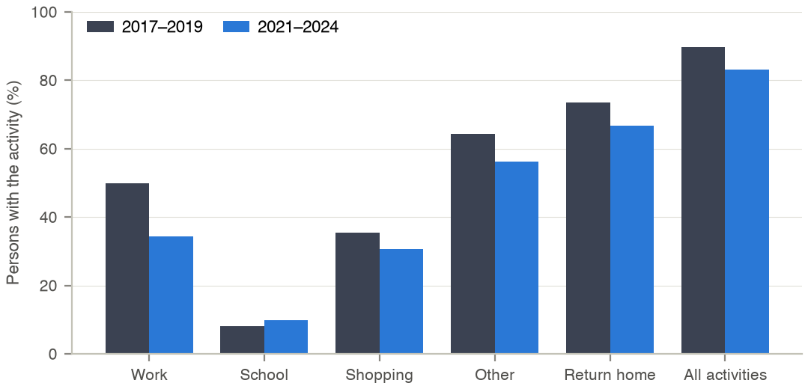
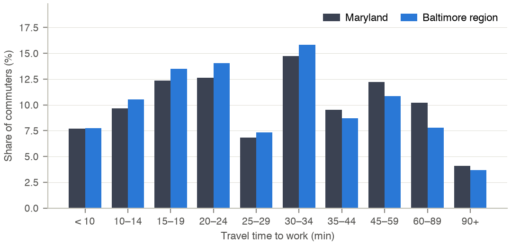

# Validation benchmarks

The data on this page are used only to test MILES; no model is estimated on them. They describe travel and commuting in the
forecast year 2024 (the time-use survey, the 2024 American Community Survey) or give an independent check of the base period
(the National Household Travel Survey). The ACS microdata used for estimation and calibration are described on
[ACS PUMS](acs-pums.md). Bracketed numbers refer to the [sources](../inputs.md#sources) of the data page.

Shares and means are weighted with the survey weights. Cells based on fewer than 10 unweighted records are shown as
"—". The *study area* or *Baltimore region* is Baltimore City and the counties of Anne Arundel, Baltimore, Carroll,
Harford and Howard.

## American Time Use Survey

The American Time Use Survey (ATUS) [17](../inputs.md#sources) records one diary day (4:00 to 4:00) of one person aged 15 or over per
household, sampled from households leaving the Current Population Survey. MILES uses the multi-year files 2003–2024
(respondent, activity, summary and CPS files), public, downloaded from the Bureau of Labor Statistics. The files hold
252,808 diaries of 2003–2024. They test the number and type of
activities per person and the commute in 2024 (`activity/lib/reporting_2024/bench_atus.py`).

### Codebook

| Variable | Description | Type | Values / categories / units | Used in |
|---|---|---|---|---|
| `TUCASEID` | Respondent identifier | Integer (14 digits) | Year and month of the CPS interview, household | Join key |
| `TUYEAR` | Year of the diary | Integer | 2003–2024; used: 2017–2019 and 2021–2024 | Period selection |
| `TUDIARYDAY` | Day of the week of the diary | Categorical | 1 Sunday … 7 Saturday; used: 2–6 | Weekday filter |
| `TRHOLIDAY` | Diary day was a holiday | Binary | 0 no, 1 yes; used: 0 | Weekday filter |
| `TUFNWGTP` | Final person weight | Continuous | Person-days | All weighted statistics |
| `TELFS` | Labour force status | Categorical | 1, 2 employed; 3, 4 unemployed; 5 not in labour force | Employed persons |
| `TEAGE` | Age | Integer | Years, 15–85 (top-coded) | Age filter (15+) |
| `TESCHENR` | Enrolled in school | Categorical | 1 yes, 2 no, −1 not asked | Student flag |
| `GESTFIPS` | State of residence (CPS file) | Categorical | FIPS code; used: 11, 24, 51 | Pool selection |
| `TUACTIVITY_N` | Episode number within the diary | Integer | 1, 2, … | Episode order |
| `TUSTARTTIM` | Start time of the episode | Time | hh:mm:ss | Activity start, departure |
| `TUACTDUR24` | Duration of the episode, truncated at 4:00 | Integer | Minutes | Activity duration, travel time |
| `TRCODEP` | Six-digit activity code | Categorical | 05 work, 06 education, 07 consumer purchases, 18 travel, … | Activity type, travel episodes |
| `TEWHERE` | Where the episode took place, or the mode of travel | Categorical | 1 home or yard; 12 car driver, 13 car passenger, 14 walk, 15 bus, 16 subway or train, 17 bicycle; other places | Home or away, commute mode |

### Statistics

Sample of weekday diaries (Monday to Friday, not a holiday) of persons aged 15 or over. Single years hold about 70
Maryland weekday diaries, so four years (2021–2024) are pooled for the 2024 benchmark and three years (2017–2019)
describe the base period; the year 2020 is not used.

| Pool | Years | Weekday diaries, age 15+ | Employed | With a commute |
|---|---:|---:|---:|---:|
| Maryland | 2017–2019 | 276 | 182 | 139 |
| Maryland | 2021–2024 | 279 | 183 | 87 |
| DC, Maryland and Virginia | 2017–2019 | 706 | 476 | 350 |
| DC, Maryland and Virginia | 2021–2024 | 804 | 521 | 255 |

Activities per person and share of persons with at least one activity of each type, weekday. An activity is a stay
away from home after a trip (or a return home), as defined under *Processing*.

| Activity | MD 2017–2019: per person | MD 2017–2019: with activity (%) | MD 2021–2024: per person | MD 2021–2024: with activity (%) | DC+MD+VA 2017–2019: per person | DC+MD+VA 2017–2019: with activity (%) | DC+MD+VA 2021–2024: per person | DC+MD+VA 2021–2024: with activity (%) |
|---|---:|---:|---:|---:|---:|---:|---:|---:|
| Work | 0.60 | 49.9 | 0.40 | 34.2 | 0.63 | 51.3 | 0.40 | 34.6 |
| School | 0.12 | 8.2 | 0.10 | 9.9 | 0.09 | 6.6 | 0.07 | 7.2 |
| Shopping | 0.48 | 35.4 | 0.48 | 30.7 | 0.46 | 34.9 | 0.45 | 30.7 |
| Other | 1.44 | 64.2 | 1.10 | 56.2 | 1.36 | 62.4 | 1.15 | 56.8 |
| Return home | 1.10 | 73.4 | 0.91 | 66.7 | 1.03 | 74.5 | 0.91 | 65.3 |
| All activities | 3.74 | 89.8 | 2.98 | 83.0 | 3.57 | 88.9 | 2.99 | 79.1 |

*Share of Maryland weekday diarists aged 15 and over with at least one activity of each type, ATUS.*

Commute on the diary day (persons with a work stay away from home):

| Pool | Years | Commuters | Employed with work away from home (%) | Mean travel time (min) | Median (min) | Mean departure |
|---|---:|---:|---:|---:|---:|---:|
| Maryland | 2017–2019 | 139 | 74.5 | 41.4 | 35 | 7:45 |
| Maryland | 2021–2024 | 87 | 47.1 | 33.3 | 30 | 7:49 |
| DC, Maryland and Virginia | 2017–2019 | 350 | 73.7 | 34.7 | 30 | 7:45 |
| DC, Maryland and Virginia | 2021–2024 | 255 | 50.5 | 36.5 | 30 | 7:39 |

Mode of the trip arriving at work, DC, Maryland and Virginia (share of commuters):

| Mode of the trip arriving at work | 2017–2019 (%) | 2021–2024 (%) |
|---|---:|---:|
| Car, driver | 80.9 | 81.9 |
| Car, passenger | 5.3 | — |
| Bus | — | — |
| Rail | — | — |
| Walk | 5.9 | 3.2 |
| Bicycle | — | — |
| Other | 4.6 | 8.1 |

### Processing

- Diary days on Monday to Friday that are not holidays, respondents aged 15 or over living in Maryland (pool *Maryland*) or
  in DC, Maryland or Virginia (larger pool, used where the Maryland sample is small).
- The diary is cut into stays at every travel episode (activity code 18xxxx). A stay after a travel episode is an activity at
  the trip's destination; the first stay of the day is not an activity. A stay is at home when its episodes are at home or in
  the yard (`TEWHERE` 1); episodes without a place take the place of the previous episode.
- The type of a stay away from home is the category with the most minutes: work (05), education (06), shopping (07) or other.
- The commute is the last trip leaving home before the first work stay. Its travel time is the sum of the travel episodes up
  to the arrival at work, without stops; its mode is that of the trip arriving at work.

## National Household Travel Survey

The National Household Travel Survey (NHTS) [18](../inputs.md#sources) is the national one-day travel diary of the Federal Highway
Administration. Two public files are used:

- **NHTS 2017** (household, person and trip files): an independent check of the base period of the regional survey,
  for residents of the Baltimore–Columbia–Towson metropolitan area (`activity/lib/reporting_2024/obs_surveys.py`).
  The national file holds 129,696 households, 264,234 persons and 923,572 trips.
- **NHTS 2022** (trip file): the trip length of car drivers and the share of business driving, used to check the traffic
  assignment (`assignment/validation/regional_validation.py`, `coverage_estimate.py`). The public 2022 file does not
  identify the metropolitan area; the closest class is the South Atlantic division, metropolitan areas of 1–3 million with
  heavy rail. The national file holds 31,074 trips.

### Codebook

| Variable | Description | Type | Values / categories / units | Used in |
|---|---|---|---|---|
| `HOUSEID`, `PERSONID` | Household and person identifiers | String, integer | — | Join keys (2017) |
| `HH_CBSA` | Core-based statistical area of the household | Categorical | 12580 Baltimore–Columbia–Towson | Area selection (2017) |
| `TRAVDAY` | Day of the week of the travel day | Categorical | 1 Sunday … 7 Saturday; used: 2–6 | Weekday filter (2017) |
| `R_AGE` | Age of the person | Integer | Years; used: 5 and over | Person filter (2017) |
| `WORKER` | Person is a worker | Categorical | 1 yes, 2 no | Description (2017) |
| `WTPERFIN`, `WTTRDFIN` | Person and trip weights | Continuous | Persons; trips per year | Weighted statistics (2017) |
| `TDTRPNUM` | Trip number within the travel day | Integer | 1, 2, … | Trip order (2017) |
| `STRTTIME`, `ENDTIME` | Trip start and end time | Integer | hhmm | Departure and arrival (2017) |
| `WHYFROM`, `WHYTO` | Purpose at the origin and destination | Categorical | 1, 2 home; 3 work; 4 work-related; 7 change of mode; 8 school; 11 buy goods; others | Activity type; business trips (2022) |
| `TRPTRANS` | Mode of the trip | Categorical | 2017: 1 walk, 2 bicycle, 3–6 car, van, SUV, pickup, 11 public bus, 15, 16 rail, …; 2022: 1–4 car, van, SUV, pickup | Mode; car filter (2022) |
| `DRVR_FLG` | Person drove on the trip | Binary | 1 yes, 2 no | Car driver |
| `TRPMILES` | Trip distance (network) | Continuous | Miles | Trip length |
| `TRVLCMIN` | Trip duration | Integer | Minutes | Travel time |
| `CENSUS_D`, `MSASIZE`, `RAIL` | Census division; size class of the metropolitan area; area has heavy rail | Categorical | 5 South Atlantic; 4 = 1–3 million; 1 yes | Area selection (2022) |
| `TDWKND` | Travel day on a weekend | Binary | 1 weekend, 2 weekday | Weekday filter (2022) |
| `WTTRDFIN5D` | Trip weight, weekday | Continuous | Weekday trips | Weighted statistics (2022) |

### Statistics

**NHTS 2017, Baltimore metropolitan area, weekday.** 290 households, 596 persons aged 5 or over
and 1,982 unlinked trips (1,959 trips after joining changes of mode). 55.1 % of the
weighted persons are workers. Trip distance: mean 13.0 km, median 5.3 km,
standard deviation 25.5 km; trip duration: mean 25.5 min, median
15 min.

Activities per person (one activity per linked trip, at its destination):

| Activity | Per person | Persons with the activity (%) |
|---|---:|---:|
| Work | 0.37 | 33.1 |
| School | 0.14 | 14.2 |
| Shopping | 0.36 | 26.2 |
| Other | 1.27 | 57.3 |
| Return home | 1.25 | 80.1 |
| All activities | 3.40 | 83.0 |

Mode of the unlinked trips (share of weighted trips):

| Mode (unlinked trips) | Trips | Share (%) |
|---|---:|---:|
| Car, driver | 1,343 | 61.6 |
| Car, passenger | 285 | 15.0 |
| Public bus | 42 | 5.1 |
| Rail | 7 | — |
| School bus | 70 | 3.9 |
| Walk | 187 | 10.6 |
| Bicycle | 14 | 0.4 |
| Other | 34 | 3.3 |

**NHTS 2022, car-driver trips on weekdays.** Of 15,300 car-driver trips with a distance in the national
file, 131 are in the South Atlantic class used for the comparison and have a positive duration. Their distance has a mean of
16.4 km (median 8.2 km, standard deviation 19.7 km);
their duration has a mean of 23.7 min (median 20 min). Work-related trips
(`WHYTO` or `WHYFROM` 4) make up 3.9 % of the car-driver distance nationally and
0.6 % in the South Atlantic class.

### Processing

- NHTS 2017: households of the Baltimore–Columbia–Towson area (which adds Queen Anne's County to the study area) with a
  weekday travel day; persons aged 5 or over. Legs that end in a change of mode (`WHYTO` 7) are joined to the next trip.
  Destination purpose: home (1, 2), work (3), school (8), shopping (11), other. Distances are capped at 300 km.
- NHTS 2022: weekday car-driver trips (`DRVR_FLG` 1, `TRPTRANS` 1–4) with a positive distance and duration.

## American Community Survey 2024, journey to work

The journey-to-work questions of the ACS person file [1](../inputs.md#sources) describe commuting in the forecast year: whether a worker
worked from home, the mode, the departure time and the travel time to work on the reference week. MILES uses the Maryland
person files of the **2024 1-year** sample (62,777 records) and of the **2020–2024 5-year** sample
(299,422 records), both public (`activity/lib/reporting_2024/bench_acs.py`). The same file series is described
for estimation on [ACS PUMS](acs-pums.md).

### Codebook

| Variable | Description | Type | Values / categories / units | Used in |
|---|---|---|---|---|
| `SERIALNO` | Housing unit identifier | String | Year of interview in the first four characters | Join key; years of the 5-year file |
| `PUMA` | Public use microdata area of residence (2020 definition) | Categorical | 5-digit code; nested in counties of the study area | County, Baltimore region |
| `PWGTP` | Person weight | Integer | Persons | All weighted statistics |
| `PWGTP1`–`PWGTP80` | Replicate weights | Integer | Persons | Standard errors (successive differences) |
| `AGEP` | Age | Integer | Years | Workers aged 16+ |
| `ESR` | Employment status | Categorical | 1, 2 civilian employed (at work, with a job not at work); 4, 5 armed forces; 3 unemployed; 6 not in labour force | Workers; at work last week (1, 4) |
| `RELSHIPP` | Relationship to the reference person | Categorical | 20–36 household members; 37, 38 group quarters | Household population |
| `JWTRNS` | Means of transportation to work | Categorical | 1 car, truck or van; 2 bus; 3 subway; 4 commuter rail; 5 light rail; 6 ferry; 7 taxi; 8 motorcycle; 9 bicycle; 10 walked; 11 worked from home; 12 other | Mode; worked from home |
| `JWRIP` | Vehicle occupancy | Integer | 1 drove alone, 2–10 persons in the carpool | Driver and passenger shares |
| `JWMNP` | Travel time to work | Integer | Minutes, 1–200 | Travel time |
| `JWDP` | Time of departure for work | Categorical | 150 intervals of 5–30 min (decoded with the data dictionary) | Departure time |
| `POWSP`, `POWPUMA` | Place of work, state and PUMA | Categorical | FIPS state; 5-digit place-of-work PUMA | Commute flows |

### Statistics

Household population (group quarters excluded). Worked from home: share of workers at work in the reference week.
Travel time and departure: commuters (at work, not working from home).

| Vintage | Area | Persons (records) | Workers (records) | Workers (weighted) | Worked from home (%) | Commuters (records) | Mean travel time (min) | Median (min) | SD (min) | Mean departure |
|---|---|---:|---:|---:|---:|---:|---:|---:|---:|---:|
| 2024 (1-year) | Maryland | 60,090 | 31,485 | 3,260,281 | 15.7 | 25,566 | 32.3 | 30 | 24.0 | 8:14 |
| 2024 (1-year) | Baltimore region | 25,966 | 13,693 | 1,452,629 | 14.9 | 11,243 | 30.4 | 25 | 22.9 | 8:16 |
| 2020–2024 (5-year) | Maryland | 284,800 | 146,634 | 3,168,183 | 19.3 | 113,871 | 31.2 | 25 | 23.0 | 8:15 |
| 2020–2024 (5-year) | Baltimore region | 122,483 | 63,327 | 1,421,624 | 18.1 | 50,061 | 29.3 | 25 | 21.8 | 8:19 |

Mode to work of commuters, 2024 1-year (a car-pool of *k* persons counts 1/*k* as driver):

| Mode | Maryland | Baltimore region |
|---|---:|---:|
| Car, driver | 84.1 | 85.9 |
| Car, passenger | 5.9 | 5.5 |
| Bus | 2.6 | 2.5 |
| Rail | 3.2 | 1.5 |
| Walk | 2.1 | 2.3 |
| Bicycle | 0.4 | 0.4 |
| Other | 1.9 | 1.9 |

By county of residence, 2024 1-year:

| County | Persons (records) | Workers (weighted) | Worked from home (%) | Commuters (records) | Mean travel time (min) | Car driver (%) | Bus and rail (%) |
|---|---:|---:|---:|---:|---:|---:|---:|
| Baltimore City | 4,436 | 280,624 | 14.1 | 1,935 | 30.5 | 72.0 | 10.8 |
| Anne Arundel | 5,787 | 321,571 | 15.2 | 2,622 | 30.9 | 89.6 | 2.2 |
| Baltimore County | 7,669 | 438,021 | 13.7 | 3,288 | 27.9 | 87.3 | 2.8 |
| Carroll | 2,007 | 89,114 | 12.9 | 853 | 36.7 | 91.1 | 0.8 |
| Harford | 2,759 | 139,761 | 11.4 | 1,212 | 32.9 | 92.7 | 0.8 |
| Howard | 3,308 | 183,538 | 22.0 | 1,333 | 29.8 | 90.1 | 3.1 |

*Travel time to work of commuters living in Maryland and in the Baltimore region, ACS 2024 1-year PUMS (weighted; the classes have unequal widths).*

### Processing

- Workers: `ESR` 1, 2, 4 or 5 and age 16 or over. Counties are assigned from the 2020 PUMA with the PUMA-to-county lookup
  of the 2024 code list; in the study area every PUMA lies in one county.
- The departure time is the midpoint of the `JWDP` interval. Mode: drove alone counts as driver, a car-pool of *k*
  persons as 1/*k* driver and (*k* − 1)/*k* passenger, motorcycle as driver; subway, commuter and light rail as rail;
  ferry, taxi and other as other.

## American Community Survey summary tables

Published ACS estimates [1](../inputs.md#sources) (detailed tables, with 90 % margins of error) are the benchmark where the microdata are
too coarse: by county for commuting and by census tract for households and housing. They were downloaded from the
data.census.gov table service as one JSON file per table and county (60 county files; 114 tract files).

- **County tables, 2024 1-year and 2020–2024 5-year** (`assignment/validation/regional_validation.py`): B08134 (travel time
  to work by mode), B08136 (aggregate travel time), B08301 (means of transportation), B08302 (departure time) and B08303
  (travel time) for the six study-area counties. Tables the Census Bureau does not publish in the 1-year release are empty:
  B08134 Carroll, B08134 Harford, B08134 Howard, B08136 Carroll, B08136 Harford, B08301 Harford.
- **Tract tables** (`reports/validation_tracts/tract_validation.py`): 2012–2016 5-year on 2010 tracts (B08202, B11001, B19001, B25003, B25007, B25008, B25009, B25032, B25044) and
  2020–2024 5-year on 2020 tracts (B01003, B08201, B08301, B11001, B19001, B19013, B25003, B25008, B25032, B25044), all tracts of the six counties.

### Codebook

| Variable | Description | Type | Values / categories / units | Used in |
|---|---|---|---|---|
| `B08134_001E`, `B08134_021E`–`_030E` | Workers 16+ who did not work from home; those who drove alone, by travel time | Count | Workers; bins of minutes | Travel time to work by county |
| `B08136_001E`, `B08136_003E` | Aggregate travel time to work, all and drove alone | Count | Minutes | Mean travel time (aggregate ÷ workers) |
| `B08301_001E`–`_021E` | Means of transportation to work | Count | 003 drove alone, 004 car-pooled, 010 public transport, 018 bicycle, 019 walked, 021 worked from home | Mode shares |
| `B08302_002E`–`_015E` | Time leaving home to go to work | Count | 14 intervals, 0:00–23:59 | Departure profile |
| `B08303_002E`–`_013E` | Travel time to work | Count | 12 bins, < 5 to 90+ min | Travel-time distribution |
| `B11001_001E` | Households | Count | Households | Households by tract |
| `B25003_001E`–`_003E` | Tenure | Count | 002 owner, 003 renter occupied | Tenure |
| `B25008` | Population in occupied units by tenure | Count | Persons | Household population |
| `B25044_001E`–`_010E` | Tenure by vehicles available | Count | 003, 010 no vehicle (owner, renter) | Car ownership |
| `B19001`, `B19013` | Household income in bins; median household income | Count; dollars | 16 bins; inflation-adjusted dollars | Income |
| `B25032` | Tenure by units in structure | Count | Dwelling types | Dwelling type |
| `B01003`, `B08201`, `B08202`, `B25007`, `B25009` | Population; household size by vehicles; household size by workers; tenure by age of householder; tenure by household size | Count | Persons, households | Tract composition |
| `…M` | 90 % margin of error of each estimate | Count | Same as the estimate | Tolerance of the comparison |

### Statistics

County commuting tables (estimates; "—" = not published in the 1-year release):

| County | 5-year: workers not at home | 5-year: mean travel time (min) | 5-year: drove alone (%) | 5-year: public transport (%) | 5-year: worked from home (%) | 1-year: workers not at home | 1-year: mean travel time (min) | 1-year: drove alone (%) | 1-year: public transport (%) | 1-year: worked from home (%) |
|---|---:|---:|---:|---:|---:|---:|---:|---:|---:|---:|
| Baltimore City | 222,441 | 29.1 | 55.5 | 10.3 | 17.8 | 243,705 | 30.2 | 56.5 | 9.7 | 14.0 |
| Anne Arundel | 257,880 | 28.9 | 70.0 | 1.6 | 18.5 | 273,560 | 30.6 | 70.6 | 1.8 | 15.6 |
| Baltimore County | 351,951 | 28.0 | 69.5 | 2.5 | 16.5 | 375,305 | 28.1 | 70.8 | 2.6 | 13.6 |
| Carroll | 75,334 | 34.4 | 73.9 | 0.3 | 17.3 | — | — | 74.7 | 0.6 | 13.2 |
| Harford | 115,350 | 32.1 | 75.1 | 0.6 | 14.9 | — | — | — | — | — |
| Howard | 129,859 | 28.5 | 64.9 | 1.5 | 26.0 | — | — | 66.2 | 2.5 | 23.0 |

Tract tables, households and housing:

| Vintage | County | Tracts | Tracts with households | Households | Mean households per tract | Owner occupied (%) | No vehicle (%) |
|---|---|---:|---:|---:|---:|---:|---:|
| 2012–2016 | Baltimore City | 200 | 198 | 242,416 | 1,224 | 46.6 | 29.4 |
| 2012–2016 | Anne Arundel | 105 | 102 | 204,829 | 2,008 | 73.9 | 3.9 |
| 2012–2016 | Baltimore County | 214 | 211 | 312,826 | 1,483 | 65.8 | 8.0 |
| 2012–2016 | Carroll | 38 | 38 | 60,449 | 1,591 | 81.2 | 4.4 |
| 2012–2016 | Harford | 57 | 57 | 92,497 | 1,623 | 78.1 | 4.9 |
| 2012–2016 | Howard | 55 | 55 | 109,872 | 1,998 | 73.4 | 3.6 |
| 2012–2016 | Study area | 669 | 661 | 1,022,889 | 1,547 | 65.7 | 11.3 |
| 2020–2024 | Baltimore City | 199 | 198 | 255,668 | 1,291 | 47.5 | 26.7 |
| 2020–2024 | Anne Arundel | 130 | 127 | 224,748 | 1,770 | 75.1 | 4.1 |
| 2020–2024 | Baltimore County | 219 | 217 | 332,801 | 1,534 | 66.4 | 7.8 |
| 2020–2024 | Carroll | 37 | 37 | 64,285 | 1,737 | 84.3 | 3.3 |
| 2020–2024 | Harford | 59 | 59 | 101,795 | 1,725 | 79.7 | 4.4 |
| 2020–2024 | Howard | 59 | 59 | 121,065 | 2,052 | 71.5 | 3.6 |
| 2020–2024 | Study area | 703 | 697 | 1,100,362 | 1,579 | 66.6 | 10.4 |

### Processing

- Values below −100,000 are the Census Bureau's annotation codes (for example a median that cannot be computed) and are
  treated as missing.
- Tract results are compared on clusters of tracts and zones, so that 2010 and 2020 tracts and the zones nest; margins of error
  of sums are combined as the square root of the sum of squares.
