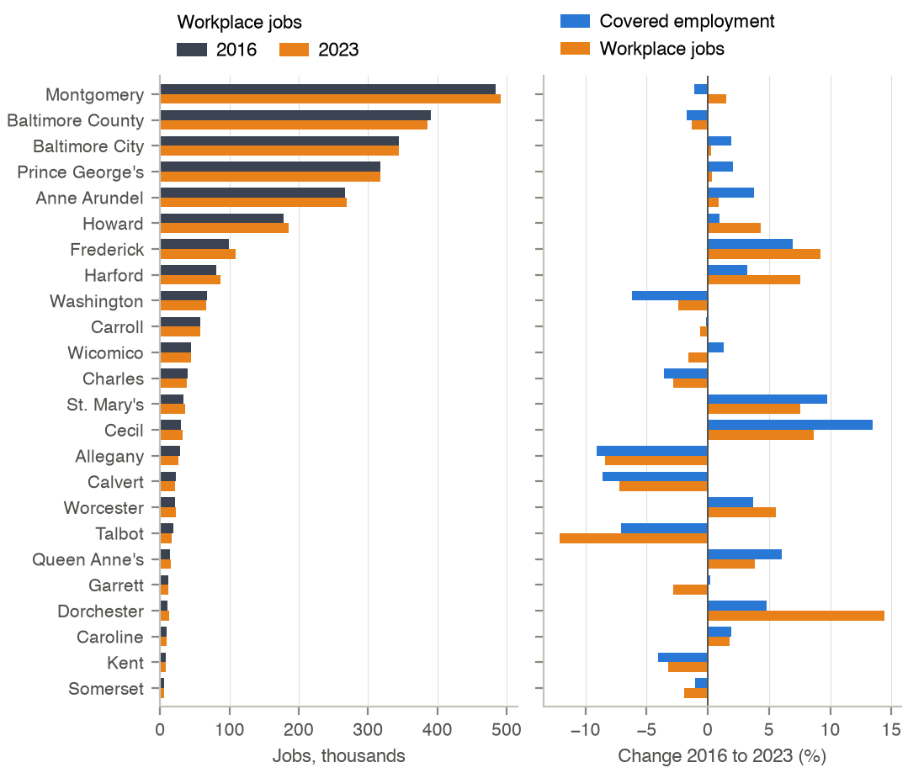
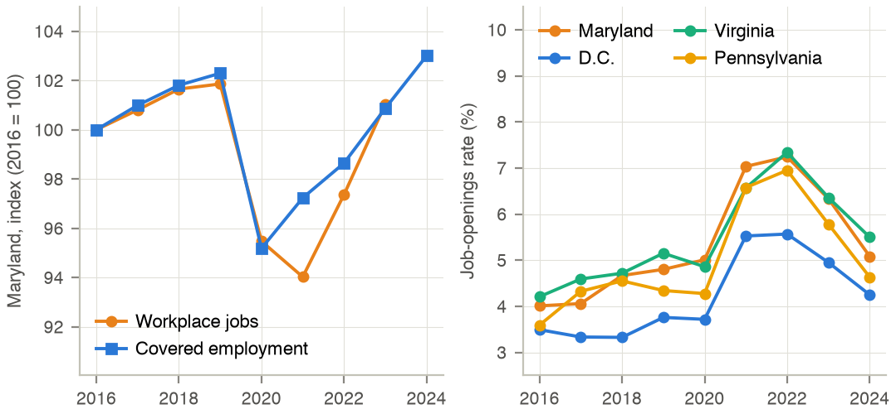

# Employment

Jobs enter MILES at three points: the 2016 job inventory of the synthetic population, the yearly job control totals of the land-use model, and the vacant share of jobs. Workplace counts come from the LEHD Origin–Destination Employment Statistics (LODES), county growth from the Quarterly Census of Employment and Wages (QCEW), and vacancies from the Job Openings and Labor Turnover Survey (JOLTS). All three are public. Counties marked * form the study area.

## LODES workplace area characteristics

Jobs by census block of workplace, all jobs (segment S000, job type JT00), LODES version 8 on 2020 blocks [[3]](../inputs.md#sources). Maryland files 2016–2023 give the 2016 job inventory (by zone and job type) and the growth path of the job control totals; the files of the District of Columbia, Delaware, Pennsylvania, Virginia and West Virginia for 2017 give the zone employment used in activity-model estimation, and those for 2022 the 2024 benchmarks. The block crosswalk (`md_xwalk.csv.gz`) supplies the county and the block centroid. Downloaded from the LEHD server; no registration.

### Codebook

| Variable | Description | Type | Values / categories / units | Used in |
|---|---|---|---|---|
| `w_geocode` | Census block of workplace (2020) | string, 15 digits | state (2) + county (3) + tract (6) + block (4) | Population; land use; activities |
| `C000` | Total jobs | integer | jobs | Population; land use; activities |
| `CNS01` … `CNS20` | Jobs by NAICS sector (20 sectors) | integer | jobs; grouped into four SILO job types, table below | Population; land use |
| `tabblk2020` | Block code (crosswalk) | string | joins `w_geocode` | Population; land use |
| `cty` | County FIPS code (crosswalk) | string, 5 digits | e.g. 24510 Baltimore City | Land use |
| `blklatdd`, `blklondd` | Block internal point (crosswalk) | float | decimal degrees, WGS 84 | Population; land use |

Sector groups used for the four SILO job types:

| Job type | LODES sectors |
|---|---|
| Retail | `CNS07` retail trade; `CNS18` accommodation and food |
| Office | `CNS09` information; `CNS10` finance and insurance; `CNS11` real estate; `CNS12` professional, scientific, technical; `CNS13` management of companies; `CNS14` administrative and waste services; `CNS15` educational services; `CNS16` health care and social assistance; `CNS20` public administration |
| Industry | `CNS01` agriculture, forestry, fishing; `CNS02` mining, oil and gas; `CNS03` utilities; `CNS04` construction; `CNS05` manufacturing; `CNS06` wholesale trade; `CNS08` transportation and warehousing |
| Other | `CNS17` arts, entertainment, recreation; `CNS19` other services |

### Statistics

Maryland files: blocks with at least one job, total jobs and job-type shares (%).

| Year | Blocks | Jobs | Retail | Office | Industry | Other |
|---|---:|---:|---:|---:|---:|---:|
| 2016 | 32,239 | 2,586,279 | 19.8 | 57.2 | 17.7 | 5.3 |
| 2017 | 32,396 | 2,607,045 | 19.8 | 57.1 | 17.6 | 5.5 |
| 2018 | 32,617 | 2,628,952 | 19.5 | 57.2 | 17.8 | 5.5 |
| 2019 | 32,733 | 2,634,322 | 19.1 | 57.5 | 18.1 | 5.4 |
| 2020 | 29,162 | 2,469,147 | 17.7 | 58.1 | 19.6 | 4.6 |
| 2021 | 29,639 | 2,431,733 | 18.1 | 57.1 | 20.0 | 4.7 |
| 2022 | 29,919 | 2,518,064 | 19.0 | 57.7 | 18.5 | 4.9 |
| 2023 | 30,936 | 2,613,215 | 18.4 | 57.6 | 18.9 | 5.1 |

No field is missing. The sector columns sum to `C000` in every row, and every workplace block is in the crosswalk. In 2016 a block with jobs holds a median of 10 jobs (mean 80.2, maximum 17,243). The crosswalk lists 83,827 Maryland blocks, all with an internal point.

Maryland jobs by sector, 2016 and 2023.

| Sector | Job type | Jobs 2016 | Share 2016 (%) | Jobs 2023 | Change (%) |
|---|---|---:|---:|---:|---:|
| Health care and social assistance | Office | 366,792 | 14.2 | 378,100 | 3.1 |
| Retail trade | Retail | 287,972 | 11.1 | 265,579 | -7.8 |
| Educational services | Office | 274,191 | 10.6 | 259,079 | -5.5 |
| Professional, scientific, technical | Office | 253,383 | 9.8 | 291,714 | 15.1 |
| Accommodation and food | Retail | 223,055 | 8.6 | 215,227 | -3.5 |
| Public administration | Office | 206,949 | 8.0 | 212,010 | 2.4 |
| Administrative and waste services | Office | 167,523 | 6.5 | 171,374 | 2.3 |
| Construction | Industry | 161,525 | 6.2 | 163,801 | 1.4 |
| Manufacturing | Industry | 105,462 | 4.1 | 113,851 | 8.0 |
| Finance and insurance | Office | 94,908 | 3.7 | 80,801 | -14.9 |
| Other services | Other | 93,319 | 3.6 | 91,851 | -1.6 |
| Wholesale trade | Industry | 87,519 | 3.4 | 86,572 | -1.1 |
| Transportation and warehousing | Industry | 87,338 | 3.4 | 112,445 | 28.7 |
| Real estate | Office | 45,570 | 1.8 | 42,513 | -6.7 |
| Information | Office | 43,919 | 1.7 | 40,418 | -8.0 |
| Arts, entertainment, recreation | Other | 43,646 | 1.7 | 40,509 | -7.2 |
| Management of companies | Office | 26,519 | 1.0 | 30,222 | 14.0 |
| Utilities | Industry | 9,895 | 0.4 | 9,908 | 0.1 |
| Agriculture, forestry, fishing | Industry | 5,557 | 0.2 | 5,880 | 5.8 |
| Mining, oil and gas | Industry | 1,237 | 0.0 | 1,361 | 10.0 |

Jobs by county of workplace.

| County | 2016 | 2019 | 2020 | 2023 | Change 2016–23 (%) |
|---|---:|---:|---:|---:|---:|
| Allegany | 28,212 | 27,898 | 25,568 | 25,839 | -8.4 |
| Anne Arundel * | 267,214 | 270,513 | 248,686 | 269,612 | 0.9 |
| Baltimore City * | 343,789 | 348,824 | 338,318 | 344,611 | 0.2 |
| Baltimore County * | 390,752 | 398,040 | 374,559 | 385,518 | -1.3 |
| Calvert | 23,035 | 21,637 | 20,433 | 21,372 | -7.2 |
| Caroline | 8,698 | 9,102 | 8,916 | 8,855 | 1.8 |
| Carroll * | 58,247 | 57,878 | 54,197 | 57,897 | -0.6 |
| Cecil | 30,227 | 31,140 | 31,648 | 32,838 | 8.6 |
| Charles | 38,976 | 37,316 | 35,206 | 37,882 | -2.8 |
| Dorchester | 10,790 | 11,902 | 11,760 | 12,350 | 14.5 |
| Frederick | 99,506 | 104,114 | 96,754 | 108,637 | 9.2 |
| Garrett | 11,544 | 11,930 | 11,194 | 11,219 | -2.8 |
| Harford * | 81,363 | 84,157 | 80,377 | 87,506 | 7.6 |
| Howard * | 177,901 | 183,273 | 173,424 | 185,575 | 4.3 |
| Kent | 8,001 | 7,861 | 7,043 | 7,744 | -3.2 |
| Montgomery | 484,038 | 490,319 | 468,650 | 491,378 | 1.5 |
| Prince George's | 317,051 | 333,163 | 285,598 | 318,010 | 0.3 |
| Queen Anne's | 14,508 | 15,070 | 14,145 | 15,068 | 3.9 |
| Somerset | 6,070 | 5,407 | 4,966 | 5,954 | -1.9 |
| St. Mary's | 33,213 | 34,551 | 34,925 | 35,732 | 7.6 |
| Talbot | 19,358 | 17,738 | 16,505 | 17,015 | -12.1 |
| Washington | 67,909 | 65,625 | 62,886 | 66,246 | -2.4 |
| Wicomico | 44,591 | 45,225 | 43,511 | 43,883 | -1.6 |
| Worcester | 21,286 | 21,639 | 19,878 | 22,474 | 5.6 |
| **Study area** | **1,319,266** | **1,342,685** | **1,269,561** | **1,330,719** | **0.9** |
| **Maryland** | **2,586,279** | **2,634,322** | **2,469,147** | **2,613,215** | **1.0** |

Other states (all blocks of the state; the model uses the blocks inside the zone system).

| State | Blocks 2017 | Jobs 2017 | Blocks 2022 | Jobs 2022 |
|---|---:|---:|---:|---:|
| District of Columbia | 3,629 | 690,999 | 3,991 | 656,985 |
| Delaware | 6,020 | 438,969 | 7,134 | 443,301 |
| Pennsylvania | 107,191 | 5,777,904 | 103,210 | 5,786,513 |
| Virginia | 52,913 | 3,729,094 | 55,584 | 3,793,766 |
| West Virginia | 14,388 | 684,952 | 15,028 | 663,554 |

### Processing

- Blocks are placed in model zones by their crosswalk internal point (point in polygon); a point outside every polygon (coastline) takes the nearest zone.
- Sectors are summed to the four job types of the table above.
- 2016 inventory: Maryland zones take the 2016 LODES jobs by type divided by (1 − 0.0401), the 2016 JOLTS job-openings rate, so that 4.01 % of jobs are vacant; zones outside Maryland keep the MSTM 2016 inventory.
- Job control totals: the 2016 synthetic jobs of a zone and type are multiplied by the LODES change of that zone and type relative to 2016 (the county change where the zone had no 2016 jobs of the type); county totals then follow QCEW (next section).

## LODES origin–destination flows

Jobs by pair of home block and workplace block [[3]](../inputs.md#sources). The `main` file holds jobs with home and workplace in Maryland; the `aux` file of a state holds jobs in that state held by residents of other states. They are used only for validation: the share of Maryland residents' jobs located in the home county (2016–2023), and the 2022 county-to-county commuting pattern of the 2024 benchmarks.

### Codebook

| Variable | Description | Type | Values / categories / units | Used in |
|---|---|---|---|---|
| `h_geocode` | Census block of residence | string, 15 digits | first five digits = county | Land-use validation; 2024 benchmarks |
| `w_geocode` | Census block of workplace | string, 15 digits | first five digits = county | Land-use validation; 2024 benchmarks |
| `S000` | Jobs of the block pair | integer | jobs | Land-use validation; 2024 benchmarks |

### Statistics

Maryland files. *Own county*: share of jobs held by Maryland residents (main file) located in the home county.

| Year | Block pairs | Jobs, home and work in Maryland | Pairs with one job (%) | Own county (%) | Jobs in Maryland, home elsewhere |
|---|---:|---:|---:|---:|---:|
| 2016 | 2,032,069 | 2,286,383 | 92.0 | 48.7 | 299,896 |
| 2017 | 2,041,712 | 2,294,363 | 92.1 | 48.2 | 312,682 |
| 2018 | 2,059,365 | 2,315,616 | 92.0 | 48.1 | 313,336 |
| 2019 | 2,064,828 | 2,319,287 | 92.1 | 48.2 | 315,035 |
| 2020 | 1,935,509 | 2,169,307 | 92.1 | 47.0 | 299,840 |
| 2021 | 1,908,839 | 2,128,870 | 92.4 | 46.2 | 302,863 |
| 2022 | 1,979,851 | 2,209,215 | 92.4 | 46.2 | 308,849 |
| 2023 | 2,059,264 | 2,304,321 | 92.3 | 46.5 | 308,894 |

Own-county share (%) by home county.

| Home county | 2016 | 2019 | 2023 |
|---|---:|---:|---:|
| Allegany | 76.0 | 74.8 | 72.1 |
| Anne Arundel * | 47.0 | 45.8 | 42.9 |
| Baltimore City * | 47.4 | 46.9 | 46.2 |
| Baltimore County * | 43.1 | 43.1 | 41.6 |
| Calvert | 39.0 | 38.0 | 36.6 |
| Caroline | 26.3 | 25.0 | 23.8 |
| Carroll * | 33.6 | 33.0 | 32.3 |
| Cecil | 50.0 | 48.5 | 46.2 |
| Charles | 35.9 | 34.2 | 33.2 |
| Dorchester | 36.7 | 37.6 | 35.0 |
| Frederick | 45.4 | 44.4 | 42.7 |
| Garrett | 69.5 | 69.9 | 68.0 |
| Harford * | 39.0 | 38.7 | 38.8 |
| Howard * | 33.2 | 32.7 | 32.1 |
| Kent | 58.3 | 57.6 | 54.0 |
| Montgomery | 70.5 | 69.7 | 67.7 |
| Prince George's | 48.7 | 49.3 | 46.2 |
| Queen Anne's | 28.4 | 28.2 | 28.8 |
| Somerset | 34.4 | 32.2 | 29.2 |
| St. Mary's | 50.9 | 51.1 | 49.6 |
| Talbot | 47.3 | 43.9 | 43.1 |
| Washington | 59.2 | 56.6 | 54.4 |
| Wicomico | 63.9 | 63.2 | 59.5 |
| Worcester | 58.2 | 57.6 | 55.7 |

Jobs held by Maryland residents in other states (`aux` file of the workplace state).

| Workplace state | 2016 | 2017 | 2022 |
|---|---:|---:|---:|
| District of Columbia | 280,484 | 278,265 | 256,918 |
| Virginia | 138,073 | 142,868 | 147,677 |
| Pennsylvania | 25,974 | 28,074 | 30,406 |
| Delaware | 26,021 | 26,540 | 27,219 |
| West Virginia | 8,137 | 8,153 | 8,697 |

### Processing

- Home and workplace counties are the first five digits of the block codes; flows are summed to county pairs.
- LODES counts jobs, not workers: a person with two jobs appears twice, and federal civilian jobs are included while self-employment is not.

## Quarterly Census of Employment and Wages

Employment and wages covered by unemployment insurance, by county, ownership and industry, annual averages, from the BLS open-data files [[6]](../inputs.md#sources). MILES uses the county total for all ownerships and industries: its growth sets the county job control totals from 2016 to 2024 (later years keep the 2024 level), and the Maryland average annual pay deflated by the CPI gives the assumed real wage growth of 0.5 % a year. 594 county files are present (66 counties, 2016–2024).

### Codebook

| Variable | Description | Type | Values / categories / units | Used in |
|---|---|---|---|---|
| `area_fips` | County FIPS code | string, 5 digits | counties of the six states of the zone system | Land use |
| `own_code` | Ownership | integer | 0 = all ownerships (used); 1–5 = federal, state, local, private | Land use |
| `industry_code` | Industry | string | 10 = total, all industries (used) | Land use |
| `year` | Year | integer | 2016–2024 | Land use |
| `annual_avg_emplvl` | Annual average employment | integer | jobs | Land use: job control totals |
| `avg_annual_pay` | Average annual pay | integer | dollars, current | Land use: real wage growth |
| `disclosure_code` | Disclosure flag | string | N = not disclosed | Check only |

### Statistics

The 594 files hold 717,052 rows; the county total (ownership 0, industry 10) is disclosed in every file.

Covered employment, Maryland counties, annual average.

| County | 2016 | 2019 | 2020 | 2024 | Change 2016–24 (%) |
|---|---:|---:|---:|---:|---:|
| Allegany | 29,312 | 28,872 | 26,086 | 26,680 | -9.0 |
| Anne Arundel * | 267,653 | 274,972 | 255,908 | 288,447 | 7.8 |
| Baltimore City * | 337,194 | 344,378 | 328,182 | 348,184 | 3.3 |
| Baltimore County * | 373,523 | 380,770 | 350,800 | 374,470 | 0.3 |
| Calvert | 24,142 | 22,668 | 20,919 | 22,676 | -6.1 |
| Caroline | 9,346 | 9,940 | 9,342 | 9,246 | -1.1 |
| Carroll * | 57,894 | 58,660 | 54,237 | 59,195 | 2.2 |
| Cecil | 31,667 | 33,458 | 33,094 | 36,713 | 15.9 |
| Charles | 42,920 | 41,505 | 38,436 | 43,087 | 0.4 |
| Dorchester | 11,202 | 11,514 | 11,751 | 11,903 | 6.3 |
| Frederick | 99,418 | 105,170 | 96,984 | 108,438 | 9.1 |
| Garrett | 11,705 | 12,050 | 11,302 | 12,162 | 3.9 |
| Harford * | 91,428 | 95,333 | 89,316 | 95,188 | 4.1 |
| Howard * | 168,168 | 174,642 | 161,299 | 173,483 | 3.2 |
| Kent | 7,901 | 7,951 | 7,180 | 7,648 | -3.2 |
| Montgomery | 463,967 | 472,495 | 439,259 | 462,298 | -0.4 |
| Prince George's | 312,033 | 322,168 | 295,521 | 329,476 | 5.6 |
| Queen Anne's | 14,748 | 15,647 | 14,321 | 16,269 | 10.3 |
| Somerset | 6,683 | 6,736 | 6,121 | 6,963 | 4.2 |
| St. Mary's | 43,340 | 45,789 | 45,449 | 49,113 | 13.3 |
| Talbot | 19,353 | 18,493 | 16,291 | 18,220 | -5.9 |
| Washington | 66,896 | 64,943 | 59,852 | 64,206 | -4.0 |
| Wicomico | 45,006 | 45,282 | 42,777 | 46,139 | 2.5 |
| Worcester | 24,308 | 25,017 | 22,054 | 26,303 | 8.2 |
| **Study area** | **1,295,860** | **1,328,755** | **1,239,742** | **1,338,967** | **3.3** |
| **Maryland** | **2,559,807** | **2,618,453** | **2,436,481** | **2,636,507** | **3.0** |

### Processing

- Counties merged in the zone system are summed: 51919 = Fairfax County, Fairfax City and Falls Church; 51942 = Prince William, Manassas and Manassas Park; 51951 = Frederick County (Virginia) and Winchester.
- County jobs of year Y = 2016 base jobs × Q(Y) / Q(2016) × (1 − v(2016)) / (1 − v(Y)), with Q the QCEW employment and v the JOLTS job-openings rate of the county's state; within a county the zone and type split follows LODES.

## Job Openings and Labor Turnover Survey

Monthly state estimates of job openings, hires and quits, seasonally adjusted, total nonfarm, from the BLS public API [[4]](../inputs.md#sources). The job-openings rate (openings as a percent of employment plus openings) sets the vacant share of jobs: 4.01 % in the 2016 base (Maryland) and the state rate of each later year in the job control totals. The Maryland quits rate of 2017–2019 sets the yearly rate of job-to-job changes.

### Codebook

| Variable | Description | Type | Values / categories / units | Used in |
|---|---|---|---|---|
| `seriesID` | Series | string | `JTS000000<ss>0000000JOR` openings rate of state ss; `JTS000000240000000QUR` Maryland quits rate | Population; land use |
| `year`, `period` | Reference month | string | M01–M12 (M13 annual, dropped) | Population; land use |
| `value` | Rate | float | percent | Population; land use |

### Statistics

Job-openings rate, annual mean of the monthly values (%).

| Year | Maryland | D.C. | Delaware | Pennsylvania | Virginia | West Virginia |
|---|---:|---:|---:|---:|---:|---:|
| 2016 | 4.0 | 3.5 | 4.1 | 3.6 | 4.2 | 4.0 |
| 2017 | 4.1 | 3.3 | 4.1 | 4.3 | 4.6 | 4.5 |
| 2018 | 4.7 | 3.3 | 4.6 | 4.5 | 4.7 | 5.0 |
| 2019 | 4.8 | 3.8 | 4.6 | 4.3 | 5.1 | 5.3 |
| 2020 | 5.0 | 3.7 | 4.5 | 4.3 | 4.9 | 6.1 |
| 2021 | 7.0 | 5.5 | 6.5 | 6.6 | 6.6 | 7.4 |
| 2022 | 7.2 | 5.6 | 7.3 | 7.0 | 7.3 | 8.2 |
| 2023 | 6.3 | 5.0 | 6.0 | 5.8 | 6.4 | 7.1 |
| 2024 | 5.1 | 4.2 | 4.9 | 4.6 | 5.5 | 6.1 |

Every state-year has 12 monthly values. The Maryland quits rate averages 2.1 % a month over 2017–2019 (36 months; range 1.6–2.7 %), or 25.2 % a year.

### Processing

- Annual rate = mean of the twelve monthly rates; years after 2024 keep the 2024 rate.
- Vacant jobs = filled jobs / (1 − rate) − filled jobs.
- The quits rate is an upper bound for job-to-job changes, because quits include exits from employment.
