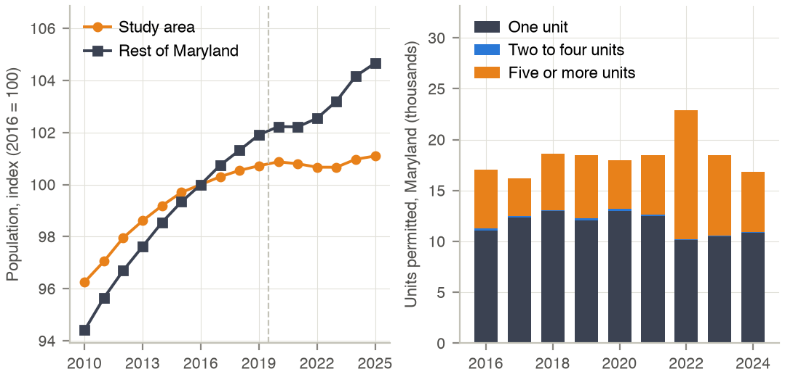

# Land-use controls and county attributes

These county-level data hold the land-use model to observed totals (population, new dwellings, housing units), describe counties in the residential location model (school quality, crime), convert dollars between years, and serve as validation targets (commuting and migration flows). All are public. Counties marked * form the study area.

## Population estimates and components of change

Annual county population estimates of the Census Bureau, July 1 of each year [[5]](../inputs.md#sources): the 2010–2020 intercensal estimates (by age and sex) for 2016–2019 and vintage 2025 (`co-est2025-alldata.csv`) for 2020–2025, so that the whole series rests on the 2020 Census. The population control of each land-use region in year Y is its synthetic 2016 population times the region's growth from 2016 to Y; 2026 extrapolates the 2024–2025 growth. Births and deaths of the components of change are validation targets for the demographic models (vintage 2020 up to 2020, vintage 2025 after).

### Codebook

| Variable | Description | Type | Values / categories / units | Used in |
|---|---|---|---|---|
| `SUMLEV` | Summary level | integer | 40 = state, 50 = county | Land use |
| `STATE`, `COUNTY` | FIPS codes | string | joined to a 5-digit county code | Land use |
| `YEAR` | Estimate date (intercensal file) | integer | 2–11 = July 1, 2010–2019 (year − 2008) | Land use: control totals |
| `POPESTIMATE`, `POPESTIMATE<y>` | Resident population, July 1 | integer | persons | Land use: control totals; validation |
| `BIRTHS<y>`, `DEATHS<y>` | Births and deaths, July to June | integer | events | Land-use validation |
| `INTERNATIONALMIG<y>`, `DOMESTICMIG<y>`, `NETMIG<y>` | Net migration | integer | persons | Description only |

### Statistics

The vintage 2020 and 2025 files hold 3,143 and 3,144 county rows (all states); the intercensal files of the six states hold 3,396 rows (283 counties × 12 dates, ages and sexes in columns). No Maryland estimate is missing.

Population by county (intercensal 2016, vintage 2025 thereafter).

| County | 2016 | 2020 | 2024 | 2025 | Change 2016–25 (%) |
|---|---:|---:|---:|---:|---:|
| Allegany | 70,764 | 67,967 | 66,984 | 66,848 | -5.5 |
| Anne Arundel * | 571,107 | 593,487 | 601,141 | 603,380 | 5.7 |
| Baltimore City * | 614,701 | 583,295 | 570,053 | 569,997 | -7.3 |
| Baltimore County * | 846,014 | 853,350 | 848,438 | 847,650 | 0.2 |
| Calvert | 90,961 | 92,922 | 94,621 | 94,484 | 3.9 |
| Caroline | 32,696 | 33,274 | 34,059 | 34,116 | 4.3 |
| Carroll * | 169,557 | 172,923 | 176,790 | 176,677 | 4.2 |
| Cecil | 102,805 | 103,798 | 106,567 | 107,131 | 4.2 |
| Charles | 158,867 | 166,734 | 174,499 | 176,593 | 11.2 |
| Dorchester | 32,672 | 32,523 | 33,208 | 33,628 | 2.9 |
| Frederick | 251,993 | 272,767 | 298,855 | 302,883 | 20.2 |
| Garrett | 29,326 | 28,798 | 28,417 | 28,370 | -3.3 |
| Harford * | 253,148 | 261,235 | 265,624 | 266,446 | 5.3 |
| Howard * | 318,361 | 332,809 | 337,795 | 339,183 | 6.5 |
| Kent | 19,655 | 19,125 | 19,517 | 19,565 | -0.5 |
| Montgomery | 1,045,323 | 1,060,926 | 1,073,045 | 1,074,582 | 2.8 |
| Prince George's | 944,503 | 965,578 | 964,596 | 970,374 | 2.7 |
| Queen Anne's | 48,404 | 50,039 | 53,681 | 54,448 | 12.5 |
| Somerset | 25,334 | 24,557 | 24,753 | 24,973 | -1.4 |
| St. Mary's | 111,444 | 113,992 | 116,216 | 116,692 | 4.7 |
| Talbot | 37,456 | 37,488 | 38,295 | 38,238 | 2.1 |
| Washington | 151,928 | 154,699 | 157,140 | 157,731 | 3.8 |
| Wicomico | 101,978 | 103,577 | 106,639 | 106,899 | 4.8 |
| Worcester | 51,559 | 52,524 | 54,381 | 54,459 | 5.6 |
| **Study area** | **2,772,888** | **2,797,099** | **2,799,841** | **2,803,333** | **1.1** |
| **Maryland** | **6,080,556** | **6,178,387** | **6,245,314** | **6,265,347** | **3.0** |

Maryland components of change (12 months to July 1 of the year). 2016–2020 are from vintage 2020 and 2021–2025 from vintage 2025, as in the validation code; the two vintages rest on different census bases, so their population levels differ from each other and from the intercensal series of the county table.

| Year | Population | Births | Deaths | Natural change | International migration | Domestic migration | Net migration |
|---|---:|---:|---:|---:|---:|---:|---:|
| 2016 | 6,007,014 | 73,498 | 47,256 | 26,242 | 22,015 | -29,699 | -7,684 |
| 2017 | 6,028,186 | 71,770 | 49,829 | 21,941 | 23,450 | -24,085 | -635 |
| 2018 | 6,042,153 | 71,695 | 50,070 | 21,625 | 16,629 | -24,238 | -7,609 |
| 2019 | 6,054,954 | 70,804 | 51,671 | 19,133 | 16,757 | -23,055 | -6,298 |
| 2020 | 6,055,802 | 69,753 | 55,635 | 14,118 | 13,078 | -26,379 | -13,301 |
| 2021 | 6,176,035 | 67,473 | 59,034 | 8,439 | 9,033 | -21,803 | -12,770 |
| 2022 | 6,183,257 | 69,100 | 57,669 | 11,431 | 42,021 | -45,953 | -3,932 |
| 2023 | 6,204,927 | 67,632 | 54,005 | 13,627 | 39,681 | -31,484 | 8,197 |
| 2024 | 6,245,314 | 65,678 | 54,060 | 11,618 | 47,375 | -18,367 | 29,008 |
| 2025 | 6,265,347 | 65,090 | 53,646 | 11,444 | 20,503 | -12,127 | 8,376 |

### Processing

- Counties are summed to the 44 land-use regions; a county split across regions is shared in proportion to its zones. Virginia composite codes of the zone system are expanded to their Census counties (51919, 51942, 51951).
- Control of region r in year Y = synthetic persons of r in 2016 × PEP(r, Y) / PEP(r, 2016).
- Validation: births per woman aged 15–50 and deaths per person, Maryland, from the components of change.

## Redistricting data: housing units by block

Table H1 (occupancy status) of the 2010 and 2020 Census redistricting files (PL 94-171) for Maryland blocks [[2]](../inputs.md#sources). Occupied units place synthetic households in zones within their PUMA; vacant units give the vacant dwelling stock of the 2016 base. Block locations: TIGER/Line 2010 block internal points (2010) and the LODES crosswalk (2020). The 2020 files of the District of Columbia, Virginia and West Virginia are also held but are not used in the base year.

### Codebook

| Variable | Description | Type | Values / categories / units | Used in |
|---|---|---|---|---|
| `SUMLEV`, `LOGRECNO` | Summary level and record number (2010 geographic header, fixed width) | string | 750 = block | Population |
| `STATE`, `COUNTY`, `TRACT`, `BLOCK` | Block identifier (2010 geographic header) | string | 15-digit `GEOID10` | Population |
| `H1_total` (H0010001) | Housing units | integer | units | Population |
| `H1_occupied` (H0010002) | Occupied housing units | integer | units | Population: household placement |
| `H1_vacant` (H0010003) | Vacant housing units (2020: total − occupied) | integer | units | Population: vacant dwellings |
| `GEOCODE` | Block identifier, 2020 | string, 15 digits | joins the LODES crosswalk | Population |
| `INTPTLAT10`, `INTPTLON10` | Block internal point, 2010 TIGER/Line | float | decimal degrees | Population |

### Statistics

| Item | 2010 | 2020 |
|---|---:|---:|
| Blocks | 145,247 | 83,827 |
| Blocks with housing units | 82,242 | 65,375 |
| Housing units | 2,378,814 | 2,530,844 |
| Occupied | 2,156,411 | 2,321,208 |
| Vacant | 222,403 | 209,636 |
| Vacancy rate (%) | 9.3 | 8.3 |
| Units per occupied block, median | 14 | 19 |

Occupied units and vacancy rate by county (2016 interpolated as in the model).

| County | Occupied 2010 | Occupied 2016 | Occupied 2020 | Vacant 2010 (%) | Vacant 2020 (%) |
|---|---:|---:|---:|---:|---:|
| Allegany | 29,177 | 28,228 | 27,596 | 12.4 | 16.1 |
| Anne Arundel * | 199,378 | 211,734 | 219,971 | 6.2 | 5.6 |
| Baltimore City * | 249,903 | 250,849 | 251,479 | 15.8 | 14.2 |
| Baltimore County * | 316,715 | 324,664 | 329,964 | 5.6 | 5.8 |
| Calvert | 30,873 | 32,002 | 32,754 | 8.6 | 8.2 |
| Caroline | 12,158 | 12,259 | 12,327 | 9.8 | 8.2 |
| Carroll * | 59,786 | 61,744 | 63,050 | 4.2 | 4.2 |
| Cecil | 36,867 | 38,386 | 39,398 | 10.3 | 10.3 |
| Charles | 51,214 | 55,950 | 59,107 | 6.8 | 4.9 |
| Dorchester | 13,522 | 13,641 | 13,721 | 18.3 | 16.2 |
| Frederick | 84,800 | 92,935 | 98,358 | 5.9 | 5.0 |
| Garrett | 12,057 | 11,995 | 11,954 | 36.1 | 35.1 |
| Harford * | 90,218 | 95,056 | 98,282 | 5.6 | 4.8 |
| Howard * | 104,749 | 113,168 | 118,781 | 4.1 | 3.6 |
| Kent | 8,165 | 8,111 | 8,075 | 22.6 | 21.5 |
| Montgomery | 357,086 | 374,993 | 386,931 | 5.0 | 4.3 |
| Prince George's | 304,042 | 326,946 | 342,216 | 7.4 | 4.9 |
| Queen Anne's | 18,016 | 18,750 | 19,240 | 10.5 | 9.6 |
| Somerset | 8,788 | 8,516 | 8,334 | 21.0 | 23.5 |
| St. Mary's | 37,604 | 40,149 | 41,845 | 8.9 | 8.2 |
| Talbot | 16,157 | 16,240 | 16,296 | 17.5 | 16.6 |
| Washington | 55,687 | 57,459 | 58,640 | 8.4 | 8.1 |
| Wicomico | 37,220 | 38,899 | 40,018 | 9.6 | 8.4 |
| Worcester | 22,229 | 22,614 | 22,871 | 60.1 | 59.3 |
| **Study area** | **1,020,749** | **1,057,216** | **1,081,527** | **8.2** | **7.5** |
| **Maryland** | **2,156,411** | **2,255,289** | **2,321,208** | **9.3** | **8.3** |

### Processing

- 2010 blocks are read from the fixed-width geographic header (summary level 750) and segment 2 of the file.
- Blocks are located by their internal point and joined to the zone polygons; points outside every polygon take the nearest zone.
- Units of 2016 = units 2010 + 0.6 × (units 2020 − units 2010), by zone; the same rule gives vacant units.

## Building Permits Survey

New privately owned housing units authorised by building permits, by county and year, annual county files (`co<year>a.txt`) [[7]](../inputs.md#sources). Maryland counties build each year's permitted units in the land-use model: one-unit permits go to single-family detached, attached and mobile homes by the model's demand, 2–4 units to small multifamily and 5+ units to large multifamily. Permits also bound the land each county needs for new dwellings. The nine files hold 27,308 county rows (all states); Maryland has 24 counties in every year.

### Codebook

| Variable | Description | Type | Values / categories / units | Used in |
|---|---|---|---|---|
| Column 1 (`State FIPS`) | State code | string | 24 = Maryland | Land use |
| Column 2 (`County FIPS`) | County code | string, 3 digits | e.g. 510 Baltimore City | Land use |
| Column 8 (`1-unit Units`) | Units in one-unit buildings | integer | units | Land use: construction |
| Columns 11, 14 (`2-units`, `3-4 units Units`) | Units in two- to four-unit buildings | integer | units | Land use: construction |
| Column 17 (`5+ units Units`) | Units in buildings with five or more units | integer | units | Land use: construction |

### Statistics

Maryland units permitted by year and structure size.

| Year | Units | One unit (%) | 2–4 units (%) | 5+ units (%) | Study area | Study-area share (%) |
|---|---:|---:|---:|---:|---:|---:|
| 2016 | 17,044 | 64.9 | 1.2 | 33.9 | 7,925 | 46.5 |
| 2017 | 16,224 | 76.3 | 0.6 | 23.1 | 6,637 | 40.9 |
| 2018 | 18,647 | 69.6 | 0.5 | 29.9 | 9,008 | 48.3 |
| 2019 | 18,491 | 65.2 | 1.3 | 33.5 | 6,628 | 35.8 |
| 2020 | 17,982 | 72.3 | 1.1 | 26.6 | 7,792 | 43.3 |
| 2021 | 18,496 | 67.7 | 0.6 | 31.7 | 7,406 | 40.0 |
| 2022 | 22,860 | 44.3 | 0.6 | 55.2 | 6,144 | 26.9 |
| 2023 | 18,453 | 56.8 | 0.4 | 42.8 | 7,003 | 38.0 |
| 2024 | 16,823 | 64.7 | 0.4 | 34.9 | 5,928 | 35.2 |

Units permitted by county, 2016–2024.

| County | Units 2016–24 | Mean per year | 5+ units (%) |
|---|---:|---:|---:|
| Allegany | 314 | 35 | 24.8 |
| Anne Arundel * | 17,415 | 1,935 | 20.9 |
| Baltimore City * | 11,389 | 1,265 | 88.0 |
| Baltimore County * | 12,145 | 1,349 | 37.9 |
| Calvert | 2,015 | 224 | 16.7 |
| Caroline | 627 | 70 | 5.7 |
| Carroll * | 3,032 | 337 | 10.4 |
| Cecil | 2,150 | 239 | 15.3 |
| Charles | 8,384 | 932 | 12.1 |
| Dorchester | 581 | 65 | 7.1 |
| Frederick | 19,360 | 2,151 | 27.6 |
| Garrett | 1,038 | 115 | 0.7 |
| Harford * | 9,245 | 1,027 | 34.5 |
| Howard * | 11,245 | 1,249 | 40.9 |
| Kent | 410 | 46 | 0.0 |
| Montgomery | 23,075 | 2,564 | 58.7 |
| Prince George's | 25,112 | 2,790 | 36.2 |
| Queen Anne's | 3,032 | 337 | 21.9 |
| Somerset | 321 | 36 | 1.9 |
| St. Mary's | 5,285 | 587 | 2.6 |
| Talbot | 997 | 111 | 2.4 |
| Washington | 2,723 | 303 | 10.7 |
| Wicomico | 2,162 | 240 | 19.9 |
| Worcester | 2,963 | 329 | 18.6 |
| **Study area** | **64,471** | **7,163** | **40.9** |
| **Maryland** | **165,020** | **18,336** | **35.3** |

### Processing

- Two header rows are skipped; Maryland rows are selected by state code 24.
- Units are summed to three structure classes (1, 2–4, 5+). For the land each county needs, 2025–2026 are extrapolated at the 2016–2024 rate.

## County-to-county commuting flows

Workers aged 16 and over by county of residence and county of work, ACS 2016–2020 five-year estimates, Table 1 [[8]](../inputs.md#sources). Used to validate the home-county and out-of-state shares of Maryland workers in 2024, and as the third constraint of the gravity model that assigns workplaces to workers in Pennsylvania, Delaware and West Virginia in the 2016 base.

### Codebook

| Variable | Description | Type | Values / categories / units | Used in |
|---|---|---|---|---|
| Residence `State FIPS Code`, `County FIPS Code` | County of residence | string | 2 + 3 digits | Population; 2024 benchmarks |
| Workplace `State FIPS Code`, `County FIPS Code` | County of work | string | 3 + 3 digits; foreign workplaces non-numeric | Population; 2024 benchmarks |
| `Workers in Commuting Flow` | Workers | integer | persons | Population; 2024 benchmarks |
| `Margin of Error` | 90 % margin of error | integer | persons | Not used |

### Statistics

The table has 122,335 county pairs, 1,503 of them with a Maryland county of residence.

Workers by county of residence and place of work (% of the county's workers).

| Home county | Workers | Own county | Other Maryland county | D.C. | Virginia | Elsewhere |
|---|---:|---:|---:|---:|---:|---:|
| Allegany | 26,999 | 84.4 | 5.5 | 0.0 | 1.1 | 8.9 |
| Anne Arundel * | 302,608 | 59.9 | 31.0 | 6.1 | 2.4 | 0.7 |
| Baltimore City * | 276,972 | 61.8 | 35.0 | 1.9 | 0.4 | 0.9 |
| Baltimore County * | 412,698 | 51.7 | 45.8 | 1.2 | 0.5 | 0.9 |
| Calvert | 47,266 | 43.8 | 40.6 | 9.8 | 5.4 | 0.4 |
| Caroline | 15,783 | 41.8 | 48.7 | 1.1 | 0.5 | 7.9 |
| Carroll * | 87,217 | 46.6 | 48.8 | 0.9 | 1.0 | 2.7 |
| Cecil | 49,939 | 46.2 | 22.4 | 0.1 | 0.2 | 31.1 |
| Charles | 82,067 | 39.2 | 28.9 | 18.1 | 13.5 | 0.3 |
| Dorchester | 14,310 | 56.8 | 38.5 | 0.6 | 0.1 | 4.0 |
| Frederick | 134,016 | 58.7 | 31.6 | 2.9 | 4.8 | 2.0 |
| Garrett | 13,668 | 77.0 | 9.2 | 0.0 | 0.2 | 13.5 |
| Harford * | 130,855 | 56.5 | 40.1 | 0.6 | 0.4 | 2.4 |
| Howard * | 169,456 | 44.9 | 47.7 | 4.7 | 2.0 | 0.7 |
| Kent | 9,258 | 68.4 | 19.1 | 1.7 | 0.6 | 10.2 |
| Montgomery | 549,986 | 64.0 | 10.8 | 17.9 | 6.4 | 1.0 |
| Prince George's | 475,260 | 42.2 | 18.6 | 28.0 | 10.6 | 0.5 |
| Queen Anne's | 25,283 | 45.7 | 47.8 | 2.3 | 1.6 | 2.5 |
| Somerset | 9,200 | 50.4 | 42.6 | 0.3 | 2.7 | 4.0 |
| St. Mary's | 56,674 | 75.7 | 17.5 | 4.5 | 2.1 | 0.3 |
| Talbot | 17,089 | 71.4 | 24.2 | 2.0 | 0.5 | 1.9 |
| Washington | 67,878 | 64.8 | 21.1 | 0.7 | 3.3 | 10.1 |
| Wicomico | 48,898 | 74.9 | 16.1 | 0.1 | 1.7 | 7.1 |
| Worcester | 23,732 | 71.1 | 17.4 | 0.3 | 2.5 | 8.7 |
| **Maryland** | **3,047,112** | **55.3** | **28.7** | **9.8** | **4.2** | **2.0** |

## County-to-county migration flows

Persons aged one and over by current county and county of residence one year earlier, ACS 2014–2018 and 2016–2020 five-year estimates [[8]](../inputs.md#sources). Aggregated to the 44 land-use regions, the flows validate the destinations of moving households in the land-use model.

### Codebook

| Variable | Description | Type | Values / categories / units | Used in |
|---|---|---|---|---|
| Columns 1–6 | Current county (state 3 + county 3 digits) | string | e.g. 024510 | Land-use validation |
| Columns 7–12 | County one year ago; continent codes for movers from abroad | string | foreign rows dropped | Land-use validation |
| Last two fields | Movers from the earlier to the current county, margin of error | integer | persons | Land-use validation |

### Statistics

The files hold 282,463 (2014–2018) and 264,203 (2016–2020) county pairs. Movers into Maryland counties from another U.S. county:

| Current county | Movers 2014–18 | Movers 2016–20 | From Maryland (%) | From neighbouring states (%) | From elsewhere (%) |
|---|---:|---:|---:|---:|---:|
| Allegany | 4,409 | 4,692 | 60.7 | 28.2 | 11.1 |
| Anne Arundel * | 35,463 | 39,330 | 51.1 | 14.4 | 34.5 |
| Baltimore City * | 35,804 | 37,044 | 60.4 | 11.9 | 27.7 |
| Baltimore County * | 40,368 | 41,610 | 67.1 | 9.7 | 23.2 |
| Calvert | 5,748 | 4,803 | 65.0 | 19.7 | 15.3 |
| Caroline | 1,815 | 1,357 | 81.5 | 14.6 | 3.9 |
| Carroll * | 6,872 | 7,124 | 72.1 | 14.1 | 13.8 |
| Cecil | 5,691 | 5,420 | 32.0 | 37.9 | 30.1 |
| Charles | 8,897 | 9,469 | 57.8 | 15.1 | 27.1 |
| Dorchester | 1,406 | 857 | 75.3 | 14.4 | 10.4 |
| Frederick | 14,551 | 15,056 | 57.0 | 17.2 | 25.8 |
| Garrett | 1,323 | 1,167 | 62.3 | 26.7 | 11.0 |
| Harford * | 12,176 | 11,730 | 52.5 | 14.3 | 33.2 |
| Howard * | 22,245 | 20,768 | 60.2 | 12.6 | 27.2 |
| Kent | 1,735 | 1,531 | 59.2 | 26.1 | 14.8 |
| Montgomery | 50,122 | 51,115 | 33.1 | 27.3 | 39.6 |
| Prince George's | 50,631 | 51,488 | 40.7 | 35.7 | 23.6 |
| Queen Anne's | 3,248 | 3,078 | 69.0 | 13.5 | 17.6 |
| Somerset | 3,135 | 2,823 | 85.3 | 9.5 | 5.1 |
| St. Mary's | 8,179 | 7,725 | 53.0 | 13.8 | 33.1 |
| Talbot | 2,476 | 2,043 | 50.4 | 16.6 | 33.0 |
| Washington | 7,990 | 8,009 | 63.4 | 19.8 | 16.8 |
| Wicomico | 7,801 | 7,117 | 48.2 | 31.7 | 20.1 |
| Worcester | 2,840 | 3,091 | 60.6 | 19.2 | 20.1 |
| **Maryland** | **334,925** | **338,447** | **52.4** | **20.0** | **27.6** |

Neighbouring states: the District of Columbia, Virginia, Pennsylvania, Delaware and West Virginia. Shares refer to 2016–2020.

### Processing

- Fixed-width lines; rows whose earlier residence is abroad, and flows shown as `.`, are dropped.
- Counties are mapped to land-use regions; both ends must lie in the zone-system area; same-county movers enter the diagonal.

## Stanford Education Data Archive

County estimates of test-score achievement and learning, pooled over 2009–2018, cohort-standardised scale, version 4.1 [[9]](../inputs.md#sources). The residential location model uses the learning-growth estimate (`cs_mn_grd_eb`) of each county, averaged to land-use regions with assessments as weights, as a school-quality attribute for households with children. Mean achievement (`cs_mn_avg_eb`) was tested and is not in the final model.

### Codebook

| Variable | Description | Type | Values / categories / units | Used in |
|---|---|---|---|---|
| `sedacounty` | County FIPS code | integer | e.g. 24510 | Land use |
| `subgroup` | Student subgroup | string | `all` (used) | Land use |
| `tot_asmts` | Number of assessments | integer | tests; weight | Land use |
| `cs_mn_grd_eb` | Learning rate, empirical Bayes estimate | float | grade levels per grade, difference from the national average (0 = average) | Land use: residential location |
| `cs_mn_avg_eb` | Mean achievement, empirical Bayes | float | grade levels relative to the national average | Estimation tests only |

### Statistics

The file holds 51,740 rows, 3,214 of them for all students; `cs_mn_grd_eb` is missing in 4.4 % of those. National county distribution (all students): learning rate mean -0.004, standard deviation 0.031, range -0.182 to 0.121.

Maryland counties.

| County | Assessments | Mean achievement | Learning rate |
|---|---:|---:|---:|
| Allegany | 64,024 | 0.08 | -0.042 |
| Anne Arundel * | 572,491 | 0.29 | -0.054 |
| Baltimore City * | 526,568 | -0.59 | -0.081 |
| Baltimore County * | 781,492 | 0.07 | -0.063 |
| Calvert | 122,464 | 0.39 | -0.039 |
| Caroline | 40,116 | 0.13 | 0.006 |
| Carroll * | 198,969 | 0.41 | 0.010 |
| Cecil | 116,127 | -0.03 | 0.005 |
| Charles | 193,253 | 0.03 | 0.002 |
| Dorchester | 33,661 | -0.26 | -0.019 |
| Frederick | 299,026 | 0.32 | 0.012 |
| Garrett | 29,961 | 0.05 | 0.024 |
| Harford * | 284,719 | 0.31 | 0.024 |
| Howard * | 393,433 | 0.53 | -0.007 |
| Kent | 14,970 | -0.11 | -0.033 |
| Montgomery | 1,076,489 | 0.33 | 0.002 |
| Prince George's | 895,351 | -0.32 | -0.019 |
| Queen Anne's | 57,617 | 0.31 | 0.005 |
| Somerset | 20,645 | -0.12 | -0.011 |
| St. Mary's | 123,866 | 0.24 | -0.017 |
| Talbot | 31,905 | 0.03 | -0.023 |
| Washington | 167,617 | 0.09 | -0.011 |
| Wicomico | 105,143 | -0.04 | -0.029 |
| Worcester | 46,241 | 0.52 | -0.018 |

## Crime by county

Part I index offences reported under Uniform Crime Reporting, 2016. Maryland: county table of the Maryland Statistical Analysis Center (1975 to present) [[10]](../inputs.md#sources); other states: FBI *Crime in the United States 2016* tables and state reports. The crime index of a county is its rate of violent and property offences per 100,000 residents (arson excluded) divided by the highest rate in the zone system (Baltimore City); it enters the residential location model for households with children and the region utility.

### Codebook

| Variable | Description | Type | Values / categories / units | Used in |
|---|---|---|---|---|
| `JURISDICTION` | County | string | 24 Maryland jurisdictions | Land use |
| `YEAR` | Year | integer | 2016 used | Land use |
| `VIOLENT CRIME TOTAL` | Murder, rape, robbery, aggravated assault | integer | offences | Land use: crime index |
| `PROPERTY CRIME TOTALS` | Burglary, larceny-theft, motor vehicle theft | integer | offences | Land use: crime index |
| `POPULATION` | UCR population | integer | persons | Check only (denominator: PEP 2016) |

### Statistics

The Maryland table has 1,104 rows (1975–2020, 24 jurisdictions); the 2016 rows cover 24 counties.

Maryland, 2016. Rate per 100,000 residents (PEP vintage 2020, July 2016, as in the model); index as written to the model input.

| County | Violent | Property | Rate | Crime index |
|---|---:|---:|---:|---:|
| Allegany | 245 | 2,074 | 3,217 | 0.482 |
| Anne Arundel * | 2,312 | 12,626 | 2,633 | 0.395 |
| Baltimore City * | 11,115 | 30,013 | 6,671 | 1.000 |
| Baltimore County * | 4,416 | 23,528 | 3,371 | 0.505 |
| Calvert | 140 | 1,184 | 1,453 | 0.218 |
| Caroline | 62 | 667 | 2,220 | 0.333 |
| Carroll * | 256 | 2,001 | 1,350 | 0.202 |
| Cecil | 373 | 2,606 | 2,903 | 0.435 |
| Charles | 564 | 2,581 | 1,997 | 0.299 |
| Dorchester | 154 | 950 | 3,421 | 0.513 |
| Frederick | 601 | 3,168 | 1,524 | 0.228 |
| Garrett | 60 | 375 | 1,480 | 0.222 |
| Harford * | 552 | 3,472 | 1,607 | 0.241 |
| Howard * | 721 | 5,537 | 1,983 | 0.297 |
| Kent | 41 | 253 | 1,492 | 0.224 |
| Montgomery | 1,834 | 15,609 | 1,678 | 0.252 |
| Prince George's | 3,519 | 20,711 | 2,665 | 0.399 |
| Queen Anne's | 116 | 604 | 1,465 | 0.220 |
| Somerset | 115 | 492 | 2,346 | 0.352 |
| St. Mary's | 227 | 2,075 | 2,057 | 0.308 |
| Talbot | 83 | 708 | 2,128 | 0.319 |
| Washington | 450 | 3,182 | 2,426 | 0.364 |
| Wicomico | 499 | 3,004 | 3,426 | 0.514 |
| Worcester | 152 | 1,835 | 3,858 | 0.578 |

Across the 61 counties of the zone system the index has median 0.263 and range 0.129–1.000.

## Consumer Price Index

CPI-U, U.S. city average, all items, annual average (series CUUR0000SA0) [[11]](../inputs.md#sources). Incomes and housing costs of ACS records from different years are converted to 2016 dollars (the PUMS adjustment factor `ADJINC` first brings them to the survey's reference year). The values are entered in the code.

| Year | CPI-U (1982–84 = 100) | Factor to 2016 dollars |
|---|---:|---:|
| 2014 | 236.736 | 1.014 |
| 2015 | 237.017 | 1.013 |
| 2016 | 240.007 | 1.000 |
| 2017 | 245.120 | 0.979 |
| 2018 | 251.107 | 0.956 |
| 2019 | 255.657 | 0.939 |
| 2020 | 258.811 | 0.927 |
| 2021 | 270.970 | 0.886 |
| 2022 | 292.655 | 0.820 |
| 2023 | 304.702 | 0.788 |
| 2024 | 313.689 | 0.765 |

The FHFA house price index (`hpi_master.csv`) is held with the land-use data but is not used by the models.
