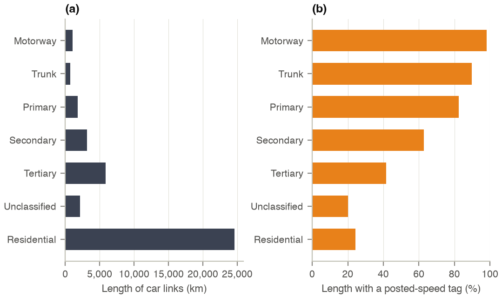
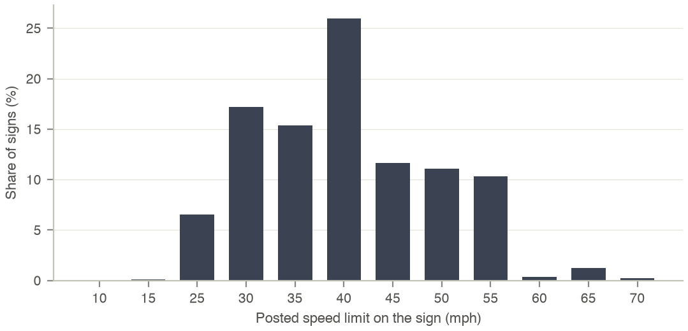

# Road network

The road network of the traffic assignment is built from OpenStreetMap and checked against three MDOT State Highway
Administration (SHA) inventories. This page describes the source data and the attributes of the 2024 network that MILES
uses. The construction steps are summarised in [Zone system and networks](../zones-networks.md).

## OpenStreetMap, Maryland extract

**Source.** OpenStreetMap contributors, Maryland extract distributed by Geofabrik [[22]](../inputs.md#sources), in PBF
format (212 MB; replication timestamp 11 June 2026). Licence: Open Database Licence. The extract is converted
with pt2matsim to a MATSim network in EPSG:26985 (NAD83, Maryland, metres).

### Codebook

| Variable | Description | Type | Values / categories / units | Used in |
|---|---|---|---|---|
| `highway` | Road class of the way | string | motorway, trunk, primary, secondary, tertiary, unclassified, residential, living_street, service; `_link` for ramps | Link class, default lanes, capacity per lane, speed rules |
| `maxspeed` | Posted speed limit | string | e.g. `35 mph`; missing on most minor roads | Free speed (rule a) |
| `lanes` | Number of lanes of the way | integer (string) | 1–8; missing on most minor roads (class default used) | `permlanes`, capacity |
| `oneway` | Direction of travel | string | yes, no, -1, alternating; missing = two-way except motorways | One or two links per way |
| `name` | Street name | string | free text | Matching of count stations and speed rule c |
| way `id` | OSM way identifier | integer | — | Join of tags to links |
| node coordinates | Longitude, latitude of nodes | float | WGS84 degrees, projected to EPSG:26985 | Link geometry and length |
| `motorway_junction` `ref` | Exit number at a junction node | string | e.g. `27A` | Interchange checks |

### Statistics

Network of 2024 as used in the assignment (car and transit links; rail links come from the OSM railway ways):

| Item | Whole network | Six study-area counties |
|---|---:|---:|
| Nodes | 214,599 | — |
| Links (all modes) | 473,098 | 266,260 |
| Car links | 469,434 | 263,661 |
| Length of car links (km) | 71,493 | 40,148 |
| Car links also open to buses | 29,761 | 26,840 |
| Rail and other transit-only links | 3,664 | 2,599 |

By road class (car links):

| OSM class | Links | km | km in six counties | Lanes (median) | Free speed, km/h (median) | Capacity, veh/h (median) | km with `maxspeed` tag (%) |
|---|---:|---:|---:|---:|---:|---:|---:|
| `motorway` | 5,253 | 1,625 | 1,073 | 3 | 104.6 | 6,000 | 97.2 |
| `motorway_link` | 4,560 | 937 | 610 | 1 | 68.0 | 2,100 | 17.5 |
| `trunk` | 6,386 | 1,259 | 690 | 2 | 80.5 | 3,000 | 92.1 |
| `trunk_link` | 1,188 | 127 | 60 | 2 | 56.3 | 2,000 | 8.1 |
| `primary` | 28,863 | 3,451 | 1,809 | 2 | 56.3 | 3,000 | 70.3 |
| `primary_link` | 1,788 | 149 | 74 | 1 | 36.2 | 1,500 | 7.9 |
| `secondary` | 36,932 | 5,465 | 3,182 | 1 | 56.3 | 800 | 53.7 |
| `secondary_link` | 807 | 49 | 32 | 1 | 36.2 | 800 | 7.6 |
| `tertiary` | 58,334 | 10,261 | 5,844 | 1 | 43.5 | 600 | 35.2 |
| `tertiary_link` | 432 | 21 | 13 | 1 | 36.2 | 600 | 3.8 |
| `unclassified` | 14,775 | 2,982 | 2,132 | 1 | 36.2 | 600 | 19.0 |
| `residential` | 310,083 | 45,161 | 24,622 | 1 | 36.2 | 600 | 15.5 |
| `living_street` | 31 | 2 | 2 | 1 | 36.2 | 300 | 7.2 |
| `other` | 2 | 4 | 4 | 2 | 104.6 | 4,000 | 0.0 |
| All car links | 469,434 | 71,493 | 40,148 | 1 | 36.2 | 600 | 27.2 |

Medians are over links; the last column is weighted by length. Share of car-link length by number of lanes (`permlanes`, one direction):

| Lanes per direction | Share of car-link km (%) |
|---|---:|
| 1 | 91.0 |
| 2 | 5.6 |
| 3 | 2.4 |
| 4 | 0.8 |
| 5 or more | 0.2 |

Summary of the coded link attributes:

| Attribute (car links) | Links | Mean | Median | SD | Min | Max |
|---|---:|---:|---:|---:|---:|---:|
| Length (m) | 469,434 | 152.3 | 103.1 | 142.9 | 0.1 | 3,622.7 |
| Lanes (`permlanes`) | 469,434 | 1.2 | 1.0 | 0.7 | 1.0 | 112.5 |
| Free speed (km/h) | 469,434 | 41.9 | 36.2 | 13.5 | 14.5 | 129.6 |
| Capacity (veh/h) | 469,434 | 947.6 | 600.0 | 1,042.4 | 300.0 | 16,000.0 |

282 short ramp links (`motorway_link`, `trunk_link`, at most 83 m) carry
more than 8 lanes, the largest values of `permlanes`; their capacity is that of the ramp (2,000–6,000 veh/h).

*Figure 1. (a) Length of car links by OpenStreetMap class in the six study-area counties; (b) share of that length
whose way carries a `maxspeed` tag.*

### Processing

- Ways with a `highway` tag of the classes above, and railway ways used by transit, are converted with pt2matsim; the
  Francis Scott Key Bridge is closed in the 2024 network (closure of 26 March 2024).
- Freeway and ramp capacities come from Highway Capacity Manual bottleneck values; non-freeway classes are raised to the MDOT
  functional class where MDOT rates the road higher, never lowered.
- Free speed of surface streets = posted speed × 0.9 below 51 km/h, × 1.0 otherwise; capacity = capacity per lane of the
  class × max(lanes, 1) (MATSim OSM reader defaults). The posted speed is the first available of:

| Source of the posted speed (first available) | Links | Share (%) |
|---|---:|---:|
| OSM `maxspeed` tag of the way | 121,333 | 26.8 |
| MDOT SHA speed-limit signs on the way (median) | 3,115 | 0.7 |
| Median of the same road name and class in the 5 km cell | 23,318 | 5.2 |
| Median of the class in the 5 km cell (5 or more links) | 243,619 | 53.9 |
| Median of the class in the whole network | 60,660 | 13.4 |
| All surface-street links | 452,045 | 100.0 |

Posted speeds (mph) of the surface-street links after this step:

| Class (MDOT-reconciled) | Links | Mean | Median | SD | Min | Max |
|---|---:|---:|---:|---:|---:|---:|
| `primary` | 32,485 | 36.5 | 35 | 7.9 | 15 | 60 |
| `secondary` | 41,651 | 34.1 | 35 | 6.9 | 10 | 55 |
| `tertiary` | 60,388 | 29.5 | 30 | 4.6 | 10 | 55 |
| `unclassified` | 14,178 | 25.0 | 25 | 4.7 | 10 | 65 |
| `residential` | 303,312 | 25.0 | 25 | 3.1 | 10 | 65 |

## MDOT SHA road inventories

**Source.** MDOT State Highway Administration open data portal [[23]](../inputs.md#sources): Roadway Functional
Classification, Roadway Lane Mileage, Roadway Sign Inventory (posted speed-limit signs) and Roadway Interchange Exits,
downloaded with the ArcGIS REST service of each layer for the bounding box of the network area (EPSG:26985).
They are used to check and correct the OSM class, lanes and speeds; they are not a network themselves.

### Codebook

| Variable | Description | Type | Values / categories / units | Used in |
|---|---|---|---|---|
| `FUNCTIONAL_CLASS` | Federal functional class of the segment | integer | 1 Interstate; 2 other freeway or expressway; 3 other principal arterial; 4 minor arterial; 5 major collector; 6 minor collector; 7 local | Class reconciliation, count-station strata |
| `COUNTY_NAME`, `ROAD_NAME`, `ID_PREFIX`, `ID_RTE_NO` | County, road name and route (e.g. IS 695) | string / integer | — | Route identity in matching |
| `EXIT_NUMBER`, `RAMP_NUMBER` | Interchange exit and ramp | string | — | Ramp inventory of I-695 |
| `MAINLINE_LANE_MILES`, `AUX_LANE_MILES`, `TOTAL_LANE_MILES` | Lane-miles of the segment, both directions | float | miles | Through lanes = mainline lane-miles ÷ length |
| `FROM_MEASURE`, `TO_MEASURE` | Mileposts of the segment | float | miles | Segment length |
| `SpeedLimit` | Posted limit on the sign | integer | mph | Posted speed (rule b), speed check |
| `Route`, `TravelDirection`, `MilePost` | Route, direction (NB, SB, EB, WB) and milepost of the sign | string / float | — | Attaching signs to links |

### Statistics

Functional classification in the network bounding box:

| Functional class | Segments | Centreline km |
|---|---:|---:|
| 1 Interstate | 1,349 | 1,723 |
| 2 Other freeway, expressway | 887 | 1,095 |
| 3 Other principal arterial | 1,046 | 2,464 |
| 4 Minor arterial | 1,559 | 3,040 |
| 5 Major collector | 2,174 | 3,251 |
| 6 Minor collector | 907 | 1,564 |
| 7 Local | 61,579 | 23,738 |
| All classes | 69,501 | 36,875 |

Lane mileage of the inventoried roads, five counties of the study area (the layer has no segments in Baltimore City):

| County | Segments | Mainline lane-km | Auxiliary lane-km |
|---|---:|---:|---:|
| Anne Arundel | 13,012 | 1,914 | 26 |
| Baltimore | 14,770 | 2,128 | 0 |
| Carroll | 5,571 | 825 | 0 |
| Harford | 7,660 | 1,039 | 0 |
| Howard | 6,318 | 1,092 | 8 |
| Five counties | 47,331 | 6,997 | 34 |

Posted speed-limit signs: 7,080 signs (state routes only), mean 40.2 mph, median
40 mph, standard deviation 9.2 mph, range 10–70 mph.

*Figure 2. Posted speed limit of the MDOT SHA speed-limit signs in the network area.*

Agreement of the network with the inventories (link-by-link audit of the six counties):

| Check (car links in the six counties) | Links | Result |
|---|---:|---:|
| Links with an MDOT centreline within 20 m and 30 degrees | 200,989 | 76.2 % of links |
| OSM class consistent with MDOT functional class | 200,989 | 83.3 % agree |
| OSM `maxspeed` equal to the attached MDOT sign | 1,929 | 84.3 % equal |

### Processing

- A link is matched to the nearest MDOT centreline within 20 m whose bearing is within 30 degrees; OSM classes map to MDOT
  groups (motorway 1–2, trunk 2–3, primary 3, secondary 4, tertiary 5–6, minor roads 7).
- Through lanes are mainline lane-miles divided by segment length, halved on two-way roads; they are compared with
  `permlanes` and reported per link, not used to recode lanes.
- A sign is attached to the nearest car link within 30 m with the same travel direction.
