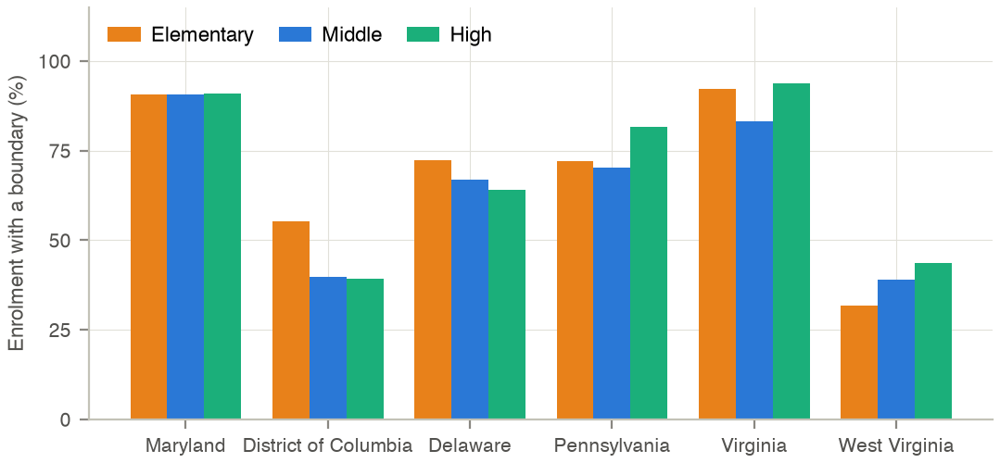
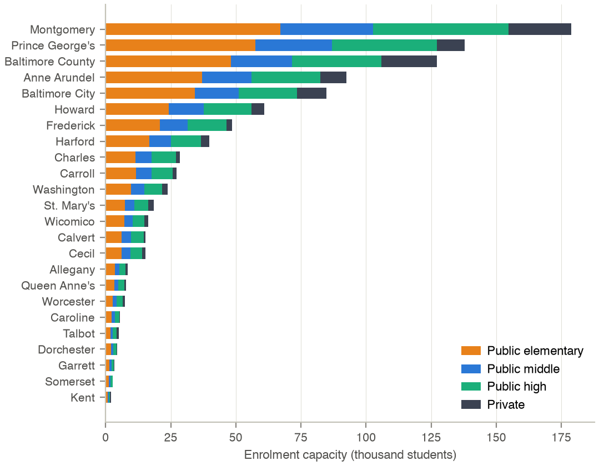

# Schools

The school location models of the land-use stage assign every student of the synthetic population to a school. They need an inventory of schools with a location and a capacity. MILES builds it from three federal collections of the National Center for Education Statistics (NCES): the Common Core of Data (public schools) and the Private School Universe Survey (private schools) [[12]](../inputs.md#sources), and the Integrated Postsecondary Education Data System (colleges and universities) [[13]](../inputs.md#sources). The School Attendance Boundary Survey [[14]](../inputs.md#sources) gives the attendance zones of public schools. All four are public and are downloaded from the NCES web site into `data/raw/nces/`, `data/raw/ipeds/` and `data/raw/sabs/`.

The inventory covers the six states with model zones: Maryland, the District of Columbia, Delaware, Pennsylvania, Virginia and West Virginia. Enrolment is taken as the capacity of a school. The inventory built from the most recent releases is used for the base year 2016 and for all later years.

## Common Core of Data, public schools

School directory and school membership files of the 2024–25 school year [[12]](../inputs.md#sources), with the EDGE geocodes of public schools for coordinates and county. The membership file is in long format (one row per school, grade and student group); MILES reads the school totals and the counts by grade.

### Codebook

| Variable | Description | Type | Values / categories / units | Used in |
|---|---|---|---|---|
| `NCESSCH` | NCES school identifier (12 digits; first 7 = district `LEAID`) | string | — | Inventory; SABS link |
| `FIPST` | State FIPS code | string | 10, 11, 24, 42, 51, 54 kept | Filter |
| `SY_STATUS_TEXT` | Operational status in the school year | category | Open, New, Reopened kept; Closed, Inactive, Future dropped | Filter |
| `SCH_NAME`, `LEA_NAME` | School and district name | string | — | Inventory (labels) |
| `GSLO`, `GSHI` | Lowest and highest grade offered | category | PK, KG, 01–13, UG | Inventory |
| `LEVEL` | School level | category | Elementary, Middle, High, Prekindergarten, Other, Not applicable | Grade band when no graded counts |
| `GRADE` | Grade of a membership row | category | Pre-Kindergarten, Kindergarten, Grade 1–13, Ungraded, Adult Education | Enrolment by band |
| `STUDENT_COUNT` | Students in the row | integer | students | Capacity |
| `TOTAL_INDICATOR` | Level of aggregation of a membership row | category | Education Unit Total; Subtotal 4 - By Grade kept | Filter |
| `LAT`, `LON` | School coordinates (EDGE geocode file) | float | degrees, WGS 84 | Zone assignment |
| `CNTY`, `NMCNTY` | County FIPS and name (EDGE geocode file) | string | — | County tables |

### Statistics

The national directory has 102,178 records. Records and students of the six states, 2024–25 (students from the state membership file):

| State | Directory records | Open, new or reopened | Students incl. PK | Students K–12 |
|---|---:|---:|---:|---:|
| Maryland | 1,414 | 1,408 | 891,525 | 859,450 |
| District of Columbia | 247 | 245 | 100,335 | 88,294 |
| Delaware | 238 | 236 | 142,156 | 139,425 |
| Pennsylvania | 2,949 | 2,932 | 1,691,456 | 1,682,241 |
| Virginia | 2,159 | 2,126 | 1,257,315 | 1,223,117 |
| West Virginia | 701 | 676 | 242,155 | 227,606 |
| Total | 7,708 | 7,623 | 4,324,942 | 4,220,133 |

Of the open, new or reopened schools, 4,328 are elementary, 1,281 are middle, 1,520 are high, 161 are other, 66 are prekindergarten schools (CCD `LEVEL`).

## Private School Universe Survey

Public-use file of the 2023–24 survey [[12]](../inputs.md#sources): one record per private school with enrolment by grade and coordinates. The survey weight `PFNLWT` corrects for non-response; the inventory uses the unweighted records, since it needs actual schools.

### Codebook

| Variable | Description | Type | Values / categories / units | Used in |
|---|---|---|---|---|
| `PPIN` | Private school identifier | string | — | Inventory |
| `PINST` | School name | string | — | Inventory (labels) |
| `PSTANSI` | State FIPS code | string | six states kept | Filter |
| `PCNTY24`, `PCNTNM` | County code and name | string | — | County tables |
| `LATITUDE24`, `LONGITUDE24` | Coordinates; EDGE private-school geocodes where missing | float | degrees | Zone assignment |
| `NUMSTUDS` | Students, kindergarten to grade 12 | integer | students | Capacity |
| `P150` | Prekindergarten students | integer | students | Kept apart (not in capacity) |
| `P160`–`P280` | Students in kindergarten and grades 1–12 | integer | students | Split of capacity by band |
| `P290`, `P300` | Ungraded students | integer | students | Follow the graded split |
| `LOGR2024`, `HIGR2024` | Lowest and highest grade | category | 1 ungraded, 2 PK, 3 K, 4–15 grades 1–12, 16 grade 13 | Inventory |
| `LEVEL` | School level | category | 1 elementary, 2 secondary, 3 combined | Band when no graded counts |
| `PFNLWT` | Final survey weight | float | — | State totals (check) |

### Statistics

The national file has 22,510 records. Six states, 2023–24:

| State | Schools | Students K–12 | Schools, weighted | Students, weighted | Without coordinates |
|---|---:|---:|---:|---:|---:|
| Maryland | 543 | 101,509 | 725 | 134,249 | 0 |
| District of Columbia | 50 | 13,869 | 70 | 25,508 | 0 |
| Delaware | 74 | 11,532 | 120 | 15,688 | 0 |
| Pennsylvania | 1,567 | 177,942 | 2,226 | 243,192 | 0 |
| Virginia | 651 | 99,127 | 882 | 132,128 | 0 |
| West Virginia | 100 | 8,994 | 133 | 11,197 | 0 |
| Total | 2,985 | 412,973 | 4,155 | 561,961 | 0 |

Among the 2,985 private schools with students, enrolment has median 58, mean 138.3 and maximum 8,873 students.

## Integrated Postsecondary Education Data System

Institutional characteristics 2024 (`HD2024`), fall enrolment 2023 (`EF2023A`) and 12-month enrolment 2023–24 (`EFFY2024`) [[13]](../inputs.md#sources). Each institution is one point; branch campuses with their own identifier are separate points.

### Codebook

| Variable | Description | Type | Values / categories / units | Used in |
|---|---|---|---|---|
| `UNITID` | Institution identifier | string | — | Inventory; link of the three files |
| `INSTNM` | Institution name | string | — | Inventory (labels) |
| `FIPS` | State FIPS code | string | six states kept | Filter |
| `CYACTIVE` | Institution active in the current year | category | 1 kept | Filter |
| `COUNTYCD`, `COUNTYNM` | County FIPS and name | string | — | County tables |
| `LATITUDE`, `LONGITUD` | Coordinates | float | degrees | Zone assignment |
| `SECTOR` | Control and level | category | 1 public 4-year, 2 private non-profit 4-year, 3 private for-profit 4-year, 4–9 two-year and less | College model size terms (public 4-year, private 4-year, other) |
| `EFALEVEL`, `EFTOTLT` | Fall enrolment, level 1 = all students, total | integer | students | Capacity |
| `EFFYALEV`, `EFYTOTLT` | 12-month unduplicated headcount, all students | integer | students | Capacity where fall enrolment is missing (× 0.8) |

### Statistics

The national file has 6,072 institutions. Six states:

| State | Institutions | Active | Active with fall enrolment | Fall enrolment 2023 |
|---|---:|---:|---:|---:|
| Maryland | 78 | 78 | 75 | 350,718 |
| District of Columbia | 23 | 23 | 22 | 100,557 |
| Delaware | 18 | 16 | 15 | 60,884 |
| Pennsylvania | 315 | 307 | 304 | 649,860 |
| Virginia | 147 | 144 | 139 | 564,465 |
| West Virginia | 68 | 68 | 68 | 137,024 |
| Total | 649 | 636 | 623 | 1,863,508 |

Active institutions with fall enrolment by sector, six states:

| Sector | Institutions | Fall enrolment | Share of enrolment (%) |
|---|---:|---:|---:|
| Public, 4-year or above | 86 | 757,132 | 40.6 |
| Private non-profit, 4-year or above | 182 | 602,552 | 32.3 |
| Private for-profit, 4-year or above | 28 | 95,335 | 5.1 |
| Public, 2-year | 72 | 366,087 | 19.6 |
| Private non-profit, 2-year | 24 | 6,093 | 0.3 |
| Private for-profit, 2-year | 63 | 17,425 | 0.9 |
| Public, less than 2-year | 46 | 3,470 | 0.2 |
| Private non-profit, less than 2-year | 8 | 1,048 | 0.1 |
| Private for-profit, less than 2-year | 114 | 14,366 | 0.8 |

## School Attendance Boundary Survey

Attendance zones of public schools for the 2015–16 school year [[14]](../inputs.md#sources), as four polygon layers (primary, middle, high, other). It is the latest collection; no later release exists. Boundaries are linked to the inventory by `ncessch`.

### Codebook

| Variable | Description | Type | Values / categories / units | Used in |
|---|---|---|---|---|
| `ncessch` | NCES school identifier | string | 12 digits | Link to the inventory |
| `leaid` | District identifier | string | 7 digits | District coverage |
| `gslo`, `gshi` | Lowest and highest grade served by the boundary | category | PK, KG, 01–12 | Band test grades 3, 7, 10 |
| `stAbbrev` | State | string | — | Filter |
| `openEnroll` | District has open enrolment | category | 0 no, 1 yes | District coverage table |
| geometry | Attendance zone polygon | polygon | EPSG:3857 | In-boundary share of zone housing units |

### Statistics

The national file has 75,128 boundary polygons. Polygons by state and layer:

| State | Primary | Middle | High | Other | All |
|---|---:|---:|---:|---:|---:|
| Maryland | 855 | 227 | 189 | 15 | 1,286 |
| District of Columbia | 77 | 12 | 9 | 2 | 100 |
| Delaware | 113 | 46 | 33 | 1 | 193 |
| Pennsylvania | 1,507 | 491 | 517 | 45 | 2,560 |
| Virginia | 1,101 | 332 | 297 | 16 | 1,746 |
| West Virginia | 312 | 88 | 76 | 6 | 482 |
| Total | 3,965 | 1,196 | 1,121 | 85 | 6,367 |

Share of public enrolment of the inventory whose school has a boundary covering the band's test grade (grade 3 elementary, 7 middle, 10 high). A district counts as covered at 90 % or more:

| State | Elementary, % (districts covered) | Middle | High |
|---|---:|---:|---:|
| Maryland | 90.8 (17 of 24) | 90.7 (19 of 25) | 90.9 (18 of 25) |
| District of Columbia | 55.3 (1 of 44) | 39.9 (0 of 37) | 39.2 (0 of 23) |
| Delaware | 72.3 (6 of 32) | 67.0 (8 of 36) | 64.0 (14 of 31) |
| Pennsylvania | 72.1 (42 of 95) | 70.4 (43 of 97) | 81.6 (75 of 104) |
| Virginia | 92.2 (13 of 21) | 83.1 (14 of 21) | 93.8 (19 of 21) |
| West Virginia | 31.7 (2 of 11) | 39.0 (4 of 11) | 43.7 (6 of 10) |

*Share of public enrolment of the inventory whose school has an attendance boundary in the 2015–16 survey, by state and grade band.*

## School inventory used by MILES

The three collections are combined into one file, one record per school and grade band (`schools.csv` of the land-use input). Its columns:

| Variable | Description | Type | Values / categories / units | Used in |
|---|---|---|---|---|
| `id` | Record identifier | integer | 1… | Land use, activities |
| `zone` | Model zone of the school point | integer | 1–1,588 (MSTM zone) | School location; activities |
| `type` | School type of the land-use model | integer | 1 primary, 2 secondary, 3 tertiary | Land use |
| `capacity` | Enrolment of the band | integer | students | Size term; capacity constraint |
| `coordX`, `coordY` | Coordinates | float | m, EPSG:26918 | Activities |
| `startTime`, `duration` | School day | integer | seconds after midnight; seconds | Activities |
| `band` | Grade band | category | elementary (K–5), middle (6–8), high (9–12), postsec | School location segments |
| `sector` | Control | category | public, private, postsec | Size terms |
| `source`, `source_id` | Source file and identifier | string | CCD, PSS or IPEDS | Links to the sources |
| `state_fips`, `county_fips` | State and county | string | FIPS | Tables |
| `pk_enrollment` | Prekindergarten students (not in capacity) | integer | students | Reporting |

### Statistics

6,749 records of 4,452 schools and institutions in 1,199 of the 1,588 zones. Capacity per record:

| Type | Records | Schools | Capacity | Mean | Median | Maximum |
|---|---:|---:|---:|---:|---:|---:|
| Public, elementary | 2,009 | 2,009 | 843,101 | 420 | 416 | 1,459 |
| Public, middle | 1,009 | 1,009 | 437,050 | 433 | 287 | 1,702 |
| Public, high | 611 | 611 | 618,515 | 1,012 | 933 | 4,655 |
| Private K–12 | 2,928 | 1,255 | 205,311 | 70 | 35 | 7,546 |
| Post-secondary | 192 | 192 | 750,572 | 3,909 | 583 | 60,084 |
| All | 6,749 | 4,452 | 2,854,549 | 423 | 158 | 60,084 |

Capacity by state. The last column compares public K–12 capacity with the NCES state total. Pennsylvania, Virginia and West Virginia are only partly inside the zone system; in the District of Columbia the difference comes from the schools dropped in processing (see below):

| State | Public K–12 | Private K–12 | Post-secondary | Public K–12 ÷ NCES state total (%) |
|---|---:|---:|---:|---:|
| Maryland | 859,450 | 101,508 | 350,718 | 100.0 |
| District of Columbia | 82,062 | 13,868 | 100,592 | 92.9 |
| Delaware | 139,425 | 11,533 | 60,884 | 100.0 |
| Pennsylvania | 274,976 | 28,586 | 53,870 | 16.3 |
| Virginia | 500,238 | 48,720 | 121,264 | 40.9 |
| West Virginia | 42,515 | 1,096 | 63,244 | 18.7 |

Maryland by county (* study area):

| County | K–12 schools | Public elementary | Public middle | Public high | Private K–12 | Post-secondary | Institutions |
|---|---:|---:|---:|---:|---:|---:|---:|
| Allegany | 28 | 3,444 | 1,779 | 2,417 | 701 | 6,740 | 2 |
| Anne Arundel * | 167 | 37,101 | 18,871 | 26,381 | 10,082 | 16,864 | 7 |
| Baltimore City * | 205 | 34,262 | 16,874 | 22,254 | 11,342 | 65,575 | 13 |
| Baltimore County * | 258 | 48,013 | 23,621 | 34,310 | 21,205 | 56,587 | 14 |
| Calvert | 29 | 6,191 | 3,521 | 4,837 | 728 | 0 | 0 |
| Caroline | 11 | 2,351 | 1,217 | 1,766 | 59 | 0 | 0 |
| Carroll * | 56 | 11,652 | 5,922 | 8,085 | 1,645 | 6,046 | 2 |
| Cecil | 36 | 6,175 | 3,260 | 4,630 | 1,132 | 1,845 | 1 |
| Charles | 45 | 11,368 | 6,201 | 9,436 | 1,513 | 4,984 | 1 |
| Dorchester | 14 | 1,944 | 979 | 1,337 | 68 | 0 | 0 |
| Frederick | 85 | 20,730 | 10,637 | 15,101 | 2,010 | 11,540 | 4 |
| Garrett | 13 | 1,427 | 746 | 1,020 | 62 | 701 | 1 |
| Harford * | 72 | 16,653 | 8,400 | 11,553 | 3,079 | 5,192 | 2 |
| Howard * | 112 | 24,318 | 13,287 | 18,428 | 4,884 | 10,386 | 4 |
| Kent | 9 | 726 | 354 | 511 | 378 | 916 | 1 |
| Montgomery | 339 | 67,074 | 35,567 | 52,150 | 24,095 | 20,445 | 6 |
| Prince George's | 247 | 57,546 | 29,300 | 40,456 | 10,565 | 121,212 | 9 |
| Queen Anne's | 18 | 3,212 | 1,645 | 2,298 | 537 | 1,980 | 1 |
| Somerset | 7 | 1,245 | 597 | 777 | 0 | 2,844 | 1 |
| St. Mary's | 43 | 7,276 | 3,765 | 5,341 | 2,080 | 1,587 | 1 |
| Talbot | 12 | 1,835 | 896 | 1,435 | 807 | 0 | 0 |
| Washington | 58 | 9,732 | 5,000 | 6,935 | 2,065 | 5,565 | 2 |
| Wicomico | 35 | 7,169 | 3,131 | 4,525 | 1,587 | 9,709 | 3 |
| Worcester | 16 | 2,722 | 1,504 | 2,227 | 884 | 0 | 0 |
| Maryland | 1,915 | 384,166 | 197,074 | 278,210 | 101,508 | 350,718 | 75 |

*Kindergarten to grade 12 enrolment capacity of the inventory by Maryland county, band and sector.*

## Processing

- Public schools: schools closed, inactive or not yet open are dropped, and so are schools without coordinates or students. Students by grade are summed to the bands K–5, 6–8 and 9–12; ungraded students follow the graded split of the school, or the CCD level where no graded counts exist. Prekindergarten is kept apart, as the synthetic students start at age 5.
- Private schools: the K–12 total `NUMSTUDS` is split over the bands by the graded counts. Missing coordinates are taken from the EDGE private-school geocodes.
- Post-secondary: active institutions; capacity is fall 2023 enrolment, or 0.8 × the 12-month headcount where fall enrolment is missing.
- A record is kept for each band with at least one student. Points are placed in the model zones (point in polygon, EPSG:26918); Maryland schools outside every polygon go to the nearest zone; schools of other states outside the zone system are dropped.
- The school day by band (start, duration) is the median of school trips of the 2017/18 Regional Travel Survey: elementary 08:35 and 7.0 h, middle 08:00 and 7.1 h, high 07:45 and 7.2 h, post-secondary 09:15 and 4.5 h.
- Attendance boundaries: census-block housing units are placed in the boundaries covering the band's test grade and in the zones; the share of a zone's housing units inside a school's boundary enters the K–8 and high-school location models.
- Code: `landuse/schools/build_inventory.py`, `attendance_boundaries.py`, `school_data.py`.
