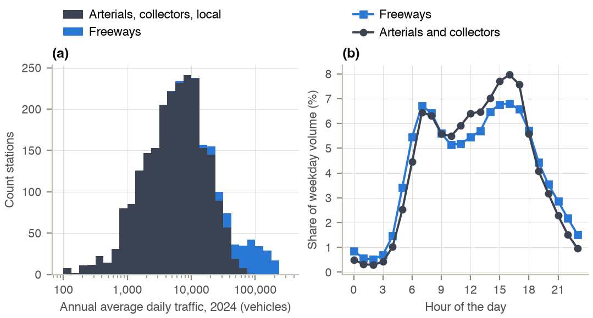

# Traffic counts

Traffic counts are used only to test the assignment; no parameter is fitted to them. Three sources are used: the MDOT
SHA count stations (annual average daily traffic), the FHWA continuous count stations (hourly volumes) and the MDOT
SHA vehicle-miles of travel by county and functional class.

## MDOT SHA annual average daily traffic

**Source.** MDOT State Highway Administration, Annual Average Daily Traffic, statewide count stations 2015–2024
[[23]](../inputs.md#sources), downloaded from the MDOT SHA open data portal. The file has 8,189 stations in
Maryland; 3,797 lie in the six study-area counties.

### Codebook

| Variable | Description | Type | Values / categories / units | Used in |
|---|---|---|---|---|
| `LOCATION_ID` | Station identifier | string | e.g. S2010020059; continuous stations P + 4 digits | Join with TMAS and network links |
| `COUNTY_DESC`, `ROADNAME`, `ID_PREFIX`, `ID_RTE_NO`, `STATION_DESC` | County, road, route and location | string | — | Road identity in matching |
| `F_SYSTEM` | Functional system | integer | 1 Interstate … 7 local | Matching tolerance, strata, split |
| `MAIN_LINE` | Mainline or ramp | integer | 1 mainline; other values ramps | Ramp stations matched to ramp links |
| `NUM_LANES` | Lanes at the station, both directions | integer | lanes | Lane check |
| `NORTH_EAST_SPLIT`, `SOUTH_WEST_SPLIT` | Directional split | float | % of AADT; 100 / 0 for one-way counts | Direction of the matched links |
| `AADT_2024` | Annual average daily traffic, 2024 | integer | vehicles per day, both directions | Test |
| `AAWDT_2024` | Annual average weekday traffic, 2024 | integer | vehicles per weekday | Weekday conversion |
| `COUNTED_FACTORED` | Counted in the year or factored from an earlier count | string | C counted; F factored | Reported |
| `CAR_AADT`, `LIGHT_TRUCK_AADT`, `BUS_AADT`, `SINGLE_UNIT_AADT`, `COMBINATION_UNIT_AADT` | AADT by vehicle class | integer | vehicles per day; classified stations only | Passenger-vehicle share |

### Statistics

Stations by county and functional system (six counties; one station on the county boundary is coded to Montgomery
County):

| County | Interstate | Other freeway, expressway | Other principal arterial | Minor arterial | Major collector | Minor collector | Local | All |
|---|---:|---:|---:|---:|---:|---:|---:|---:|
| Anne Arundel | 164 | 240 | 59 | 118 | 138 | 93 | 46 | 858 |
| Baltimore City | 148 | 17 | 160 | 186 | 233 | 1 | 22 | 767 |
| Baltimore County | 420 | 42 | 128 | 225 | 257 | 129 | 37 | 1,238 |
| Carroll | 6 | 0 | 41 | 31 | 80 | 21 | 19 | 198 |
| Harford | 45 | 18 | 32 | 51 | 81 | 65 | 9 | 301 |
| Howard | 77 | 188 | 23 | 39 | 74 | 17 | 16 | 434 |
| Montgomery (on the boundary) | 0 | 0 | 0 | 1 | 0 | 0 | 0 | 1 |
| All stations | 860 | 505 | 443 | 651 | 863 | 326 | 149 | 3,797 |

AADT 2024 by functional system, mainline stations with a 2024 value (ramp stations in the last row):

| Functional system | Stations | Mean AADT | Median | SD | Min | Max | AAWDT ÷ AADT | Counted in 2024 (%) | Stations with vehicle classes | Single-unit and combination trucks (%) |
|---|---:|---:|---:|---:|---:|---:|---:|---:|---:|---:|
| Interstate | 126 | 111,723 | 109,361 | 51,275 | 7,404 | 220,843 | 1.026 | 25.4 | 33 | 9.8 |
| Other freeway, expressway | 85 | 58,632 | 56,351 | 31,691 | 4,420 | 142,771 | 1.073 | 20.0 | 25 | 3.3 |
| Other principal arterial | 334 | 22,139 | 19,961 | 13,139 | 2,394 | 79,351 | 1.076 | 36.5 | 160 | 4.5 |
| Minor arterial | 635 | 11,667 | 9,920 | 7,624 | 31 | 43,280 | 1.077 | 15.3 | 247 | 4.3 |
| Major collector | 863 | 4,916 | 3,875 | 3,948 | 85 | 28,905 | 1.092 | 30.4 | 207 | 4.3 |
| Minor collector | 325 | 3,166 | 2,341 | 2,697 | 41 | 17,471 | 1.091 | 11.1 | 76 | 4.3 |
| Local | 142 | 3,733 | 2,365 | 3,771 | 71 | 16,270 | 1.097 | 14.8 | 35 | 5.1 |
| All mainline stations | 2,510 | 15,803 | 6,681 | 28,532 | 31 | 220,843 | 1.061 | 23.4 | 783 | — |
| Ramps (all systems) | 1,281 | 4,917 | 3,733 | 4,721 | 80 | 46,940 | 1.048 | 13.3 | 0 | — |

The truck share is the unweighted mean over classified stations of (single-unit + combination) ÷ all classes.

Matching to the 2024 network:

| Stations in the six counties | Stations | Share (%) |
|---|---:|---:|
| Both directions matched to network links | 2,722 | 71.7 |
| One direction matched | 735 | 19.4 |
| Not matched | 340 | 9.0 |
| Matched with a 2024 AADT: calibration-check half | 1,716 | — |
| Matched with a 2024 AADT: held-out half | 1,721 | — |

### Processing

- Each direction of a station is matched to the nearest car link of a compatible class within 60 m (functional system
  1–2) or 40 m (others), with the road identity checked against the MDOT route and the OSM name; ramp stations match ramp
  links only. A two-way count with one direction found takes the opposite carriageway within 150 m.
- The matched stations with a 2024 AADT are split once, with a fixed seed and stratified by functional system, into a
  calibration-check half and a held-out half; the held-out half is compared only once, in the final validation.
- Model volumes are compared with passenger vehicles: AADT × (1 − truck share − bus share) of the station, or of its class
  where the station has no classification.

## FHWA continuous count stations (TMAS)

**Source.** Federal Highway Administration, Travel Monitoring Analysis System, 2024 monthly volume files and station
file for Maryland [[25]](../inputs.md#sources). Volume records give hourly counts by station, direction, lane and day.

### Codebook

| Variable | Description | Type | Values / categories / units | Used in |
|---|---|---|---|---|
| `station_id` | Continuous station | string | 0Pnnnn = MDOT station Pnnnn | Join with the MDOT station and its links |
| `county_code` | County FIPS (station file) | string | 003, 005, 013, 025, 027, 510 in the study area | Station selection |
| `f_system` | Functional system and area type | string | 1–7 with U urban / R rural | Road groups |
| `travel_dir` | Direction | integer | 1 north, 3 east, 5 south, 7 west | Link of the direction |
| `travel_lane` | Lane | integer | 1 = outside lane | Summed over lanes |
| `month_record`, `day_record`, `day_of_week` | Date | integer | day_of_week 1 Sunday … 7 Saturday | Weekday selection |
| `hour_00` … `hour_23` | Hourly volume | integer | vehicles per hour; negative = missing | Hourly profile, test |

### Statistics

The twelve monthly files hold 81,208 station-direction-lane-day records for 78 Maryland stations;
24 stations are in the six counties (35,604 records). Average weekday volumes after the filters below:

| Functional system | Stations | Station-directions | Valid weekdays (median) |
|---|---:|---:|---:|
| Interstate | 11 | 22 | 240 |
| Other freeway, expressway | 3 | 6 | 234 |
| Other principal arterial | 4 | 8 | 248 |
| Minor arterial | 1 | 2 | 220 |
| Major collector | 1 | 2 | 245 |
| All | 20 | 40 | 238 |

Share of the weekday volume in the morning peak (6–9 h) and afternoon peak (15–19 h): freeways
18.6 % and 25.9 %, arterials and collectors
17.2 % and 28.8 %.

*Figure 1. (a) AADT 2024 of the MDOT mainline count stations of the six counties (logarithmic axis); (b) hourly share of the
average weekday volume at the continuous count stations of the six counties.*

### Processing

- Weekdays Monday–Friday, federal holidays of 2024 and the day after Thanksgiving excluded; days with a missing hour or a
  missing lane are dropped, and days below half the median daily total of the station-direction are dropped.
- Average weekday = mean over the kept days of the volume summed over lanes, per hour and direction. No year scaling (the
  counts and the model are both 2024, with the Key Bridge closed from 26 March).

## MDOT SHA vehicle-miles of travel

**Source.** MDOT SHA, *2024 Mileage Reports* (as of 1 January 2025), table FCAVMT-ALL, annual vehicle-miles of travel by
county and functional class on all public roads [[26]](../inputs.md#sources). The PDF is converted to text and parsed.

### Codebook

| Variable | Description | Type | Values / categories / units | Used in |
|---|---|---|---|---|
| County row | County of Maryland | string | 23 counties and Baltimore City | County totals |
| Columns 1–7, rural and urban | Annual VMT by functional class | float | millions of vehicle-miles per year | Summed over rural and urban |
| TOTAL, GRAND TOTAL | Totals | float | millions of vehicle-miles per year | Check |

### Statistics

Annual vehicle-miles of travel, 2024 (millions), rural and urban combined:

| County | Interstate | Other freeway, expressway | Other principal arterial | Minor arterial | Collector | Local | All classes |
|---|---:|---:|---:|---:|---:|---:|---:|
| Anne Arundel | 1,351 | 1,622 | 930 | 961 | 558 | 450 | 5,872 |
| Baltimore County | 4,065 | 252 | 1,095 | 1,285 | 855 | 634 | 8,186 |
| Carroll | 40 | 0 | 519 | 350 | 269 | 139 | 1,317 |
| Harford | 746 | 149 | 448 | 502 | 454 | 205 | 2,504 |
| Howard | 1,368 | 1,091 | 398 | 480 | 430 | 366 | 4,133 |
| Baltimore City | 1,080 | 86 | 1,033 | 563 | 204 | 222 | 3,188 |
| Six counties | 8,650 | 3,200 | 4,423 | 4,141 | 2,770 | 2,016 | 25,200 |
| Maryland | 17,395 | 6,852 | 11,898 | 9,047 | 6,940 | 4,961 | 57,093 |

The six counties carry 44.1 % of the vehicle-miles of Maryland.

### Processing

- Annual VMT ÷ 365 gives the average day; the weekday factor (AAWDT ÷ AADT) and the passenger-vehicle share of each class
  come from the count stations of the six counties (collectors and local roads pooled).
