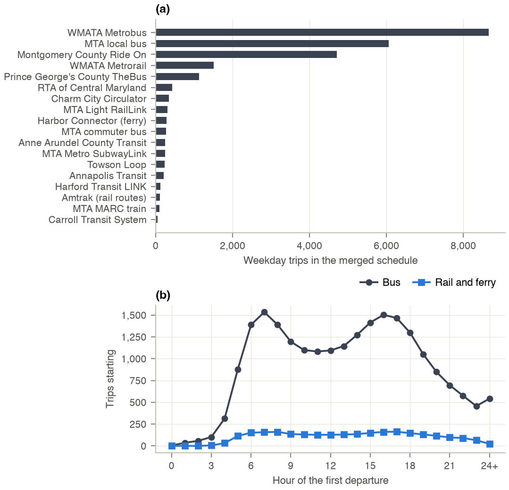

# Transit

The transit network of the assignment and the transit skims of the land-use and activity models are built from the GTFS
timetables of the operators in the network area. Fares enter the mode-choice utilities; boardings from the National
Transit Database are a validation target only.

## GTFS timetables of 18 feeds

**Source.** MTA Maryland developer resources (five MTA feeds) and the official feeds of 13 regional operators, with the
Mobility Database as mirror where the official URL failed [[24]](../inputs.md#sources). Downloaded 21–22 October 2026.
One representative weekday, Wednesday 21 October 2026, is extracted from every feed.

### Codebook

| Variable | Description | Type | Values / categories / units | Used in |
|---|---|---|---|---|
| `routes.txt`: `route_id`, `agency_id`, `route_short_name`, `route_type` | Route and its mode | string / integer | `route_type` 0 tram (light rail), 1 subway, 2 rail, 3 bus, 4 ferry | Lines of the MATSim schedule, vehicle types |
| `trips.txt`: `trip_id`, `route_id`, `service_id`, `direction_id`, `shape_id` | One scheduled vehicle trip | string | — | Departures |
| `stop_times.txt`: `trip_id`, `stop_id`, `stop_sequence`, `arrival_time`, `departure_time` | Timetable of each trip | string / time | hh:mm:ss, may exceed 24:00 | Route profiles, schedule |
| `stops.txt`: `stop_id`, `stop_lat`, `stop_lon`, `parent_station` | Stop location | float | WGS84 degrees | Stop facilities, clip to the network area |
| `calendar.txt`, `calendar_dates.txt`: `service_id`, weekday flags, `start_date`, `end_date`, `exception_type` | Days of service | date / integer | YYYYMMDD; 1 added, 2 removed | Selection of the weekday |
| `frequencies.txt`: `trip_id`, `start_time`, `end_time`, `headway_secs` | Frequency-based service | time / integer | seconds | Expanded to departures |
| `shapes.txt`: `shape_id`, `shape_pt_lat`, `shape_pt_lon`, `shape_pt_sequence` | Route geometry | float | WGS84 degrees | Mapping routes on the road network |
| `transfers.txt`: `from_stop_id`, `to_stop_id`, `min_transfer_time` | Transfer rules | string / integer | seconds | Transit router |

### Statistics

By feed (trips and stops after the selection of the weekday and the clip to the network area):

| Operator (feed) | Mode | Calendar of the feed | Service day used | Routes in feed | Routes kept | Trips on the day | Trips kept | Stops kept |
|---|---|---|---|---:|---:|---:|---:|---:|
| MTA local bus | Bus | 2026-06-21 to 2027-02-06 | 2026-10-21 | 66 | 66 | 6,052 | 6,052 | 3,938 |
| MTA Light RailLink | Light rail | 2023-04-23 to 2026-12-31 | 2026-10-21 | 1 | 1 | 304 | 304 | 67 |
| MTA Metro SubwayLink | Metro (heavy rail) | 2024-01-01 to 2026-12-31 | 2026-10-21 | 1 | 1 | 247 | 247 | 26 |
| MTA MARC train | Commuter and intercity rail | 2022-11-14 to 2026-12-31 | 2026-10-21 | 3 | 3 | 96 | 95 | 63 |
| MTA commuter bus | Bus | 2021-08-29 to 2026-12-31 | 2026-10-21 | 37 | 33 | 394 | 274 | 326 |
| Charm City Circulator | Bus | 2022-12-25 to 2025-12-31 | 2025-12-31 (last day of the feed) | 5 | 5 | 338 | 338 | 130 |
| Harbor Connector (ferry) | Ferry | 2021-07-28 to 2026-10-31 | 2026-10-21 | 3 | 3 | 282 | 282 | 5 |
| Towson Loop | Bus | 2025-01-01 to 2027-12-31 | 2026-10-21 | 2 | 2 | 238 | 238 | 48 |
| RTA of Central Maryland | Bus | 2025-05-17 to 2027-02-28 | 2026-10-21 | 16 | 13 | 431 | 431 | 633 |
| Anne Arundel County Transit | Bus | 2022-01-01 to 2023-12-31 | 2023-12-27 (last day of the feed) | 9 | 9 | 248 | 248 | 299 |
| Annapolis Transit | Bus | 2025-08-01 to 2026-09-30 | 2026-09-30 (last day of the feed) | 8 | 8 | 210 | 210 | 166 |
| Harford Transit LINK | Bus | 2019-01-17 to 2022-12-31 | 2022-12-28 (last day of the feed) | 7 | 7 | 116 | 116 | 186 |
| Carroll Transit System | Bus | 2019-01-01 to 2022-01-31 | 2022-01-26 (last day of the feed) | 6 | 6 | 50 | 49 | 70 |
| WMATA Metrorail | Metro (heavy rail) | 2026-10-20 to 2027-01-02 | 2026-10-21 | 6 | 6 | 1,699 | 1,509 | 32 |
| WMATA Metrobus | Bus | 2026-09-13 to 2027-03-27 | 2026-10-21 | 126 | 78 | 13,544 | 8,658 | 3,463 |
| Montgomery County Ride On | Bus | 2026-09-06 to 2027-01-09 | 2026-10-21 | 82 | 82 | 4,709 | 4,709 | 4,556 |
| Prince George's County TheBus | Bus | 2026-07-19 to 2027-03-01 | 2026-10-21 | 24 | 24 | 1,128 | 1,128 | 1,651 |
| Amtrak (rail routes) | Commuter and intercity rail | 2026-10-18 to 2027-10-18 | 2026-10-21 | 63 | 7 | 405 | 115 | 11 |
| All 18 feeds |  |  |  | 465 | 354 | 30,491 | 25,003 | 15,670 |

By mode, merged weekday schedule (15,746 stop records including parent stations, 828,829 stop times):

| Mode (GTFS `route_type`) | Routes | Weekday trips | Share of trips (%) | Trips starting 6–9 h (%) | Trips starting 15–19 h (%) |
|---|---:|---:|---:|---:|---:|
| Bus | 333 | 22,451 | 89.8 | 19.2 | 25.3 |
| Light rail | 1 | 304 | 1.2 | 15.8 | 20.4 |
| Metro (heavy rail) | 7 | 1,756 | 7.0 | 18.1 | 23.4 |
| Commuter and intercity rail | 10 | 210 | 0.8 | 21.4 | 31.4 |
| Ferry | 3 | 282 | 1.1 | 21.3 | 28.4 |
| All modes | 354 | 25,003 | 100.0 | 19.1 | 25.2 |

| Per trip (merged feed) | Trips | Mean | Median | SD | Min | Max |
|---|---:|---:|---:|---:|---:|---:|
| Stops served | 25,003 | 33.1 | 34 | 23.1 | 2 | 109 |
| Scheduled duration, first to last stop (min) | 25,003 | 35.9 | 36 | 21.6 | 0 | 250 |

After mapping on the road network the MATSim schedule has 354 lines, 4,319 route
patterns, 25,099 departures and 16,687 stop facilities (frequency-based trips expanded
to departures).

*Figure 1. (a) Weekday trips of each feed in the merged schedule; (b) trips by hour of their first departure (24+: after midnight of the service day), bus and
rail (light rail, Metro, MARC, Amtrak, WMATA Metrorail) with the Harbor Connector ferry.*

### Processing

- Active services of the day: calendar range with the Wednesday flag, plus exceptions added, minus exceptions removed.
  Five feeds whose calendar had ended are used on their last Wednesday with service (marked in the table).
- Stops farther than 250 m from a node of the road or rail network are dropped (the network covers Maryland, not DC or
  Virginia); trips keep their stops inside the area, and trips with fewer than two such stops are dropped. Amtrak
  Thruway buses are dropped.
- All identifiers are prefixed with the feed key and the feeds are merged; pt2matsim converts the merged feed and maps
  routes on the road network guided by the GTFS shapes.

## Transit fares

**Source.** Published fare tables of MTA Maryland and WMATA for 2017/18 [[20]](../inputs.md#sources). The fares are
coded as rules in the mode-choice model (one-way fare per half-tour, 2017 dollars, the year of the travel survey); the
car operating cost of the same model is \$0.179 per mile (AAA, *Your Driving Costs* 2017 [[19]](../inputs.md#sources)).

| Service | Fare rule (2017 dollars, one way) | Applied to |
|---|---|---|
| MTA local bus, Light RailLink, Metro SubwayLink | \$1.80 single-trip fare (from 25 June 2017) | All transit paths not covered below |
| WMATA Metrorail, peak | \$2.25 up to 3 miles, rising linearly to \$6.00 at 15 miles or more of car distance | Rail paths with both ends in the WMATA counties |
| WMATA Metrorail, off-peak | \$2.00 to \$3.85, same interpolation | Same, outside the AM and PM periods |
| Metrobus and county buses | \$2.00 | Bus paths with both ends in the WMATA counties |
| MARC train | min(\$8.00, \$4.00 + km ÷ 15) | Rail paths longer than 30 km |

WMATA counties: District of Columbia, Montgomery and Prince George's (Maryland), Arlington, Fairfax, Loudoun and Prince
William (Virginia), and the independent cities of Alexandria, Fairfax, Falls Church, Manassas and Manassas Park. The car distance of the zone pair is taken
from the car-distance skim. The drive-access leg of park-and-ride paths adds its car operating cost.

## National Transit Database, MTA Maryland

**Source.** Federal Transit Administration, National Transit Database [[27]](../inputs.md#sources): *Complete Monthly
Ridership* (2002–2026) and *Annual Data – Service by Mode and Time Period* (report years 2022–2025), MTA Maryland
(NTD ID 30034), downloaded from data.transportation.gov.

### Codebook

| Variable | Description | Type | Values / categories / units | Used in |
|---|---|---|---|---|
| `mode` | NTD mode | string | MB bus, CB commuter bus, LR light rail, HR heavy rail, CR commuter rail, DR demand response | Grouping of modelled boardings |
| `type_of_service` (`tos`) | Directly operated or purchased | string | DO, PT | Summed |
| `report_year` | NTD report year | string | 2022–2025 | Year selection |
| `time_period` | Period of the service statistic | string | Annual Total; Average Typical Weekday; … | Weekday target |
| `unlinked_passenger_trips_upt` (`upt`) | Boardings (unlinked passenger trips) | integer | boardings per period | Target, 2017/18 scaling |
| `date` | Month of the monthly ridership | date | first day of the month | Annual sums 2017, 2018, 2024 |

### Statistics

| MTA mode | NTD code | Annual boardings 2017 | Annual boardings 2018 | Annual boardings 2024 | Average typical weekday 2023 | Average typical weekday 2024 |
|---|---|---:|---:|---:|---:|---:|
| Local bus | `MB` | 66,275,560 | 64,007,566 | 48,986,453 | 124,410 | 133,655 |
| Commuter bus | `CB` | 3,839,623 | 3,757,805 | 1,275,600 | 4,331 | 4,786 |
| Light rail | `LR` | 7,222,529 | 7,157,617 | 5,444,978 | 8,884 | 11,882 |
| Metro subway | `HR` | 10,247,257 | 7,526,797 | 5,543,857 | 5,248 | 11,245 |
| MARC train | `CR` | 9,174,765 | 9,387,801 | 4,086,632 | 11,127 | 12,736 |
| Demand response (MobilityLink) | `DR` | 2,878,861 | 2,989,342 | 3,405,479 | 6,231 | 6,512 |

### Processing

- Weekday target: *Average Typical Weekday* boardings of the mode, all types of service, report year 2024.
- 2017/18 equivalent: the 2024 weekday value × (mean annual boardings 2017–2018 ÷ annual boardings 2024) of the mode.
- Demand response is not modelled and not compared.
