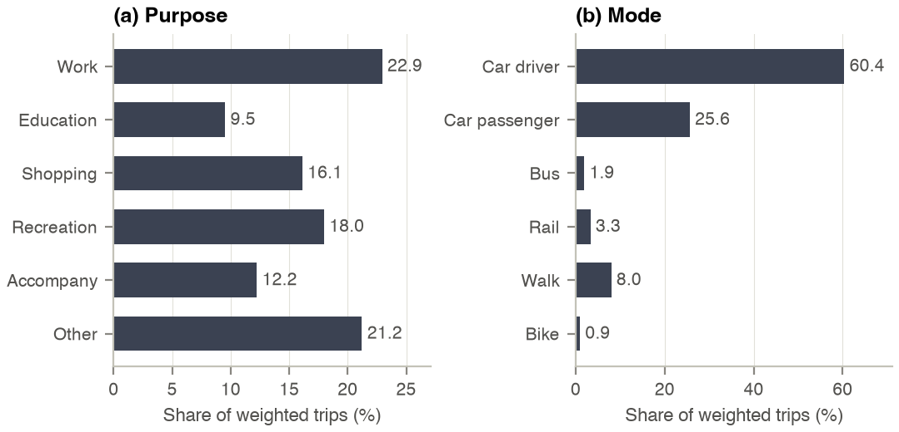
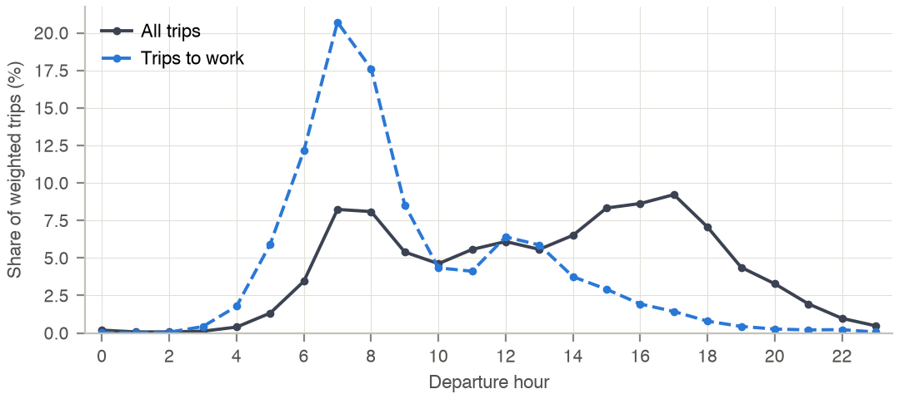
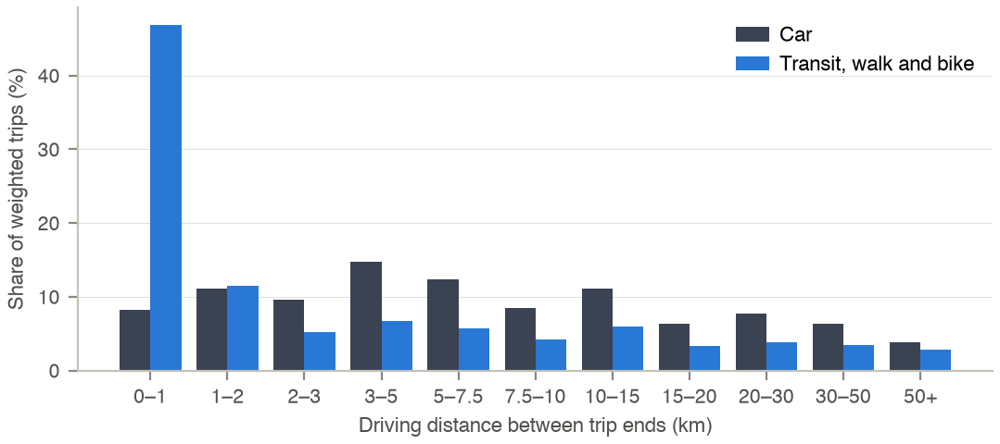

# Regional Travel Survey 2017/18

The 2017/18 Regional Travel Survey (RTS) is the household travel survey of the Baltimore and Washington regions. MILES uses
it to estimate the activity models (tour formation, scheduling, destination, stop and mode choice), the workplace and
school location models, and to validate the activity model on households not used in estimation. This page gives the
codebook of the variables MILES reads and aggregate statistics of the survey.

## Source and access

| Item | Value |
|---|---|
| Producer | Baltimore Metropolitan Council (BMC) and the National Capital Region Transportation Planning Board (TPB) at the Metropolitan Washington Council of Governments [[15]](../inputs.md#sources) |
| Survey period | Weekday travel days, October 2017 to October 2018 |
| Design | Household survey, one assigned weekday travel day per household; all members report their trips |
| Files read | One flat file in which every trip row carries its household and person fields; a cleaned trip file; a tour file built from the cleaned trips; the codebook (sheets Household, Person, Vehicle, Trip) |
| Weights | `wthhfin` (household), `wtperfin` (person), `wttrdfin` (trip) |
| Survey zone systems | BMC TAZ 2010 and TPB TAZ 3722 [[16]](../inputs.md#sources) |
| Access | Released by the agencies on request. The survey files are not redistributed with MILES. |

The tables show aggregate statistics only. Shares are weighted with the weight of the unit of observation; a share or
statistic resting on fewer than 10 unweighted records is shown as "—".

## Codebook

Variables MILES reads, with names as in the files. Codes follow the survey codebook; −9 marks a missing or not
applicable value.

| Variable | Description | Type | Values / categories / units | Used in |
|---|---|---|---|---|
| `household_id` | Household identifier | integer | unique per household | all survey steps; estimation/validation split |
| `person_id` | Person identifier (household id and person number) | integer | unique per person | all survey steps |
| `tripid` | Trip identifier | integer | unique per trip | trip and tour building |
| `persno`, `tripno` | Person number in household; trip number of the person | integer | 1, 2, … | trip chaining into tours |
| `wthhfin` | Household weight | real | expansion factor | household statistics; imputed persons |
| `wtperfin` | Person weight | real | expansion factor | person and tour statistics; estimation weights |
| `wttrdfin` | Trip weight | real | expansion factor (equal to the person weight in the cleaned trips) | trip statistics; targets |
| `in_bmc`, `in_tpb` | Home inside the BMC or TPB modelled area | binary | 0 no, 1 yes | sample description |
| `tdate_dow` | Assigned travel day | categorical | 1 Monday … 5 Friday | weekday check |
| `home_state_county_fips` | Home county (state and county FIPS) | categorical | 5-digit FIPS | split strata; county targets; residential location |
| `home_tract_fips` | Home census tract (2010) | categorical | 6-digit tract code | home zone of the survey population; destination choice |
| `home_bmc_taz`, `home_tpb_taz` | Home zone in the BMC or TPB zone system | categorical | zone number; −9 outside | school location (zone-level records) |
| `hhsize` | Household members | count | 1–8 (8 = 8 or more) | split strata; survey population; tour formation |
| `numworkers`, `numstudents`, `numdrivers` | Workers, students, licensed drivers in household | count | 0–8 | imputation of non-travellers; mode choice |
| `numvehicle` | Household vehicles | count | 0–8 (8 = 8 or more) | survey population (cars); mode choice availability |
| `hh_income_detailed` | Household income | ordinal | 1 < \$15,000 … 8 ≥ \$150,000; −9 not reported | survey population (class midpoint); mode and destination choice |
| `home_ownership` | Tenure | categorical | 1 own, 2 rent, 3 other, −9 | residential location (zone and structure type) |
| `home_type` | Structure type of the residence | categorical | 1 single-family detached, 2 attached, 3 apartment, 4 mobile home, 5 dormitory, −9 | residential location (zone and structure type) |
| `age` | Age in years | integer | 0–99 | person type; all models |
| `age_group` | Age class | ordinal | 1 under 5 … 13 85 or older | residential location |
| `gender` | Gender | categorical | 1 female, 2 male, −9 (recoded to SILO 2 / 1) | survey population; destination and workplace choice |
| `license` | Driver's licence (age 15+) | categorical | 1 yes, 2 no, −9 | mode choice availability; survey population |
| `employment_status` | Employment status (age 16+) | categorical | 0 worker … 7 disabled; −9 not asked | person type (worker, retiree) |
| `student_status` | Student | categorical | 0 no, 1 yes, −9 | person type (student bands) |
| `school_type` | Type of school attended | categorical | 1 daycare … 8 graduate, 9 other | school location; education tours |
| `school_freq` | Days a week travelled to school | categorical | 1 five days … 8 online only | education tour frequency |
| `school_mode` | Usual travel mode to school | categorical | 1 walk … 9 school bus, 10 other | school location |
| `school_state_county_fips`, `school_tract_fips`, `school_bmc_taz`, `school_tpb_taz` | School location | categorical | FIPS / tract / zone | school location (observed school zone) |
| `j1_workplace_loc` | Usual work location of the main job | categorical | 1 fixed, 2 varies, 3 at home, 4 drives for a living, −9 | workplace choice; work tours |
| `work_state_county_fips`, `work_tract_fips` | Workplace county and census tract | categorical | FIPS / tract | workplace choice; commute length distribution |
| `j1_telecommute`, `j1_telecommute_days` | Telecommuting option and usual days per week | categorical | 1 offered, 2 not; 0–5 days | work-tour frequency (scheduling) |
| `trips_yesno`, `person_tripcount` | Travelled on the travel day; number of trips | binary; count | 1 yes (all records); 1, 2, … | tour frequency |
| `o_activity`, `d_activity` | Activity at trip origin and destination | categorical | 1 home, 2 work, 3 volunteer, 4 school, 5 shopping, 6 quick meal, 7 meal, 8 gas, 9 health care, 10 errand, 11 socialise, 12 civic or religious, 13 exercise, 14 recreation, 15 entertainment, 16 drop-off or pick-up, 17 change mode, 18 other | trip purpose; activity type of all models |
| `o_state_county_fips`, `o_tract_fips`, `d_state_county_fips`, `d_tract_fips` | Origin and destination county and census tract | categorical | FIPS / tract | destination and stop choice (observed zone) |
| `o_bmc_taz`, `o_tpb_taz`, `d_bmc_taz`, `d_tpb_taz` | Origin and destination zone in the BMC or TPB system | categorical | zone number; −9 outside | zone-level destination choice records |
| `dep_min`, `arr_min` | Departure and arrival time (cleaned trips) | integer | minutes after midnight, 0–1,439 | scheduling; time-of-day period of level of service |
| `travel_mode` | Main mode of the trip | categorical | 1 walk, 2 bike, 3 motorcycle, 4 auto driver, 5 auto passenger, 6 school bus, 7 rail, 8 bus, 9 private bus, 10 paratransit, 11 taxi, 12 ride-hailing, 13 air, 14 water, 15 other | mode choice (recoded to six modes) |
| `transit_access_mode`, `transit_egress_mode` | Access and egress mode of transit trips | categorical | 1 walk, 2 bicycle, 3 park and ride, 4 kiss and ride, 5 taxi, 6 other, −9 | walk- or drive-access transit |
| `park_pay` | Driver paid for parking | categorical | 0 no, 1 yes, −9 | share of paid parking by destination area (mode choice) |
| `travelers_hh`, `hh_member1`–`hh_member8` | Household members on the trip; which members | count; binary | 1–8; 0 / 1 | joint tours; accompany trips |
| `distance` | Driving distance between trip ends | real | miles (Google estimate); −9 missing | trip-length targets; validation |
| `reported_travel_time` | Reported trip duration | real | minutes; −9 missing | descriptive only |
| `purpose` | Tour type (tour file) | categorical | HBW, HBE, HBS, HBO, WBO | tour formation |
| `anchor`, `closed` | Tour anchor; tour returns to its anchor | categorical; binary | home, work, open; true / false | tour selection (closed tours) |
| `tour_mode` | Tour main mode | categorical | autoDriver, autoPassenger, bus, train, walk, bike, sr, other | tour mode choice |
| `n_trips`, `n_stops`, `n_stops_out`, `n_stops_in` | Trips and intermediate stops of the tour | count | 0, 1, … | stop generation |
| `start_min`, `primary_arr`, `primary_dep`, `end_min` | Tour start, arrival and departure at the primary activity, tour end | integer | minutes after midnight | scheduling (start and duration distributions) |
| `primary_act`, `dist_primary` | Primary activity of the tour; distance to it | categorical; real | activity code; miles | tour purpose; descriptive |

## Statistics

### Sample

The flat file has 488,705 rows: the household, person, trip and vehicle tables are joined, so trip records repeat. Removing the repeats gives
163,290 trips of 41,914 persons in 21,788 households, the same records as the cleaned trip file. The files hold only
persons with at least one trip on the travel day (`trips_yesno` = 1 for every record). Weighted, 13.6 % of household
members made no trip; their records are not in the files. The tour file holds 57,627 tours, of which
54,149 are closed home-based tours or work-based subtours and 2,342 are open.

| Home location | Households | Weighted households | Persons with trips | Trips | Closed tours |
|---|---:|---:|---:|---:|---:|
| Both model areas | 9,429 | 1,405,242 | 18,173 | 70,508 | 23,404 |
| BMC model area only | 3,523 | 631,152 | 6,396 | 25,435 | 7,932 |
| TPB model area only | 7,438 | 1,127,021 | 14,705 | 56,233 | 19,429 |
| Neither model area | 1,398 | 238,345 | 2,640 | 11,114 | 3,384 |
| Study area (Baltimore region) | 6,393 | 972,479 | 12,269 | 48,538 | 15,446 |
| All households | 21,788 | 3,401,760 | 41,914 | 163,290 | 54,149 |

"Study area" means households living in Baltimore City or the counties of Anne Arundel, Baltimore, Carroll, Harford and
Howard. A household can lie inside both the BMC and the TPB model area.

| Home county or state | Households | Weighted households |
|---|---:|---:|
| Baltimore City | 1,414 | 222,804 |
| Anne Arundel | 1,540 | 197,780 |
| Baltimore County | 1,519 | 298,003 |
| Carroll | 540 | 56,682 |
| Harford | 545 | 89,301 |
| Howard | 835 | 107,910 |
| Other Maryland counties | 6,784 | 1,127,871 |
| District of Columbia | 1,936 | 288,286 |
| Virginia | 6,541 | 994,854 |
| West Virginia | 134 | 18,270 |

### Households

| Category | All households (%) | Study area (%) |
|---|---:|---:|
| **Household size** |  |  |
| 1 | 24.9 | 26.7 |
| 2 | 31.7 | 33.3 |
| 3 | 17.3 | 16.5 |
| 4 | 14.5 | 14.0 |
| 5 or more | 11.6 | 9.6 |
| **Vehicles** |  |  |
| 0 | 6.6 | 6.6 |
| 1 | 31.3 | 30.7 |
| 2 | 39.6 | 39.9 |
| 3 or more | 22.5 | 22.8 |
| **Household income** |  |  |
| Less than \$15,000 | 3.7 | 5.3 |
| \$15,000–24,999 | 3.5 | 4.7 |
| \$25,000–34,999 | 4.6 | 6.7 |
| \$35,000–49,999 | 7.2 | 8.2 |
| \$50,000–74,999 | 14.5 | 17.5 |
| \$75,000–99,999 | 14.6 | 13.8 |
| \$100,000–149,999 | 23.0 | 19.6 |
| \$150,000 or more | 27.1 | 19.3 |
| Not reported | 1.7 | 4.8 |
| **Tenure** |  |  |
| Own | 73.0 | 72.6 |
| Rent | 25.4 | 26.0 |
| Other | 1.5 | 1.1 |
| Not reported | 0.1 | 0.3 |
| **Structure type** |  |  |
| Single-family detached | 54.9 | 50.6 |
| Single-family attached | 19.7 | 25.3 |
| Apartment or condominium | 24.9 | 23.5 |
| Mobile home | 0.5 | 0.5 |
| Dormitory or institution | — | — |
| Not reported | — | — |
| Unweighted records | 21,788 | 6,393 |

| Variable | Records | Mean | Median | SD | Min | Max |
|---|---:|---:|---:|---:|---:|---:|
| Household size (persons) | 21,788 | 2.6 | 2.0 | 1.4 | 1.0 | 8.0 |
| Workers | 21,788 | 1.4 | 1.0 | 0.9 | 0.0 | 8.0 |
| Students | 21,788 | 0.7 | 0.0 | 1.1 | 0.0 | 7.0 |
| Licensed drivers | 21,788 | 1.8 | 2.0 | 0.8 | 0.0 | 8.0 |
| Vehicles | 21,788 | 1.9 | 2.0 | 1.1 | 0.0 | 12.0 |
| Household weight | 21,788 | 156.1 | 131.0 | 119.2 | 9.0 | 2,554.0 |

### Persons

Persons with at least one trip on the travel day (weight `wtperfin`).

| Category | All persons (%) | Study area (%) |
|---|---:|---:|
| **Age** |  |  |
| 0–4 | 6.2 | 5.5 |
| 5–17 | 17.4 | 15.8 |
| 18–24 | 5.2 | 5.5 |
| 25–44 | 28.8 | 26.9 |
| 45–64 | 27.7 | 28.8 |
| 65 or older | 14.4 | 16.8 |
| **Gender** |  |  |
| Female | 51.9 | 52.8 |
| Male | 48.0 | 47.1 |
| Not reported | 0.0 | 0.1 |
| **Employment status** |  |  |
| Worker, including self-employed | 55.1 | 55.4 |
| Retired | 12.2 | 13.8 |
| Volunteer | 2.9 | 0.5 |
| Homemaker | 0.9 | 2.5 |
| Unemployed, looking for work | 1.8 | 1.8 |
| Unemployed, not looking | 0.4 | 0.4 |
| Student | 3.6 | 3.1 |
| Disabled, not working | 1.5 | 2.5 |
| Not asked (under 16) or not reported | 21.5 | 19.8 |
| **Student** |  |  |
| Full- or part-time student | 28.4 | 26.3 |
| Not a student | 71.6 | 73.6 |
| Not reported | 0.0 | 0.1 |
| **Person type (model segment)** |  |  |
| Worker | 55.0 | 55.0 |
| Student, age 5–10 | 8.3 | 7.8 |
| Student, age 11–13 | 4.1 | 3.4 |
| Student, age 14–17 | 4.2 | 3.5 |
| Student, age 18+ | 2.5 | 2.4 |
| Non-worker | 7.6 | 8.3 |
| Retiree | 11.9 | 13.4 |
| Child under 5 | 6.5 | 6.2 |
| Unweighted records | 41,914 | 12,269 |

| Driver's licence, persons aged 16+ | All (%) | Study area (%) |
|---|---:|---:|
| Licensed | 92.6 | 92.3 |
| Not licensed | 7.4 | 7.6 |
| Not reported | — | — |
| Unweighted records | 35,686 | 10,478 |

| Usual work location, workers | All (%) | Study area (%) |
|---|---:|---:|
| Same location outside home | 79.8 | 76.8 |
| Location varies | 12.4 | 16.4 |
| At home | 7.0 | 6.8 |
| Drives for a living | 0.8 | — |
| Not reported | — | — |
| Unweighted records | 24,696 | 6,992 |
| **Usual telecommute days per week (fixed or varying workplace)** |  |  |
| None | 11.7 | 10.3 |
| 1 day | 9.3 | 9.7 |
| 2 days | 4.7 | 4.4 |
| 3 days | 1.5 | 1.3 |
| 4 days | 0.5 | 0.4 |
| 5 or more days | 1.9 | 1.0 |
| Not asked or not reported | 70.3 | 72.8 |
| Unweighted records | 22,827 | 6,525 |

| School type, students | All (%) | Study area (%) |
|---|---:|---:|
| Daycare or preschool | 16.6 | 14.4 |
| Grades K–8 | 40.2 | 41.5 |
| Grades 9–12 | 16.6 | 14.3 |
| Home school | 3.5 | 2.2 |
| Vocational or technical | 1.3 | 2.4 |
| Two-year college | 5.0 | 5.5 |
| Four-year college or university | 7.4 | 9.5 |
| Graduate or professional | 7.7 | 9.3 |
| Other | 1.7 | 0.9 |
| Not reported | — | — |
| Unweighted records | 9,023 | 2,567 |

### Trips

Cleaned trips (weight `wttrdfin`). The purpose of a trip is the activity at its non-home end, grouped as in the activity
model; trips between two non-home activities take the destination activity.

| Category | All trips (%) | Study area (%) |
|---|---:|---:|
| **Purpose (non-home end)** |  |  |
| Work | 22.9 | 22.7 |
| Education | 9.5 | 8.9 |
| Shopping | 16.1 | 16.4 |
| Recreation | 18.0 | 19.3 |
| Accompany | 12.2 | 10.9 |
| Other | 21.2 | 22.0 |
| **Mode (survey categories)** |  |  |
| Walk | 7.9 | 7.0 |
| Bike | 0.9 | 0.4 |
| Motorcycle | 0.0 | 0.1 |
| Auto (driver) | 60.0 | 64.5 |
| Auto (passenger) | 21.4 | 20.0 |
| School bus | 3.3 | 3.0 |
| Rail | 3.3 | 1.1 |
| Bus | 1.7 | 1.9 |
| Private bus | 0.2 | 0.2 |
| Paratransit | 0.1 | 0.1 |
| Taxi or private car | 0.2 | 0.1 |
| Ride-hailing | 0.6 | 0.4 |
| Air | 0.1 | 0.1 |
| Water | — | — |
| Other | 0.4 | 1.0 |
| Unweighted records | 163,290 | 48,538 |

Mode by purpose, six model modes (air, water and other modes excluded; weighted shares within each purpose, %):

| Mode | Work | Education | Shopping | Recreation | Accompany | Other |
|---|---:|---:|---:|---:|---:|---:|
| Car driver | 73.3 | 12.8 | 68.7 | 52.8 | 69.9 | 62.1 |
| Car passenger | 5.9 | 73.5 | 21.8 | 30.5 | 20.5 | 27.2 |
| Bus | 3.3 | 2.3 | 1.6 | 1.2 | 0.5 | 1.7 |
| Rail | 9.5 | 1.4 | 1.2 | 1.9 | 0.8 | 1.6 |
| Walk | 6.6 | 8.5 | 6.3 | 12.3 | 7.9 | 6.9 |
| Bike | 1.5 | 1.5 | 0.4 | 1.3 | 0.4 | 0.4 |
| Unweighted trips | 39,741 | 10,906 | 28,820 | 30,793 | 15,812 | 36,390 |

| Variable | Records | Mean | Median | SD | Min | Max |
|---|---:|---:|---:|---:|---:|---:|
| Trips per traveller (per day) | 41,914 | 3.8 | 3.0 | 2.2 | 1.0 | 41.0 |
| Closed tours per traveller (per day) | 41,914 | 1.3 | 1.0 | 0.7 | 0.0 | 14.0 |
| Trip distance, all trips (km) | 163,289 | 12.4 | 5.5 | 23.6 | 0.0 | 300.0 |
| Trip duration, reported (min) | 163,273 | 24.1 | 15.0 | 31.7 | 0.0 | 1,130.0 |
| Trip distance, car driver (km) | 102,382 | 13.7 | 6.8 | 21.2 | 0.0 | 300.0 |
| Trip distance, car passenger (km) | 33,816 | 10.4 | 5.1 | 20.7 | 0.0 | 300.0 |
| Trip distance, bus (km) | 3,554 | 11.5 | 5.2 | 24.8 | 0.0 | 300.0 |
| Trip distance, rail (km) | 6,648 | 22.8 | 14.5 | 29.9 | 0.0 | 300.0 |
| Trip distance, walk (km) | 14,526 | 0.8 | 0.5 | 1.9 | 0.0 | 120.5 |
| Trip distance, bike (km) | 1,535 | 3.9 | 2.4 | 4.3 | 0.0 | 49.0 |
| Departure time (hour of day) | 163,290 | 13.5 | 14.0 | 4.5 | 0.0 | 24.0 |
| Household members on the trip | 163,290 | 1.6 | 1.0 | 1.0 | 1.0 | 8.0 |

Distances are driving distances between the reported addresses, capped at 300 km. Means and standard deviations are
weighted; the median is the weighted median.

| Parking payment, car-driver trips | All (%) | Study area (%) |
|---|---:|---:|
| Paid for parking | 2.0 | 1.7 |
| Did not pay | 6.1 | 7.9 |
| Not asked or not reported | 91.9 | 90.4 |
| Unweighted records | 102,382 | 32,687 |

| Access mode, transit trips | All (%) | Study area (%) |
|---|---:|---:|
| Walk | 80.2 | 80.9 |
| Bicycle | 0.9 | — |
| Park and ride | 9.8 | 8.1 |
| Kiss and ride (dropped off) | 2.7 | 1.1 |
| Taxi or ride-hailing | 0.7 | 1.4 |
| Other | 1.4 | — |
| Not reported | 4.3 | 7.9 |
| Unweighted records | 10,202 | 1,898 |

### Tours

Closed tours (home-based tours and work-based subtours), weight `wtperfin`.

| Category | All tours (%) | Study area (%) |
|---|---:|---:|
| **Tour type** |  |  |
| Home-based work | 32.7 | 31.1 |
| Home-based education | 14.1 | 13.3 |
| Home-based shopping | 16.5 | 16.7 |
| Home-based other | 35.3 | 35.9 |
| Work-based subtour | 1.4 | 3.1 |
| **Tour mode** |  |  |
| Car driver | 58.7 | 62.9 |
| Car passenger | 21.0 | 20.5 |
| Bus, including school bus | 7.9 | 7.5 |
| Rail | 4.9 | 1.8 |
| Walk | 5.7 | 5.7 |
| Bike | 1.0 | 0.4 |
| Shared ride (school bus, taxi, ride-hailing) | 0.5 | 0.4 |
| Other | 0.2 | 0.8 |
| Unweighted records | 54,149 | 15,446 |

| Variable | Records | Mean | Median | SD | Min | Max |
|---|---:|---:|---:|---:|---:|---:|
| Trips per tour | 54,149 | 2.8 | 2.0 | 1.4 | 1.0 | 41.0 |
| Stops per tour | 54,149 | 0.8 | 0.0 | 1.3 | 0.0 | 39.0 |
| Tour start (hour of day) | 54,149 | 10.9 | 9.1 | 4.3 | 0.0 | 23.9 |
| Tour duration, home to home (min) | 54,149 | 338.0 | 275.0 | 256.5 | 0.0 | 1,335.0 |
| Time at the primary activity (min) | 53,216 | 241.1 | 155.0 | 217.2 | 0.0 | 1,435.0 |
| Distance home to primary activity (km) | 54,149 | 12.2 | 5.8 | 18.7 | 0.0 | 300.0 |

Durations of tours that pass midnight are taken modulo 24 hours; distances are capped at 300 km.

### Estimation and validation halves

| Half | Households | Weighted households | Travellers | Trips | Closed tours | Households in zone system | Persons incl. imputed | Imputed non-travellers |
|---|---:|---:|---:|---:|---:|---:|---:|---:|
| Estimation | 10,889 | 1,703,904 | 20,949 | 81,732 | 27,071 | 10,856 | 23,770 | 2,884 |
| Validation | 10,899 | 1,697,856 | 20,965 | 81,558 | 27,078 | 10,869 | 23,818 | 2,900 |

The survey population adds the household members without a trip (imputed from the household counts) and keeps the
households whose home tract lies inside the zone system.

### Missing values

| Variable | Universe | Records | Missing (−9) | Missing (%) |
|---|---:|---:|---:|---:|
| `hh_income_detailed` | households | 21,788 | 347 | 1.6 |
| `home_ownership` | households | 21,788 | 16 | 0.1 |
| `home_type` | households | 21,788 | 6 | 0.0 |
| `gender` | persons | 41,914 | 11 | 0.0 |
| `license` | persons 16+ | 35,686 | 3 | 0.0 |
| `employment_status` | persons 16+ | 35,686 | 39 | 0.1 |
| `student_status` | persons | 41,914 | 15 | 0.0 |
| `j1_workplace_loc` | workers | 24,696 | 3 | 0.0 |
| `school_type` | students | 9,023 | 5 | 0.1 |
| `distance` | trips | 163,290 | 1 | 0.0 |
| `reported_travel_time` | trips | 163,290 | 17 | 0.0 |

### Survey zone systems

The survey codes locations by 2010 census tract and by the zones of the two regional models. The BMC TAZ 2010 layer
has 2,922 zones (1,387 in the BMC region, the rest copies of TPB zones); the TPB TAZ 3722 layer has
3,669 zones. MILES places survey locations in its own zones through the census tract (internal point of the 2010
tract), because neither survey zone system has a crosswalk to the statewide model zones.

## Figures

*Weighted shares of trips by purpose (non-home end) and by model mode, all survey households.*

*Weighted distribution of the departure hour, all trips and trips to work.*

*Weighted trip-length distribution (driving distance between trip ends) for car trips and for transit, walk and bike trips.*

## Processing

- Trips: the cleaned trip file (deduplicated); purpose from `o_activity` and `d_activity` as above; mode from
  `travel_mode`: auto driver and motorcycle to car driver; auto passenger, school bus, paratransit, taxi and ride-hailing to
  car passenger; rail to rail; bus and private bus to bus; air, water and other dropped from mode shares.
- Person types: worker (`employment_status` 0, a working student counts as a worker); student (`student_status` 1),
  by age band 5–10, 11–13, 14–17, 18+; retiree (`employment_status` 1); non-worker otherwise; persons under 5 have no tours.
- Tours: closed home-based tours and work-based subtours of the tour file; open tours are dropped.
- Split: households are split into an estimation half and a validation half, stratified by home county and household
  size (1 to 5 or more), with a fixed seed. Models are estimated on one half and validated on the other.
- Survey population: home zone = the statewide model zone containing the internal point of the household's 2010 census
  tract; income = midpoint of `hh_income_detailed`; household members without a trip are added from `hhsize`,
  `numworkers` and `numstudents`, with age, gender and licence copied from a traveller of the same role.
- Workplace and school: the zone of the work or school tract when it lies inside the zone system.
- Parking: the survey records whether a driver paid for parking but not the amount; the car-driver utility uses the
  share of paid parking at the destination area.

### Costs used with the survey

| Item | Value (2017 dollars) | Source |
|---|---|---|
| Car operating cost | \$0.179 per mile (\$0.111 per km): fuel 10.0 cents and maintenance 7.9 cents per mile, average new car at 15,000 miles a year; paid by the driver | AAA [[19]](../inputs.md#sources) |
| MTA local bus, Light Rail, Metro | \$1.80 per trip | [[20]](../inputs.md#sources) |
| WMATA Metrorail | peak \$2.25–6.00, off-peak \$2.00–3.85, linear in distance between 3 and 15 miles | [[20]](../inputs.md#sources) |
| Metrobus and county buses (Washington region) | \$2.00 per trip | [[20]](../inputs.md#sources) |
| MARC (rail paths longer than 30 km) | min(\$8, \$4 + km / 15) | [[20]](../inputs.md#sources) |
