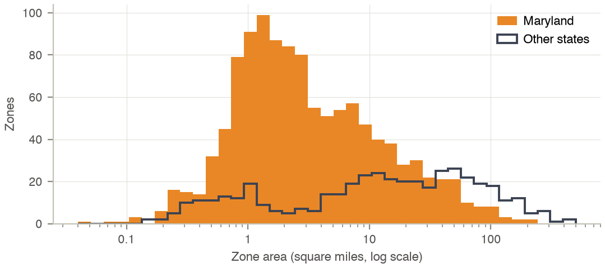
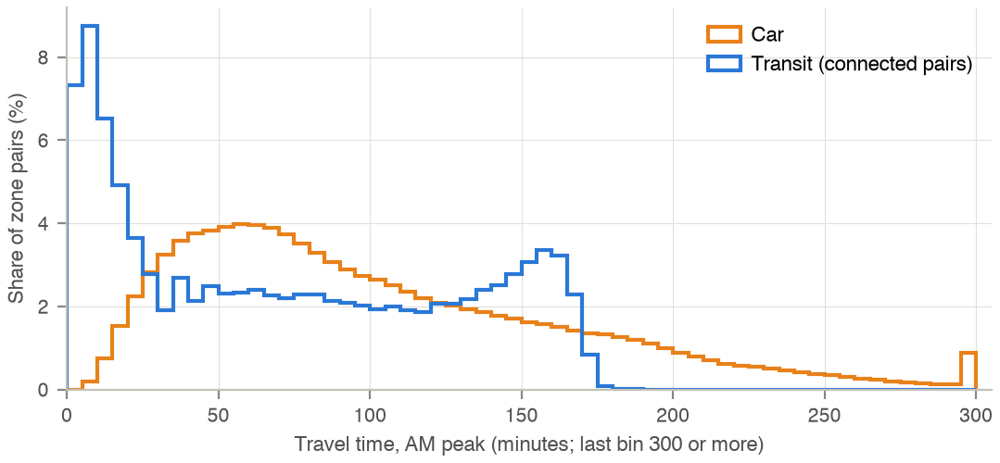

# Zones, skims and census geography

MILES uses the zone system of the Maryland Statewide Transportation Model (MSTM) for land use and activities, the zone-to-zone car skims of that model, transit skims computed on the 2024 schedule, and census tract geography to link survey and census records to zones. The zone system and the car skims are released by the Maryland Department of Transportation on request [[21]](../inputs.md#sources) and are not distributed with MILES; this page reports only aggregate statistics of them.

## Zone system

1,588 statewide and regional modelling zones (SMZ in Maryland and nearby, RMZ further out), as a zone table (`zoneSystem.csv`) and a polygon shapefile in EPSG:26918 [[21]](../inputs.md#sources).

### Codebook

| Variable | Description | Type | Values / categories / units | Used in |
|---|---|---|---|---|
| `ZoneId` / `SMZRMZ` | Zone identifier | integer | 1–1,674, 1,588 zones | All stages |
| `STFIPS`, `STATEFP10` | State FIPS code | integer | 10, 11, 24, 42, 51, 54 | Tables; school inventory |
| `COUNTYFIPS` | County FIPS code | integer | 61 counties | Land use (county controls), schools, validation |
| `JUR_NAME` | County name | string | — | Labels |
| `Region` | Land-use region | integer | 44 regions; one per Maryland county | Land use (residential location, construction) |
| `PUMA_10` | 2010 PUMA of the zone | integer | 96 PUMAs | Residential location; population synthesis |
| `AREA_SQMI` | Zone area | float | square miles | Density terms |
| `SchoolQualityIndex` | School quality index | float | constant in this file | Land use (not informative) |
| geometry (shapefile) | Zone polygon | polygon | EPSG:26918 | School and tract matching; survey locations |

### Statistics

Zones by state:

| State | Zones | Counties | Area (sq mi) | Median zone area (sq mi) |
|---|---:|---:|---:|---:|
| Maryland | 1,151 | 24 | 10,598 | 2.46 |
| District of Columbia | 84 | 1 | 68 | 0.66 |
| Delaware | 97 | 3 | 2,010 | 15.85 |
| Pennsylvania | 55 | 9 | 7,294 | 113.83 |
| Virginia | 171 | 16 | 4,290 | 12.97 |
| West Virginia | 30 | 8 | 3,289 | 85.17 |
| Total | 1,588 | 61 | 27,549 | 3.37 |

The study area (Baltimore City and five counties) has 599 zones with a median area of 1.73 sq mi. Over all zones the area ranges from 0.05 to 413.1 sq mi (mean 17.3). The table has 44 land-use regions and 96 PUMAs; no values are missing.

*Distribution of zone area, Maryland and the other states.*

## Skims

Zone-to-zone matrices of all 2,521,744 ordered pairs (1,588²), stored as gzipped CSV with columns `FROM`, `TO`, `VALUE`. Car time and distance come from the MSTM base year [[21]](../inputs.md#sources); the transit matrices are computed by MILES on the 2024 transit schedule (see [Transit](transit.md)). In the transit and bus matrices the value 1,000 marks a pair without a connection; in the rail matrix 0 marks a pair without a rail path.

### Codebook

| Variable | Description | Type | Values / categories / units | Used in |
|---|---|---|---|---|
| `FROM`, `TO` | Origin and destination zone | integer | zone identifiers | All skims |
| `VALUE` of `traveltime_auto`, `auto_peak_time` | Car travel time, AM peak | float | minutes | Land use (accessibility, workplace and school choice); activities |
| `VALUE` of `distance_auto` | Car distance on the shortest path | float | metres | Activities (destination and mode choice) |
| `VALUE` of `transit_peak_time` | Transit door-to-door time, AM peak (7–9 h) | float | minutes; 1,000 = no connection | Land use; mode choice |
| `VALUE` of `bus_tt` | Transit time on the bus-only schedule | float | minutes; 1,000 = no connection | Activities (mode choice) |
| `VALUE` of `rail_tt00` | Transit time where the best path uses rail in at least half of the departures | float | minutes; 0 = no rail path | Activities (mode choice) |

### Statistics

Distribution over pairs of different zones with a connection:

| Skim | Unit | Pairs | Mean | SD | 10th pct. | Median | 90th pct. | Maximum |
|---|---|---:|---:|---:|---:|---:|---:|---:|
| Car time, AM peak | min | 2,520,156 | 103.2 | 63.9 | 33.9 | 87.9 | 193.4 | 536.1 |
| Car distance | km | 2,520,156 | 116.9 | 84.8 | 29.6 | 94.4 | 235.6 | 680.3 |
| Transit time, door to door | min | 447,084 | 72.5 | 55.6 | 6.5 | 64.7 | 154.7 | 230.1 |
| Bus time | min | 380,160 | 62.1 | 51.9 | 5.6 | 49.6 | 144.6 | 230.1 |
| Transit time, rail paths | min | 327,440 | 85.3 | 49.5 | 22.7 | 77.9 | 157.4 | 188.1 |

All pairs, the share of inter-zonal pairs with a connection and the mean intra-zonal value:

| Skim | Pairs | Inter-zonal pairs connected (%) | Mean intra-zonal value |
|---|---:|---:|---:|
| Car time, AM peak | 2,521,744 | 100.0 | 9.5 |
| Car distance | 2,521,744 | 100.0 | 1.0 |
| Transit time, door to door | 2,521,744 | 17.7 | 5.0 |
| Bus time | 2,521,744 | 15.1 | 5.0 |
| Transit time, rail paths | 2,521,744 | 13.0 | 0.0 |

*Distribution of AM-peak travel time over inter-zonal pairs: car (MSTM) and transit (computed on the 2024 schedule, connected pairs only).*

## Census tract geography

Four public Census Bureau and IPUMS files link census tracts, PUMAs and zones. They are used to place survey and PUMS records, which carry tracts or PUMAs, in the zone system.

- TIGER/Line 2010 census tracts of the six states, and 2010 Maryland census blocks [[28]](../inputs.md#sources).
- 2010 Gazetteer file of census tracts: internal point, land area and housing units [[29]](../inputs.md#sources).
- 2010 census tract to 2010 PUMA relationship file [[30]](../inputs.md#sources).
- IPUMS crosswalk of 2010 PUMAs to migration PUMAs and place-of-work PUMAs [[31]](../inputs.md#sources).

### Codebook

| Variable | Description | Type | Values / categories / units | Used in |
|---|---|---|---|---|
| `GEOID10` (TIGER), `GEOID` (Gazetteer) | Tract identifier: state, county, tract | string | 11 digits | Tract–zone matching |
| `INTPTLAT`, `INTPTLONG` | Internal point of the tract | float | degrees | Tract → zone (point in polygon); tract distances |
| `HU10` | Housing units, Census 2010 | integer | dwellings | Weights of tracts within PUMAs and MIGPUMAs |
| `ALAND` | Land area | integer | m² | Statistics only |
| `STATEFP`, `COUNTYFP`, `TRACTCE` | Tract code parts (relationship file) | string | 2, 3 and 6 digits | Tract → PUMA |
| `PUMA5CE` | 2010 PUMA code | string | 5 digits | Tract → PUMA |
| State, PUMA, place-of-work state, MIGPUMA/POWPUMA (columns 1–4 of the IPUMS sheet) | PUMA to migration and place-of-work PUMA | string | codes | Residential location (moves, workplaces) |
| geometry (TIGER) | Tract and block polygons | polygon | NAD83 | Survey locations; housing units in attendance zones |

### Statistics

The national Gazetteer has 74,002 tracts and the national relationship file 74,091 rows. Six states:

| State | Tracts (TIGER) | Land area (sq mi) | Housing units 2010 | Tracts with internal point in a zone | PUMAs |
|---|---:|---:|---:|---:|---:|
| Maryland | 1,406 | 9,707 | 2,378,814 | 1,392 | 44 |
| District of Columbia | 179 | 61 | 296,719 | 179 | 5 |
| Delaware | 218 | 1,949 | 405,885 | 215 | 6 |
| Pennsylvania | 3,218 | 44,743 | 5,567,315 | 426 | 92 |
| Virginia | 1,907 | 39,490 | 3,364,939 | 638 | 56 |
| West Virginia | 484 | 24,038 | 881,917 | 59 | 13 |
| Total | 7,412 | 119,988 | 12,895,589 | 2,909 | 216 |

97 PUMAs have housing units in the zone system; 88 lie fully inside (at least 99 % of their 2010 housing units) and 9 partly. The IPUMS crosswalk has 2,378 PUMA rows nationally and 216 in the six states, which map to 105 migration (and place-of-work) PUMAs. Maryland has 145,247 census blocks of 2010.

## Processing

- A tract belongs to the zone that contains its Gazetteer internal point (EPSG:26918); tracts whose point falls outside every zone are outside the model area.
- A PUMA is linked to land-use regions and zones through its tracts, weighted by 2010 housing units; migration and place-of-work PUMAs are linked through the IPUMS crosswalk, with zone weights by dwellings (origins) or jobs (workplaces).
- Transit skims are computed on the 2024 schedule for departures between 7 and 9 h, every 15 minutes; pairs without a connection get the value 1,000. Pairs with an end in a zone without transit stops in reach keep the values of the earlier base skims.
- Code: `landuse/lib/residential/s01_geography.py`, `activity/survey/survey_population.py`, `pipeline/transit_skim.py`.
