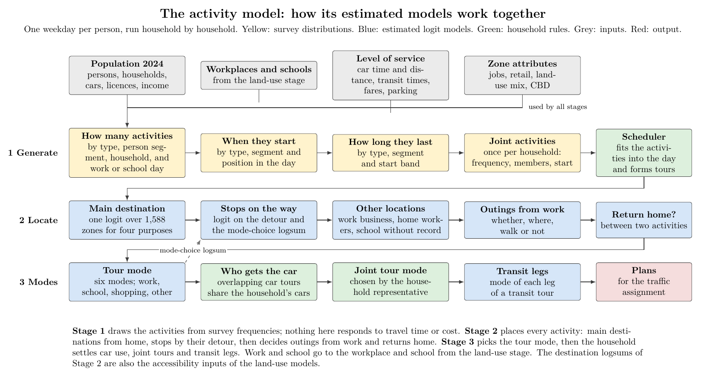

# Activities (ORIOLE-Day)

!!! abstract "At a glance"

    | | |
    |---|---|
    | **Engine** | ORIOLE-Day on the ABIT engine, Java |
    | **Code** | `activity/` (coefficients, run scripts, Java source) |
    | **Estimated on** | 2017/18 Regional Travel Survey, estimation half |
    | **Models** | 3,946 survey distributions, 13 location and tour-formation logits, 7 mode-choice models |
    | **Sensitive to** | Car and transit times and costs, parking, zone attributes, household composition, cars and licences |
    | **Produces** | One weekday plan per person: activities, locations, times, modes |

**ORIOLE-Day** generates, schedules and locates the activity episodes of every person for one weekday and assigns
their tour modes. Work and school episodes go to the job and school the person holds in the land-use model; every
other episode is located by an estimated model. All distributions and parameters come from the estimation half of
the travel survey, and **no calibration factor is applied**.

<figure markdown>
  
  <figcaption>How the estimated parts of ORIOLE-Day work together. Yellow: survey distributions; blue: estimated logit models; green: household rules; grey: inputs; red: output.</figcaption>
</figure>

## Lineage

ORIOLE-Day runs on the engine of the ABIT activity-based model of the Maryland set-up and adopts the scheduling idea of
TASHA. Against the original set-up it changes the following:

| Part | What it does |
|---|---|
| TASHA-type generation and scheduling | Episodes drawn from the survey's joint distributions of frequency, start time and duration; scheduled by precedence; household joint activities |
| Conditioning on the day | Frequencies depend on whether a work or school episode is scheduled that day |
| Licence split | Shopping, recreation, accompanying and other frequencies of persons 16+ split by driving licence |
| Joint activities by work or school | Joint frequency, membership and start time depend on the members' work or school that day |
| Pooled primary destination model | One logit for four purposes with purpose scales, over all 1,588 zones |
| Stop models | Stops located by their detour and the mode-choice logsum |
| Outings from the workplace | Whether, where and by which mode |
| Return-home model | Whether a person goes home between two out-of-home episodes |
| Re-estimated tour mode models | Time and cost, paid parking, children, stops; four segments |
| Household car allocation | Overlapping car-driver tours share the household's cars |
| Joint-tour representative | Joint tours take the mode chosen by a household representative with a group-level model |
| Transit leg modes | Mode of each leg of a transit tour |

## Stage 1: generation and scheduling

The number of episodes \(n\), the arrival time \(t\) and the duration \(\delta\) of each person and episode type are drawn
from

\[
P(n \mid \tau, g, h, m, r), \qquad P(t \mid \tau, g, n, e, \sigma), \qquad P(\delta \mid \tau, g, \beta_t, n)
\]

| Symbol | Meaning |
|---|---|
| \(\tau\) | episode type (13, below) |
| \(g\) | person segment (10): worker with a usual workplace, working at home, without a fixed workplace; elementary, middle, high-school and post-secondary student; non-worker; retiree; child under 5 |
| \(h\) | household class (3): single person, several persons without children, with a child under 16 |
| \(m\) | whether a work or school episode is scheduled that day |
| \(r\) | number of episodes of higher precedence on the day (0, 1, 2+) |
| \(e\) | episode index (1, 2, 3+) |
| \(\sigma\) | schedule attribute |
| \(\beta_t\) | start band |

**Episode types, in order of scheduling precedence**

| Code | Episode type |
|---|---|
| WB | Work business: a work episode away from the usual workplace |
| WAHB | Work trip of a person whose usual workplace is home |
| PW | Primary work: at the usual workplace, arriving before 15:00 |
| SW | Secondary work: at the usual workplace, arriving at 15:00 or later |
| RHW | Return home from work (for example, lunch at home) |
| SCH | School, college or daycare |
| JO_REC, JO_OTH | Joint recreation, joint other activity with household members |
| JS | Joint shopping |
| IO_REC, IO_ACC, IO_OTH | Individual recreation, accompanying (drop-off or pick-up), other errand |
| IS | Individual shopping |

The 3,946 distributions are weighted relative frequencies of the estimation half; when a cell is too thin, the model
falls back to a coarser cell. Start times are in 15-minute bins; durations in 5-minute bins up to two hours, then
15-minute bins. Joint episodes are generated once per household, by household composition, workers and whether
members work or attend school that day.

Whether a worker has a usual workplace, works at home or has no fixed workplace is drawn from the survey shares by
age band. Frequencies, start times and durations come from survey distributions and therefore **do not respond to
travel time or cost**.

The scheduler inserts episodes into the day in precedence order, shifts and shortens them to fit, and forms
home-based tours.

## Stage 2: locations and tours

### Main destination of discretionary tours

The main activity of each discretionary tour is located from home with one multinomial logit over the 1,588 zones,
for four purposes (shopping, recreation, accompanying, other errands), estimated jointly with a scale \(\mu_p\) per
purpose:

\[
U_{pj} = \mu_p \Big[ \mu \ln(1 + S_j) + f_p(d_{hj}) + \beta_g\, GT_{hj} + \boldsymbol\beta^{\top}\mathbf z_j
 + \boldsymbol\gamma^{\top} (\ln d_{hj} \times \mathbf w_n) \Big], \qquad S_j = \text{retail}_j + \sum_c e^{\theta_c} x_{jc}
\]

\(S_j\) is the size of zone \(j\) (retail jobs as base, other components with estimated log weights), \(f_p\) a
piecewise-linear car distance with knots at 1, 2, 5, 10, 20 and 50 km, \(GT_{hj}\) the car generalised time,
\(\mathbf z_j\) zone attributes (intrazonal, CBD, retail density, land-use mix, county and state) and \(\mathbf w_n\)
person, household, time-of-day and tour flags interacting with log distance. The mode-choice logsum was tested as the
impedance and lost to car time for every purpose. Estimated on 14,341 tours (71 parameters).

### Stops

Intermediate stops are located in time order by their detour between the previous location \(a\) and the next anchor
\(b\) (the main activity on the way out, home on the way back):

\[
\text{detour}_{j} = d(a,j) + d(j,b) - d(a,b), \qquad LS_j = LS(a,j) + LS(j,b) - LS(a,b)
\]

where \(LS\) is the logsum of the tour mode-choice model of the stop's purpose. One model per stop purpose: shopping,
recreation, accompanying and other errands.

### Other locations

Logits of the same form locate work business (workers with a usual workplace; other persons), the work trips of
persons who work at home, and school and daycare episodes of persons without a school record (one pooled model).

### Outings and returns home

- **Outing from the workplace** (binary logit): whether a work episode contains an outing, from work duration,
  arrival time, a CBD workplace and the home–work distance. A location logit places its first stop, and a binary
  logit decides whether it is walked.
- **Return home** (binary logit): for every pair of consecutive out-of-home episodes, whether the person goes home
  in between, from the detour via home, the distance from home, the episode types, person and household variables and
  the time of day.

## Stage 3: modes

### Tour mode choice

The main mode of each home-based tour is chosen after its destination, timing and stops are known. Six modes (car
driver as reference, car passenger, bus, train, walk, bicycle) and four segments (work, school, shopping, other):

\[
V_{nm} = \alpha_{sm} + \boldsymbol{\gamma}_{sm}^{\top}\mathbf{z}_n + f_{s}(T_{nm}, C_{nm}) + \lambda_{sm}\, d_n
\]

| Segment | Time and cost | Structure |
|---|---|---|
| Work | Generalised cost \(GC = T + 60\,C/VOT\), with \(VOT = 0.5 \times\) hourly household income | MNL, weighted to ACS commute shares (WESML) |
| School | Not significant; distance only | MNL |
| Shopping | Separate time and cost (VOT \$12.3/h) | MNL |
| Other | Separate time and cost (VOT \$41.2/h) | Nested: car driver with car passenger, bus with train |

\(\mathbf z_n\) holds person, household and area-type variables, the paid-parking share at the destination and
whether the tour has stops; \(d_n\) is the round-trip car distance. On work tours a dollar is worth 2.96 minutes for a
household with an income of \$84,216. Race is not used in any choice model.

### Household stage

- **Cars:** car-driver tours whose times away from home overlap beyond the household's cars form a conflict set; the
  cars go to the feasible combination with the highest household utility, and a tour without a car takes its
  next-best mode.
- **Joint tours:** a household representative (the oldest member who can drive, otherwise the oldest member) chooses
  the mode with a group-level model for joint shopping and for joint recreation and other tours; when the
  representative drives, the other members ride as car passengers.
- **Transit legs:** a multinomial logit gives the mode of each leg of a transit tour (transit, walk, car passenger,
  car driver, bicycle).

## Output

One weekday plan per person: the sequence of activities with their zone, start and end times, and the mode of each
trip. These plans are converted to MATSim plans for the assignment ([assignment](assignment.md)).
