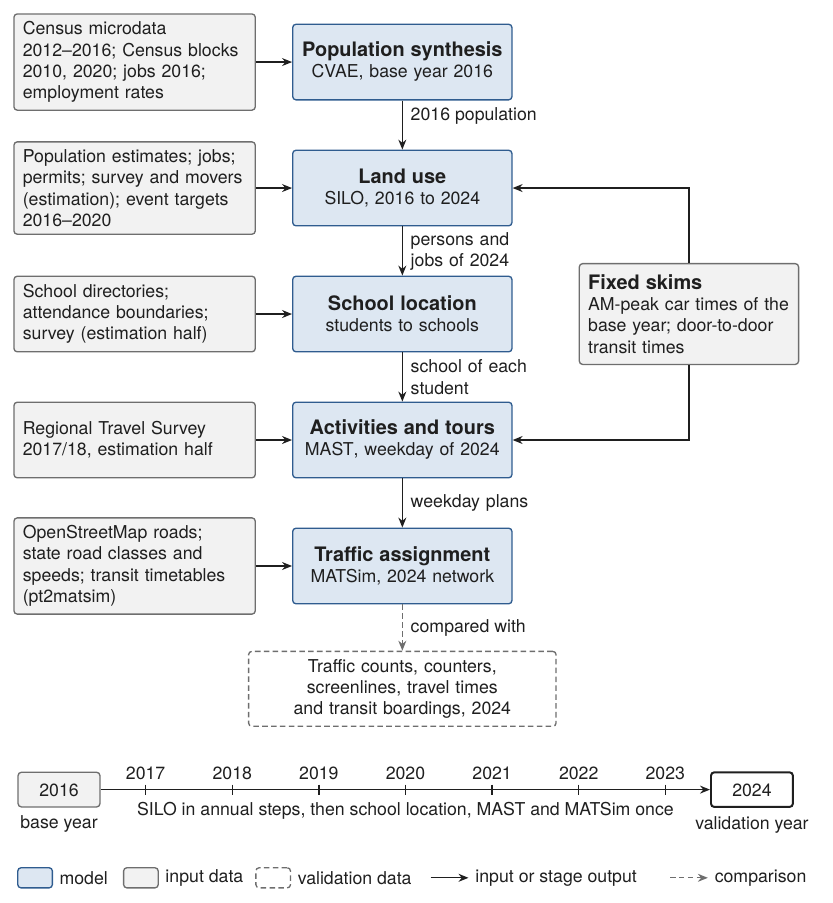
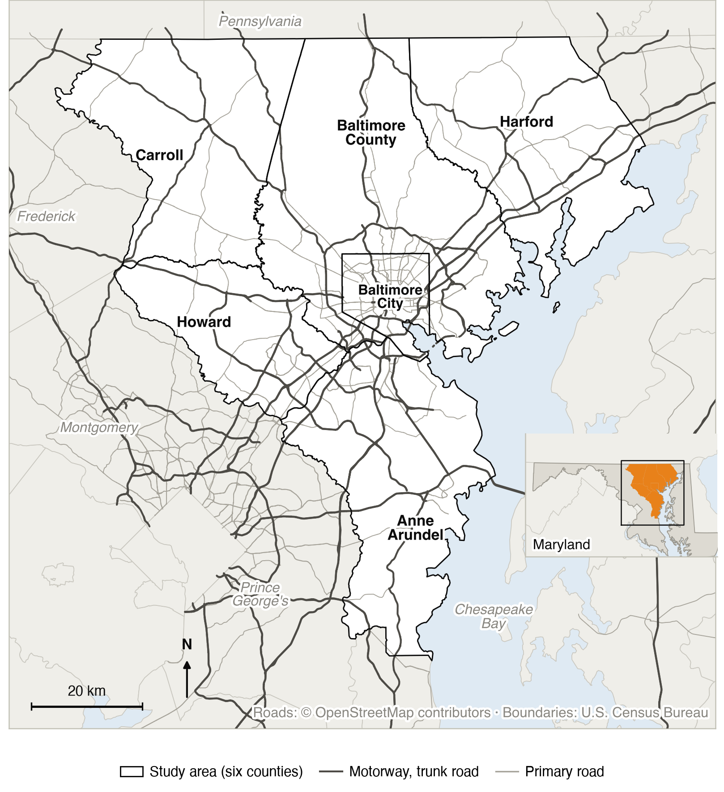

# Model design

MILES is a chain of five components. Each component's output is the next one's input; each has its own page:
[Synthetic population](population.md), [Land use](landuse.md), [School location](schools.md),
[Activities](activity.md) and [Traffic assignment](assignment.md).

## Stages and what passes between them

<figure markdown>
  
  <figcaption>The MILES chain. Blue: models; grey: input data; dashed: validation data. The skims are fixed: the assignment does not feed travel times back to the land-use and activity models.</figcaption>
</figure>

| Step | Model | Input from the previous step | Output to the next step |
|---|---|---|---|
| 1 | Synthetic population (CVAE) | Census microdata | Households, persons, dwellings, jobs and workplaces of 2016 |
| 2 | Land use (SILO) | The 2016 base | Persons, households, dwellings and jobs of every year to 2024 |
| 3 | School location | Students of each year | The school of every student |
| 4 | Activities (MAST) | Population, jobs and schools of 2024 | One weekday plan per person: activities, locations, times, tour modes |
| 5 | Traffic assignment (MATSim) | Weekday plans | Routes, departure times, link volumes, travel times |

## Time line

The base year is 2016. SILO advances the population in annual steps from 2016 to 2024; the school step runs every
simulated year. The activity model and the assignment run once, for a weekday of 2024, which is the validation year.

## Study area and zone system

The study area is the six counties of the Baltimore region: Baltimore City and the counties of Anne Arundel,
Baltimore, Carroll, Harford and Howard. It is embedded in a zone system of **1,588 zones** covering Maryland, the
District of Columbia and parts of Virginia, Pennsylvania, Delaware and West Virginia, so that commuting and
migration across the regional boundary are represented. Land use runs with open migration among 44 counties.

<figure markdown>
  
  <figcaption>Study area: the six counties of the Baltimore region and the major roads. Inset: location in Maryland.</figcaption>
</figure>

## Level of service

The land-use and activity models read fixed skims:

- **Car:** base-year AM-peak times of the Maryland Statewide Transportation Model (MSTM).
- **Transit:** door-to-door times computed on the OpenStreetMap network with the timetables (GTFS) of the 18
  operators of the network area.

The road network of the assignment (links, lanes, road classes, posted speeds) is also taken from OpenStreetMap;
free speeds and capacities are derived from it by fixed rules ([assignment](assignment.md)).

## What is estimated, imposed, calibrated or assumed

Every component is in one of four classes.

Estimated
: Parameters are maximum-likelihood or empirical estimates from microdata. This covers the synthetic population,
  residential location, car ownership, workplace and school choice, activity generation and scheduling,
  destinations, stops, tour formation and tour mode choice.

Imposed
: A quantity is set to observed data: county population and employment totals, construction, deaths, job changes,
  incomes and school seats.

Calibrated
: A parameter is adjusted until a model output matches a target: the moving decision, the workplaces of residents of
  Pennsylvania, Delaware and West Virginia, and the rates of births, marriages, divorces and leaving home ([calibration](../calibration-validation/calibration.md)).

Assumed
: A value is set without estimation or calibration: the car skims, the rules for free speeds and capacities, the
  partner-choice distance decay and the value of time of the assignment.
