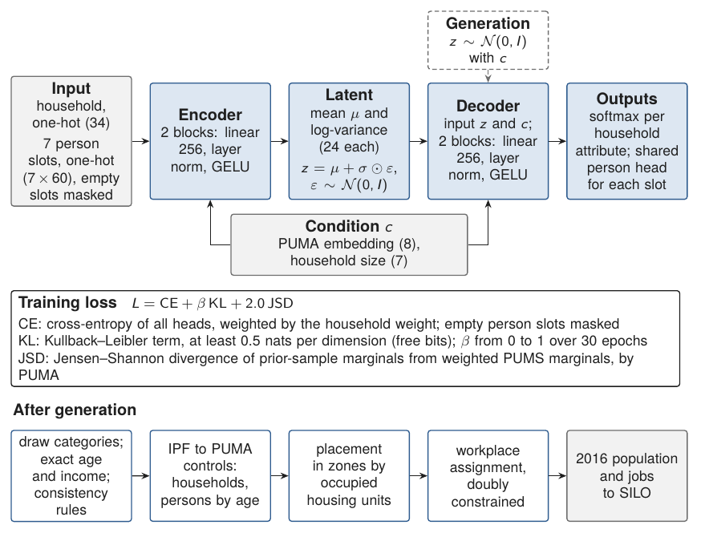

# Synthetic population

!!! abstract "At a glance"

    | | |
    |---|---|
    | **Engine** | Conditional variational autoencoder, Python and PyTorch |
    | **Code** | `population/cvae` (generator), `population/post` (zones, dwellings, jobs, workplaces) |
    | **Trained on** | ACS PUMS 2012–2016, 253,029 households in 96 PUMAs |
    | **Produces** | Households, persons, dwellings, jobs and workplaces of 2016 in SILO format |
    | **Runs** | Once, for the base year |

The base population of 2016 is generated by a **conditional variational autoencoder** (CVAE) that learns the joint
distribution of household and person attributes from census microdata, and then draws new households from it.
Unlike reweighting methods (IPF, IPU), which can only copy households of the sample, the CVAE can generate
combinations of attributes that the sample does not contain.

## Training data

- ACS PUMS 2012–2016 five-year sample: 253,029 households and 626,201 persons in the 96 PUMAs of the six states the
  zone system covers. In PUMAs only partly inside the zone system, the weights are scaled by the covered share.
- Within each PUMA the households are split at random into training (80 %, 202,427 households), validation (10 %)
  and test (10 %) sets. The test set is used only for validation.

## Variables

A household is the vector \(\mathbf{x} = (\mathbf{h}, \mathbf{p}_1, \ldots, \mathbf{p}_7)\): four household
attributes and eight attributes of each of up to seven persons, householder first. Every attribute is categorical;
incomes are in bands, so the long upper tail needs no top code.

The **condition** \(\mathbf{c} = (\mathbf{e}_g, \mathbf{s})\) is a learned 8-dimensional embedding \(\mathbf{e}_g\) of
the PUMA \(g\) and the one-hot household size \(\mathbf{s}\); the size fixes how many person slots are filled.

## Architecture

<figure markdown>
  
  <figcaption>The conditional variational autoencoder.</figcaption>
</figure>

- **Encoder** \(q_\phi(\mathbf{z} \mid \mathbf{x}, \mathbf{c})\): the one-hot household and the condition pass through
  two layers of 256 units (layer normalisation, GELU) to the mean and log-variance of a 24-dimensional Gaussian
  latent vector \(\mathbf{z}\).
- **Decoder** \(p_\theta(\mathbf{x} \mid \mathbf{z}, \mathbf{c})\): two layers of 256 units to a hidden state; one
  softmax per household attribute, and a person head shared by all slots that takes the hidden state and the slot
  number and gives one softmax per person attribute.

Given \(\mathbf{z}\) and \(\mathbf{c}\) the attributes are independent; their joint dependence, within the household
and among its members, is carried by \(\mathbf{z}\).

## Loss

For a batch of households \(n\) with normalised weights \(w_n\):

\[
\mathcal{L} = \sum_n w_n \Big[ -\sum_{k} \ln p_\theta(h_{nk} \mid \mathbf{z}_n, \mathbf{c}_n)
 - \sum_{i=1}^{7} m_{ni} \sum_{k} \ln p_\theta(p_{nik} \mid \mathbf{z}_n, \mathbf{c}_n) \Big]
 + \beta \sum_{d=1}^{24} \max\big(\lambda, \overline{\mathrm{KL}}_d\big) + \gamma\, \overline{\mathrm{JSD}}
\]

- **Reconstruction:** cross-entropy of the household attributes \(h_{nk}\) and of the person attributes \(p_{nik}\) of
  the filled slots (\(m_{ni} = 1\)).
- **Kullback–Leibler term:** each latent dimension is charged at least \(\lambda = 0.5\) nats (free bits), so the
  decoder cannot ignore the latent vector; \(\beta\) rises from 0 to 1 over the first 30 epochs.
- **Marginal term:** households decoded from prior draws are summed by PUMA, and \(\overline{\mathrm{JSD}}\) is the
  mean Jensen–Shannon divergence between these marginals and the weighted PUMS marginals of the PUMA over twelve
  attributes; \(\gamma = 2\).

## Training

AdamW (learning rate \(10^{-3}\), weight decay \(10^{-5}\)), batches of 512 households, gradients clipped to norm 1.
An exponential moving average of the weights (decay 0.999) is used for generation. Training stops when the
validation loss has not improved for 25 epochs; the best epoch is 197.

## Generation

1. For each PUMA, the household count of the PUMS weights is drawn as pairs of PUMA and size, in proportion to their
   weighted frequency.
2. For each pair, \(\mathbf{z} \sim \mathcal{N}(\mathbf{0}, \mathbf{I})\) is decoded and every attribute is sampled
   from its softmax.
3. Exact age is drawn uniformly within the five-year band; dollar incomes are drawn from the PUMS incomes of the
   same PUMA and band, and person incomes are rescaled to sum to the household income.
4. Five logical rules are imposed: children under 6 have the under-6 occupation; nobody under 16 is employed, has a
   licence or is a spouse; nobody under 62 is retired; the first person is the only householder.

## Controls

Within each PUMA the generated households are redrawn with replacement, with weights from iterative proportional
fitting, so that the household count equals the ACS 2014–2018 count and persons in four age bands (0–17, 18–34,
35–64, 65+) equal the ACS household population. Household size enters with a damping exponent of 0.15, because the
ACS household and person weights disagree on the mean size by about 6 %; weights are bounded to 0.2–5.

## From PUMAs to zones

Each household is placed in a zone of its PUMA, in proportion to the zones' households: in Maryland the occupied
housing units of 2016, interpolated between the 2010 and 2020 Census block counts; elsewhere the MSTM 2016 household
counts. Each household receives an occupied dwelling of its generated type and tenure; bedrooms, monthly cost and
year built are copied from a PUMS household of the same PUMA, type, tenure and income band. Vacant dwellings are
added from the Census block counts, reduced to the share on the market.

## Employment, jobs and workplaces

- Employment by single year of age and sex is brought to the ACS rates that SILO uses in later years.
- Jobs are the 2016 LODES workplace counts by zone and type (retail, office, industry, other) in Maryland and the
  MSTM 2016 inventory elsewhere; jobs not covered by LODES are added so that 4.01 % of jobs are vacant (JOLTS 2016).
- The 4,960,054 workers living in Maryland, the District of Columbia and Virginia are given a workplace with the
  estimated workplace-choice model ([landuse](landuse.md)), with zone shadow prices updated until predicted workers equal
  filled jobs in every zone. Workers in Pennsylvania, Delaware and West Virginia are assigned by a doubly constrained
  gravity model with the ACS county-to-county commuting flows as a third constraint.

## The 2016 base

| Item | Count |
|---|---|
| Households | 4,704,934 |
| Persons | 12,488,143 |
| Employed persons | 6,453,136 |
| Dwellings (vacant) | 4,862,410 (157,476) |
| Jobs (vacant) | 6,722,717 (269,581) |

For Maryland residents, the county-to-county commuting flows correlate with the ACS 2016–2020 flows at 0.992. The fit
of the population is reported in [validation](../calibration-validation/validation.md).
